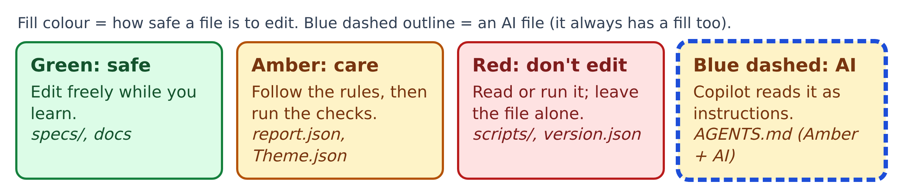
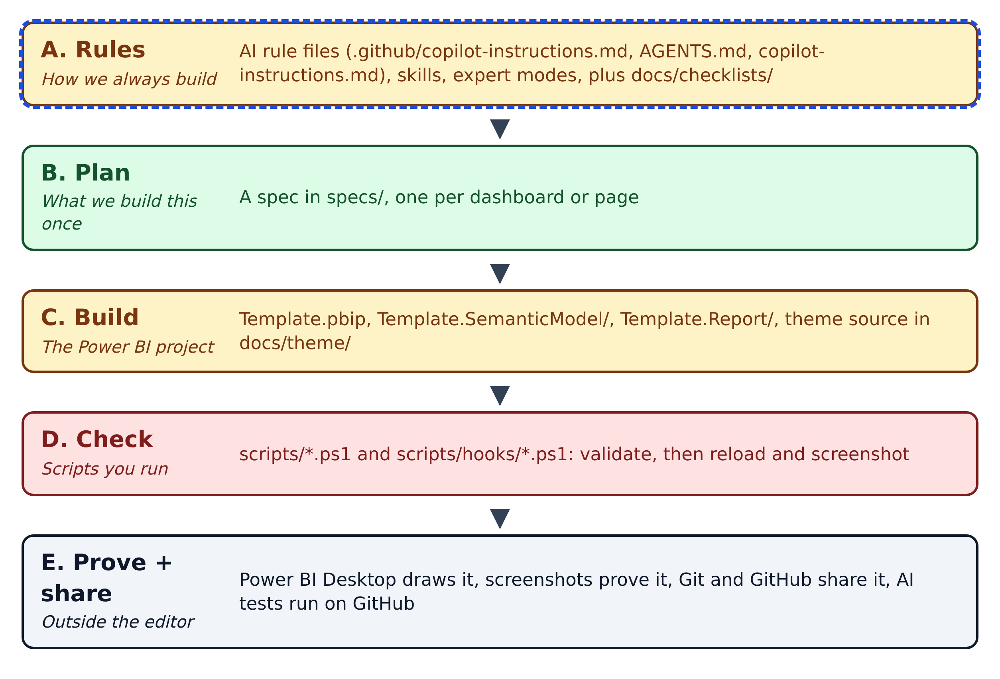

# Start here

## What this repository is

**PGE-PBIP-Template** is a starter kit for building Power BI dashboards with an AI coding assistant. You clone it, open it in VS Code, describe the page you want, and let GitHub Copilot (or Claude) build it, inside rules the team has written down.

The trick that makes this work: the dashboard is not stored as one binary `.pbix` file. It is stored as a **PBIP** (Power BI Project): a folder of small text files. Text files mean Git can show you every change, and an AI agent can read and edit them like any other code.

Around those files the repo adds three things: written rules the AI loads every time, checklists for quality, and PowerShell scripts that check the files and then screenshot what Power BI actually drew.

Think of it as a **restaurant franchise kit**:

| In a franchise kit | In this repo |
|---|---|
| An empty, fitted kitchen | The blank report and data model (`Template.pbip`) |
| The house recipe book | The rule files the AI reads (`.github/copilot-instructions.md` and friends) |
| Recipe cards for specific dishes | Skills: step-by-step procedures in `.github/skills/` |
| The order ticket for tonight's table | A spec: your plan for one page, in `specs/` |
| Food-safety checklists | `docs/checklists/` |
| The inspector who tastes every plate | The verify loop: scripts that screenshot every page |

## The colour code you'll see everywhere

**Figure 0.1 — The colour legend.** Every diagram and table in this guide uses it.

1. **Green:** safe to edit while you learn.
2. **Amber:** edit with care, follow the rules, then run the checks.
3. **Red:** read it or run it, but don't change the file.
4. **Blue dashed outline:** an AI file that Copilot or Claude reads as instructions. It always has a fill colour too.

## The whole system in one picture

**Figure 0.2 — The master map.** Read it top to bottom: every folder in the repo belongs to one of these five stages.

- **A. Rules:** how the team always builds. Permanent, loaded by the AI every session.
- **B. Plan:** a spec for the one page you are building now.
- **C. Build:** the Power BI project files the AI (or you) edit.
- **D. Check:** scripts that validate the files, reload Power BI and screenshot each page.
- **E. Prove and share:** you review the screenshots, then Git and GitHub share the work.

## Your everyday workflow

1. **Branch.** In VS Code, create a new Git branch for your change.
2. **Plan.** Copy `specs/TEMPLATE.md` to `specs/<page-name>.md` and fill it in.
3. **Build.** Ask Copilot: "Build the page in `specs/<page-name>.md`." It reads the rules, then edits the project files.
4. **Check.** Run the three validators in `scripts/`, then the verify loop to screenshot every page.
5. **Review.** Look at the screenshots yourself. Valid files are not enough; the page must look right.
6. **Share.** Commit, push, and open a pull request. A reviewer approves and merges.

The rest of this guide explains each piece, then walks through the common tasks. The full file-by-file list is in Appendix A.
