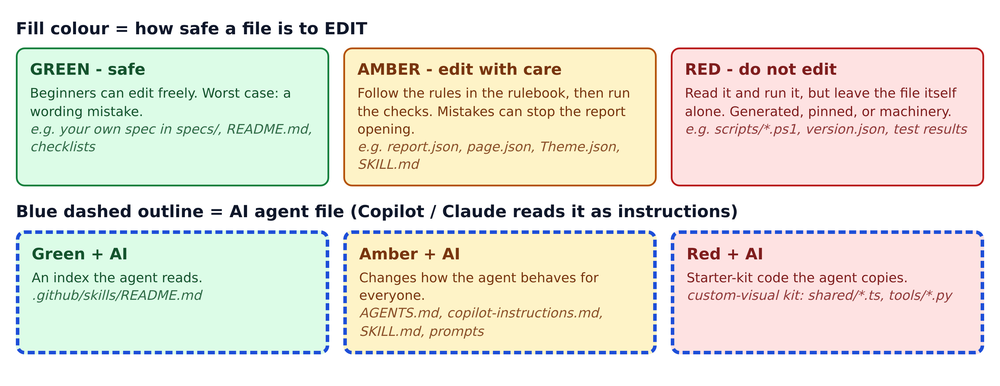
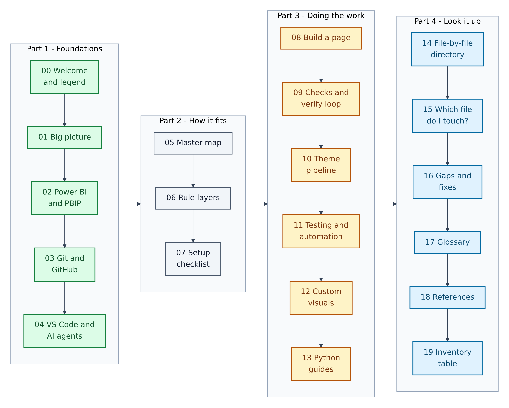

# 00. Welcome, how to use this guide, and the colour legend

**Figure 0.1 — The colour legend.** Every diagram in this guide uses these colours. Learn them once and every picture will tell you, at a glance, what you may safely touch.

Walkthrough of Figure 0.1:

1. **Green boxes** are safe. You can edit these files while you are still learning. The worst you can do is make a sentence unclear.
2. **Amber boxes** need care. They control how the report looks or how the AI behaves. Edit them by following the repository's rules, then run the checks described in Section 09.
3. **Red boxes** are "look, don't touch". They are scripts, generated results, or files with exact required contents. You will often *run* or *read* them, but you should not change them.
4. **A blue dashed outline** means "AI agent file". An AI coding assistant (GitHub Copilot or Claude) reads it as instructions. A blue outline is always combined with a fill colour, so you also know whether it is safe to edit.
5. In diagrams that show actions rather than files, you will also see purple boxes for **you** (the human), light-blue boxes for **outside services** such as GitHub, and grey boxes for neutral steps.

---

## Who this guide is for

You are learning four things at once: **Power BI** (Microsoft's dashboard tool), **Git** (a tool that saves the history of your files), **VS Code** (a free code editor), and **AI coding agents** (AI assistants that can read and change files for you). That is a lot. This guide takes it one picture at a time.

You do not need to know how to program. You need to be willing to follow numbered steps and to look closely at diagrams.

## What this guide covers

This guide explains one specific repository: **GibbonGambits/PGE-PBIP-Template**. A *repository* (or "repo") is a project folder whose full history is tracked by Git. Think of it as a shared binder that remembers every page ever added, changed or removed.

Every one of its 176 files and folders is covered. Nothing was guessed: each file was opened and read.

**Figure 0.2 — Road map of this guide.** The guide has four parts. Read Parts 1 and 2 in order. Dip into Parts 3 and 4 when you need them.

Walkthrough of Figure 0.2:

1. **Part 1 — Foundations (Sections 00–04).** Plain-English introductions to the repository, Power BI's project format, Git and GitHub, VS Code, and AI agents. Start here if any of those words are new.
2. **Part 2 — How it fits (Sections 05–07).** The master map of how every part connects, the "who wins" rules for AI instructions, and a setup checklist for your own computer.
3. **Part 3 — Doing the work (Sections 08–13).** Step-by-step walkthroughs: building a dashboard page, running the checks, changing the theme, testing, custom visuals, and the Python email guides.
4. **Part 4 — Look it up (Sections 14–19).** A file-by-file directory, "which file do I touch?" decision trees, known gaps in the repository and how to fix them, a glossary, verified official links, and the complete inventory table.

## How each section is laid out

- **Picture first.** Each section opens with a diagram. Read the picture, then the words.
- **Numbered captions.** "Figure 8.2" means the second diagram in Section 08.
- **Numbered walkthroughs.** The numbers under a diagram match the numbered steps or boxes in it.
- **Terms in bold** are defined the first time they appear and again in the Glossary (Section 17).
- **Commands** appear in grey code boxes. You type them into a terminal (a text window for typing commands). Most commands in this repository are for **Windows PowerShell**, because Power BI Desktop only runs on Windows.

## Two safety promises

1. **Secrets stay secret.** This repository contains a file called `.env.example` that lists *names* of passwords (for example `DB_PASSWORD`) but no real values. This guide never prints real values, and Section 07 shows you how to create your own private `.env` file without exposing it.
2. **Read before you change.** If a file is Amber or Red, read its entry in Section 14 before touching it.

## A note on facts and dates

Facts about Power BI, Git, GitHub, VS Code and Claude were checked against the official documentation pages listed in Section 18, opened on 10 November 2026. Software changes quickly. If a menu or button has moved, the official page is the place to check.
