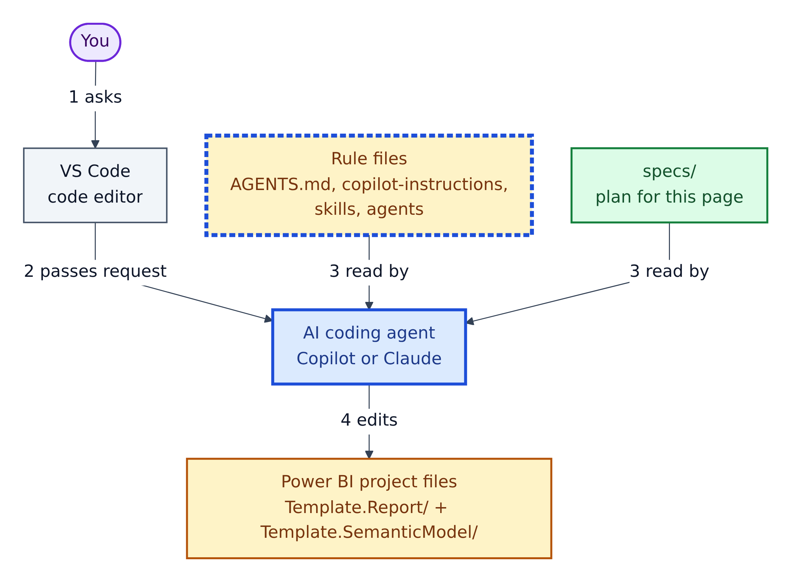
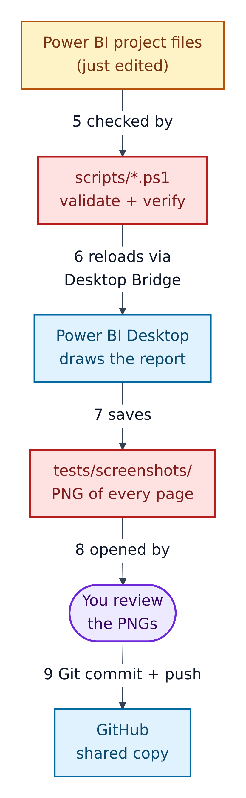
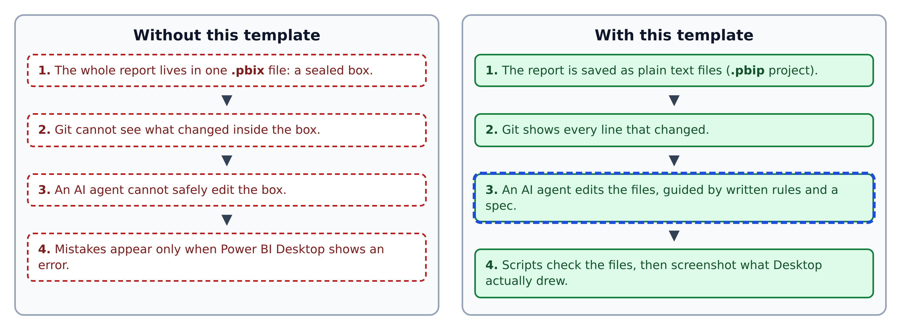
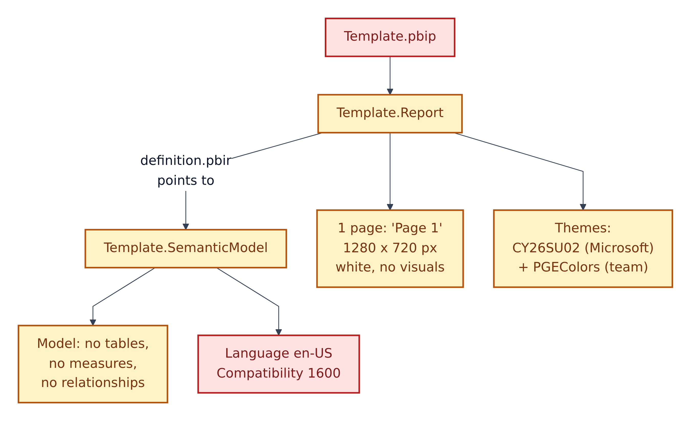

# 01. The big picture: what this repository is, and who it is for

**Figure 1.1 — The system, part 1: making a change.** Arrows 1–4 show how your idea becomes edited project files.

Walkthrough of Figure 1.1:

1. **You ask for a change** in VS Code, for example "add a sales page". VS Code is a free code editor: a word processor built for code and configuration files.
2. **VS Code passes the request** to an **AI coding agent**: GitHub Copilot or Claude. An agent is an AI that can read files, write files and run commands, not just chat.
3. **The agent reads the rule files and the spec.** Rule files (Amber, blue outline) tell it *how* this team always builds. The spec (Green) says *what* to build this time.
4. **The agent edits the Power BI project files.** These are plain text files that describe the report and its data model.

**Figure 1.2 — The system, part 2: checking and sharing.** Arrows 5–9 continue from Figure 1.1, top to bottom.

Walkthrough of Figure 1.2:

5. **Scripts check the files.** PowerShell scripts in `scripts/` confirm the files are well formed before Power BI ever sees them.
6. **The verify loop reloads Power BI Desktop** through the **Desktop Bridge**, a local connection that lets programs control a running copy of Power BI Desktop.
7. **Power BI Desktop saves a screenshot** of every page into `tests/screenshots/`.
8. **You (or the agent) open and review the screenshots.** The repository's core rule: a page is not done because its files are valid; it is done when what Power BI *drew* looks right. If something is wrong, go back to Figure 1.1, step 1.
9. **You save the work with Git and push it to GitHub**, the online home of the shared copy. GitHub can also run automated tests ("Actions").

---

## What the repository is, in one paragraph

**PGE-PBIP-Template** is a *starter kit* for building Power BI dashboards with an AI assistant. A dashboard is a page of charts and numbers that helps people make decisions. Normally a Power BI dashboard is stored as one sealed `.pbix` file. This template uses Power BI's newer **project format (PBIP)**, which saves the dashboard as many small, readable text files. Readable files mean Git can track every change and an AI agent can edit them. Around those files the template adds written rules, step-by-step "skills" for the AI, quality checklists, and scripts that check the result.

**Real-world comparison:** think of a restaurant franchise kit. It contains an empty kitchen (the blank report and model), the house recipe book (the rule files), recipe cards for specific dishes (skills), food-safety checklists (docs/checklists), and a quality inspector who tastes every plate before it leaves the kitchen (the screenshot loop).

**Figure 1.3 — The problem this template solves.** Left: the traditional single-file approach. Right: the text-file approach this template uses.

Walkthrough of Figure 1.3:

1. **Sealed box vs. plain text.** A `.pbix` file is a compressed bundle you cannot read in a text editor. A `.pbip` project is a folder of readable files.
2. **Invisible vs. visible changes.** Git can only tell you "the box changed". With text files, Git shows the exact line that changed, for example a colour going from blue to green.
3. **Unsafe vs. guided AI edits.** An AI cannot open a `.pbix`. It *can* edit text files, and the repository's rule files keep those edits within the team's standards. The blue dashed outline marks this as the AI step.
4. **Late vs. early mistakes.** Instead of discovering errors when Power BI refuses to open the file, scripts catch most errors in the text first, then screenshots catch anything that still *looks* wrong.

## Who this repository is for

| Person | What they get from it |
|---|---|
| **Report builders** learning Power BI | A ready-made, correctly structured project to start from |
| **Business intelligence (BI) teams** | One shared standard for how every dashboard is built, reviewed and tested |
| **People using GitHub Copilot** (or Claude) | Rule files and skills that keep AI-written changes consistent |
| **Reviewers and managers** | Every change visible in Git, plus screenshot evidence |
| **Platform engineers** | Validation scripts and a GitHub Actions workflow to extend |

The `README.md` states four goals: standardise how dashboards are built, reviewed and tested; keep report and model files source-controlled and auditable; support AI-assisted development with clear guardrails; and provide repeatable test evidence.

## What is in the box when you start

**Figure 1.4 — The starting state.** The template is deliberately almost empty, like a new notebook with the margins already ruled.

Walkthrough of Figure 1.4:

1. **`Template.pbip`** is the file you open in Power BI Desktop. It points to the report folder.
2. **`Template.Report`** holds one page called "Page 1", 1280 by 720 pixels, white, with no charts yet.
3. **Two themes** are registered: Microsoft's base theme `CY26SU02` and the team's custom colour theme `PGEColors`.
4. **`Template.SemanticModel`** is the data model. It has no tables, measures or relationships yet. You or the AI add them.
5. **Language and compatibility settings** (English US, compatibility level 1600) are fixed technical settings. Leave them alone.
6. The labelled arrow shows that the report finds its model through a pointer file, `definition.pbir` (explained in Section 02).

## The ten guardrails (the house rules in one list)

The README, `AGENTS.md` and `.github/copilot-instructions.md` all repeat these "non-negotiable" rules. You will meet each one again later.

1. New business measures (calculations such as "Total Sales") go in a table called `_Measures`.
2. Measures that draw SVG picture cards go in `_SVG_Measures`, named by page: `P1_...`, `P2_...`.
3. Background images and custom themes live in `Template.Report/StaticResources/RegisteredResources/` and must be listed in `report.json`.
4. Follow the exact file layout rules in `copilot-instructions.md`, including properties that are forbidden.
5. Save `.tmdl` model files as UTF-8 *without* a byte-order mark, and never use `//` comments in them.
6. Format numbers sensibly and consistently, with thousand separators.
7. SVG picture cards use the "image visual" pattern.
8. Make fake test data with Python (numpy and pandas).
9. Never call a page done because its files are valid; check the screenshot.
10. Give every measure a description.

`.github/copilot-instructions.md` adds two more: keep "SVG header" mode as the default page style, and treat `docs/theme/Theme.json` as the editable source, never registering it directly.
