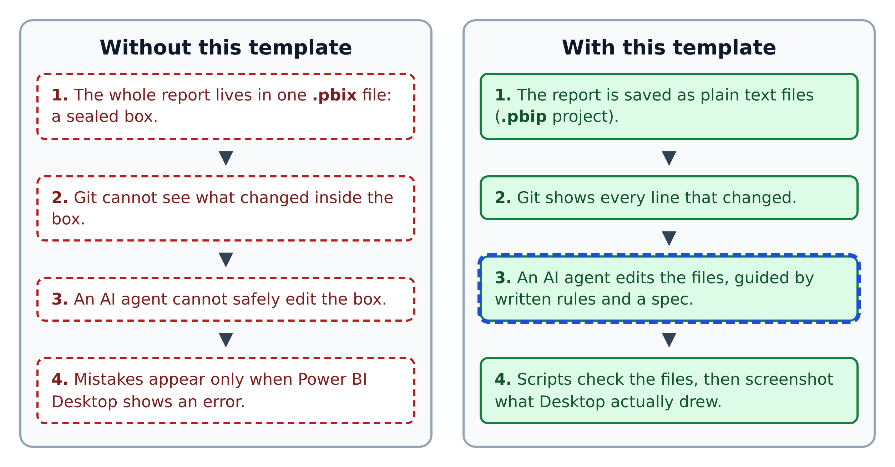
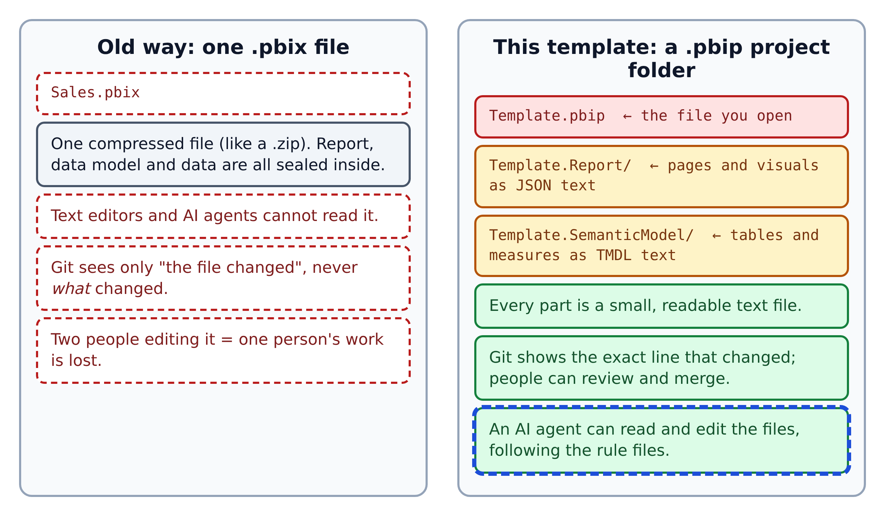
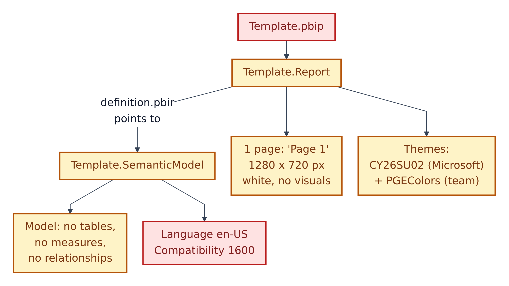
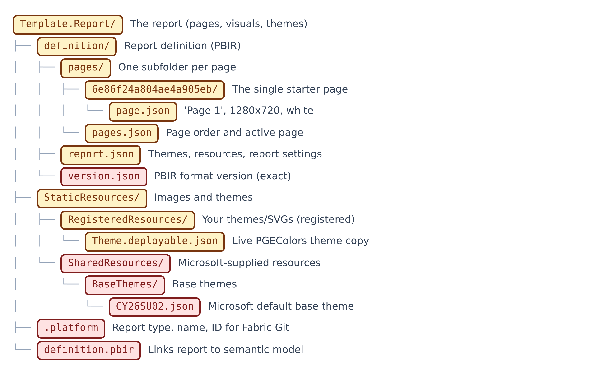
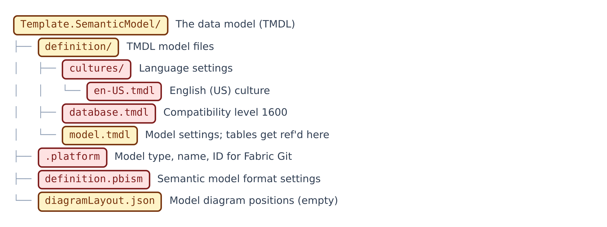
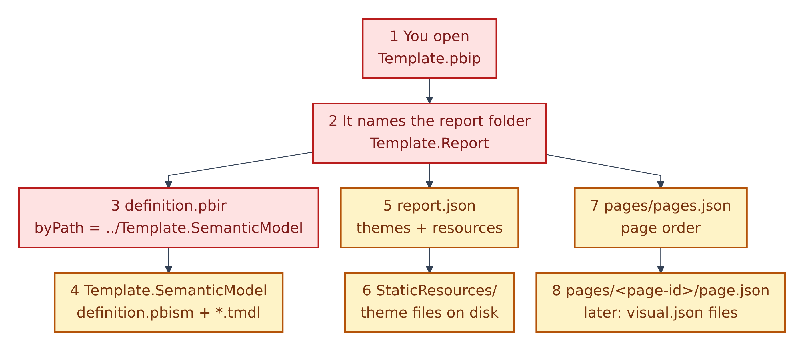
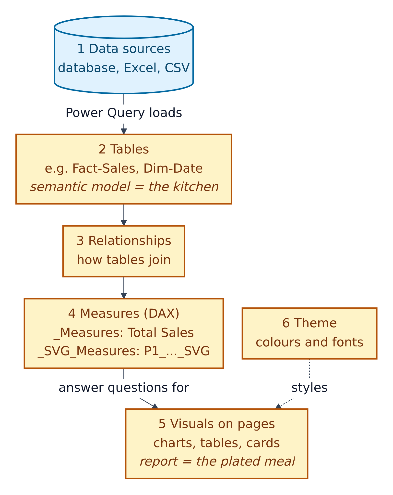

# 1. Power BI projects: what the files are

Power BI Desktop is Microsoft's free Windows app for building reports. A report is a set of pages full of **visuals** (charts, tables, cards). Behind the report sits a **semantic model**: the tables, the relationships between them, and the **measures** (named calculations such as "Total Sales", written in Power BI's formula language, **DAX**).

This chapter shows how this repo stores all of that as text.

**Figure 1.1 — Why the repo uses text files.** Left: the classic single-file approach. Right: this template.

1. A `.pbix` file is one compressed bundle. You can't open it in an editor.
2. So Git can only say "the file changed", never what changed.
3. An AI agent can't safely edit it either.
4. With a project folder, scripts can check the files before Power BI ever opens them, and screenshots catch what still looks wrong.

## .pbix vs .pbip

**Figure 1.2 — One sealed file vs. a project folder.**

1. **`.pbix`** seals report, model and data into one file.
2. **`.pbip`** (Power BI Project) saves the same thing as a folder. Microsoft's docs: the definitions are saved "as individual plain text files".
3. **`Template.pbip`** is the file you double-click. It just points to the report folder.
4. **`Template.Report/`** holds pages and visuals as JSON, in a layout called **PBIR** (Power BI enhanced report format), which Microsoft now uses by default.
5. **`Template.SemanticModel/`** holds the model as **TMDL** (Tabular Model Definition Language): indented text, a bit like YAML, with no braces.

## What you get on day one

**Figure 1.3 — The starting state.** The template is deliberately almost empty.

1. `Template.pbip` opens the report.
2. The report has one blank page, "Page 1", 1280 × 720 pixels.
3. Two themes are registered: Microsoft's base theme `CY26SU02` and the team's `PGEColors`.
4. `definition.pbir` points the report at the model.
5. The model has no tables, measures or relationships yet.
6. Language (en-US) and compatibility level (1600) are fixed settings. Leave them alone.

## Inside the report folder

**Figure 1.4 — `Template.Report/`.** Each label shows its safety colour.

1. `definition/pages/` has one folder per page. The only page has a generated id, `6e86f24a804ae4a905eb`; its `page.json` names it "Page 1".
2. `pages.json` sets the page order and which page opens first.
3. `report.json` registers the themes and resources. You'll edit it when you add a theme or background image.
4. `version.json` must contain exact content, so it is Red.
5. `StaticResources/RegisteredResources/` is where your themes and SVG backgrounds go. Each must also be listed in `report.json`.
6. `.platform` is an ID file for **Microsoft Fabric** (Microsoft's online analytics platform) when syncing with Git. Don't touch it.

As you build, each visual gets its own `pages/<page-id>/visuals/<visual-id>/visual.json`.

## Inside the model folder

**Figure 1.5 — `Template.SemanticModel/`.**

1. `database.tmdl` sets the compatibility level. Red.
2. `model.tmdl` holds model-wide settings. Each new table gets a `ref table` line here. Amber.
3. `cultures/en-US.tmdl`, `definition.pbism` and `.platform` are fixed settings. Red.
4. `diagramLayout.json` remembers where tables sit in Power BI's diagram view. Empty for now.

New tables go in `definition/tables/<TableName>.tmdl`.

## How the files find each other

**Figure 1.6 — The pointer chain.** Each file tells Power BI where to look next.

1. You open `Template.pbip`.
2. It names the report folder, `Template.Report`.
3. `definition.pbir` points to `../Template.SemanticModel`.
4. Power BI loads the model from there.
5. `report.json` lists the themes and resources…
6. …which must exist on disk under `StaticResources/`.
7. `pages.json` gives the page order…
8. …and each `page.json` (and later `visual.json`) describes one page or visual.

If any name in this chain is wrong, the report won't open. The scripts in Chapter 8 check these links for you.

## Model vs. report

**Figure 1.7 — From data to picture.**

1. Data sources: a database, Excel, CSV.
2. **Power Query** (Power BI's data-loading tool) loads them into tables. The checklists prefer a **star schema**: *fact* tables of events (sales) surrounded by *dimension* tables of things (products, dates).
3. Relationships join the tables.
4. Measures turn rows into answers. Business measures live in a table called `_Measures`; measures that draw SVG picture cards live in `_SVG_Measures`.
5. Visuals on pages show the answers.
6. The theme styles every visual.

## Three file rules to remember

- **Close Power BI Desktop before editing files by hand**, or it may save over your edits. The scripts will reload it for you.
- **Save `.tmdl` files as UTF-8 without a BOM** (a byte-order mark: an invisible marker at the start of a file). Power BI's TMDL reader rejects it. PowerShell's `Set-Content -Encoding UTF8` adds one, so the rulebook says to write files from Python instead.
- **No `//` comments in TMDL.** Put a `///` description line above each measure instead; it becomes the measure's description.
