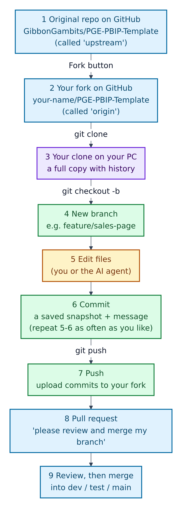
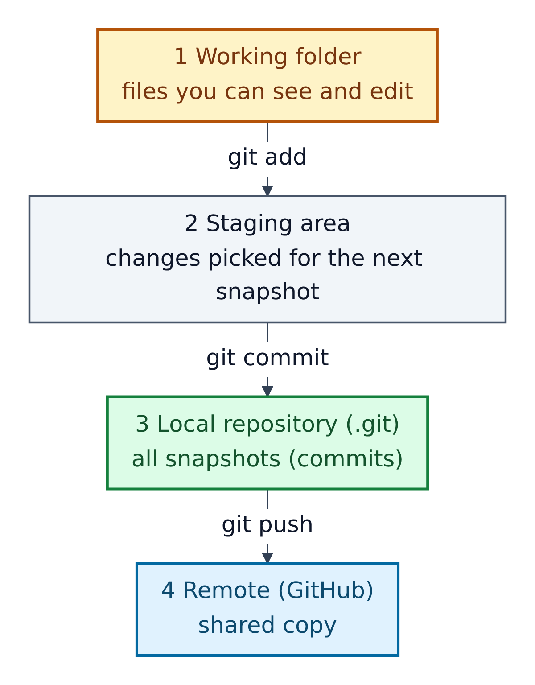
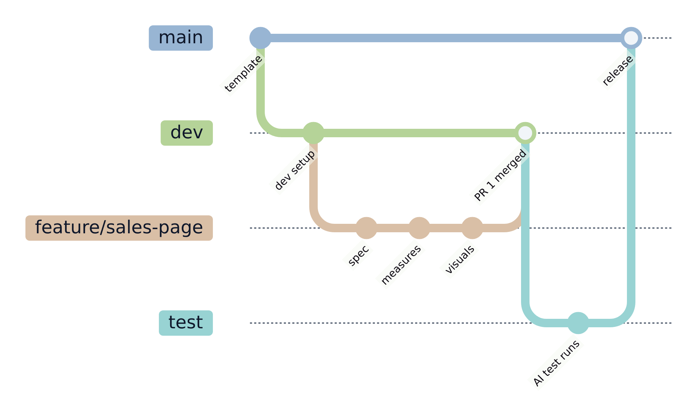
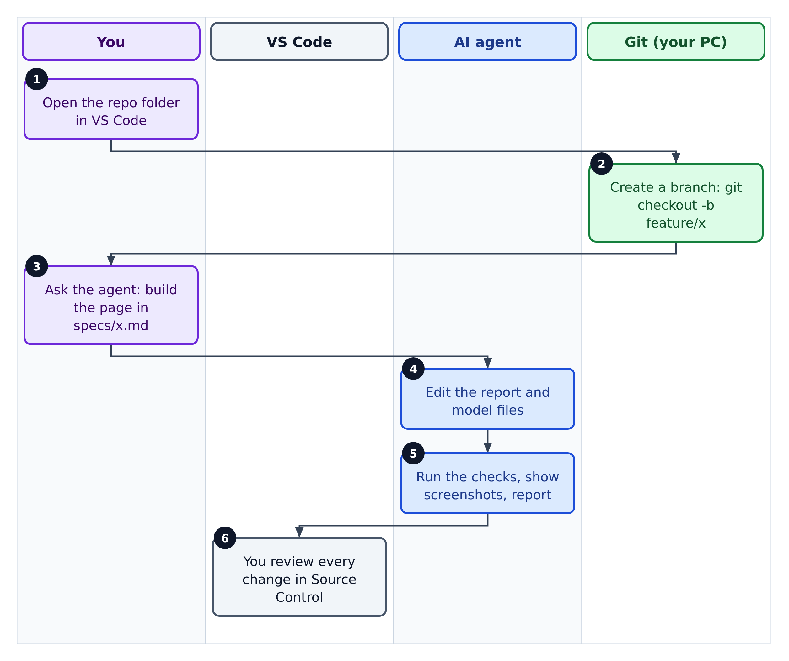
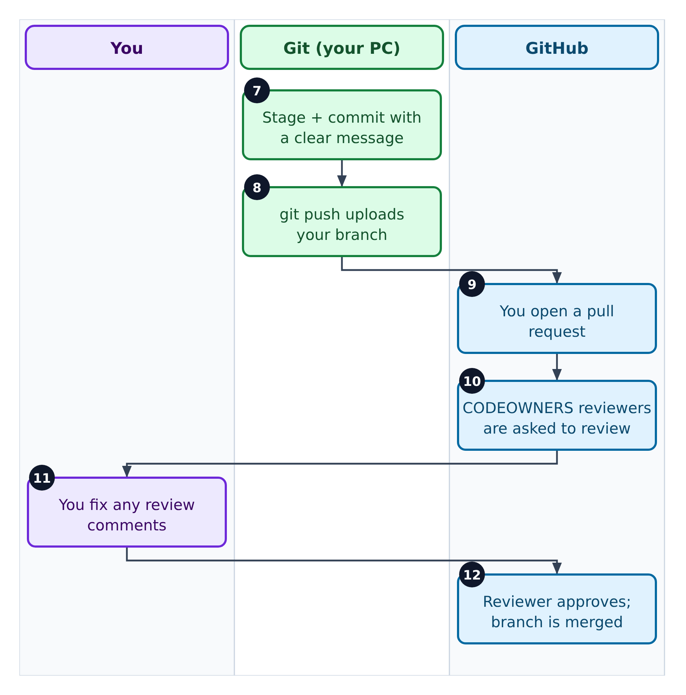

# 2. Git and GitHub for this repo

**Git** records the history of your files on your machine. **GitHub** hosts that history online and adds reviews and automation. GitHub's own docs put it this way: GitHub is "based on the open-source software, Git".



**Figure 2.1 — The life of a change.**

1. The original template on GitHub is called **upstream**.
2. A **fork** is your own copy on GitHub, made with the *Fork* button. It "lets you propose changes to a project without affecting the upstream repository". Your fork is usually called **origin**.
3. `git clone` downloads your fork, with full history.
4. A **branch** is a separate line of work, e.g. `feature/sales-page`.
5. You (or the agent) edit files.
6. A **commit** saves a snapshot with a message. Repeat 5–6 as often as you like.
7. `git push` uploads your commits to your fork.
8. A **pull request** (PR) asks the team to review and merge your branch.
9. After review, the branch is merged into `dev`, then `test`, then `main`.

## Why fork instead of just clone?

Because this is a template: each team or dashboard gets its own copy to rename and customise, and nothing you try can break the original. You still get template updates by pulling from upstream. The recipe from `docs/REPOSITORY-GUIDE.md`:

```powershell
git remote add upstream https://github.com/<upstream-owner>/<upstream-repo>.git
git fetch upstream
git checkout main
git merge upstream/main
```

The `<upstream-owner>/<upstream-repo>` part is a placeholder: for this template it is `GibbonGambits/PGE-PBIP-Template`. After merging, rerun the validators (Chapter 8).

## Where a change lives



**Figure 2.2 — The four places a change passes through.**

1. **Working folder:** the files you edit.
2. **Staging area:** `git add` picks which changes go into the next commit.
3. **Local repository:** `git commit` stores the snapshot in the hidden `.git` folder.
4. **Remote:** `git push` sends commits to GitHub; `git pull` brings others' commits down.

VS Code's **Source Control** view (`Ctrl+Shift+G`) does all of this with buttons.

## The branch path the repo recommends



**Figure 2.3 — Branches over time.** Each line is a branch; each dot is a commit.

1. `main` holds what is released.
2. `dev` collects finished features.
3. `feature/sales-page` is your short-lived branch.
4. Your pull request into `dev` is merged.
5. `test` is the release candidate. Pushing here runs the AI test workflow (Chapter 10).
6. `test` is merged into `main` to release.

`docs/CICD-SETUP.md` also recommends protecting `dev`, `test` and `main`: require a pull request, passing checks and at least one reviewer.

## Who does what when you save work



**Figure 2.4 — Building the change.** Each column is one person or tool; follow the numbers.

1. You open the repo folder in VS Code.
2. Git creates your branch.
3. You ask the agent to build what the spec describes.
4. The agent edits the report and model files.
5. The agent runs the checks and shows you screenshots.
6. You read every changed line in Source Control.



**Figure 2.5 — Saving and sharing.** Continues from step 6.

7. Git commits your changes with a clear message.
8. `git push` uploads the branch.
9. You open a pull request. It starts from `.github/PULL_REQUEST_TEMPLATE.md`: a summary and a three-item checklist.
10. GitHub asks the owners in `.github/CODEOWNERS` to review.
11. You fix any review comments by pushing more commits.
12. A reviewer approves and merges.

## Git-related files in the repo

| File | What it does |
|---|---|
| `.gitignore` | Keeps Power BI's local caches (`**/.pbi/…`), your `.env`, Python caches, `tests/screenshots/`, `.github/.pbip-state/` and `Proposals/` out of Git |
| `.github/CODEOWNERS` | Who reviews which folder. The `@your-org/...` handles are placeholders to replace |
| `.github/PULL_REQUEST_TEMPLATE.md` | The starting text of every pull request |
| `.github/ISSUE_TEMPLATE/` | Forms for bug reports and feature requests |
| `CONTRIBUTING.md` | Where new skills, specs and tests go |
