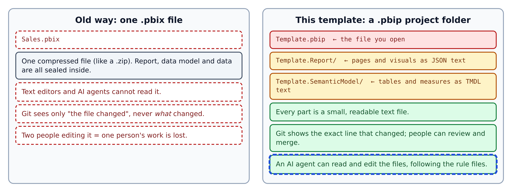
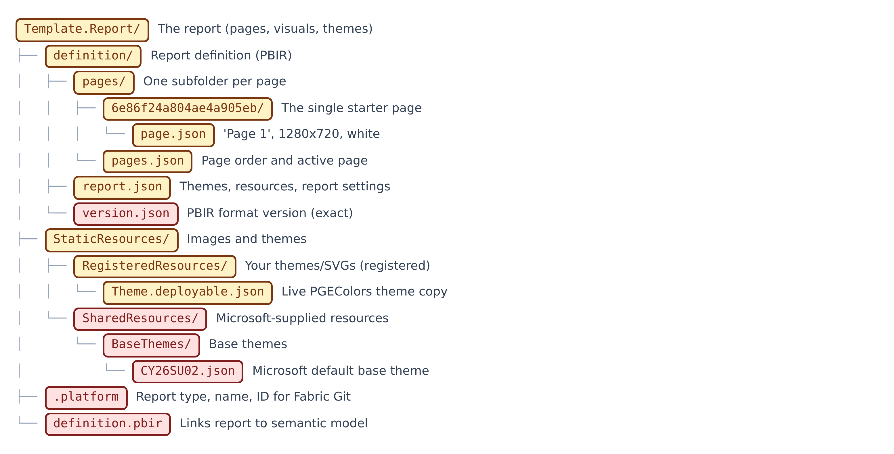
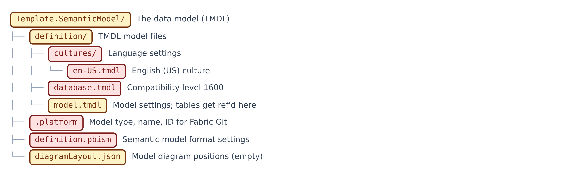
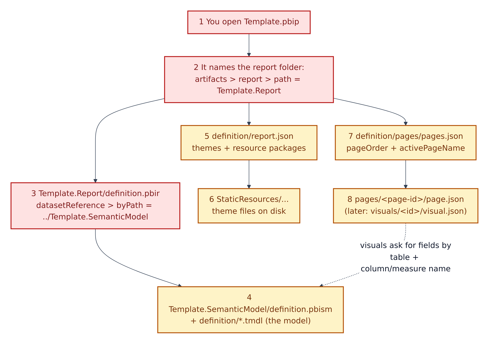
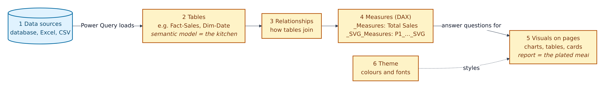

# 02. Power BI and the Power BI Project format (.pbip)

**Figure 2.1 — A sealed box vs. a labelled filing cabinet.** On the left, the traditional single `.pbix` file. On the right, the project folder this repository uses.

Walkthrough of Figure 2.1:

1. **`.pbix`** is Power BI's classic file type: one compressed file that contains the report, the data model and a copy of the data. It is like a sealed box: you can only open it with Power BI Desktop.
2. Because it is sealed, **text editors and AI agents cannot read it**, and Git (Section 03) can only say "the box changed".
3. **`.pbip`** stands for **Power BI Project**. When Power BI Desktop saves as a project, Microsoft's documentation says it saves "report and semantic model item definitions … as individual plain text files" in a folder. It is like a filing cabinet with a labelled drawer for every part.
4. **`Template.pbip`** is a small text file that acts as the cabinet's front door: it is the file you double-click.
5. **`Template.Report/`** holds the report pages and visuals as **JSON** files. JSON (JavaScript Object Notation) is a common text format made of named values inside curly braces, like `"displayName": "Page 1"`.
6. **`Template.SemanticModel/`** holds the data model as **TMDL** files. TMDL (Tabular Model Definition Language) is a text format for data models that uses indentation (tabs) instead of braces, so it reads more like an outline.
7. The result: Git shows exactly what changed, people can review changes, and an AI agent can safely edit the files (blue outline).

---

## Key ideas in plain English

| Term | Plain meaning | Real-world comparison |
|---|---|---|
| **Power BI Desktop** | Microsoft's free Windows app for building reports | The workshop where the furniture is built |
| **Report** | The pages of charts people look at | The plated meal |
| **Page** | One screen of the report | One page of a magazine |
| **Visual** | One chart, table, card or image on a page | One photo on that page |
| **Semantic model** | The tables, relationships and calculations behind the report | The kitchen and pantry |
| **Table** | Rows and columns of data, like a spreadsheet tab | One shelf in the pantry |
| **Relationship** | A link between two tables, e.g. each sale belongs to one date | The label that says which shelf goes with which recipe |
| **Measure** | A named calculation, e.g. "Total Sales", written in DAX | A recipe |
| **DAX** | Data Analysis Expressions: Power BI's formula language | The cooking language the recipes are written in |
| **Theme** | A JSON file of colours and fonts | The restaurant's tableware and colour scheme |
| **PBIR** | Power BI enhanced report format: the report saved as many JSON files in a `definition/` folder. Microsoft says it is now the default report format | The labelled drawers of the report cabinet |
| **TMDL** | The model saved as indented text files | A neatly indented recipe book |

## The report folder

**Figure 2.2 — Inside `Template.Report/`.** Each label is coloured with its safety flag from the legend in Section 00.

Walkthrough of Figure 2.2:

1. **`definition/`** is the PBIR report definition.
2. **`pages/`** has one subfolder per page. The only page today has the machine-made name `6e86f24a804ae4a905eb`; its `page.json` gives it the human name "Page 1", a size of 1280 × 720 pixels and a white surround.
3. **`pages.json`** lists the page order and which page opens first.
4. **`report.json`** registers the two themes and sets report-wide options such as "allow export of summarised data". It is Amber: you will edit it when you add a theme or background image.
5. **`version.json`** must contain exactly the content shown in `copilot-instructions.md`. A wrong value stops the report opening, so it is Red.
6. **`StaticResources/RegisteredResources/`** is where *your* themes and SVG background images go. Each one must also be listed in `report.json`.
7. **`StaticResources/SharedResources/BaseThemes/CY26SU02.json`** is Microsoft's base theme. Leave it alone.
8. **`.platform`** is an ID card used by **Microsoft Fabric** (Microsoft's online analytics platform) when the project is synced with Git. Microsoft calls it a "Fabric platform file". Do not change it.
9. **`definition.pbir`** points the report at its semantic model (see Figure 2.4).

As you build, more files appear: `pages/<page-id>/visuals/<visual-id>/visual.json` for each visual, and `bookmarks/` if you use bookmarks.

## The semantic model folder

**Figure 2.3 — Inside `Template.SemanticModel/`.**

Walkthrough of Figure 2.3:

1. **`definition/database.tmdl`** sets the compatibility level (1600), a technical version number for the model engine. Red.
2. **`definition/model.tmdl`** holds model-wide settings (culture `en-US`, the "DevMode" tooling annotation, time-intelligence setting). When tables are added, each one gets a `ref table` line here. Amber.
3. **`definition/cultures/en-US.tmdl`** declares the English (US) language. Red.
4. **`diagramLayout.json`** remembers where tables sit in Power BI's model diagram. Empty today. Amber.
5. **`definition.pbism`** declares the semantic model format version (4.2). Red.
6. **`.platform`** is the model's Fabric ID card. Red.

Later, each table becomes its own file: `definition/tables/<TableName>.tmdl`, including the special tables `_Measures` and `_SVG_Measures` required by the guardrails.

## How the files find each other

**Figure 2.4 — The pointer chain.** Like a treasure hunt: each file holds the clue to the next.

Walkthrough of Figure 2.4:

1. You open **`Template.pbip`** in Power BI Desktop.
2. Inside it, `artifacts > report > path` says the report lives in **`Template.Report`**.
3. The report's **`definition.pbir`** says `datasetReference > byPath > path = ../Template.SemanticModel`. The `../` means "go up one folder".
4. Power BI loads the **semantic model**: `definition.pbism` plus the `.tmdl` files.
5. **`report.json`** lists the themes and other resource packages.
6. Those resources must exist on disk under **`StaticResources/`**. The script `validate-pbip.ps1` checks this.
7. **`pages.json`** gives the page order.
8. Each **`page.json`** (and later each `visual.json`) describes one page or visual. Visuals ask the model for data by table name and column or measure name. If a name is misspelled, the visual breaks. `Test-PbipSemantics.ps1` checks many of these links (Section 09).

## Model vs. report: the kitchen and the meal

**Figure 2.5 — From data to picture.**

Walkthrough of Figure 2.5:

1. **Data sources** (a database, Excel, CSV files) hold the raw data.
2. **Power Query** (Power BI's data-loading tool) loads them into **tables** in the semantic model.
3. **Relationships** join the tables. This template's checklists prefer a **star schema**: Microsoft describes *fact* tables as storing "observations or events" (sales, orders) and *dimension* tables as describing "business entities" (products, dates, customers).
4. **Measures** written in DAX turn rows into answers, like "Total Sales" or "Sales YoY %". Business measures live in `_Measures`; measures that draw picture cards live in `_SVG_Measures`.
5. **Visuals** on pages show those answers.
6. The **theme** styles every visual with the team's colours and fonts.

## What this template expects you to know about the format

- **Never edit while Desktop has the file open** unless a script tells you to reload. Desktop can save over your edits.
- **Save `.tmdl` files as UTF-8 without a BOM.** A BOM (byte-order mark) is an invisible marker some programs add at the start of a file. Power BI's TMDL reader rejects it. Windows PowerShell's `Set-Content -Encoding UTF8` adds one, so the rulebook tells you to write files with Python instead.
- **No `//` comments in TMDL.** Use `///` description lines above a measure instead; those become the measure's description.
- **Desktop keeps two local files out of Git:** `.pbi/localSettings.json` and `.pbi/cache.abf` (the data cache). This repository's `.gitignore` excludes them, plus `.pbi/editorSettings.json`.
