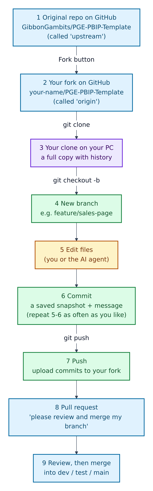
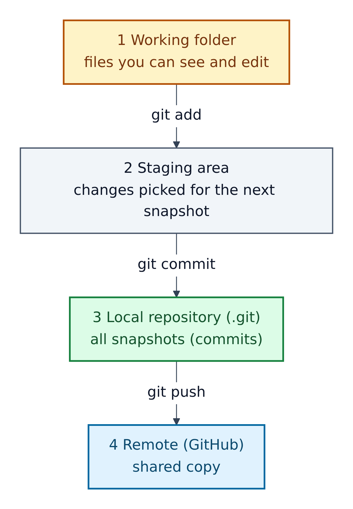
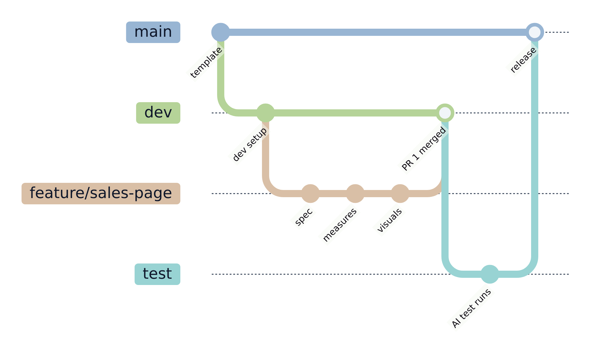
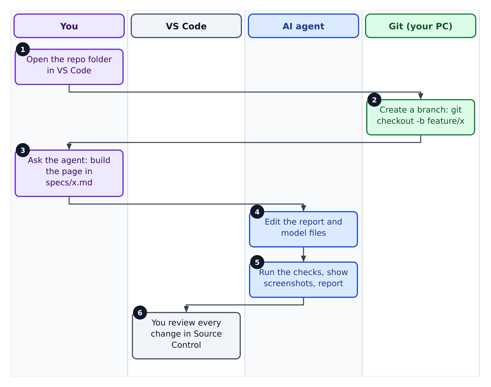
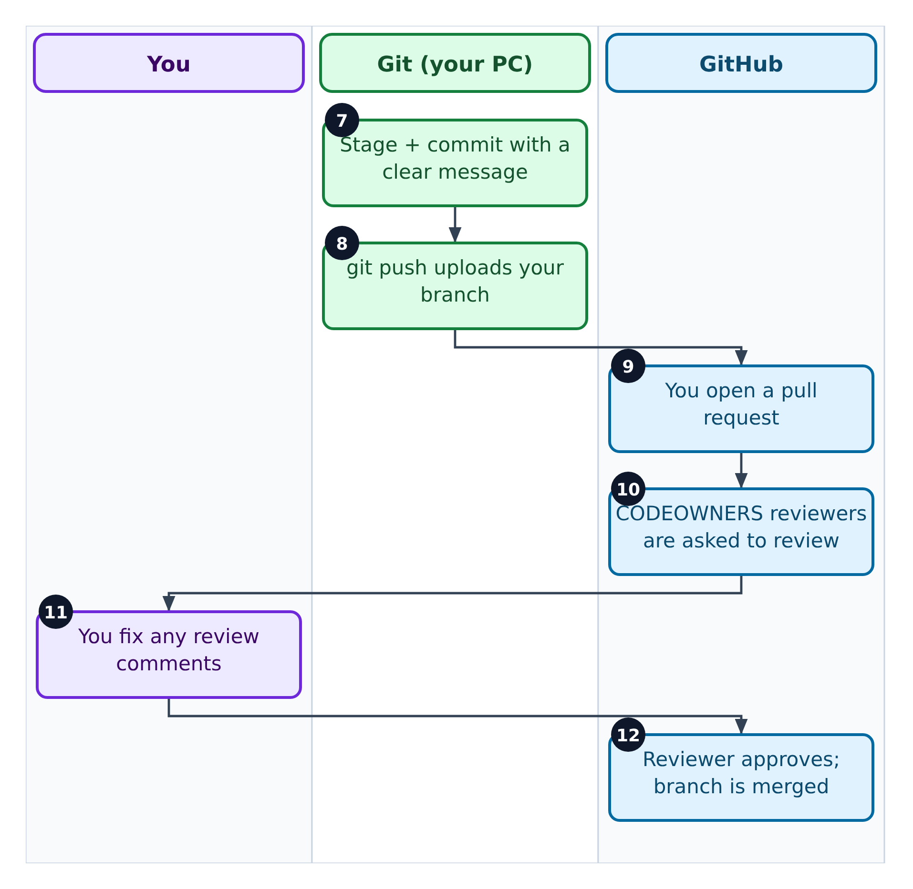

# 03. Git, GitHub, and why we fork



**Figure 3.1 — The life of a change.** From the original template on GitHub, through your own copy, to a reviewed and merged change.

Walkthrough of Figure 3.1:

1. **The original repository** (`GibbonGambits/PGE-PBIP-Template`) lives on GitHub. In Git language this is the **upstream**: the source you copied from.
2. **Your fork** is your own copy of that repository on GitHub, made with GitHub's *Fork* button. GitHub's documentation says forking "lets you propose changes to a project without affecting the upstream repository". Your fork is usually called **origin**.
3. **Your clone** is a full copy of your fork, downloaded to your computer with `git clone`. It includes the entire history.
4. **A branch** is a separate line of work, e.g. `feature/sales-page`. It lets you experiment without disturbing the main line.
5. **You or the AI agent edit files.**
6. **A commit** saves a snapshot of your changes with a short message. You can repeat steps 5 and 6 as often as you like.
7. **A push** uploads your commits to your fork on GitHub.
8. **A pull request** (PR) asks the team to review your branch and merge it. GitHub defines pull requests as "proposals to merge code changes into a project".
9. **Review and merge.** Reviewers comment, you fix, and the branch is merged into `dev`, then `test`, then `main` (Figure 3.3).

Later improvements to the template reach you the other way: you fetch them from **upstream** and merge them into your copy (commands below).

---

## Git and GitHub in plain words

- **Git** is a free program on your computer that records changes to files over time. The official Git book describes version control as a system that "records changes to a file or set of files over time so that you can recall specific versions later". Comparison: an unlimited "undo" history with a label on every save.
- **GitHub** is a website that hosts Git repositories online and adds collaboration tools: pull requests, reviews, issues and automation (GitHub Actions). Comparison: Git is the camera that takes the snapshots; GitHub is the shared photo album where the team looks at them together.

## Why we fork (and not just clone)

| Reason | What it means for you |
|---|---|
| **It is a template** | Each team or dashboard gets its own copy to customise: rename `Template.pbip`, add tables, change the theme. |
| **No risk to the original** | You cannot break the upstream template by experimenting in your fork. |
| **You still get updates** | `docs/REPOSITORY-GUIDE.md` shows how to pull in template improvements from upstream. |
| **Pull requests work both ways** | You can propose an improvement back to the template from your fork. |

The repository's own update recipe (`docs/REPOSITORY-GUIDE.md`, "How to update from upstream"):

```powershell
git remote add upstream https://github.com/<upstream-owner>/<upstream-repo>.git   # once
git fetch upstream
git checkout main
git merge upstream/main    # or: git rebase upstream/main
```

After merging, re-run the validation commands (Section 09) and resolve any conflicts in `.github/copilot-instructions.md`, `.github/skills/`, `scripts/` and the PBIP project files.

## The three places your changes live



**Figure 3.2 — Where a change goes on its way to GitHub.**

Walkthrough of Figure 3.2:

1. **Working folder:** the files you see in File Explorer and VS Code. Edits land here first.
2. **Staging area:** `git add` picks which changes go into the next snapshot. Comparison: putting photos in an envelope before posting it.
3. **Local repository:** `git commit` seals the envelope and files it in the hidden `.git` folder, with a message.
4. **Remote:** `git push` sends your commits to GitHub. The reverse, `git pull`, brings other people's commits down into your working folder.

VS Code does all four with buttons in its **Source Control** view (`Ctrl+Shift+G`), so you rarely need to type these commands.

## The branch path this repository recommends



**Figure 3.3 — Branches over time.** Each coloured line is a branch; each dot is a commit.

Walkthrough of Figure 3.3:

1. **`main`** holds what is released (production).
2. **`dev`** is where finished features are combined first.
3. **`feature/sales-page`** is your short-lived branch: write the spec, add measures, add visuals.
4. **"PR 1 merged":** your pull request into `dev` is approved and merged.
5. **`test`** is the release-candidate branch. Pushing to `test` runs the AI test workflow in `.github/workflows/ai-testing.yml` (Section 11).
6. **"release":** `test` is merged into `main`.

`docs/CICD-SETUP.md` and `docs/STARTER-PACK-CHECKLIST.md` describe this path as feature → `dev` → `test` → `main`, with branch protection rules (required reviews and status checks) on the three long-lived branches.

## Who does what when you save work



**Figure 3.4 — Swimlane, part 1: building the change.** Each column is a "lane" for one person or tool. Follow the numbered boxes from top to bottom; each arrow hands the work to the next box.

Walkthrough of Figure 3.4:

1. You open the repository folder in VS Code.
2. Git creates a branch for your work (`git checkout -b feature/x`, or the branch button in VS Code).
3. You ask the AI agent to build what the spec describes.
4. The agent edits the report and model files.
5. The agent runs the checks and shows you the screenshots and a summary.
6. You review every changed line in VS Code's Source Control view.



**Figure 3.5 — Swimlane, part 2: saving and sharing.** Continues from step 6.

Walkthrough of Figure 3.5:

7. Git stages and commits your changes with a clear message, e.g. "Add Sales Overview page".
8. `git push` uploads your branch to GitHub.
9. You open a pull request on GitHub, filling in `.github/PULL_REQUEST_TEMPLATE.md` (a summary plus a three-item checklist).
10. GitHub automatically asks the owners named in `.github/CODEOWNERS` to review. GitHub's docs: owners "are automatically requested for review" when a pull request changes their files.
11. You fix any review comments (new commits on the same branch update the pull request).
12. A reviewer approves and the branch is merged.

## Files in this repository that are about Git and GitHub

| File | What it does |
|---|---|
| `.gitignore` | Lists files Git must never save: local Power BI caches (`**/.pbi/...`), your private `.env`, Python caches, `tests/screenshots/`, `.github/.pbip-state/`, and `Proposals/`. |
| `.github/CODEOWNERS` | Names which team reviews which folder. The handles (`@your-org/...`) are placeholders to replace. |
| `.github/PULL_REQUEST_TEMPLATE.md` | The form every pull request starts with. |
| `.github/ISSUE_TEMPLATE/*.md` | Forms for reporting a bug or requesting a feature. |
| `.github/workflows/ai-testing.yml` | Automation that runs on GitHub (Section 11). |
| `CONTRIBUTING.md`, `CODE_OF_CONDUCT.md` | How to contribute, and how to behave. |
