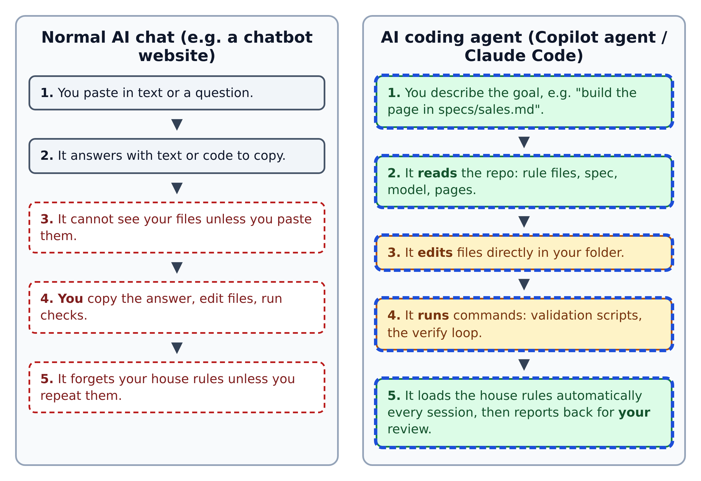
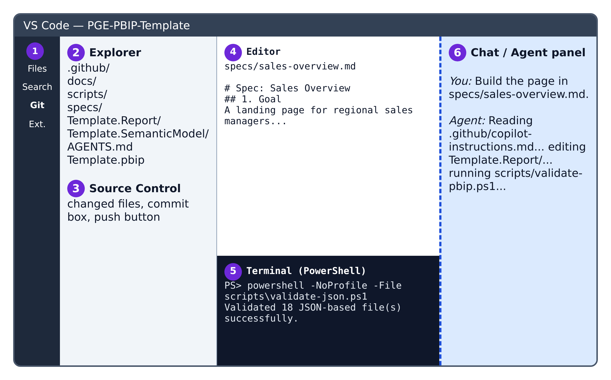
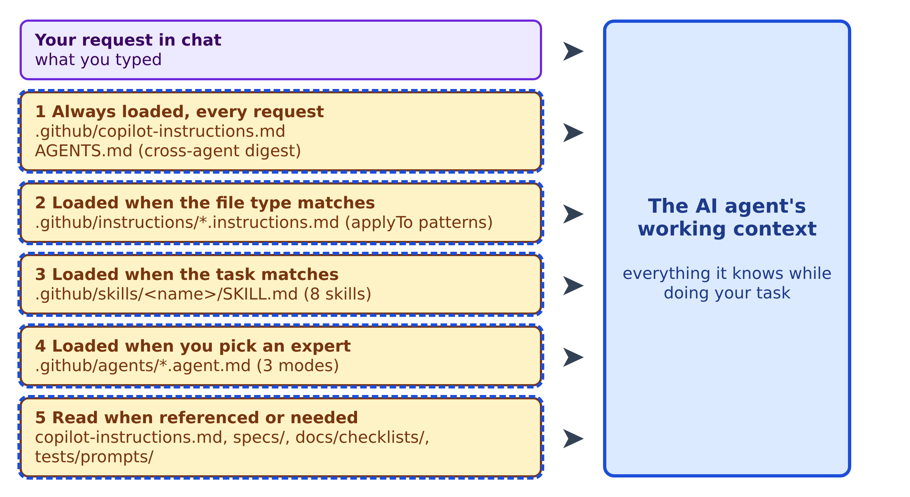
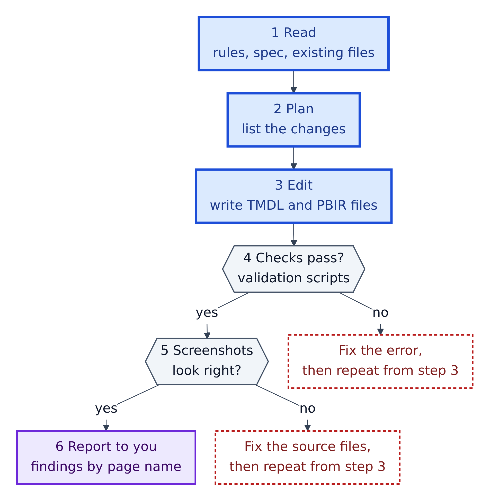

# 3. VS Code and GitHub Copilot

**VS Code** is Microsoft's free code editor. **GitHub Copilot** is GitHub's AI assistant inside it. In *agent* mode Copilot does more than chat: VS Code's docs say "an agent uses a model and tools to find relevant code, make changes, and run checks."

**Figure 3.1 — A chatbot advises; an agent does the work.**

1. With a chatbot you paste a question. With an agent you describe a goal, like "build the page in `specs/sales.md`".
2. The agent reads your repo: rules, spec, model, pages.
3. It edits files directly in your folder.
4. It runs commands, such as the validation scripts, and reads the output.
5. It loads the house rules automatically, then reports back for your review.

You stay responsible: read every change before you commit it.

## The VS Code window

**Figure 3.2 — The six areas you'll use.**

1. **Activity bar:** switch between Files, Search, Git and Extensions.
2. **Explorer:** open the whole `PGE-PBIP-Template` folder, not single files.
3. **Source Control:** changed files, commit message box, push and pull. Git must be installed separately.
4. **Editor:** where you read and edit files.
5. **Terminal:** PowerShell inside VS Code, for running the repo's scripts.
6. **Chat / agent panel:** where you talk to Copilot and watch it work.

## How Copilot learns this repo's rules

**Figure 3.3 — Five ways instructions reach the agent.** All are Amber + AI: changing them changes the agent's behaviour for everyone.

1. **Always loaded:** **Copilot instructions** are a Markdown file of standing rules, here `.github/copilot-instructions.md`. GitHub's docs: they "are automatically added to requests that you submit to Copilot". Copilot also reads **`AGENTS.md`**, a cross-tool format; Claude Code reads it too when there is no `CLAUDE.md`.
2. **By file type:** files in `.github/instructions/` end in `.instructions.md` and have an `applyTo` pattern, e.g. `**/*.{ts,tsx,js,jsx,less,css}`. They load only for matching files.
3. **By task:** **skills** are folders with a `SKILL.md` procedure. The agent loads one when your task matches its `description`. This repo has eight.
4. **By choice:** **custom agents** (`.github/agents/*.agent.md`) are expert roles you pick: data modelling, DAX, and visualisation.
5. **When needed:** the deep rulebook `copilot-instructions.md` (727 lines), your spec, the checklists and the test prompts.

## The agent's working cycle

**Figure 3.4 — What the agent does with your request.**

1. Read the rules, the spec and the existing files.
2. Plan the changes.
3. Edit the TMDL and PBIR files.
4. Run the validation scripts; on failure, fix and repeat from step 3.
5. Screenshot every page; if something looks wrong, fix the source files (never the image) and repeat from step 3.
6. Report findings by page *display name* ("Sales Overview", not a page id).

## Copilot and Claude in this repo

| | GitHub Copilot | Claude Code |
|---|---|---|
| Main rule file | `.github/copilot-instructions.md` | `AGENTS.md` (when there is no `CLAUDE.md`) |
| Skills | `.github/skills/*/SKILL.md` | Claude Code looks in `.claude/skills/`; these skills are written for Copilot |
| Expert modes | `.github/agents/*.agent.md` | Not used |
| Hooks | Run by hand (Chapter 5) | The hook scripts read the JSON that Claude Code hooks send and use exit code 2 to block, matching Claude Code's hook design |

The README also asks for a one-time step in **GitHub Copilot CLI** (Copilot in a terminal): adding Microsoft's `skills-for-fabric` plugin collection. Chapter 6 has the commands.

## Habits that keep you safe

- Write the spec first. A clear plan means fewer guesses.
- Work on a branch, never directly on `main`.
- Never paste secrets into a chat.
- "The JSON is valid" is not done. Ask for the screenshots.
