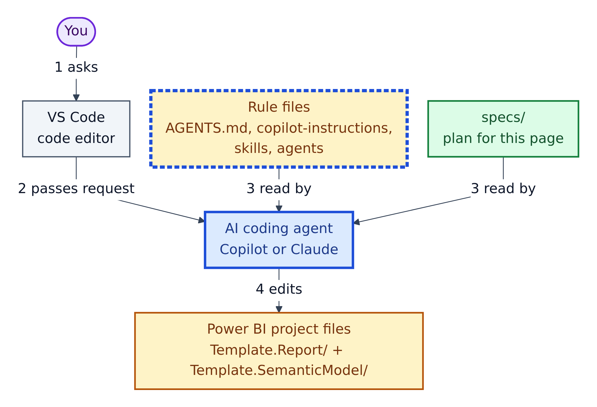
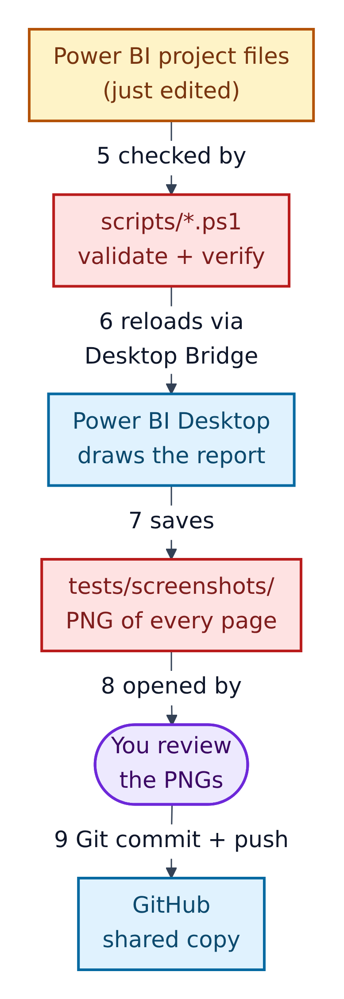
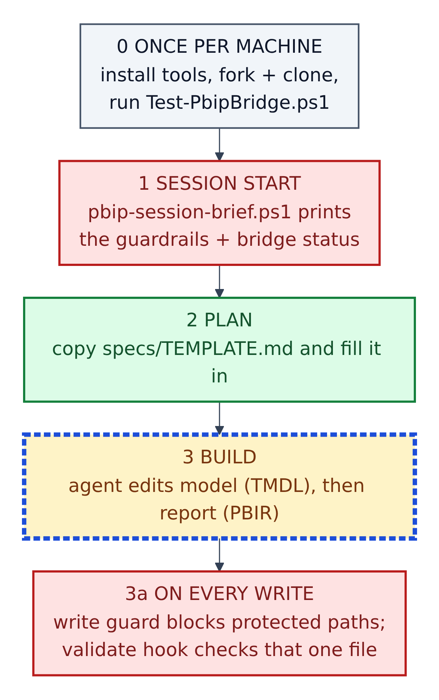
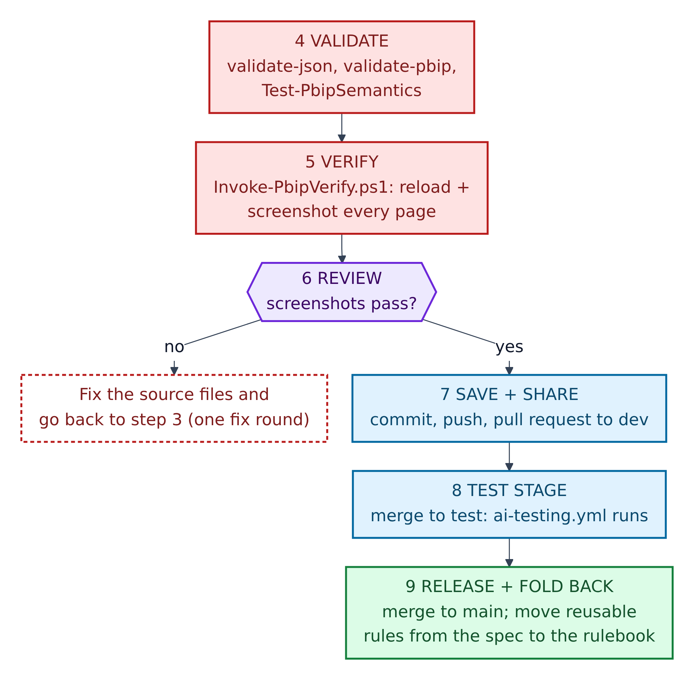
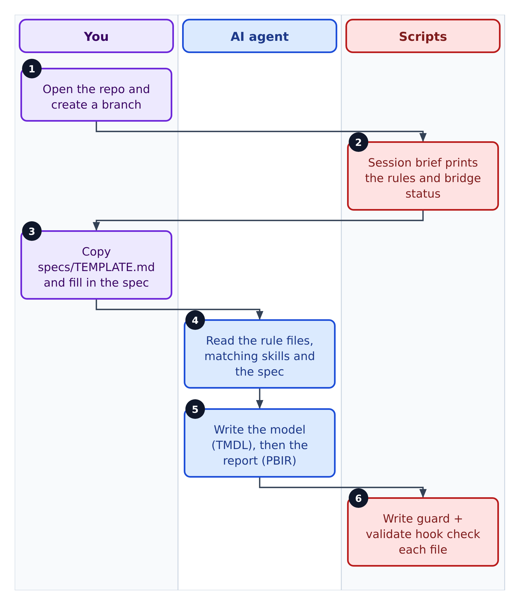
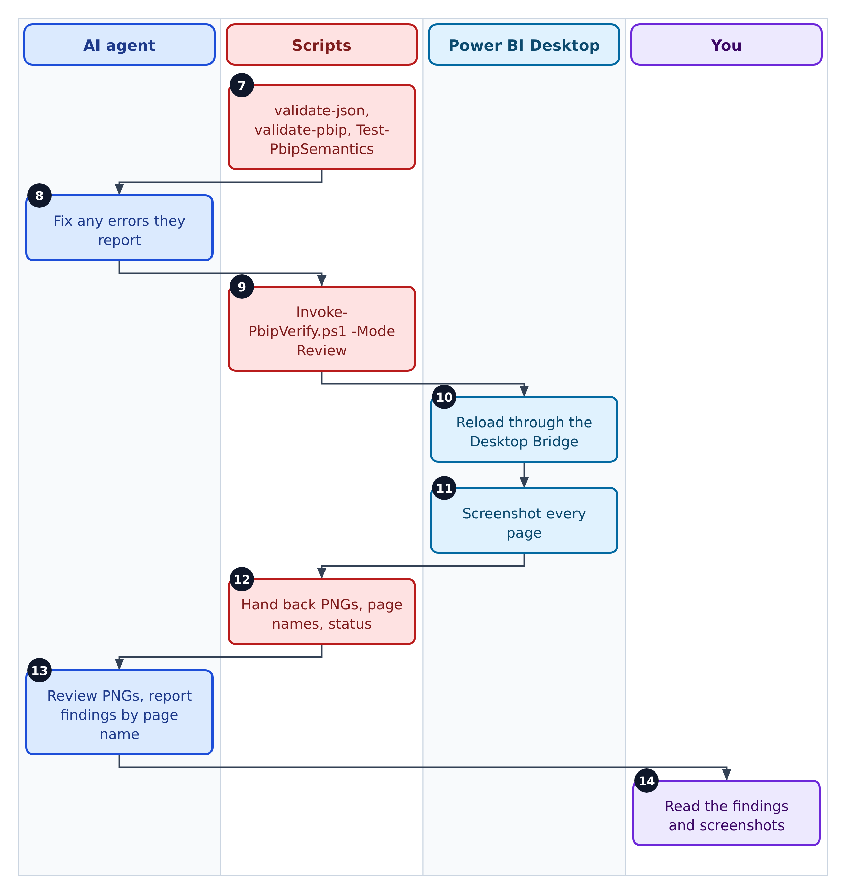
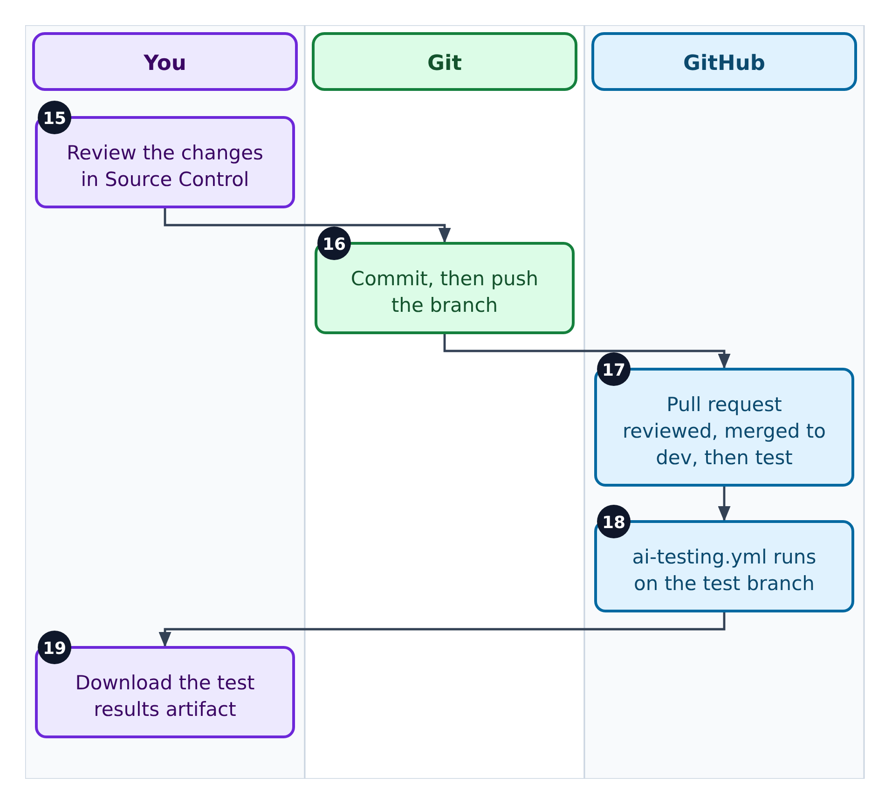
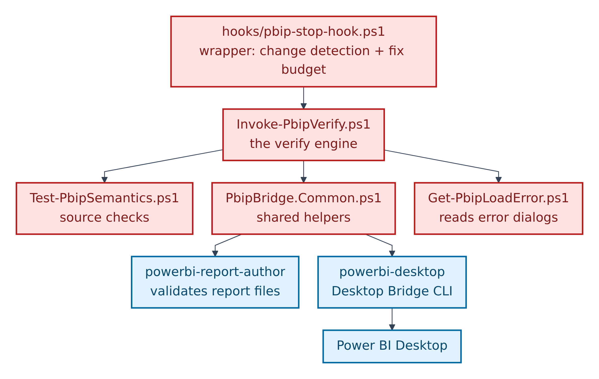
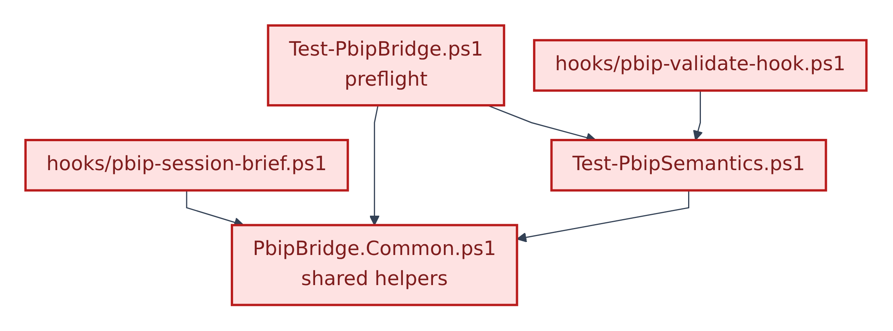

# 4. How the parts work together

Now that you know the pieces, here is how one change flows through all of them.

**Figure 4.1 — Making a change.**

1. You ask for a change in VS Code.
2. VS Code passes it to the AI agent.
3. The agent reads the rule files and your spec.
4. The agent edits the Power BI project files.

**Figure 4.2 — Checking and sharing.** Continues from Figure 4.1.

5. PowerShell scripts check the edited files.
6. The verify loop reloads Power BI Desktop through the **Desktop Bridge**: a local connection that lets programs control a running Power BI Desktop.
7. Power BI saves a screenshot of every page in `tests/screenshots/`.
8. You open and review the screenshots. If something is wrong, start again at step 1.
9. You commit and push to GitHub.

## The order things run in

**Figure 4.3 — Run order, part 1.**

0. **Once per machine:** install tools, fork and clone, run the preflight `scripts\Test-PbipBridge.ps1` (Chapter 6).
1. **Session start:** `scripts\hooks\pbip-session-brief.ps1` prints the guardrails and whether the bridge is up.
2. **Plan:** copy and fill in a spec.
3. **Build:** the agent edits the model first, then the report.
   - **3a, on every write:** a write guard blocks protected folders, and a validator checks the file just written.

**Figure 4.4 — Run order, part 2.** Continues from step 3.

4. **Validate:** `validate-json.ps1`, `validate-pbip.ps1`, `Test-PbipSemantics.ps1`.
5. **Verify:** `Invoke-PbipVerify.ps1` reloads Power BI and screenshots every page.
6. **Review:** if screenshots fail, fix the source and go back to step 3. The repo allows **one fix round**: fix once, then confirm and report.
7. **Save and share:** commit, push, open a pull request into `dev`.
8. **Test stage:** merging to `test` runs `.github/workflows/ai-testing.yml`.
9. **Release and fold back:** merge to `main`; move any rule worth keeping from the spec into the rulebook.

## Who does what, end to end

**Figure 4.5 — Plan and build (steps 1–6).**

1. You open the repo and create a branch.
2. The session brief prints the rules and bridge status.
3. You copy `specs/TEMPLATE.md` and fill it in.
4. The agent reads the rules, matching skills and your spec.
5. The agent writes the model (TMDL), then the report (PBIR).
6. The write guard and validator check each file.

**Figure 4.6 — Check and verify (steps 7–14).**

7. The three validators run.
8. The agent fixes any errors.
9. The agent runs `Invoke-PbipVerify.ps1 -Mode Review`.
10. Power BI reloads through the bridge.
11. Power BI screenshots every page.
12. The scripts hand back the PNGs, page names and a status.
13. The agent reviews them and reports findings by page name.
14. You check the findings and screenshots yourself.

**Figure 4.7 — Save and share (steps 15–19).**

15. You review the changes in Source Control.
16. Git commits and pushes the branch.
17. The pull request is reviewed and merged to `dev`, later to `test`.
18. On `test`, the AI testing workflow runs.
19. You download the results from the workflow run.

## Which script uses which

**Figure 4.8 — The verify engine.** An arrow means "loads or calls". All scripts are Red: run them, don't edit them.

1. `hooks/pbip-stop-hook.ps1` wraps the engine, adding change detection and the fix budget.
2. `Invoke-PbipVerify.ps1` is the engine.
3. It loads `Test-PbipSemantics.ps1` and the shared helpers in `PbipBridge.Common.ps1`, and starts `Get-PbipLoadError.ps1` when Power BI shows an error dialog.
4. The helpers call Microsoft's two command-line tools: `powerbi-report-author` (validates report files) and `powerbi-desktop` (the Desktop Bridge CLI).
5. `powerbi-desktop` talks to Power BI Desktop.

**Figure 4.9 — Other scripts that share the helpers.**

1. `Test-PbipBridge.ps1` (preflight) uses the helpers and the semantic checks.
2. `hooks/pbip-validate-hook.ps1` uses `Test-PbipSemantics.ps1` on one file at a time.
3. `hooks/pbip-session-brief.ps1` uses the helpers to read the bridge status.

Five scripts stand alone: `validate-json.ps1`, `validate-pbip.ps1`, `run-ai-md-test.ps1`, `hooks/pbip-write-guard.ps1`, and `Invoke-PbipRefresh.ps1`, which clicks Power BI's Refresh button using Windows UI Automation.
