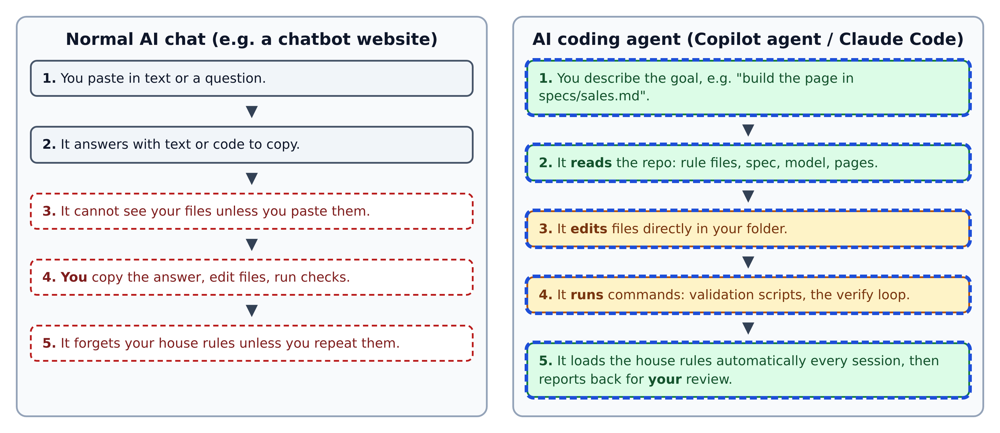
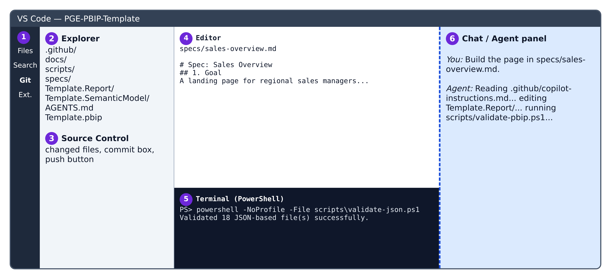
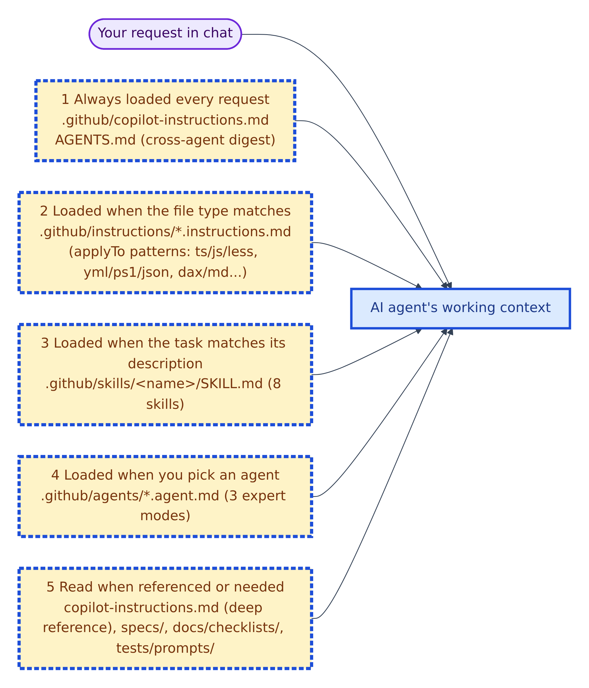
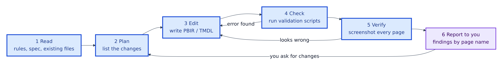

# 04. VS Code, and what an AI coding agent does compared with a normal chat

**Figure 4.1 — A chatbot gives advice; an agent does the work.** Left: a normal AI chat. Right: an AI coding agent working inside your repository (blue dashed outlines mark AI actions).

Walkthrough of Figure 4.1:

1. **Chat:** you paste a question and get text back. **Agent:** you describe a goal, such as "build the page in `specs/sales.md`".
2. **Chat:** it cannot see your files. **Agent:** it *reads* the repository: rule files, the spec, the model and the pages.
3. **Chat:** you must copy its answer into files yourself. **Agent:** it *edits* the files directly.
4. **Chat:** you run any checks. **Agent:** it *runs* commands, such as `scripts\validate-pbip.ps1`, and reads the output.
5. **Chat:** it forgets your house rules unless you repeat them. **Agent:** it loads the rule files automatically each session, then reports back so *you* can review.

VS Code's documentation puts it simply: "An agent uses a model and tools to find relevant code, make changes, and run checks."

**Real-world comparison:** a normal chat is a consultant on the phone. An agent is a contractor in your house, with the building code (rule files) pinned to the wall and a checklist to sign off. You still inspect the work before you accept it.

---

## VS Code in one picture

**Figure 4.2 — The VS Code window.** **VS Code** (Visual Studio Code) is Microsoft's free code editor for Windows, macOS and Linux.

Walkthrough of Figure 4.2:

1. **Activity bar:** switch between Files, Search, Git (Source Control) and Extensions.
2. **Explorer:** the repository's folders and files. Open the whole `PGE-PBIP-Template` folder, not single files.
3. **Source Control:** shows every changed file, a box for the commit message, and push/pull buttons. VS Code "has built-in Git support", but Git itself must be installed separately.
4. **Editor:** where you read and edit a file, e.g. your spec.
5. **Terminal:** a PowerShell window inside VS Code for running the repository's scripts.
6. **Chat / Agent panel:** where you talk to GitHub Copilot (or another agent such as Claude) and watch it read, edit and run commands.

## How the agent learns this repository's rules

**Figure 4.3 — Five ways rule files reach the agent.** All are Amber with a blue outline: AI files that change the agent's behaviour for everyone, so edit them with care.

Walkthrough of Figure 4.3:

1. **Always loaded.** GitHub's docs say repository instructions in `.github/copilot-instructions.md` "are automatically added to requests that you submit to Copilot". Copilot also supports **`AGENTS.md`** files, which VS Code calls "a cross-agent format". Claude Code reads `AGENTS.md` when there is no `CLAUDE.md`. This repository has both files and keeps them in step.
2. **Loaded by file type.** Files named `*.instructions.md` in `.github/instructions/` have an `applyTo` pattern. For example, the custom-visuals rules apply to `**/*.{ts,tsx,js,jsx,less,css}`. They load only when the agent works on matching files.
3. **Loaded when the task matches.** **Skills** are folders with a `SKILL.md` file: "folders of instructions, scripts, and resources" that the agent loads when relevant. The `description` line is how the agent decides. This repository has 8 skills under `.github/skills/`.
4. **Loaded when you pick an expert.** **Custom agents** (`.github/agents/*.agent.md`) bundle instructions and tools for one role. Here: a data-modelling expert, a DAX expert and a visualisation expert.
5. **Read when needed.** The deep rulebook `copilot-instructions.md` (727 lines), your spec in `specs/`, the checklists in `docs/checklists/`, and the test prompts in `tests/prompts/` are read when the agent or you point to them.

## The agent's working loop

**Figure 4.4 — The agent's loop.** Arrows going back show where it repeats.

Walkthrough of Figure 4.4:

1. **Read** the rules, the spec and the existing files.
2. **Plan** the list of changes.
3. **Edit** the report (PBIR JSON) and model (TMDL) files.
4. **Check** with validation scripts. If an error is found, go back to Edit.
5. **Verify** by screenshotting every page in Power BI Desktop. If something looks wrong, go back to Edit.
6. **Report** findings to you by page *display name* (e.g. "Sales Overview", not `6e86f24a804ae4a905eb`). If you want changes, the loop starts again at Plan.

## GitHub Copilot and Claude in this repository

| | GitHub Copilot | Claude (Claude Code) |
|---|---|---|
| **Main rule file** | `.github/copilot-instructions.md` (primary authority, per README) | `AGENTS.md` (read when no `CLAUDE.md` exists) |
| **Skills** | `.github/skills/*/SKILL.md` | Claude Code looks in `.claude/skills/`; this repo's skills are written for Copilot |
| **Expert modes** | `.github/agents/*.agent.md` | Not used by Claude |
| **Hooks** | Run manually (`scripts/hooks/*.ps1`) | The hook scripts read the same JSON fields that Claude Code hooks send (`tool_input`, `session_id`, `stop_hook_active`), and use exit code 2 to block, which matches Claude Code's documented hook behaviour |

The README names one extra, one-time setup for **GitHub Copilot CLI** (the command-line version of Copilot): adding Microsoft's `skills-for-fabric` plugin collection. Section 07 covers it.

## Golden rules for working with an agent

1. **Write the spec first** (Section 08). An agent with a clear plan makes fewer guesses.
2. **Work on a branch**, never directly on `main`.
3. **Read every changed line** in Source Control before committing. You are responsible for what you commit.
4. **Never paste secrets** (passwords, API keys) into a chat.
5. **Do not accept "the JSON is valid" as done.** Ask for the screenshots (guardrail 9).
