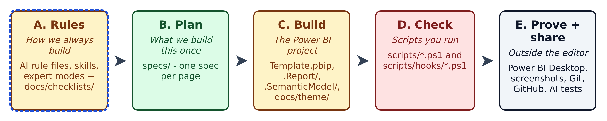
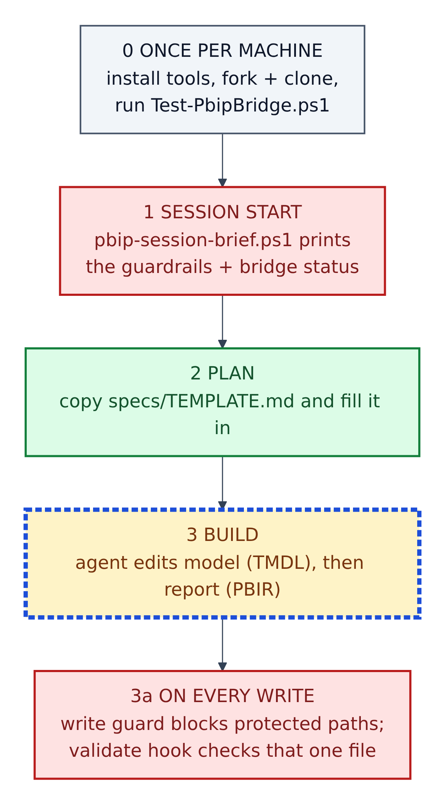
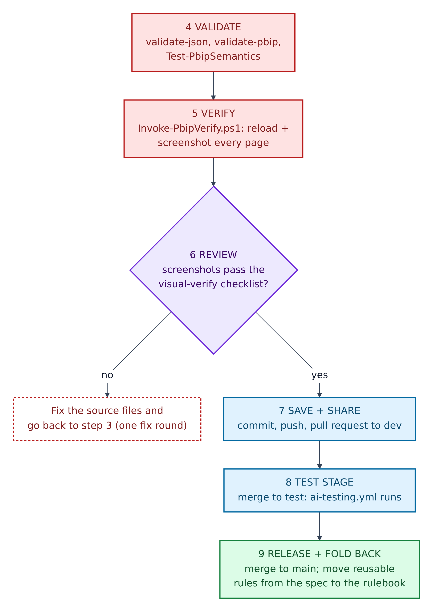
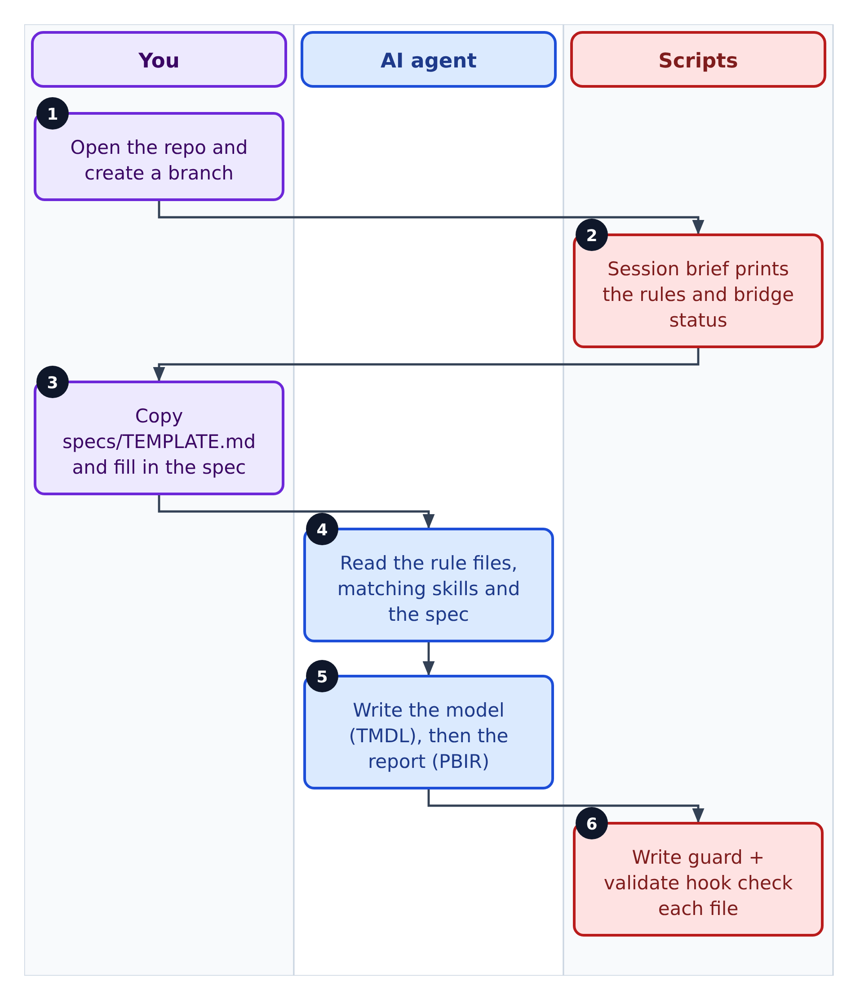
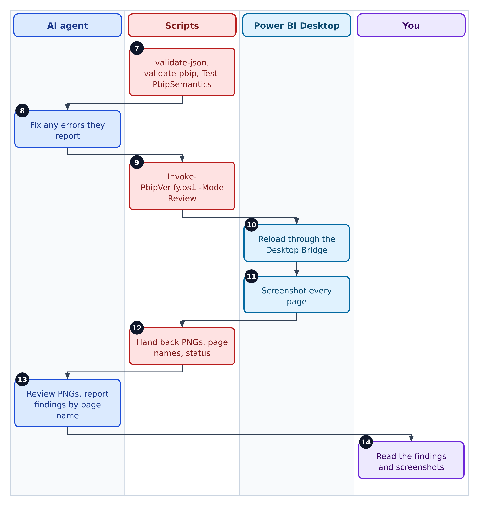
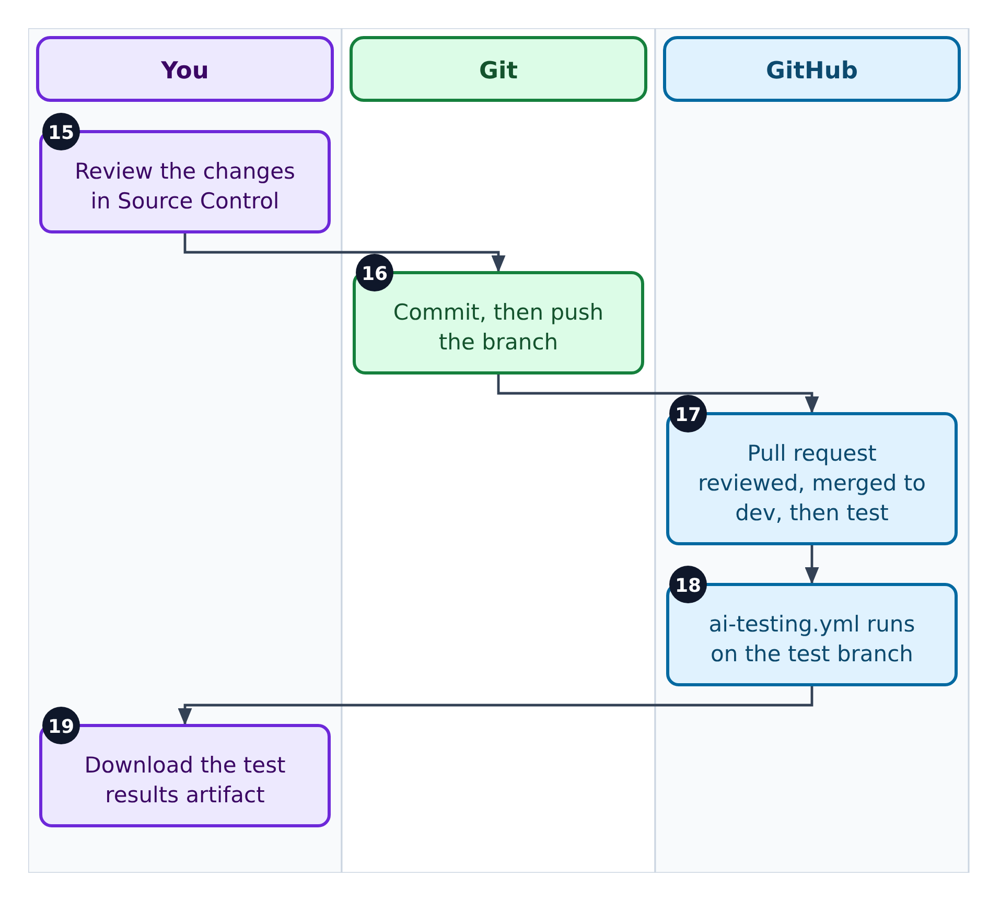
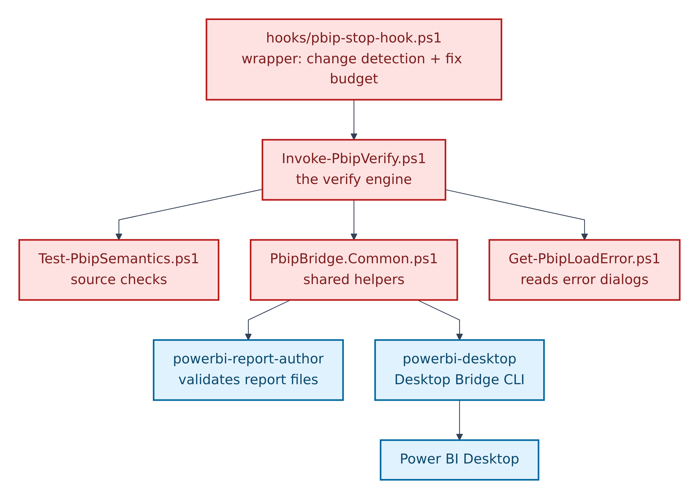
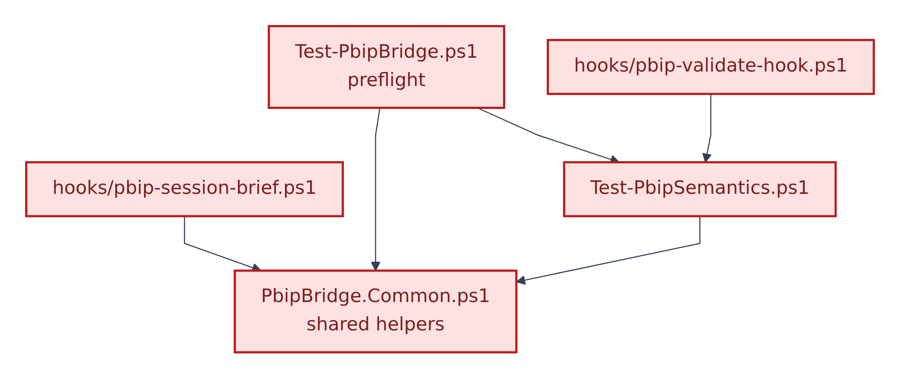

# 05. The master map: how every part connects, and in what order it runs

**Figure 5.1 — The master map.** Five stages, read left to right. Every top-level part of the repository belongs to one of them.

Walkthrough of Figure 5.1:

1. **A. Rules — how we always build.** The AI rule files (blue outline) plus the human quality checklists. They are permanent and apply to every dashboard.
2. **B. Plan — what we build this once.** A spec in `specs/`, copied from `TEMPLATE.md`. One per dashboard or page.
3. **C. Build — the Power BI project.** `Template.pbip`, the model, the report, and the theme source in `docs/theme/`.
4. **D. Check — scripts you run.** PowerShell scripts, from "does every JSON file parse?" up to "reload Power BI and screenshot every page".
5. **E. Prove and share.** Power BI Desktop draws the report, screenshots are saved locally, Git and GitHub share the work, and a GitHub workflow runs AI tests.

What sits in each stage:

| Stage | Files and folders | Safety |
|---|---|---|
| **A. Rules** | `.github/copilot-instructions.md`, `AGENTS.md`, `copilot-instructions.md`, `.github/instructions/` (3), `.github/agents/` (3), `.github/skills/` (8), `docs/checklists/` (6) | Amber + AI; checklists Green |
| **B. Plan** | `specs/TEMPLATE.md`, `specs/EXAMPLE-sales-overview.md`, your own `specs/<page>.md` | Green |
| **C. Build** | `Template.pbip`, `Template.SemanticModel/`, `Template.Report/`, `docs/theme/` | Amber (entry and fixed files Red) |
| **D. Check** | `scripts/validate-json.ps1`, `validate-pbip.ps1`, `Test-PbipSemantics.ps1`, `Test-PbipBridge.ps1`, `Invoke-PbipVerify.ps1`, `Get-PbipLoadError.ps1`, `Invoke-PbipRefresh.ps1`, `PbipBridge.Common.ps1`, `run-ai-md-test.ps1`, `scripts/hooks/` (4) | Red |
| **E. Prove and share** | Power BI Desktop, `tests/screenshots/` (generated, not in Git), Git, GitHub, `.github/workflows/ai-testing.yml`, `tests/results/` | Red (tools are not files) |

---

## The order things run in

**Figure 5.2 — Run order, part 1: before and during the build.** Read top to bottom.

Walkthrough of Figure 5.2:

0. **Once per machine:** install the tools, fork and clone, and run the preflight `scripts\Test-PbipBridge.ps1` (Section 07).
1. **Session start:** `scripts\hooks\pbip-session-brief.ps1` prints a short brief of the guardrails and whether Power BI Desktop's bridge is up.
2. **Plan:** copy `specs/TEMPLATE.md` to `specs/<name>.md` and fill it in. Answer its "Open questions" before building.
3. **Build:** the agent (or you) edits the model first, then the report, following the build order in `copilot-instructions.md`.
   - **3a, on every write:** `pbip-write-guard.ps1` refuses writes to protected folders, and `pbip-validate-hook.ps1` checks the single file just written.

**Figure 5.3 — Run order, part 2: checking, sharing and releasing.** Continues from step 3.

Walkthrough of Figure 5.3:

4. **Validate:** `validate-json.ps1`, `validate-pbip.ps1` and `Test-PbipSemantics.ps1`.
5. **Verify:** `Invoke-PbipVerify.ps1` (or its wrapper `pbip-stop-hook.ps1`) reloads Power BI Desktop and screenshots every page.
6. **Review:** compare the screenshots with the `powerbi-visual-verify` skill's checklist. If they fail, fix the source files and go back to step 3. The repository allows **one fix round**: review and fix, then confirm and report.
7. **Save and share:** commit, push the branch, and open a pull request into `dev`.
8. **Test stage:** merging to `test` starts `.github/workflows/ai-testing.yml`.
9. **Release and fold back:** merge to `main`. Then move any rule from the spec that will apply to the *next* dashboard into `.github/copilot-instructions.md`, and keep `copilot-instructions.md` aligned.

## Who does what, end to end

The full process has 19 hand-offs, so it is split into three swimlanes. In each one, columns are "lanes" (a person or tool) and the numbered boxes run top to bottom.

**Figure 5.4 — Swimlane 1: plan and build (steps 1–6).**

Walkthrough of Figure 5.4:

1. You open the repository and create a branch.
2. The session-brief script prints the rules and the bridge status.
3. You copy `specs/TEMPLATE.md` and fill in the spec.
4. The agent reads the rule files, any matching skills, and your spec.
5. The agent writes the model (TMDL) first, then the report (PBIR).
6. The write guard and the post-write validator check each file as it is written.

**Figure 5.5 — Swimlane 2: check and verify (steps 7–14).**

Walkthrough of Figure 5.5:

7. The scripts run the three validation checks.
8. The agent fixes any errors they report.
9. The agent runs `Invoke-PbipVerify.ps1 -Mode Review`.
10. Power BI Desktop reloads the project through the Desktop Bridge.
11. Power BI Desktop screenshots every page.
12. The scripts hand back the PNG files, page names and a status.
13. The agent reviews the PNGs and reports findings by page display name.
14. You read the findings and look at the screenshots yourself.

**Figure 5.6 — Swimlane 3: save and share (steps 15–19).**

Walkthrough of Figure 5.6:

15. You review the changes in VS Code's Source Control view.
16. Git commits the changes and pushes the branch.
17. On GitHub, the pull request is reviewed and merged to `dev`, and later to `test`.
18. On `test`, the AI testing workflow runs.
19. You download the test results from the workflow run.

## Which script uses which

**Figure 5.7 — The verify engine.** An arrow means "loads or calls". All scripts are Red: run them, do not edit them.

Walkthrough of Figure 5.7:

1. **`hooks/pbip-stop-hook.ps1`** is a thin wrapper that adds change detection and the one-round fix budget.
2. **`Invoke-PbipVerify.ps1`** is the engine of the screenshot loop.
3. It loads **`Test-PbipSemantics.ps1`** (checks the source for load errors), **`PbipBridge.Common.ps1`** (the shared toolbox), and starts **`Get-PbipLoadError.ps1`** in a separate process when Power BI shows an error dialog.
4. The toolbox calls Microsoft's two command-line tools: **`powerbi-report-author`** (used here to validate report files) and **`powerbi-desktop`** (the Desktop Bridge CLI).
5. **`powerbi-desktop`** talks to the running **Power BI Desktop**.

**Figure 5.8 — The other scripts that share the toolbox.**

Walkthrough of Figure 5.8:

1. **`Test-PbipBridge.ps1`** (preflight) loads the toolbox and the semantic checks.
2. **`hooks/pbip-validate-hook.ps1`** uses `Test-PbipSemantics.ps1` to check one file at a time.
3. **`hooks/pbip-session-brief.ps1`** loads the toolbox only, to read the bridge status quickly.
4. **`Test-PbipSemantics.ps1`** itself loads the toolbox.

**Stand-alone scripts** need nothing else from the repository, so they have no arrows: `validate-json.ps1`, `validate-pbip.ps1`, `run-ai-md-test.ps1`, `hooks/pbip-write-guard.ps1`, and `Invoke-PbipRefresh.ps1` (which clicks Power BI's Refresh button through Windows UI Automation).
