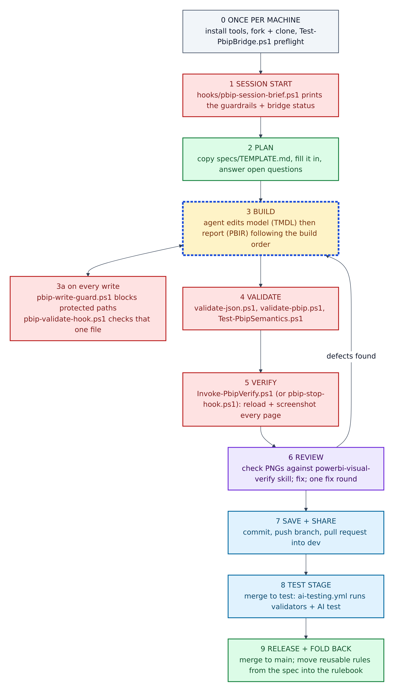
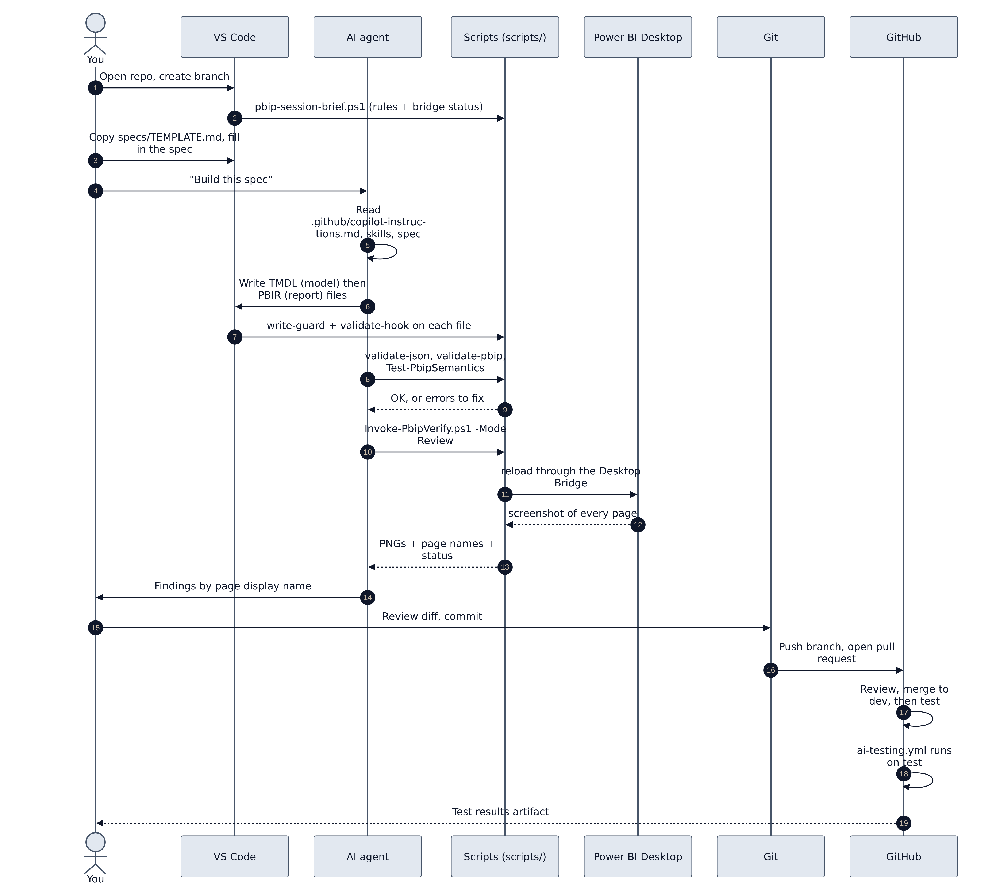
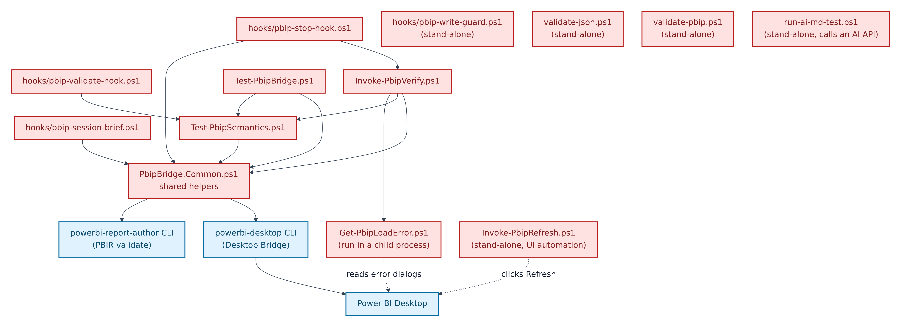

# 05. The master map: how every part connects, and in what order it runs

**Figure 5.1 — The master map.** Five columns, read left to right. Every top-level part of the repository sits in one of them.

Walkthrough of Figure 5.1:

1. **A. Rules — how we always build.** The AI rule files (blue outline) plus the human checklists. These are permanent and apply to every dashboard.
2. **B. Plan — what we build this once.** A spec in `specs/`, copied from `TEMPLATE.md`. One per dashboard or page.
3. **C. Build — the Power BI project.** `Template.pbip`, the model, the report, and the theme source in `docs/theme/`.
4. **D. Check — scripts you run.** Six kinds of PowerShell script, from "does every JSON file parse?" up to "reload Power BI and screenshot every page".
5. **E. Prove and share.** Power BI Desktop draws the report; screenshots are saved locally; Git and GitHub share the work; the GitHub workflow runs AI tests and stores results.

---

## The order things run in

**Figure 5.2 — Run order, top to bottom.** Steps 0–9 are the full life of one dashboard change.

Walkthrough of Figure 5.2:

0. **Once per machine:** install the tools, fork and clone, and run the preflight `scripts\Test-PbipBridge.ps1` (Section 07).
1. **Session start:** `scripts\hooks\pbip-session-brief.ps1` prints a short brief of the guardrails and whether Power BI Desktop's bridge is up.
2. **Plan:** copy `specs/TEMPLATE.md` to `specs/<name>.md` and fill it in. Answer its "Open questions" before building.
3. **Build:** the agent (or you) edits the model first, then the report, following the build order in `copilot-instructions.md`.
   - **3a, on every write:** `pbip-write-guard.ps1` refuses writes to protected folders, and `pbip-validate-hook.ps1` checks the single file just written.
4. **Validate:** `validate-json.ps1`, `validate-pbip.ps1` and `Test-PbipSemantics.ps1`.
5. **Verify:** `Invoke-PbipVerify.ps1` (or its wrapper `pbip-stop-hook.ps1`) reloads Power BI Desktop and screenshots every page.
6. **Review:** compare the screenshots against the `powerbi-visual-verify` skill. The repository allows **one fix round**: review and fix, then confirm and report. Defects send you back to step 3.
7. **Save and share:** commit, push the branch, and open a pull request into `dev`.
8. **Test stage:** merging to `test` triggers `.github/workflows/ai-testing.yml`.
9. **Release and fold back:** merge to `main`. Then move any rule from the spec that will apply to the *next* dashboard into `.github/copilot-instructions.md` (and keep `copilot-instructions.md` aligned).

## Who does what, end to end

**Figure 5.3 — End-to-end swimlane.** Seven lanes: you, VS Code, the AI agent, the scripts, Power BI Desktop, Git and GitHub.

Walkthrough of Figure 5.3:

1. You open the repository and create a branch.
2. The session-brief script shows the rules and bridge status.
3. You write the spec from the template.
4. You ask the agent to build it.
5. The agent reads the rule files, matching skills and your spec.
6. The agent writes the model (TMDL) first, then the report (PBIR).
7. Each written file passes the write guard and the post-write validator.
8. The agent runs the three validation scripts.
9. The scripts report OK, or list errors to fix.
10. The agent runs the verify loop in Review mode.
11. The scripts tell Power BI Desktop to reload through the Desktop Bridge.
12. Power BI Desktop returns a screenshot of every page.
13. The scripts hand the PNG files, page names and a status back to the agent.
14. The agent reports findings to you by page display name.
15. You review the changes and commit.
16. You push and open a pull request.
17. On GitHub the change is reviewed and merged to `dev`, later to `test`.
18. On `test`, the AI testing workflow runs.
19. You get the test results as a downloadable artifact.

## Which script uses which

**Figure 5.4 — Script dependency map.** An arrow means "loads or calls". All scripts are Red: run them, do not edit them.

Walkthrough of Figure 5.4:

1. **`PbipBridge.Common.ps1`** is the shared toolbox. Most bridge scripts load it first. It calls the two Microsoft command-line tools: `powerbi-desktop` (the Desktop Bridge CLI) and `powerbi-report-author` (used here to validate report files).
2. **`Invoke-PbipVerify.ps1`** is the engine of the screenshot loop. It loads the toolbox and `Test-PbipSemantics.ps1`, and starts `Get-PbipLoadError.ps1` in a separate process when Power BI shows an error dialog.
3. **`hooks/pbip-stop-hook.ps1`** is a thin wrapper around `Invoke-PbipVerify.ps1` that adds change detection and the one-round fix budget.
4. **`hooks/pbip-validate-hook.ps1`** uses `Test-PbipSemantics.ps1` to check one file at a time.
5. **`Test-PbipBridge.ps1`** (preflight) uses the toolbox and the semantic checks.
6. **Stand-alone scripts** need nothing else from the repository: `validate-json.ps1`, `validate-pbip.ps1`, `run-ai-md-test.ps1`, `hooks/pbip-write-guard.ps1` and `Invoke-PbipRefresh.ps1` (which clicks Power BI's Refresh button through Windows UI Automation).
7. **`Get-PbipLoadError.ps1`** reads Power BI's error dialogs through Windows UI Automation, because the bridge itself cannot see them.
