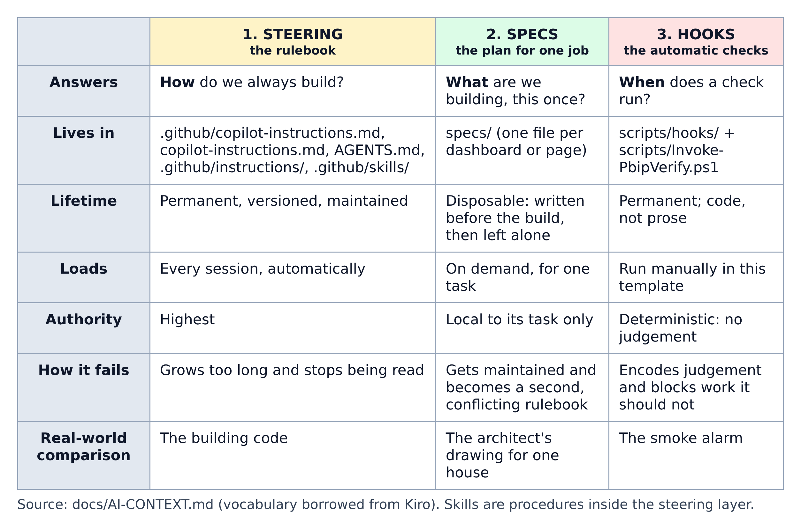
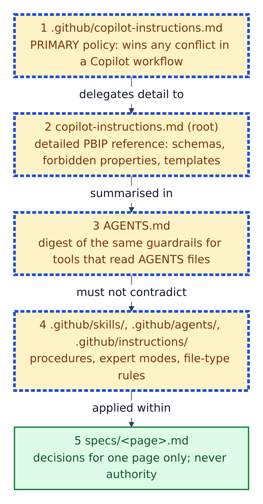
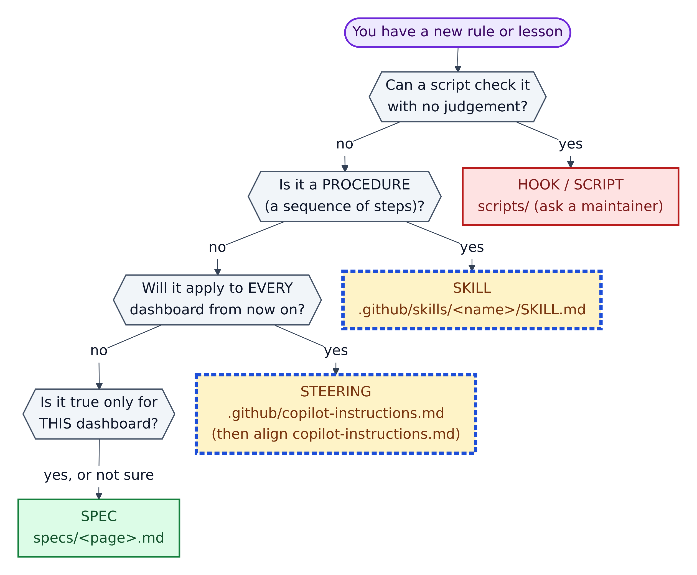
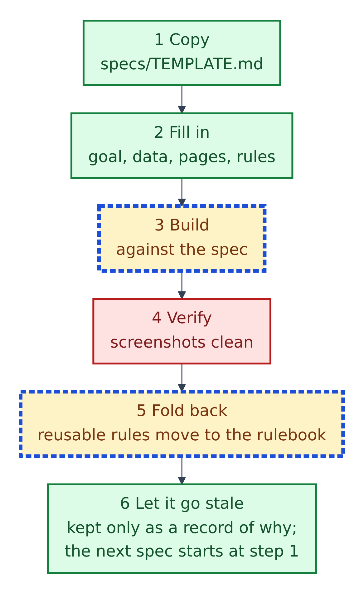

# 5. Rules for the AI: steering, specs and hooks

`docs/AI-CONTEXT.md` explains that the repo keeps three kinds of guidance apart on purpose.

**Figure 5.1 — Steering, specs and hooks.**

1. **Steering** is the permanent rulebook: *how* we always build. It loads every session and has the highest authority.
2. **Specs** are plans for one job: *what* we build this time. Written before the build, then left alone.
3. **Hooks** are small scripts that run at fixed moments and make no judgement calls.

Each fails in its own way: a rulebook that keeps growing stops being read; a spec that keeps being updated becomes a second, conflicting rulebook; a hook that tries to judge blocks work it shouldn't. Keeping them apart avoids all three.

## Who wins when rules disagree

**Figure 5.2 — The precedence ladder.** The higher box wins.

1. `.github/copilot-instructions.md` is the primary policy. The README: "If there is any conflict … follow `.github/copilot-instructions.md`."
2. `copilot-instructions.md` (in the root) is the detailed technical reference: file schemas, forbidden properties, JSON templates.
3. `AGENTS.md` repeats the guardrails for tools that read AGENTS files.
4. Skills, expert modes and scoped instruction files must not contradict the files above.
5. A spec covers one page and is never authority.

Watch out: the three files in `.github/agents/` and two skills call the *root* file "the final authority". Chapter 14 lists that as gap G5.

## The guardrails

These "non-negotiable" rules appear in the README, `AGENTS.md` and `.github/copilot-instructions.md`:

1. New business measures go in `_Measures`; keep existing measure homes unless migration is approved.
2. SVG picture-card measures go in `_SVG_Measures`, named by page: `P1_...`, `P2_...`.
3. SVG backgrounds and custom themes live in `StaticResources/RegisteredResources/` and must be registered in `report.json`.
4. Follow the schema rules in `copilot-instructions.md` exactly, including forbidden properties.
5. Save `.tmdl` as UTF-8 without a BOM; no `//` comments in TMDL.
6. Format numbers sensibly and consistently, with thousand separators.
7. SVG cards use the image-visual pattern.
8. Make fake CSV data with Python (numpy and pandas).
9. Never call a page done on valid JSON alone; check the screenshot.
10. Give every measure a description.

`.github/copilot-instructions.md` adds two: keep "SVG-header" page style as the default, and treat `docs/theme/Theme.json` as source only.

## Where should a new rule go?

**Figure 5.3 — Choosing the layer**, following the questions at the end of `docs/AI-CONTEXT.md`.

1. Can a script check it with no judgement? Make it a hook or script: "If a machine can check it, do not spend context asking an agent to remember it." Ask a maintainer.
2. Is it a procedure? Make it a skill in `.github/skills/<name>/SKILL.md`.
3. Will it apply to every dashboard? Add it to `.github/copilot-instructions.md`, then align the root file.
4. Only for this dashboard, or unsure? Put it in the spec.

## The life of a spec

**Figure 5.4 — The spec lifecycle** (`specs/README.md`).

1. Copy `specs/TEMPLATE.md` to `specs/<name>.md`.
2. Fill in its eight sections: goal, data, pages, rules, build tasks, definition of done, open questions, fold-back.
3. Build against it.
4. Verify every page.
5. **Fold back** reusable rules into the rulebook. The example spec folded back two: keep visuals 30 px below their card title, and a "Top 10" label must really be filtered to 10.
6. Leave the spec as a record. The next page gets a new one.

You need a spec for a new dashboard or page, a new fact table, or a rebuild that changes a page's data. You don't for a colour tweak or label fix.

## The four hooks

The README says the hooks are run manually in this template. All of them **fail open**: if something unexpected happens, they let you carry on rather than lock you out.

| Hook script | When | What it does |
|---|---|---|
| `pbip-session-brief.ps1` | Session start | Prints the guardrails and bridge status |
| `pbip-write-guard.ps1` | Before a write | Blocks `Proposals/`, `**/.pbi/`, `tests/screenshots/`, `.github/.pbip-state/` |
| `pbip-validate-hook.ps1` | After a write | Checks that one file: JSON parses, filters are well formed, TMDL has no BOM, `//` or name clash |
| `pbip-stop-hook.ps1` | Before finishing | Runs the verify loop if anything changed and makes the agent review the screenshots |

`docs/AI-CONTEXT.md` is honest about the limit: the write guard only sees the agent's file-writing tools, so shell commands can bypass it. "It is a guardrail, not a sandbox."
