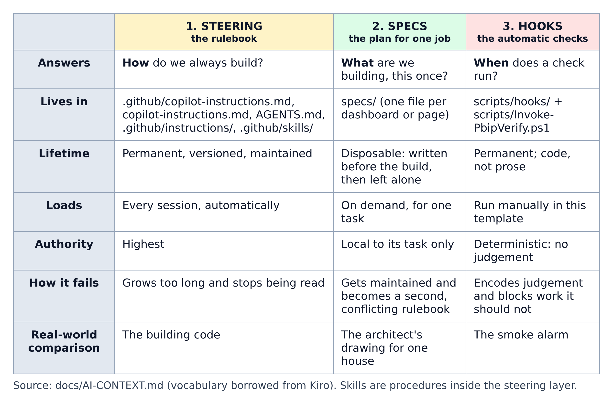
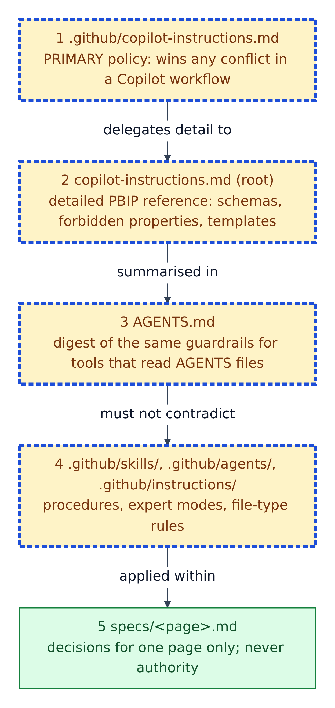
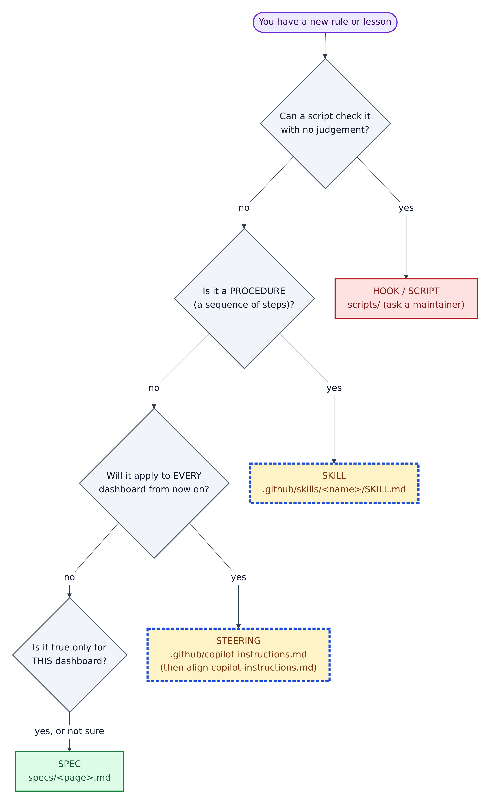
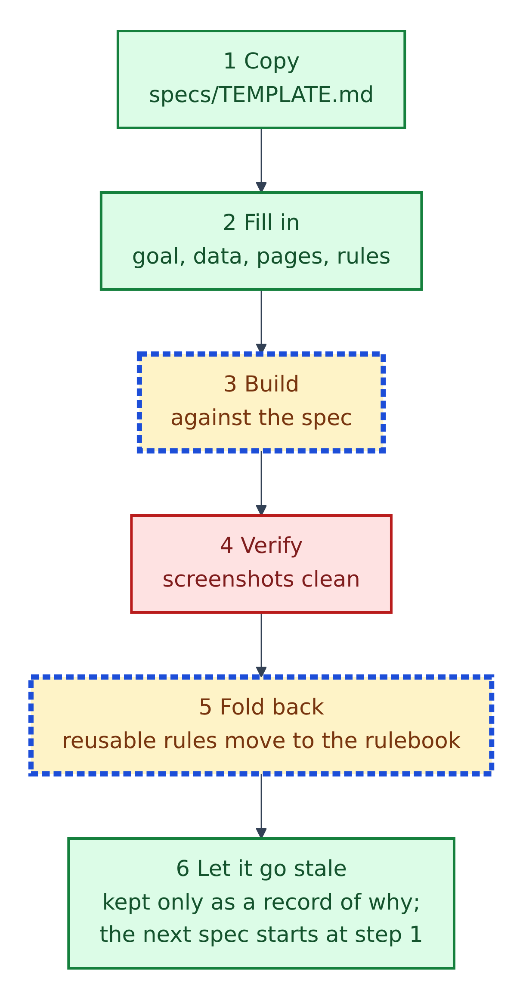

# 06. Rule layers: steering, specs, hooks, skills, and "who wins"

**Figure 6.1 — The three layers.** `docs/AI-CONTEXT.md` explains that this repository deliberately keeps three kinds of guidance apart, and why.

Walkthrough of Figure 6.1:

1. **Steering — the rulebook.** It answers *how* we always build. It lives in `.github/copilot-instructions.md`, `copilot-instructions.md`, `AGENTS.md`, `.github/instructions/` and `.github/skills/`. It is permanent, loaded every session, and has the highest authority. Real-world comparison: the building code.
2. **Specs — the plan for one job.** They answer *what* we are building, this once. One file per dashboard or page in `specs/`. They are written before the build, then left alone. Comparison: the architect's drawing for one house.
3. **Hooks — the automatic checks.** They answer *when* a check runs. They live in `scripts/hooks/` plus `scripts/Invoke-PbipVerify.ps1`. They are code, not prose, and make no judgement calls. Comparison: a smoke alarm.
4. **How each one fails** is the reason they are kept apart: a rulebook that keeps growing stops being read; a spec that keeps being updated turns into a second rulebook that contradicts the first; a hook that tries to make judgement calls blocks work it should not.

The README also lists the same ideas as five "context and execution layers": repository policy, scoped instructions, skills, specs, and validation wrappers. That is the same picture with steering split into three parts.

---

## Who wins when rules disagree

**Figure 6.2 — The precedence ladder.** The higher box wins any conflict. Read top to bottom.

Walkthrough of Figure 6.2:

1. **`.github/copilot-instructions.md`** is the primary policy for GitHub Copilot work. The README calls it the "Final Boss": "If there is any conflict … follow `.github/copilot-instructions.md`."
2. **`copilot-instructions.md` (root)** holds the detailed technical reference: exact file schemas, forbidden properties, JSON templates, the SVG measure pattern and the Python build-script pattern. The primary file delegates this detail to it.
3. **`AGENTS.md`** repeats the same guardrails for tools that read `AGENTS.md` files.
4. **Skills, expert modes and scoped instruction files** apply procedures and topic rules. They must not contradict the files above.
5. **Specs** record decisions for one page only. `specs/README.md` is clear that a spec is "never" authority.

One wrinkle: the three expert-mode files in `.github/agents/` and the `powerbi-dashboard-header` skill say the *root* `copilot-instructions.md` is "the final authority". Section 16 explains this gap and how to fix it.

## Which layer does a new rule belong to?

**Figure 6.3 — Where to put a new rule.** Start at the top and answer each question. This tree follows the four questions at the end of `docs/AI-CONTEXT.md`.

Walkthrough of Figure 6.3:

1. **Can a script check it with no judgement?** Then it should be a hook or script: "If a machine can check it, do not spend context asking an agent to remember it." Ask a maintainer, because scripts are Red.
2. **Is it a procedure**, a sequence of steps someone follows? Then it is a skill: `.github/skills/<name>/SKILL.md`. The skill's `description` line is what makes the agent pick it up.
3. **Will it apply to every dashboard from now on?** Then it is steering: add it to `.github/copilot-instructions.md`, then keep `copilot-instructions.md` in step.
4. **Is it true only for this dashboard**, or are you unsure? Put it in the spec.

## The life of a spec

**Figure 6.4 — The spec lifecycle**, from `specs/README.md`.

Walkthrough of Figure 6.4:

1. **Copy** `specs/TEMPLATE.md` to `specs/<dashboard-or-page-name>.md` (lower-case words joined by hyphens).
2. **Fill in** the eight sections: goal, data required, pages, rules that apply, build tasks, definition of done, open questions, fold-back.
3. **Build** against the spec.
4. **Verify** that every page renders cleanly.
5. **Fold back:** move any rule that will matter for the next dashboard into the rulebook. The worked example `specs/EXAMPLE-sales-overview.md` folded back two rules: visuals must sit at least 30 pixels below their card title (`card_y + 30`), and a visual labelled "Top 10" must really be filtered to 10.
6. **Let it go stale.** Keep the spec as a record of *why*, but do not keep updating it. The next dashboard starts with a fresh spec at step 1.

**When a spec is required** (`specs/README.md`): a new dashboard or page; a new fact table or shared set of measures; any rebuild that changes a page's data. **Not required** for a colour tweak, a label fix or a measure rename.

**How specs differ from `tests/prompts/`:** test prompts are standing instructions reused unchanged ("execute the instructions in `PowerBI_Test.md` exactly"). A spec is written once for one deliverable.

## Hooks in plain words

A **hook** is a small script that runs at a fixed moment, like a smoke alarm that checks the air every time a door opens. This repository has four, in `scripts/hooks/`. The README says they are run manually in this template, and all of them **fail open**: if anything unexpected happens, they let you carry on rather than lock you out.

| Hook script | Moment | What it does |
|---|---|---|
| `pbip-session-brief.ps1` | Start of a session | Prints the guardrails and whether the Desktop Bridge is up |
| `pbip-write-guard.ps1` | Before a file is written | Blocks writes to `Proposals/`, `**/.pbi/`, `tests/screenshots/`, `.github/.pbip-state/` |
| `pbip-validate-hook.ps1` | After a file is written | Checks that one file: JSON parses, filter expressions are well formed, TMDL has no BOM, no `//` comments, no measure/column name clash |
| `pbip-stop-hook.ps1` | Before a turn finishes | Runs the verify loop if anything changed, and makes the agent review the screenshots |

`docs/AI-CONTEXT.md` adds an honest limit: the write guard only sees the agent's file-writing tools, so commands typed in a shell can bypass it. "It is a guardrail, not a sandbox."
