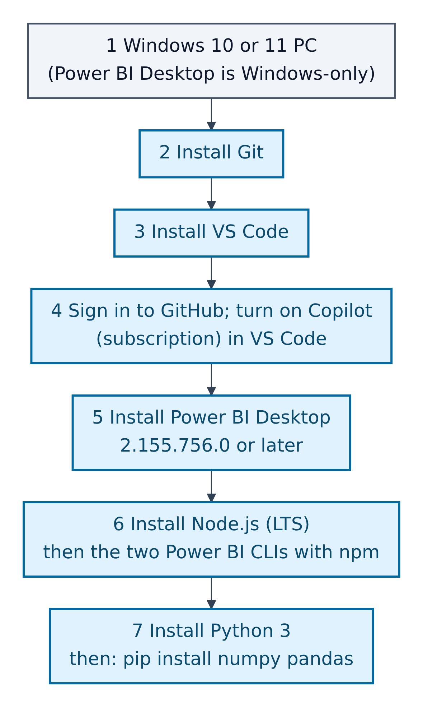
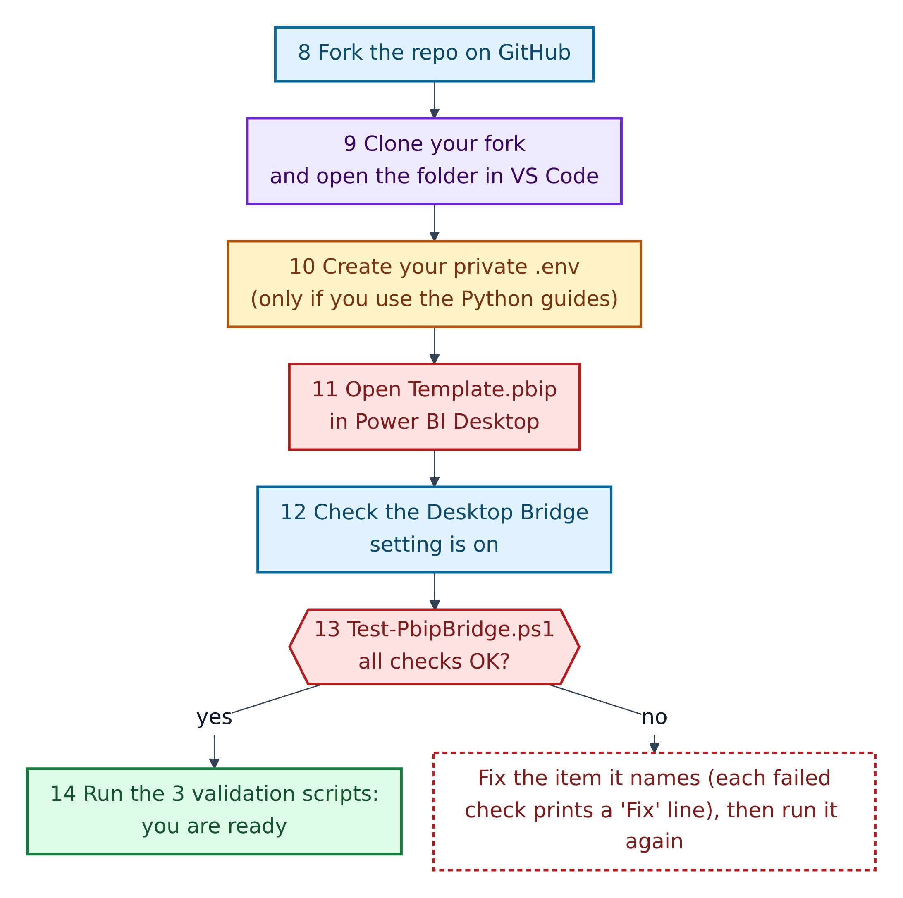
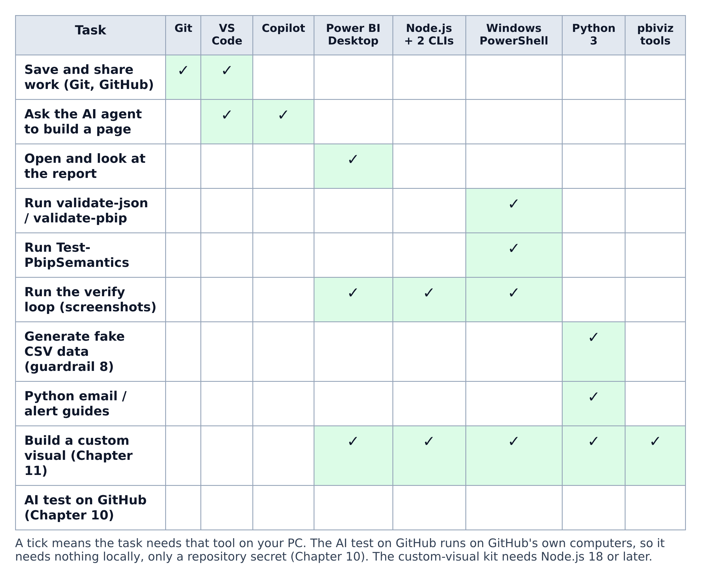
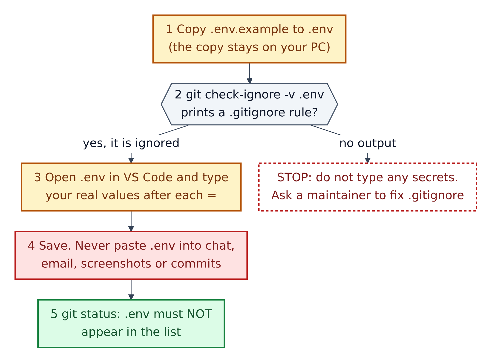

# 6. Set up your computer

You need Windows: Microsoft lists only Windows ("Windows 10 or Windows Server 2016 or later") for Power BI Desktop, and the scripts target Windows PowerShell 5.1, which comes with Windows.



**Figure 6.1 — Install the tools, once per machine.**

1. A Windows 10 or 11 PC.
2. Git.
3. VS Code (Git must be installed separately; VS Code uses it).
4. Sign in to GitHub in VS Code and turn on Copilot (needs a Copilot subscription).
5. Power BI Desktop **2.155.756.0 or later**. The README says older builds have no Desktop Bridge.
6. Node.js (LTS), then the two Power BI CLIs with npm.
7. Python 3, then `pip install numpy pandas` (guardrail 8; no virtual environment needed).



**Figure 6.2 — Get the repo and prove the setup works.**

8. Fork `GibbonGambits/PGE-PBIP-Template` on GitHub.
9. Clone your fork and open the folder in VS Code.
10. Create your private `.env` file, only if you'll use the Python guides (Figure 6.4).
11. Open `Template.pbip` in Power BI Desktop.
12. Check the Desktop Bridge setting is on (see the note below).
13. Run the preflight `scripts\Test-PbipBridge.ps1`. Each failed check prints a "Fix" line; do it and rerun.
14. Run the three validators. You're ready.

> **Where's the Desktop Bridge setting?** Microsoft's page "What is the Power BI Desktop Bridge?" says *File > Options and settings > Options > **Security** > Desktop Bridge*, "Enable external tool access to Power BI Desktop through secure local APIs", and that "this setting is on by default". The repo's README and `copilot-instructions.md` say **Preview features**. Look under Security first. (Gap G12 in Chapter 14.)

## Which tool you need for what



**Figure 6.3 — Tools by task.** A tick means you need that tool installed.

1. Git and VS Code are enough to save and share work.
2. Copilot is needed to have the agent build pages.
3. The three validators need only Windows PowerShell.
4. The verify loop needs Power BI Desktop, Node.js with the two CLIs, and PowerShell.
5. Python is for fake data and the Python guides.
6. Custom visuals need everything plus the `pbiviz` tools (Node.js 18 or later).
7. The AI test on GitHub runs on GitHub's computers; you only add a secret.

## Commands

Run these in a PowerShell terminal in the repo folder (VS Code: *Terminal > New Terminal*).

```powershell
git --version
node --version
npm install -g @microsoft/powerbi-desktop-bridge-cli@latest
npm install -g @microsoft/powerbi-report-authoring-cli@latest
powerbi-desktop --version
powerbi-report-author --version
pip install numpy pandas
```

For the Python guides, also `pip install python-dotenv pyodbc`. For custom visuals, `npm i -g powerbi-visuals-tools`.

**Copilot CLI and the Fabric skills (optional).** The README asks for a one-time step in GitHub Copilot CLI. GitHub's install page offers `winget install GitHub.Copilot` (it needs PowerShell 6 or later on Windows, or use npm with Node.js 22+). Then, inside Copilot CLI:

```text
/plugin marketplace add microsoft/skills-for-fabric
/plugin install powerbi-authoring@fabric-collection
/skills list
```

**Prove it works:**

```powershell
powershell -NoProfile -File scripts\Test-PbipBridge.ps1
powershell -NoProfile -File scripts\validate-json.ps1
powershell -NoProfile -File scripts\validate-pbip.ps1
powershell -NoProfile -File scripts\Test-PbipSemantics.ps1
```

The preflight checks eight things: the project is found, Power BI is new enough, both CLIs are on your PATH, the bridge pipe exists, a running Power BI has *this* project open, the semantic checks are clean, and the report files validate.

## Create your private `.env` safely



**Figure 6.4 — Creating `.env` without leaking secrets.** A `.env` file holds `NAME=value` settings such as passwords. It must never leave your machine.

1. Copy the example: `Copy-Item .env.example .env`. The example has only names (`DB_SERVER`, `DB_NAME`, `DB_USER`, `DB_PASSWORD`, `DB_DRIVER`, `SMTP_EMAIL`, `SMTP_PASSWORD`).
2. Prove Git ignores it: `git check-ignore -v .env` should print a rule such as `.gitignore:4:.env`. If it prints nothing, stop.
3. Type your real values after each `=`. Never put real values in `.env.example`; that file is in Git.
4. Never paste `.env` into a chat, email, screenshot or pull request.
5. Check `git status`: `.env` must not appear.

The Python guides load it with `python-dotenv` (`load_dotenv()`), then read `os.environ['DB_SERVER']` and so on. GitHub automation never sees your `.env`; it uses repository **secrets** instead (Chapter 10).
