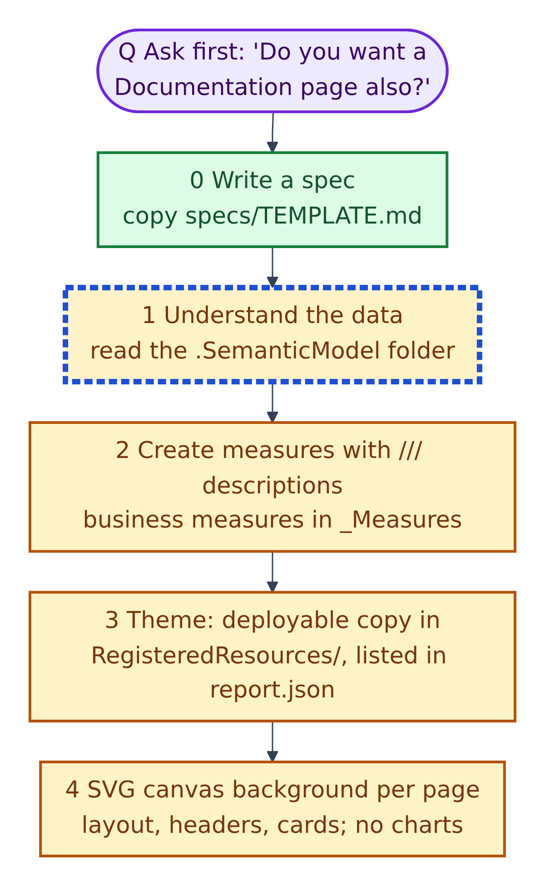
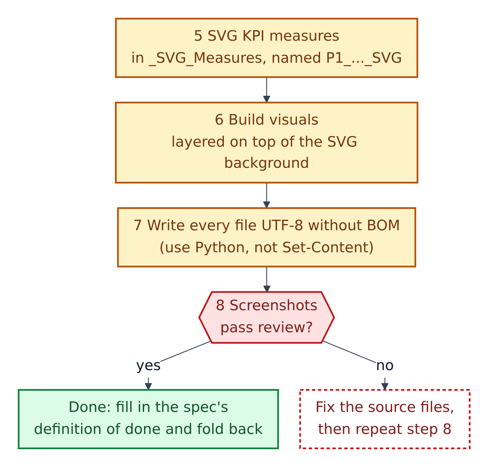
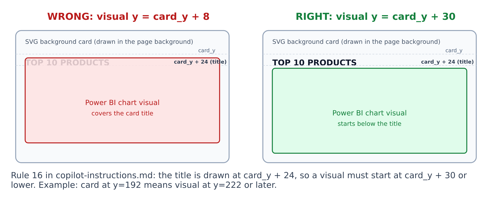
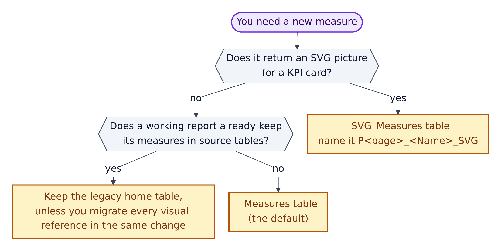
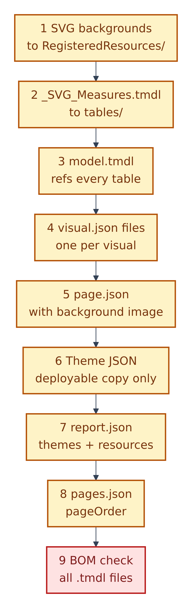

# 7. Task: build a dashboard page

This follows the "Dashboard Creation Steps" in `copilot-instructions.md`. Normally the agent does the steps; you write the spec and review.

**Figure 7.1 — From question to background.**

- **Q. Ask first.** On a first request the agent must ask: "Do you want a Documentation page also?" If yes, it adds a `Documentation` page whose background summarises the project.

0. **Write a spec.** Decisions "are cheap to change in a spec and expensive to change in generated PBIR JSON."
1. **Understand the data:** read the model's tables, columns, relationships and measures.
2. **Create measures** with a `///` description. Business measures go in `_Measures`.
3. **Register the theme:** the deployable theme file goes in `RegisteredResources/` and is listed in `report.json` (Chapter 9).
4. **Create an SVG background per page.** SVG is a text-based image format. The background draws the layout, card boxes and card titles, but no charts.

**Figure 7.2 — From measures to proof.**

5. **SVG KPI measures** go in `_SVG_Measures`, named by page: `P1_Sales_KPI_SVG`. (KPI: a key performance indicator, one headline number.)
6. **Build the visuals** on top of the background.
7. **Write every file as UTF-8 without a BOM.** The rulebook says use Python, `open(f, 'w', encoding='utf-8')`.
8. **Screenshots pass review?** Then tick the spec's definition of done. If not, fix the source and repeat step 8.

## The most common layout bug

**Figure 7.3 — Keep visuals below the card title.**

1. The SVG background draws each card's title at `card_y + 24` pixels.
2. A Power BI visual sits on top. If its top edge is too high, it covers the title.
3. Rule 16 in `copilot-instructions.md`: put the visual at `card_y + 30` or lower. Card at `y=192` → visual at `y=222` or later.

`specs/TEMPLATE.md` calls this "the single most common rendering defect in this template", and no JSON check can see it. Because titles come from the background, visuals have no title, background, border or shadow of their own. That default is called **SVG-header mode**; giving visuals their own titles ("visual-title mode") needs an exception in the spec.

## Where does a new measure go?

**Figure 7.4 — Choosing a measure's table.**

1. Returns an SVG picture for a KPI card? `_SVG_Measures`, named `P<page>_<Name>_SVG`.
2. An existing report already keeps measures in source tables (e.g. `Fact-MaterialMaster`)? Leave them there ("legacy-safe mode") unless you move every visual reference in the same change.
3. Otherwise: `_Measures`. If it doesn't exist yet, create it as a one-row placeholder table. The rulebook writes `_Measures = BLANK{}`; the correct DAX, which it uses for `_SVG_Measures`, is `{ BLANK() }` (gap G7).

## The Python build-script order

**Figure 7.5 — Nine steps for one build script.** `copilot-instructions.md` recommends a single Python script that writes everything.

1. SVG backgrounds into `RegisteredResources/`.
2. `_SVG_Measures.tmdl` into `tables/`.
3. `model.tmdl`, referencing every table.
4. Each `visual.json`.
5. Each `page.json`, with its background.
6. The deployable theme JSON.
7. `report.json`: themes and resources.
8. `pages.json`: page order.
9. A final check that no `.tmdl` file has a BOM.

## House style for visuals

`copilot-instructions.md` lists 16 formatting rules. The short version:

| Rule | Meaning |
|---|---|
| Number formats | Whole numbers by default; decimals, currency or percent when justified; thousand separators |
| Names | No "Sum of", no underscores in headers or tooltips |
| Data labels | On for every chart; full numbers, not K/M, unless the spec says so |
| Sort | Descending by value; months Jan→Dec by a month-number column |
| Chrome | No visual background, border, shadow or title |
| Axes | No axis titles; value axis hidden; category axis shown |
| Top N | If the SVG label says "Top 10", filter the visual to 10 |

The same file has JSON templates for bar, line, donut and table visuals, and a list of **forbidden properties** that make Power BI reject a file, e.g. `"filters": []` at the top of a visual, `"selector": null`, or `sort` inside `visual` (use `query.sortDefinition`).

**SVG KPI cards** are image visuals with `sourceType = 'imageData'` and the measure in `sourceField`. The measure returns text starting `data:image/svg+xml;utf8,<svg...` (never base64), uses `rgb(...)` or `#HEX` colours, Segoe UI, `INT()` for positions, and no headings: the heading is on the background card.

## Definition of done

From `specs/README.md`, a page is done only when:

- [ ] The three validators pass.
- [ ] The project opens in Power BI Desktop with no error dialog (the window title shows the project, not *Untitled*).
- [ ] `powerbi-desktop status` reports the project path.
- [ ] Every page screenshot has been reviewed with the `powerbi-visual-verify` skill.
- [ ] No visual covers its card title; no cut-off labels; no blank charts.
- [ ] Findings are reported by page display name.

If you said yes to a Documentation page, it follows the pattern in `copilot-instructions.md` (816 × 2740 pixels, actual size, background `#FBF7F2`); the prompt `tests/prompts/PBIP_Documentation_Page.md` builds it.
