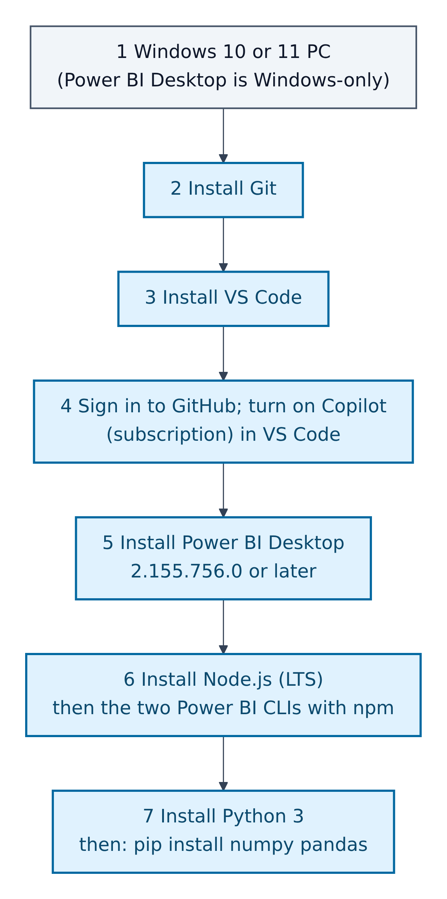
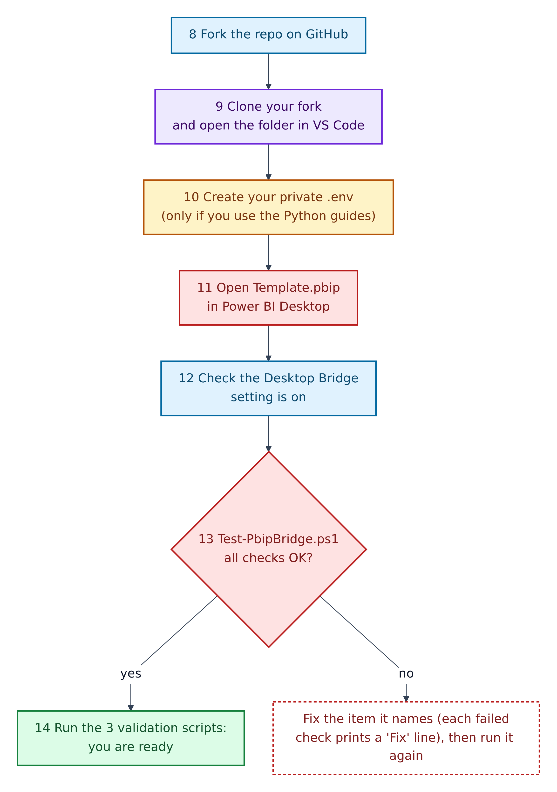
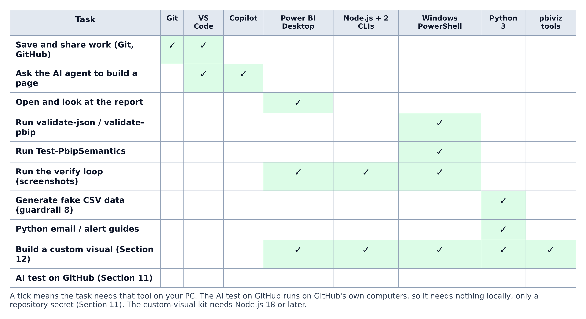
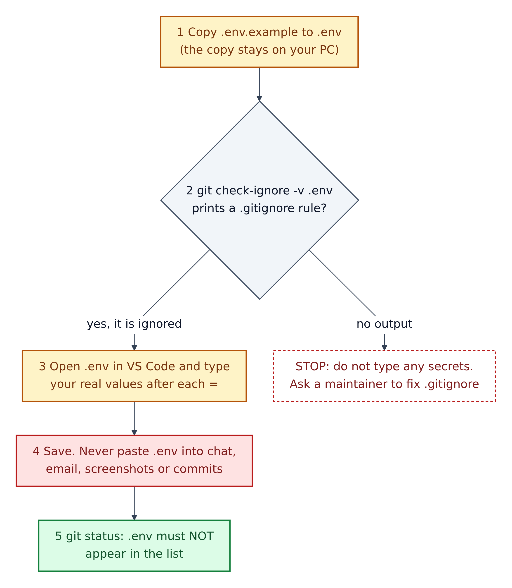

# 07. Local setup checklist



**Figure 7.1 — Setup, part 1: install the tools.** Do these once per computer, top to bottom.

Walkthrough of Figure 7.1:

1. **A Windows 10 or 11 computer.** Microsoft lists only Windows ("Windows 10 or Windows Server 2016 or later") for Power BI Desktop, and every PowerShell script here targets Windows PowerShell 5.1, which is built into Windows.
2. **Install Git**, the version-history tool.
3. **Install VS Code**, the editor. It has Git built in, but Git itself must be installed separately (step 2).
4. **Sign in to GitHub and turn on GitHub Copilot** in VS Code. Copilot needs a GitHub Copilot subscription.
5. **Install Power BI Desktop 2.155.756.0 or later.** The README says older builds have no Desktop Bridge. Use the Microsoft Store or Microsoft's Download Center; Microsoft recommends the 64-bit version.
6. **Install Node.js** (the current LTS, "long-term support", version), then the two Power BI command-line tools with npm (Node's package installer).
7. **Install Python 3**, then the two libraries guardrail 8 asks for: numpy and pandas. No virtual environment is needed, according to the guardrail.



**Figure 7.2 — Setup, part 2: get the repository and prove your setup works.** Continues from step 7.

Walkthrough of Figure 7.2:

8. **Fork** `GibbonGambits/PGE-PBIP-Template` on GitHub (the *Fork* button, top right of the repository page).
9. **Clone your fork** and open the whole folder in VS Code.
10. **Create your private `.env` file**, but only if you will use the Python email and alert guides. Figure 7.4 shows the safe way.
11. **Open `Template.pbip`** in Power BI Desktop.
12. **Check that the Desktop Bridge setting is on** (see the box below).
13. **Run the preflight**, `scripts\Test-PbipBridge.ps1`. If any check fails, it prints a `Fix` line; do that and run it again.
14. **Run the three validation scripts.** When they pass, you are ready.

> **Where is the Desktop Bridge setting?** Microsoft's current page, "What is the Power BI Desktop Bridge?", says: *File > Options and settings > Options > **Security** > Desktop Bridge*, then "Enable external tool access to Power BI Desktop through secure local APIs", and that "this setting is on by default". This repository's README and `copilot-instructions.md` place the same checkbox under **Preview features**. Look in Security first; if your build shows it under Preview features, use that. Section 16 lists this as a documentation gap.

---

## Which tool is needed for what



**Figure 7.3 — Tool and task matrix.** A tick means the task needs that tool on your computer.

Walkthrough of Figure 7.3:

1. **Git + VS Code** are enough to save and share work.
2. **VS Code + Copilot** are what you need to ask an agent to build a page.
3. **Power BI Desktop** is needed to look at the report.
4. **Windows PowerShell** alone runs the three validation scripts. They need no other tools.
5. **The verify loop** needs Power BI Desktop, Node.js with the two CLIs, and PowerShell together.
6. **Python 3** is needed for fake data (guardrail 8) and for the Python email and alert guides.
7. **A custom visual** needs everything plus the `pbiviz` tools (Section 12). The custom-visual skill asks for Node.js 18 or later.
8. **The AI test on GitHub** runs on GitHub's own computers, so it needs nothing on yours, only a repository secret (Section 11).

## The checklist, with commands

Tick each box as you go. Commands are for **Windows PowerShell**, run from the repository folder (VS Code: *Terminal > New Terminal*).

**Tools**

- [ ] **Git** installed. Check: `git --version`
- [ ] **VS Code** installed, with the GitHub Copilot extension signed in.
- [ ] **Power BI Desktop** 2.155.756.0 or later. Check in Desktop: *Help > About*.
- [ ] **Node.js** installed. Check: `node --version`
- [ ] **The two Power BI CLIs**, exactly as the README gives them:

```powershell
npm install -g @microsoft/powerbi-desktop-bridge-cli@latest
```

```powershell
npm install -g @microsoft/powerbi-report-authoring-cli@latest
```

- [ ] Check them: `powerbi-desktop --version` and `powerbi-report-author --version` (the same check `Test-PbipBridge.ps1` runs).
- [ ] **Python 3** with numpy and pandas:

```powershell
pip install numpy pandas
```

- [ ] **Optional, for the Python guides:** `pip install python-dotenv pyodbc` (the libraries `python/db_alerts/ALERT_EMAIL_INSTRUCTIONS.md` lists, along with pandas).
- [ ] **Optional, for custom visuals:** `npm i -g powerbi-visuals-tools` (Section 12).

**Optional: GitHub Copilot CLI and the Fabric skills.** The README asks for a one-time step in **GitHub Copilot CLI** (Copilot in a terminal window). GitHub's install page offers, for example:

```powershell
winget install GitHub.Copilot
```

GitHub notes Copilot CLI needs PowerShell 6 or later on Windows (the newer, separately installed "PowerShell 7"), or Node.js 22+ for the npm install route. Then, inside Copilot CLI, type the README's commands:

```text
/plugin marketplace add microsoft/skills-for-fabric
/plugin install powerbi-authoring@fabric-collection
/skills list
```

The `microsoft/skills-for-fabric` repository confirms the first two commands. The README says `/skills list` should then show `powerbi-report-cli` and `semantic-model-authoring`.

**The repository**

- [ ] Forked on GitHub, cloned, and opened as a folder in VS Code.
- [ ] Preflight passes:

```powershell
powershell -NoProfile -File scripts\Test-PbipBridge.ps1
```

It checks eight things: the PBIP project is found; Power BI Desktop is new enough; both CLIs are on the PATH (the list of folders Windows searches for commands); the bridge pipe exists; a running Desktop has *this* project open; the semantic checks are clean; the report files validate.

- [ ] The three validators pass:

```powershell
powershell -NoProfile -File scripts\validate-json.ps1
```

```powershell
powershell -NoProfile -File scripts\validate-pbip.ps1
```

```powershell
powershell -NoProfile -File scripts\Test-PbipSemantics.ps1
```

## Creating your private `.env` file safely



**Figure 7.4 — Creating `.env` without exposing secrets.** A **`.env` file** is a plain text file of `NAME=value` lines that programs read for settings such as passwords. It must never leave your computer.

Walkthrough of Figure 7.4:

1. **Copy the example.** In PowerShell, from the repository folder:

   ```powershell
   Copy-Item .env.example .env
   ```

   `.env.example` contains only names: `DB_SERVER`, `DB_NAME`, `DB_USER`, `DB_PASSWORD`, `DB_DRIVER`, `SMTP_EMAIL`, `SMTP_PASSWORD`. Its first lines say: "Copy this file to .env and fill in real values. .env is gitignored - never commit real credentials."

2. **Prove Git will ignore it** before you type any secret:

   ```powershell
   git check-ignore -v .env
   ```

   It should print the `.gitignore` line that matches, such as `.gitignore:4:.env  .env`. This repository's `.gitignore` ignores `.env` and every `.env.*` file except `.env.example`. **If nothing is printed, stop** and ask a maintainer.

3. **Type your real values** after each `=` in VS Code. Never edit `.env.example` with real values: it *is* saved in Git.
4. **Save, and keep it private.** Never paste `.env` into a chat (including an AI chat), an email, a screenshot, an issue or a pull request.
5. **Double-check** with `git status`. `.env` must not appear in the list of changed files.

**How the values are used:** the Python guides load the file with the `python-dotenv` library (`load_dotenv()`), then read each value with `os.environ['DB_SERVER']` and so on. Nothing else in the repository reads `.env`.

**Secrets for GitHub are different.** Automated runs on GitHub never see your `.env`. They use **repository secrets**, set in the repository's *Settings > Secrets and variables > Actions*, and read in workflows as `${{ secrets.NAME }}`. Section 11 lists the ones this repository uses.
