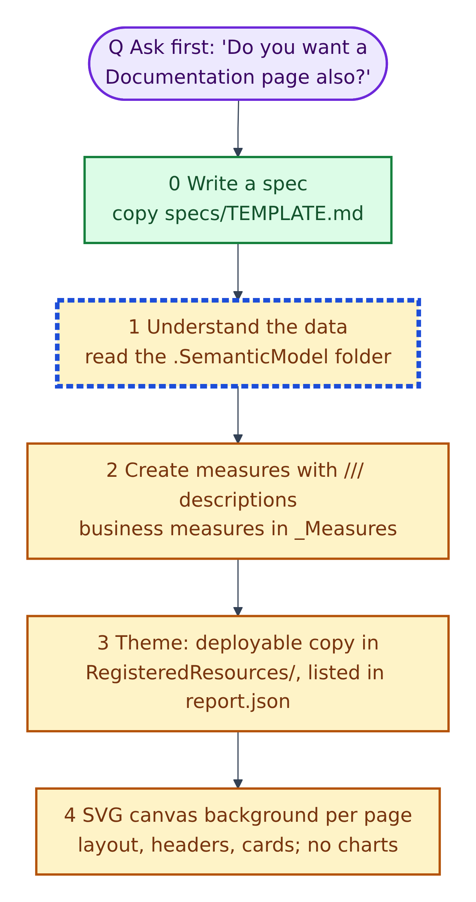
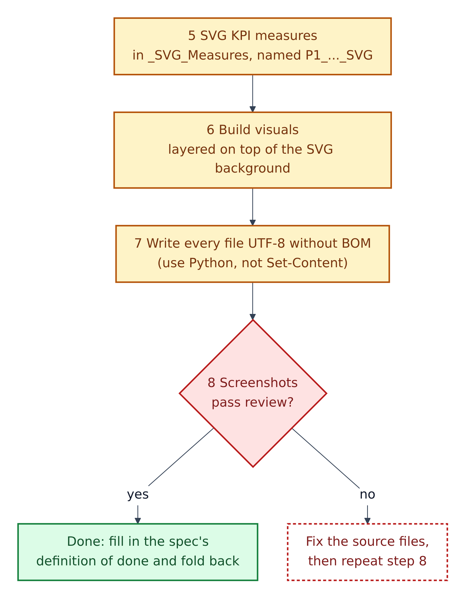
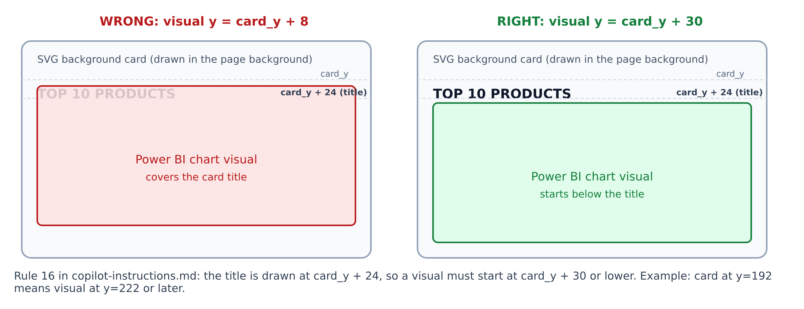
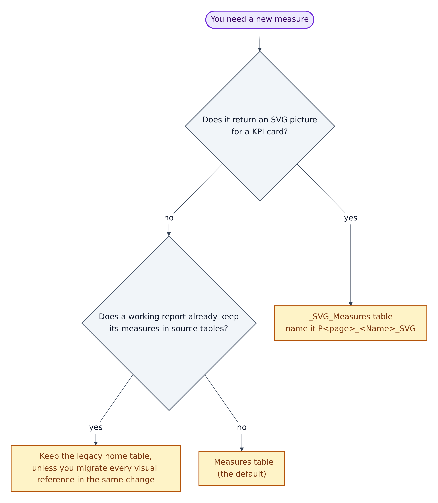
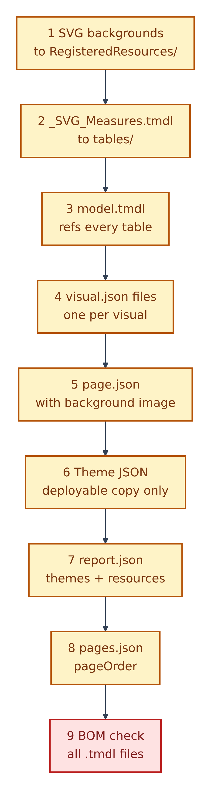

# 08. Building a dashboard page from start to finish

**Figure 8.1 — Build steps, part 1: from question to background.** These are the "Dashboard Creation Steps" in `copilot-instructions.md`, plus the question the rulebook says to ask first.

Walkthrough of Figure 8.1:

- **Q. Ask first.** Before generating pages on a first request, the agent must ask: "Do you want a Documentation page also?" If yes, it adds a page called `Documentation` whose background is an SVG summary of the project (see "The Documentation page" below). If no, it does not ask again in that conversation.

0. **Write a spec.** Copy `specs/TEMPLATE.md` to `specs/<name>.md` and fill it in (Section 06). "Decisions … are cheap to change in a spec and expensive to change in generated PBIR JSON."
1. **Understand the data.** Read the `.SemanticModel` folder: tables, columns, relationships, measures. This step is Amber with a blue outline because the agent does it, using the rule files.
2. **Create measures.** Give every measure a `///` description line. Business measures go in the `_Measures` table, created if missing as a one-row placeholder table. (The rulebook writes this as `_Measures = BLANK{}`; the DAX table syntax it uses for `_SVG_Measures`, `{ BLANK() }`, is the correct form. Section 16 lists this typo.)
3. **Create or register the theme.** The deployable theme file goes in `StaticResources/RegisteredResources/` and is listed in `report.json` (Section 10).
4. **Create an SVG canvas background for each page.** **SVG** (Scalable Vector Graphics) is a text-based picture format. The background holds the layout, headers, card boxes and card titles, but no charts. Comparison: the printed paper form; the charts are the handwriting on it.

**Figure 8.2 — Build steps, part 2: from measures to proof.** Continues from step 4.

Walkthrough of Figure 8.2:

5. **Create SVG KPI measures** in the separate `_SVG_Measures` table, named by page: `P1_Sales_KPI_SVG`, `P2_Profit_KPI_SVG`. A **KPI** (key performance indicator) card shows one headline number.
6. **Build the visuals**, layered on top of the SVG background.
7. **Write every file as UTF-8 without a BOM.** The rulebook says to use Python, `open(f, 'w', encoding='utf-8')`, and never PowerShell's `Set-Content -Encoding UTF8`, which adds a BOM.
8. **Verify what actually rendered** (Section 09). If the screenshots pass, you are done: tick the spec's definition of done and fold back reusable rules. If not, fix the source files and repeat step 8.

---

## How a page is layered

**Figure 8.3 — The single most common layout defect.** Left: wrong. Right: right.

Walkthrough of Figure 8.3:

1. The **SVG background** draws each card's box and title. The title is drawn at `card_y + 24` (24 pixels below the top of the card).
2. A **Power BI visual** sits on top of the background. If its top edge (`y`) is too high, it covers the title.
3. **Rule 16** in `copilot-instructions.md`: set the visual's `y` to at least `card_y + 30`. Example: card at `y=192` → visual at `y=222` or later.
4. `specs/TEMPLATE.md` calls this "the single most common rendering defect in this template", and JSON validation cannot see it. Only a screenshot can.

Because titles come from the background, the default style removes each visual's own title, background, border and shadow. `.github/copilot-instructions.md` calls this **SVG-header mode** (the default). **Visual-title mode** (visuals carry their own titles) is allowed only when the spec records it as an exception.

## Where does a new measure go?

**Figure 8.4 — Choosing a measure's home table** (guardrails 1 and 2, and step 2 of the creation steps).

Walkthrough of Figure 8.4:

1. **Does the measure return an SVG picture for a KPI card?** Then it goes in `_SVG_Measures`, named `P<page number>_<Name>_SVG`.
2. **Otherwise, does an existing working report already keep its measures in source tables** (for example `Fact-MaterialMaster`)? Then keep them there ("legacy-safe mode"), unless you move every visual reference in the same change.
3. **Otherwise**, use `_Measures`, the default.

## The Python build-script order

**Figure 8.5 — The nine-step order for a Python build script.** `copilot-instructions.md` recommends one Python script that writes everything in a single run.

Walkthrough of Figure 8.5:

1. SVG backgrounds → `RegisteredResources/`.
2. `_SVG_Measures.tmdl` → `tables/`.
3. `model.tmdl`, which must reference every table, including `_SVG_Measures`.
4. Each visual's `visual.json`.
5. Each `page.json`, with its background image.
6. The theme JSON (deployable copy only, valid top-level keys only).
7. `report.json`, with `themeCollection` and `resourcePackages`.
8. `pages.json`, with `pageOrder`.
9. A final check that every `.tmdl` file is UTF-8 without a BOM.

The script's helper functions (`write_utf8`, `write_json`, `col_field`, `meas_field`) and the visual schema address (`visualContainer/2.7.0`) are in the same section of `copilot-instructions.md`.

## The formatting house style (summary)

`copilot-instructions.md` lists 16 "General Dashboard Formatting Rules". In plain words:

| Rule | Meaning |
|---|---|
| Sensible number formats | Whole numbers by default; decimals, currency or percent when justified. Thousand separators everywhere. |
| Clean names | No "Sum of", no underscores in tooltips or column headers. |
| Data labels on | Every chart shows its values; full numbers, not K/M, unless the spec says so. |
| Sort | Descending by value, except months: January to December, shown as "Jan", sorted by a month-number column. |
| No chrome | No background, border, shadow or title on any visual (titles are in the SVG). |
| Axes | No axis titles; value axis hidden; category axis shown. |
| "Top N" means it | If an SVG label says "Top 10", the visual must be filtered to the top 10. |
| Position | Visual `y` at least `card_y + 30` (Figure 8.3). |

The same file gives complete JSON templates for bar, line, donut and table visuals, and a section of **forbidden properties** that make Power BI reject a file. Examples: `"filters": []` at the top of a visual; `"selector": null`; a `sort` block inside `visual` (use `query.sortDefinition` instead); `wallpaper` in `page.json`. Never "tidy up" JSON by adding these.

## SVG KPI cards in brief

- They are **image visuals** whose picture comes from a measure: `sourceType = 'imageData'`, with the measure named in `sourceField` (guardrail 7). They have no `query` section.
- The measure returns text that starts with `data:image/svg+xml;utf8,<svg...` (never base64).
- The rulebook suggests five sections inside the DAX: context and timeline; base metrics; derived metrics (maths only); layout and colours; assemble the SVG.
- Colours as `rgb(...)` or `#HEX`, font `Segoe UI`, transparent background, positions wrapped in `INT()`, and no headings inside the picture (the heading is on the background card).

## The Documentation page

If you answer "yes" to the opening question, the page follows the pattern in `copilot-instructions.md`: display name `Documentation`, size 816 × 2740 at actual size, surround colour `#FBF7F2`, and an SVG background that summarises the project inventory, the model, the report, the resource packages and a timestamp. The ready-made prompt `tests/prompts/PBIP_Documentation_Page.md` builds it in seven phases.

## The spec's definition of done

From `specs/README.md` and `specs/TEMPLATE.md`, a page is done only when:

- [ ] `validate-json.ps1`, `validate-pbip.ps1` and `Test-PbipSemantics.ps1` pass.
- [ ] The PBIP opens in Power BI Desktop with no error dialog, and the window title shows the project, not *Untitled*.
- [ ] `powerbi-desktop status` reports the project path.
- [ ] The verify loop has run, and every page screenshot has been reviewed against `.github/skills/powerbi-visual-verify/SKILL.md`.
- [ ] No visual overlaps its card title; no truncated labels; no blank charts.
- [ ] Findings are reported by page display name.
