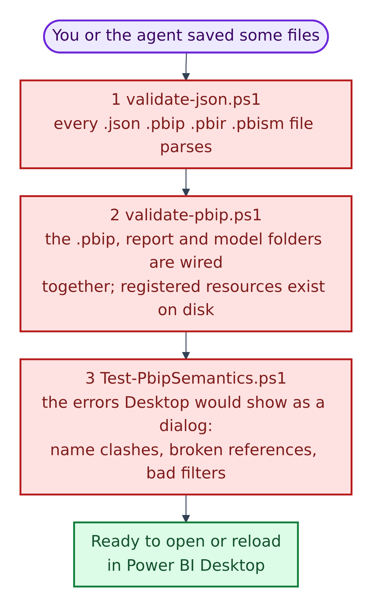
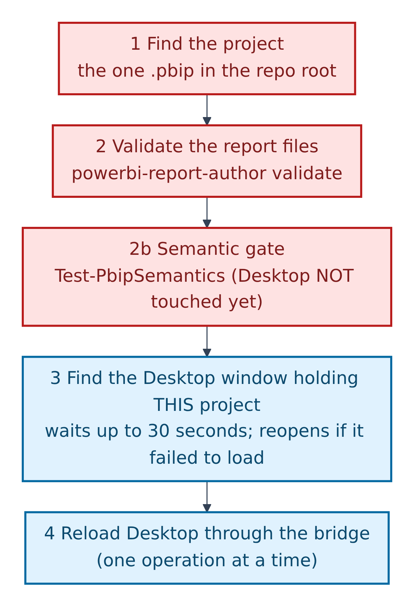
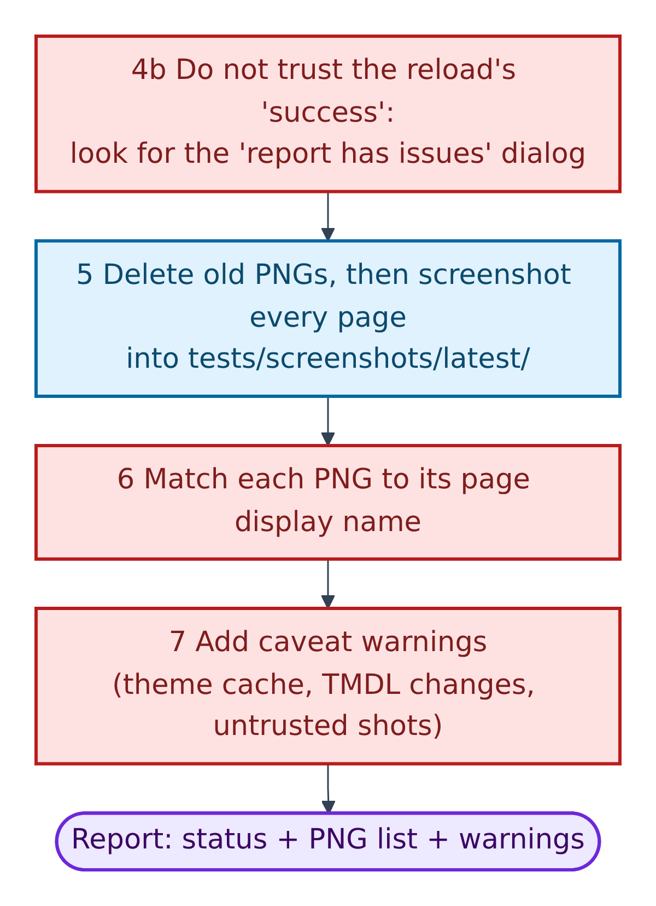
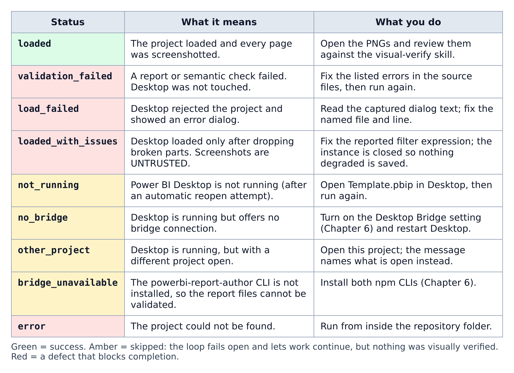
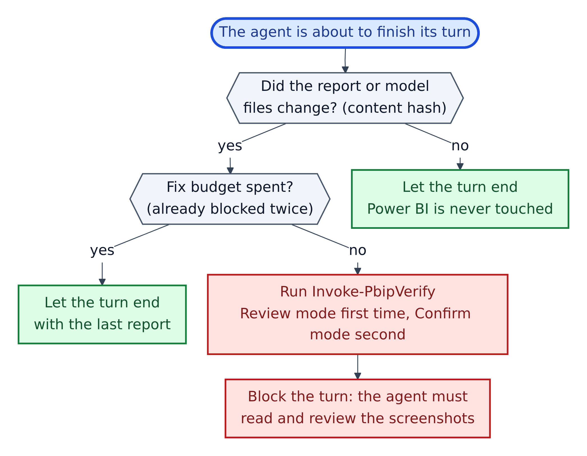
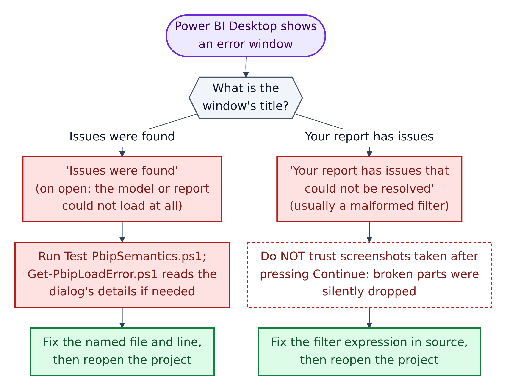

# 8. Task: check your work

Checking happens in two stages: fast text checks that never open Power BI, then the verify loop that screenshots what Power BI actually drew.



**Figure 8.1 — The three validators, cheapest first.** Each runs in seconds with only Windows PowerShell.

1. **`validate-json.ps1`** checks every `.json`, `.pbip`, `.pbir` and `.pbism` file parses. It skips `node_modules`, `dist`, `.tmp`, `.vscode`, `.git`, `package-lock.json`, and `tsconfig.json` (which may contain comments).
2. **`validate-pbip.ps1`** follows the pointer chain from Chapter 1: required files exist, every resource in `report.json` exists on disk, and every custom visual a page uses is registered. Add `-Project <name>` if there's more than one project.
3. **`Test-PbipSemantics.ps1`** finds, in the text, the errors Power BI would show as a pop-up: a measure and column with the same name, duplicate names, a misspelled filter key (it suggests the fix, e.g. `Inn` → `In`), and, once the model is complete, relationships to missing columns, unresolved `'Table'[Column]` references, unregistered resources and duplicate page ids. Add `-Path <file>` to check one file.

```powershell
powershell -NoProfile -File scripts\validate-json.ps1
powershell -NoProfile -File scripts\validate-pbip.ps1
powershell -NoProfile -File scripts\Test-PbipSemantics.ps1
```

`-NoProfile` starts PowerShell without personal start-up settings, so scripts behave the same everywhere.

## The verify loop

The README sums it up: "edit PBIR/TMDL → validate → reload → screenshot every page → review → fix → repeat". The engine is `scripts\Invoke-PbipVerify.ps1`.



**Figure 8.2 — Before anything is drawn.**

1. Find the project: the one `.pbip` in the repo root. Scripts never assume the name `Template`.
2. Validate the report files with `powerbi-report-author validate`.
   - **2b.** Run the semantic checks before Power BI is touched.
3. Find the Power BI window that has *this* project open. Wait up to 30 seconds; if loading failed, capture the error, close that window, and reopen once. It only ever closes a window it started or one stuck on an error.
4. Reload through the bridge. Bridge calls run one at a time; overlapping calls fail with "Cancelled".



**Figure 8.3 — Capture and report.**

- **4b.** Don't trust the reload's "success": `powerbi-desktop reload` reports success even when the "Your report has issues" dialog appears, so the script looks for it.
5. Delete old PNGs, then screenshot every page into `tests/screenshots/latest/` (ignored by Git).
6. Match each PNG to its page display name.
7. Add warnings, e.g. stale theme colours or untrusted screenshots.
- **Result:** a status, the PNG list and the warnings.

```powershell
powershell -NoProfile -File scripts\Invoke-PbipVerify.ps1 -Mode Review
```

Options: `-Mode Confirm` (second pass after a fix), `-NoReopen`, `-LoadTimeoutSeconds 30`, `-Scale 2`.

## Reading the result



**Figure 8.4 — Statuses and what to do.**

1. **Green, `loaded`:** the only success. Now review the PNGs.
2. **Red:** a defect in your files. `loaded_with_issues` is the sneaky one: the page *looks* fine, but broken parts were silently dropped. The script closes that window so the damaged version can't be saved.
3. **Amber:** the loop **failed open**: it couldn't reach Power BI, so it skipped instead of blocking you. Nothing was verified. AGENTS.md says to then "say the report was not visually verified rather than claiming it renders correctly".

## When the loop runs by itself



**Figure 8.5 — `scripts\hooks\pbip-stop-hook.ps1`**, the wrapper that runs when an agent is about to finish.

1. Did anything change? It compares a content hash (a fingerprint of the files). No change means Power BI is never touched.
2. Is the fix budget spent? At most two blocks: "round 1 = review + fix, round 2 = confirmation + report".
3. Otherwise it runs the loop: Review mode first, Confirm mode second.
4. It blocks the turn so the agent must review the screenshots. Its bookkeeping lives in `.github/.pbip-state/` (ignored by Git; don't edit it).

## When Power BI shows an error window



**Figure 8.6 — Two error windows, two fixes.**

1. **"Issues were found"** appears when the project can't load; the window often stays *Untitled*. Run `Test-PbipSemantics.ps1`. If that finds nothing, `Get-PbipLoadError.ps1` reads the dialog through Windows UI Automation, including the "Copy details to clipboard" text that names the file and line.
2. **"Your report has issues that could not be resolved"** usually means one malformed filter. Its list of about 49 issues usually comes from a single bad key. Don't press *Continue* and trust the result: it silently drops the broken parts.
3. Either way, fix the source file, then reopen. Usual causes: a measure missing from TMDL, a resource not registered in `report.json`, a property the schema version doesn't allow, or a BOM.

## Gotchas that make screenshots lie

| Gotcha | What you see | What to do |
|---|---|---|
| Theme cache | Old colours after a theme edit | Rename the theme with a new suffix and update `report.json`, or reopen Power BI |
| Model changes | Stale or missing measure values | Reopen: `powerbi-desktop open "<project>.pbip"` |
| First open | Power BI refuses to load, stays on *Untitled* | Fix the cause; never use *continue with errors* |
| Wrong window | An idle *Untitled* window fails with `REPORT_DIR_REQUIRED` | Open the project there; scripts match by file path |
| Empty visuals on a new project | "Some of the tables have incomplete or no data" | Run `scripts\Invoke-PbipRefresh.ps1`, then save in Power BI |

## Reviewing the PNGs

Use `.github/skills/powerbi-visual-verify/SKILL.md`: score the relevant checklist rows Pass / Needs Work / N/A, cite the visible evidence, fix the **source files, never the image**, and report by **page display name**.
