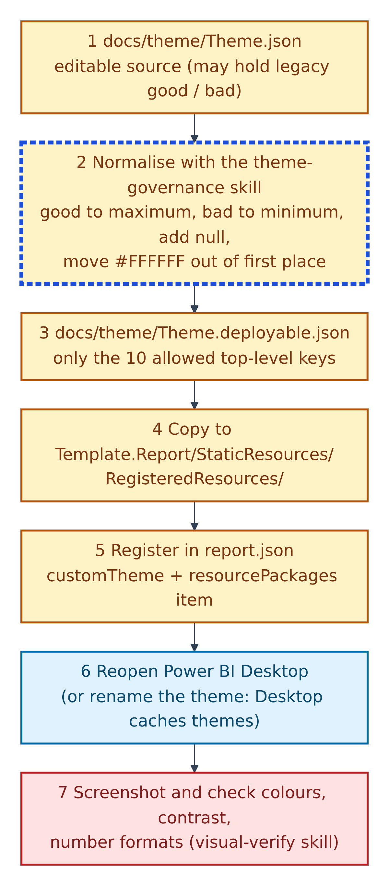
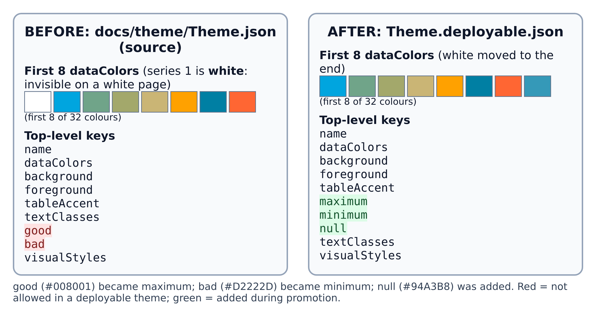
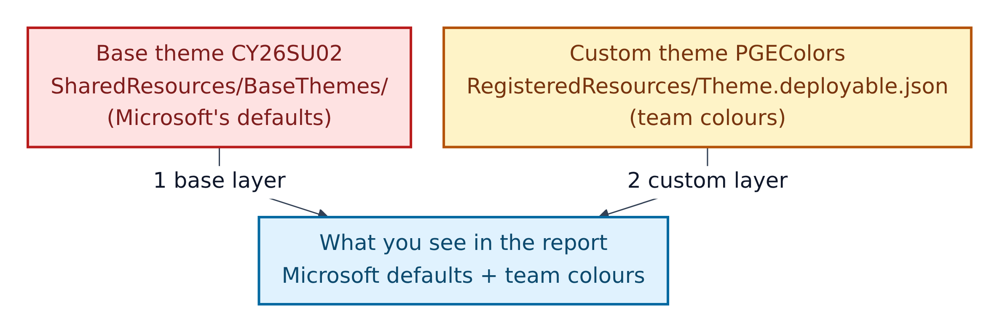

# 9. Task: change the theme

A Power BI **theme** is a JSON file of colours and fonts. Microsoft's docs: report colours "come from data colors in the theme". This repo keeps an editable source file and a cleaned, loadable copy.

**Figure 9.1 — The seven-step theme pipeline.**

1. Edit `docs/theme/Theme.json`, the source theme `PGEColors`. It may contain older keys (`good`, `bad`) that Power BI won't accept.
2. Normalise it with the `powerbi-theme-governance` skill: `good` → `maximum`, `bad` → `minimum`, add `null`, and move white (`#FFFFFF`) out of first place in `dataColors`.
3. The result, `docs/theme/Theme.deployable.json`, may only use ten top-level keys: `name`, `dataColors`, `background`, `foreground`, `tableAccent`, `maximum`, `minimum`, `null`, `textClasses`, `visualStyles`. "Any other key causes import failure."
4. Copy it into `Template.Report/StaticResources/RegisteredResources/`. Today the two copies are identical.
5. Register it in `report.json` under `themeCollection > customTheme` (keep `reportVersionAtImport`) and as a `CustomTheme` item in the `RegisteredResources` package.
6. Reopen Power BI: it caches themes, so a plain reload can show old colours.
7. Screenshot and check: theme applied (checklist row 51), no white-on-white or low contrast (rows 67, 71, 75), consistent number formats (row 72).

## What promotion changed here

**Figure 9.2 — The real before and after.**

1. In the source, the first series colour is white, invisible on a white page. The deployable copy moves it to the end of the 32 colours.
2. `good` (`#008001`) became `maximum`; `bad` (`#D2222D`) became `minimum`; `null` (`#94A3B8`) was added.
3. Everything else is unchanged.

## Two themes at once

**Figure 9.3 — Two layers, both registered in `report.json`.**

1. The base theme `CY26SU02` is Microsoft's file in `SharedResources/BaseThemes/`. Red.
2. The custom theme `PGEColors` is the team's file in `RegisteredResources/`. Amber.
3. The report combines Microsoft's defaults with the team's colours and fonts.

## Do and don't

| Do | Don't |
|---|---|
| Edit colours in `docs/theme/Theme.json` | Register `Theme.json` directly |
| Re-run the promotion rules after every edit | Leave white as the first data colour |
| Keep `reportVersionAtImport` (without it: "Required properties are missing") | Add keys like `visualContainerHeader`, `axisLine` or `gridlines` |
| Reopen Power BI, or rename the theme, before judging colours | Trust colours after a plain reload |

One detail: `docs/theme/Theme.json` starts with a BOM, so Python's `json.load` rejects it unless you open it with `encoding='utf-8-sig'` (gap G14).
