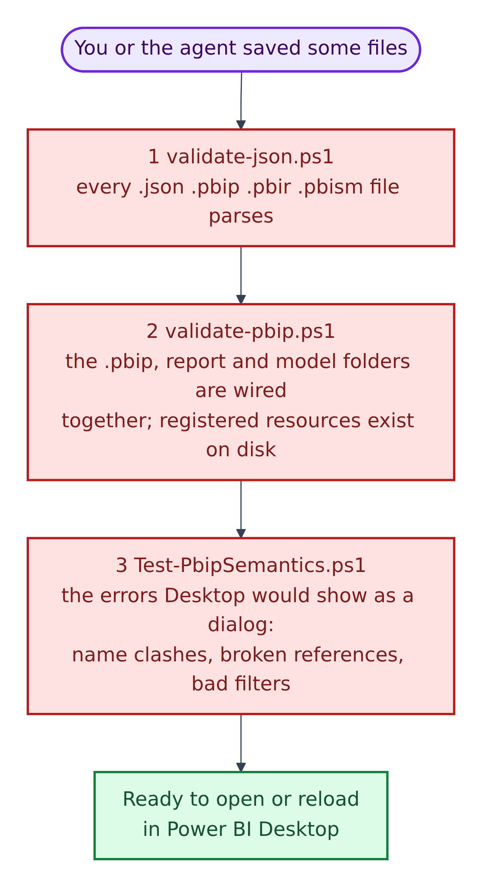
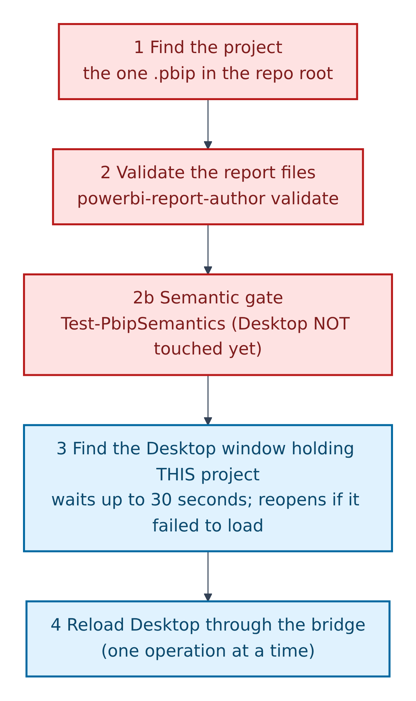
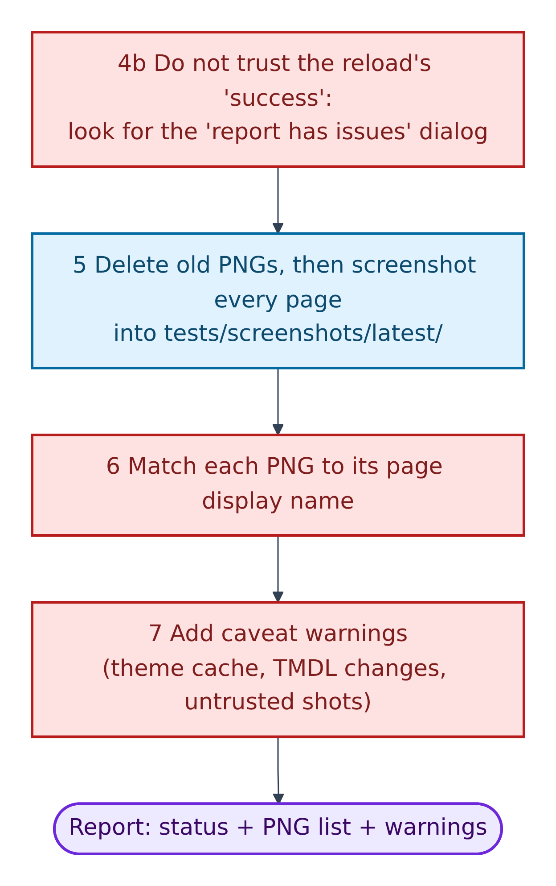
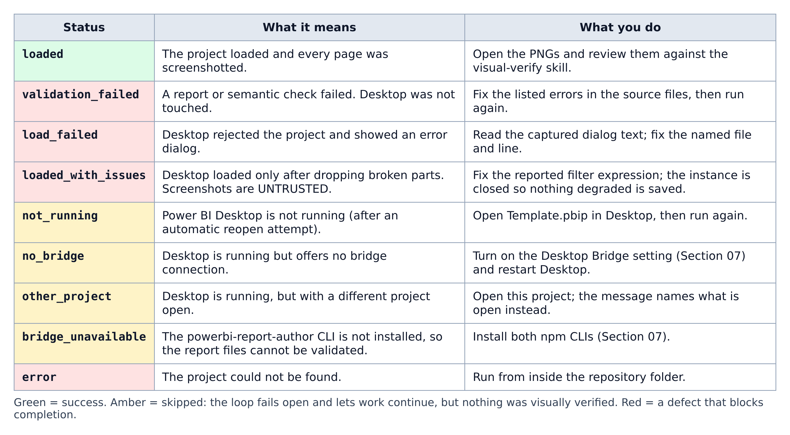
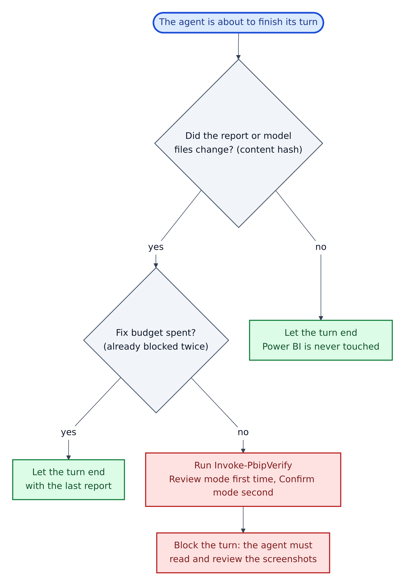
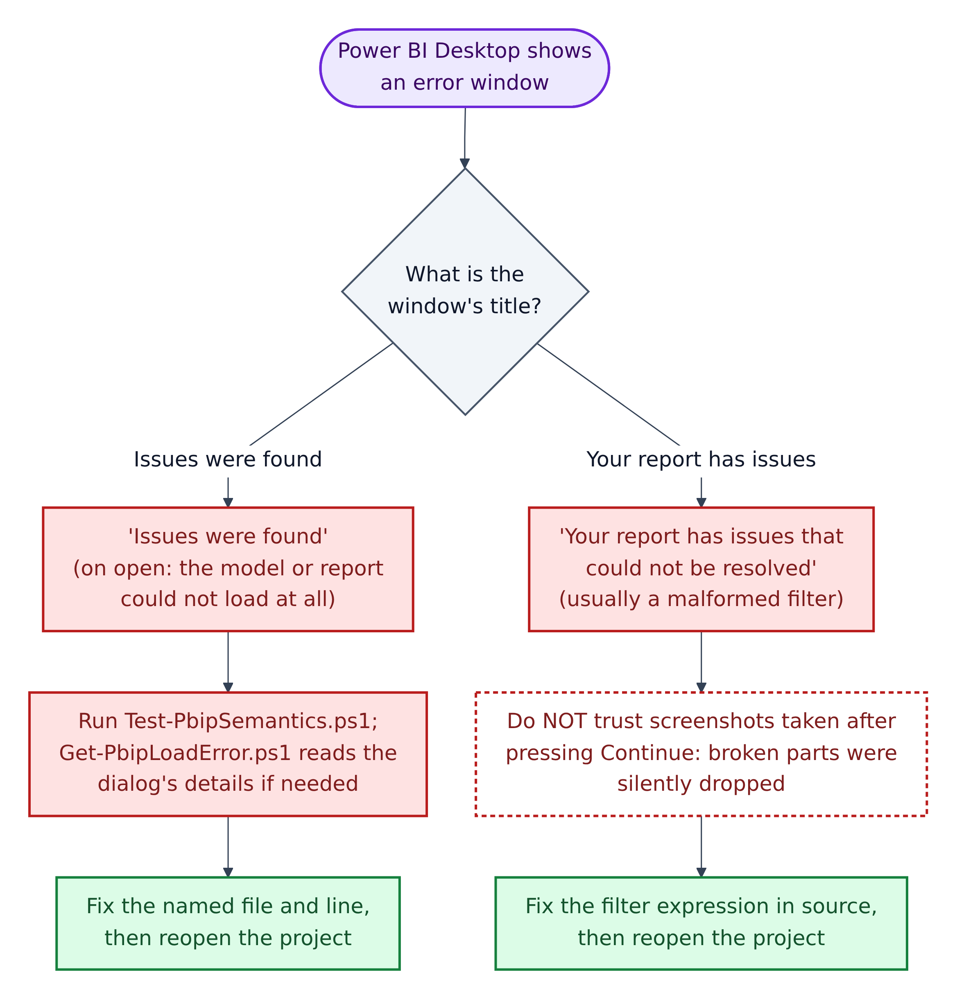

# 09. Checks and the screenshot (verify) loop



**Figure 9.1 — The three validators, cheapest first.** All three run in a few seconds, need only Windows PowerShell, and never open Power BI.

Walkthrough of Figure 9.1:

1. **`validate-json.ps1`** opens every `.json`, `.pbip`, `.pbir` and `.pbism` file and checks it parses. It skips other people's code (`node_modules`, `dist`, `.tmp`, `.vscode`, `.git`) and two files that are allowed to break plain JSON rules (`package-lock.json`, and `tsconfig.json`, which may contain comments).
2. **`validate-pbip.ps1`** follows the pointer chain from Section 02: each `.pbip` → its report folder → `definition.pbir` → the semantic model. It checks the required files exist (`report.json`, `pages.json`, `database.tmdl`, `model.tmdl`), that every resource listed in `report.json` exists on disk, and that every custom visual a page uses is registered. Use `-Project <name>` if the folder holds more than one project.
3. **`Test-PbipSemantics.ps1`** finds, in the text, the errors Power BI Desktop would otherwise show as a pop-up:
   - **checks on one file at a time** (safe to run on every save): a measure and a column with the same name in one table; duplicate column or measure names; a filter whose expression key is misspelled (it suggests the fix, e.g. `Inn` → `In`);
   - **checks across files** (run when the model is complete): measure names unique across the whole model; relationships pointing at tables or columns that exist; every `'Table'[Column]` reference resolves; every resource used is registered; no duplicate page ids.

   Add `-Path <file>` to check one file.
4. **Ready.** Only now is it worth opening or reloading Power BI Desktop.

```powershell
powershell -NoProfile -File scripts\validate-json.ps1
```

```powershell
powershell -NoProfile -File scripts\validate-pbip.ps1
```

```powershell
powershell -NoProfile -File scripts\Test-PbipSemantics.ps1
```

**Why `-NoProfile`?** It starts PowerShell without your personal start-up settings, so the script behaves the same on every machine.

---

## The verify loop, step by step

The README's one-line summary: "edit PBIR/TMDL → validate → reload → screenshot every page → review → fix → repeat". The engine is `scripts\Invoke-PbipVerify.ps1`. Its own code is divided into numbered steps, shown here in two parts.



**Figure 9.2 — Verify loop, part 1: before anything is drawn.**

Walkthrough of Figure 9.2:

1. **Find the project:** the one `.pbip` file in the repository root. The scripts never assume it is called `Template`, because the template is meant to be renamed.
2. **Validate the report files** with `powerbi-report-author validate`. Invalid files are refused here, which "saves a Desktop cycle and gives a far better error".
   - **2b. Semantic gate:** `Test-PbipSemantics` runs before Desktop is touched.
3. **Find the Desktop window that has *this* project open.** It waits up to 30 seconds for a slow load. If the project failed to load, it captures the error dialog, closes that spent window, and reopens the project once. It only ever closes a window it started, or one that was stuck on an error.
4. **Reload Desktop through the bridge.** Bridge calls go strictly one at a time; overlapping calls fail with "Cancelled".



**Figure 9.3 — Verify loop, part 2: capture and report.**

Walkthrough of Figure 9.3:

- **4b. Do not trust the reload's "success".** `powerbi-desktop reload` reports success even when Desktop raises "Your report has issues that could not be resolved", so the script looks for that dialog itself.
5. **Delete old PNGs, then screenshot every page** into `tests/screenshots/latest/` (2× scale by default). This folder is ignored by Git.
6. **Match each PNG to its page display name**, so findings say "Sales Overview", not a 20-character id.
7. **Add caveat warnings**, such as "theme colours may be stale" or "screenshots are untrusted".
- **Result:** a status (Figure 9.4), the list of PNGs, and any warnings.

Run it yourself:

```powershell
powershell -NoProfile -File scripts\Invoke-PbipVerify.ps1 -Mode Review
```

Useful options: `-Mode Confirm` (second pass, after a fix), `-NoReopen` (do not reopen automatically), `-LoadTimeoutSeconds 30`, `-Scale 2`.

## What the result means



**Figure 9.4 — Result statuses and what to do.** Read the row for the status the loop printed.

Walkthrough of Figure 9.4:

1. **`loaded`** (green) is the only success. Now open the PNGs and review them.
2. **Red statuses** are defects in your files. Fix them before calling the page done.
   - **`loaded_with_issues`** is the most dangerous: the page *looks* normal, but broken parts were silently dropped, so the screenshots are marked UNTRUSTED. The script closes that window so the damaged version cannot be saved over your files.
3. **Amber statuses** mean the loop **failed open**: it could not reach Power BI, so it skipped rather than block you. Nothing was visually verified. AGENTS.md is explicit: in that case, "say the report was not visually verified rather than claiming it renders correctly".

## The stop hook: when the loop runs by itself



**Figure 9.5 — `scripts\hooks\pbip-stop-hook.ps1`.** This wrapper runs the loop when an agent is about to finish.

Walkthrough of Figure 9.5:

1. **Did anything change?** It compares a fingerprint (a "content hash") of the report and model files with the last verified one. If nothing changed, Power BI is never touched.
2. **Is the fix budget spent?** The budget is **one fix round**: at most two blocks, "round 1 = review + fix, round 2 = confirmation + report". After that, the turn may end.
3. **Otherwise it runs the verify loop**: Review mode the first time, Confirm mode the second.
4. **It blocks the turn**, so the agent must read and review the screenshots before finishing. Its bookkeeping lives in `.github/.pbip-state/` (ignored by Git; never edit it).

## When Power BI shows an error window



**Figure 9.6 — Two error windows, two different fixes.**

Walkthrough of Figure 9.6:

1. **"Issues were found"** appears on open when the model or report cannot load at all. The window title often stays *Untitled*. Run `Test-PbipSemantics.ps1` to find the cause in the source. If that finds nothing, `scripts\Get-PbipLoadError.ps1` reads the dialog through Windows UI Automation: its text, the "Copy details to clipboard" diagnostic (which names the file and line), and a cropped screenshot.
2. **"Your report has issues that could not be resolved"** usually means one malformed filter expression. Its list of about 49 issues usually comes from a single bad expression key. **Do not press *Continue* and trust the result**: *Continue* silently drops the broken parts, so a broken filter simply stops filtering.
3. In both cases, fix the source file, then reopen the project. `copilot-instructions.md` lists the usual causes: a measure missing from TMDL, a resource not registered in `report.json`, a property not allowed by the declared schema version, or a UTF-8 BOM.

## Gotchas that make screenshots lie

From `copilot-instructions.md` and the README:

| Gotcha | What happens | What to do |
|---|---|---|
| **Theme cache** | After editing a theme, a reload still shows the **old colours** | Rename the theme file with a new suffix and update `report.json`, or close and reopen Desktop |
| **Model changes** | A visual shows stale or missing measure values after a TMDL change | Reopen instead of reload: `powerbi-desktop open "<project>.pbip"` |
| **First open of a new report** | Desktop refuses to load and stays on *Untitled* | Fix the cause; never use *continue with errors* |
| **Wrong window** | An idle *Untitled* window says "connected" but fails with `REPORT_DIR_REQUIRED` | Open the project in that window; the scripts match by file path |
| **One operation at a time** | Reload and screenshot together give "Cancelled" | Let each call finish first |
| **Empty visuals on a fresh project** | "Some of the tables have incomplete or no data" | Run `scripts\Invoke-PbipRefresh.ps1` (it clicks *Refresh*), then save in Desktop |

## Reviewing the PNGs

Use `.github/skills/powerbi-visual-verify/SKILL.md`. It asks you to score the relevant checklist rows as **Pass / Needs Work / N/A**, cite the row and visible evidence for every defect, recommend a fix **in the source files, never in the image**, and report by **page display name** in this table:

| Page | Row | Status | Visual evidence | Threshold/standard | Recommended source fix |
|---|---:|---|---|---|---|
