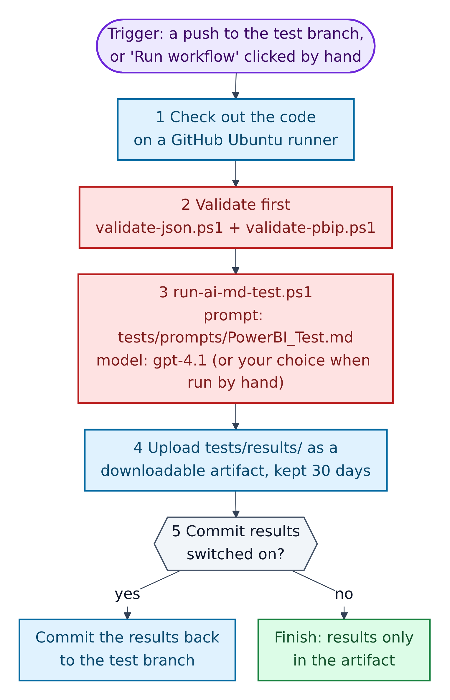
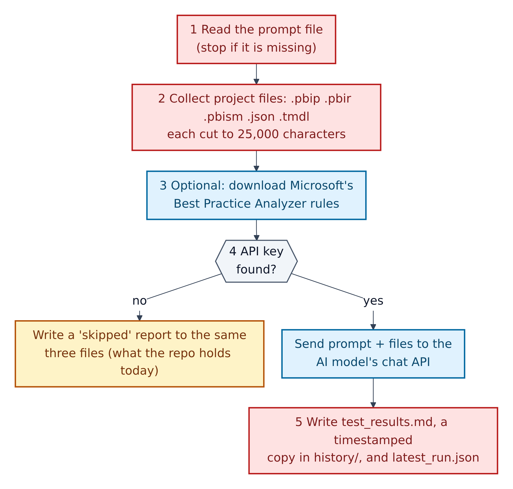
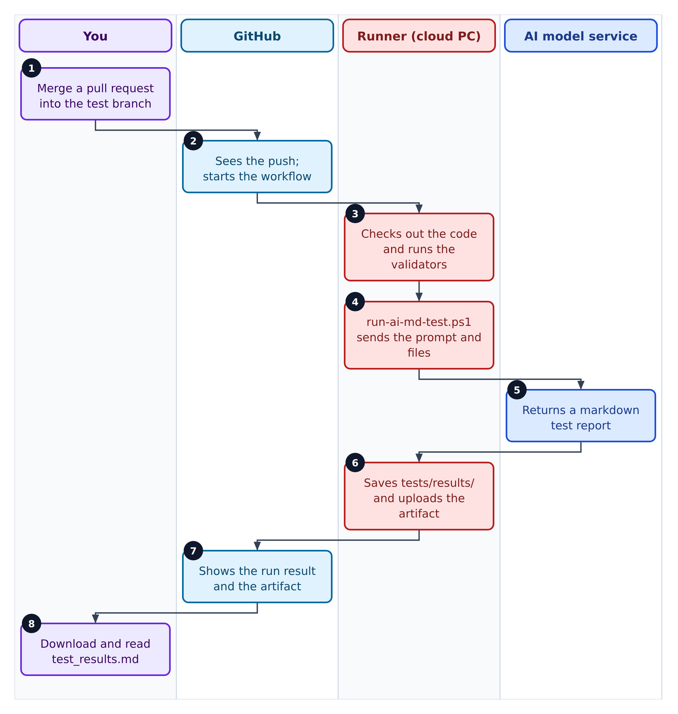

# 10. Tests and GitHub automation

**GitHub Actions** runs automation on GitHub's computers. A **workflow** is a YAML file in `.github/workflows/`; GitHub defines it as "a configurable automated process that will run one or more jobs". A **runner** is the cloud machine that runs it.



**Figure 10.1 — `.github/workflows/ai-testing.yml`.**

- **Trigger:** a push to the `test` branch, or *Run workflow* by hand (`workflow_dispatch`). A manual run can pick the model (default `gpt-4.1`) and whether to include Best Practice Analyzer rules.

1. Check out the code on an Ubuntu runner, in the `test` environment.
2. Run `validate-json.ps1` and `validate-pbip.ps1` with PowerShell 7 (`pwsh`). A failure stops the run.
3. Run `scripts/run-ai-md-test.ps1` with the prompt `tests/prompts/PowerBI_Test.md`.
4. Upload `tests/results/` as an artifact (a downloadable file bundle), kept for 30 days.
5. Only if the run is on `test` **and** the variable `AI_TEST_COMMIT_RESULTS` is `true`, commit the results back (with `[skip ci]` so it doesn't trigger itself).

## Inside the test runner



**Figure 10.2 — `scripts/run-ai-md-test.ps1`.**

1. Read the prompt file; stop if it's missing.
2. Collect the project files (`.pbip`, `.pbir`, `.pbism`, `.json`, `.tmdl`), each cut to 25,000 characters.
3. With `-IncludeBpaRules`, download Microsoft's Best Practice Analyzer rules from the `microsoft/Analysis-Services` repo.
4. Look for an API key in `GITHUB_MODELS_API_KEY`, then `AZURE_OPENAI_API_KEY`. No key: write a "skipped" report. That's what `tests/results/` holds today (two runs on 17 April 2026). With a key: send everything to the chat API, by default `https://models.inference.ai.azure.com/chat/completions`.
5. Write `test_results.md`, a timestamped copy in `history/`, and `latest_run.json`.

```powershell
./scripts/run-ai-md-test.ps1 -PromptFile tests/prompts/PowerBI_Test.md -OutputDir tests/results -OutputFileName test_results.md -IncludeBpaRules
```

## One automated run, step by step



**Figure 10.3 — Who does what.**

1. You merge a pull request into `test` (a merge is a push).
2. GitHub starts the workflow.
3. The runner checks out the code and runs the validators.
4. The script sends the prompt and files to the AI model.
5. The model returns a markdown report.
6. The runner saves and uploads `tests/results/`.
7. GitHub shows the result and the artifact.
8. You download and read `test_results.md`.

## What the AI test checks

`tests/prompts/PowerBI_Test.md` is a "Measure Killer-style" audit: it hunts for unused and broken parts of the model by reading files only (running scripts is forbidden). In eight phases it inventories the model and report, finds references to missing measures or columns and things nothing uses, writes a report with severity markers, adds a Best Practice Analyzer check, and gives one verdict.

`tests/prompts/Python_Data_Value_Test.md` is different: it doesn't write code. It asks Copilot for a blueprint of your own Python checker, e.g. "sales of branch `ABV` in March 2026", with options `--branch`, `--month`, `--year`, `--dry-run`.

## Settings to add on GitHub

| Setting | Kind | Where | Why |
|---|---|---|---|
| `GITHUB_MODELS_API_KEY` or `AZURE_OPENAI_API_KEY` | Secret (at least one) | *Settings > Secrets and variables > Actions* | Lets the test call a model |
| `AI_TEST_COMMIT_RESULTS` = `true` | Variable | Same page, *Variables* | Commits results back to `test` |
| `test` | Environment | *Settings > Environments* | The job runs in it |

GitHub doesn't pass secrets to workflows triggered from forks, and an unset secret reads as empty, which is why a fork produces a "skipped" report instead of an error.

`docs/CICD-SETUP.md` also describes Fabric deployment secrets (`FABRIC_TENANT_ID`, `FABRIC_CLIENT_ID`, `FABRIC_CLIENT_SECRET`) and workspace variables (`PBI_WORKSPACE_ID_DEV`, `_TEST`, `_PROD`) for a `cd.yml` deployment workflow that isn't in the repo (gap G1). It also recommends GitHub environments `dev`, `test` and `prod`, with required reviewers for `test` and `prod`.
