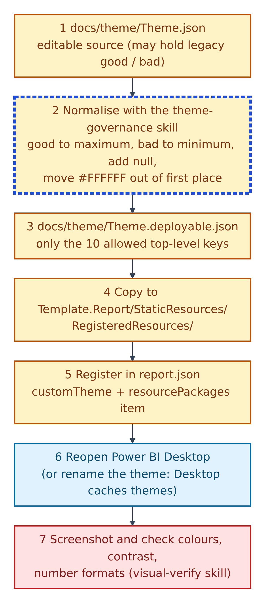
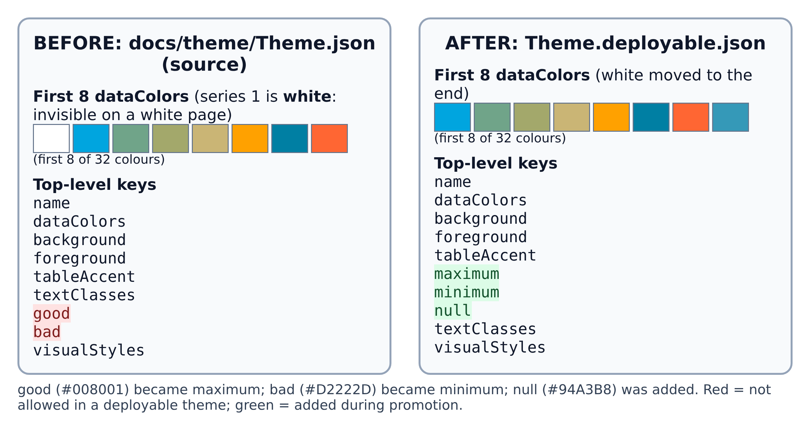
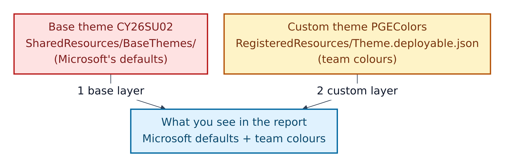

# 10. The theme pipeline: from `Theme.json` to the live report

**Figure 10.1 — The seven-step theme pipeline.** A **theme** is a JSON file of colours and fonts. Microsoft's documentation describes it as a JSON file that sets a report's design, with colours that "come from data colors in the theme".

Walkthrough of Figure 10.1:

1. **`docs/theme/Theme.json`** is the editable source, named `PGEColors`. It may contain older fields (`good`, `bad`) that Power BI will not accept in a registered theme.
2. **Normalise** it using the skill `.github/skills/powerbi-theme-governance/SKILL.md` (Amber + AI). The skill's rules: `good` becomes `maximum`, `bad` becomes `minimum`, make sure `null` exists, and move `#FFFFFF` (white) out of first place in `dataColors`.
3. **`docs/theme/Theme.deployable.json`** is the result. It may only use ten top-level keys: `name`, `dataColors`, `background`, `foreground`, `tableAccent`, `maximum`, `minimum`, `null`, `textClasses`, `visualStyles`. "Any other key causes import failure."
4. **Copy** it into `Template.Report/StaticResources/RegisteredResources/`. In this repository the two copies are byte-for-byte identical today.
5. **Register** it in `Template.Report/definition/report.json`: under `themeCollection > customTheme` (name `PGEColors`, including `reportVersionAtImport`), and as an item in the `RegisteredResources` package with `"type": "CustomTheme"`.
6. **Reopen Power BI Desktop.** Desktop caches themes, so a plain reload can show the old colours. Either reopen, or rename the file with a new suffix and update `report.json`.
7. **Screenshot and check** with the visual-verify skill: a theme is applied on purpose (checklist row 51), no white-on-white or low-contrast series (rows 67, 71, 75), and repeated numbers are formatted the same way (row 72).

---

## What promotion changed in this repository

**Figure 10.2 — Before and after.** Real values from the two files in `docs/theme/`.

Walkthrough of Figure 10.2:

1. **The colour order.** In the source, the first series colour is white (`#FFFFFF`). On a white page the first line or bar would be invisible. The deployable copy moves white to the end of the 32 colours.
2. **The semantic colours.** `good` (`#008001`, green) became `maximum`; `bad` (`#D2222D`, red) became `minimum`; `null` (`#94A3B8`, grey) was added. Red highlighting marks keys that are not allowed; green marks keys added.
3. **Everything else** (`name`, `background`, `foreground`, `tableAccent`, `textClasses`, `visualStyles`) is unchanged.

## Two themes at once

**Figure 10.3 — Two theme layers.** `report.json` registers both.

Walkthrough of Figure 10.3:

1. **The base theme `CY26SU02`** is a Microsoft file in `SharedResources/BaseThemes/` (Red: do not edit).
2. **The custom theme `PGEColors`** is the team's file in `RegisteredResources/` (Amber).
3. The report you see combines Microsoft's defaults with the team's colours and fonts.

## Do and don't

| Do | Don't |
|---|---|
| Edit colours in `docs/theme/Theme.json` | Register `Theme.json` directly in `report.json` |
| Re-run the promotion rules after every edit | Leave `#FFFFFF` as the first data colour |
| Keep `reportVersionAtImport` in `report.json` (omitting it gives "Required properties are missing") | Add keys such as `visualContainerHeader`, `axisLine` or `gridlines` to the deployable file |
| Reopen Desktop, or rename the theme, before judging colours | Trust colours after a plain reload |
| Keep IBCS green and red meanings (Section 12) | Use brand colours for "good" and "bad" |

A small detail for careful readers: `docs/theme/Theme.json` starts with an invisible byte-order mark (BOM). Python's standard JSON reader rejects such a file unless you open the file with `encoding='utf-8-sig'`. Section 16 lists this.
