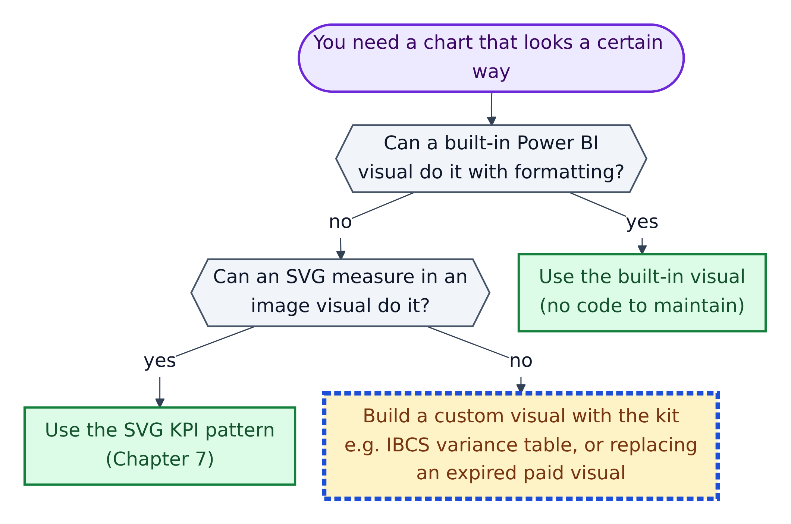
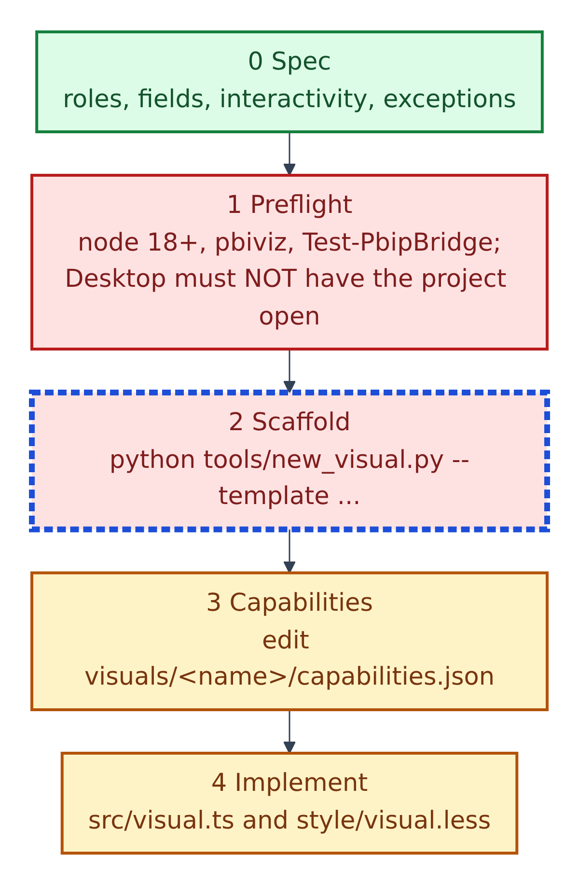
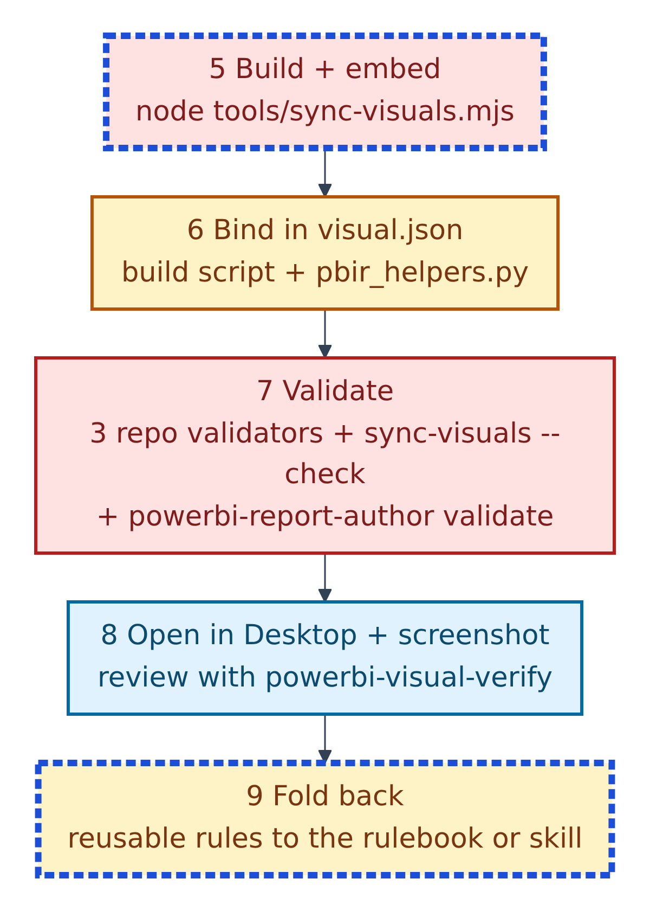
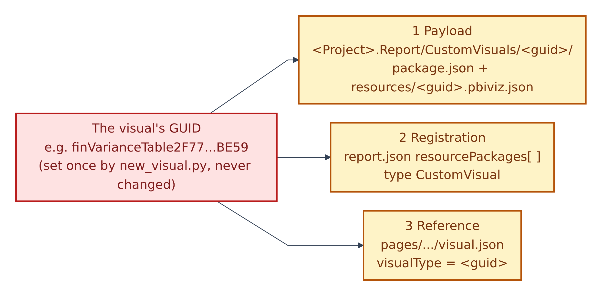
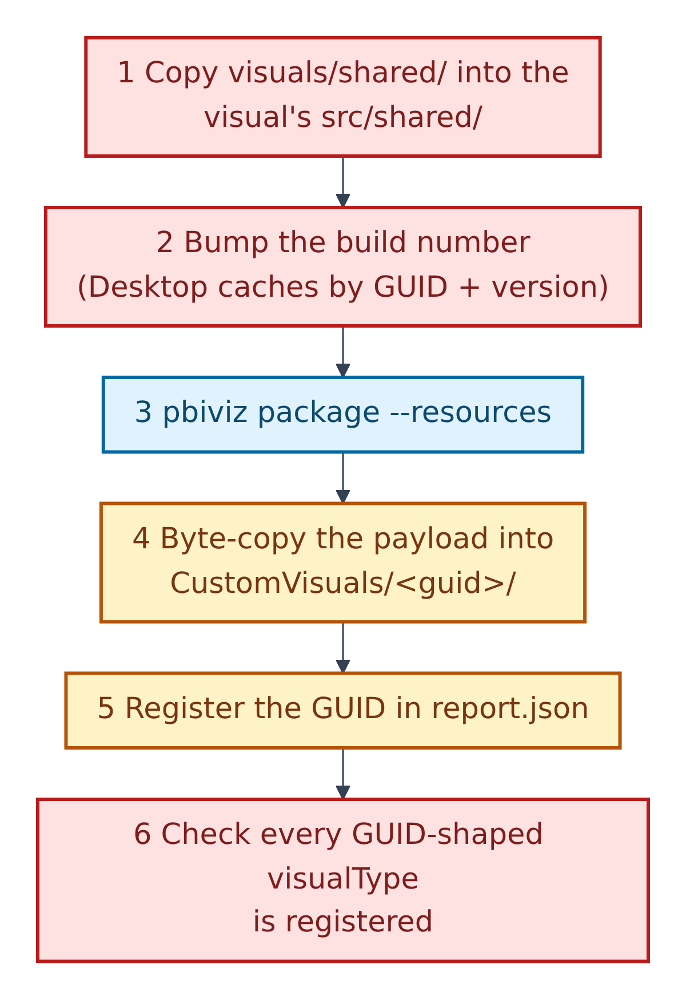
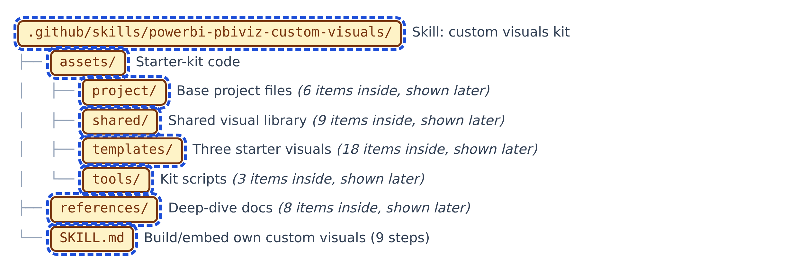

# 11. Custom visuals (the .pbiviz kit)

A **custom visual** is a chart type you write yourself in TypeScript and package as a `.pbiviz` bundle. The skill `.github/skills/powerbi-pbiviz-custom-visuals/SKILL.md` warns: "A custom visual is code to maintain. Say so if the request does not need one."

**Figure 11.1 — Do you really need one?**

1. Can a built-in visual do it with formatting? Use that.
2. Can an SVG measure in an image visual do it? Use the SVG KPI pattern (Chapter 7).
3. Neither? Use the kit, e.g. for an **IBCS** finance layout (a business-chart standard: actuals solid dark, variances green and red) or to replace a paid marketplace visual whose licence expired.

Before building, the agent must ask you three questions in one go:

- What should the visual show, and what decision does it support? Is there a reference screenshot or a visual to replace?
- How interactive should it be? The default is fully interactive: tooltips, click to cross-filter, highlight.
- What author name and email go in `pbiviz.json`? Packaging refuses without them.

## The workflow

**Figure 11.2 — Plan and write.**

0. **Spec:** data roles and fields, Format-pane options, logic, interactivity, size, exceptions.
1. **Preflight:** Node.js 18+, `pbiviz --version` (`npm i -g powerbi-visuals-tools`), and `Test-PbipBridge.ps1`. Power BI must *not* have the project open while syncing.
2. **Scaffold:** `python .github\skills\powerbi-pbiviz-custom-visuals\assets\tools\new_visual.py --name finVarianceTable --template varianceTable ...`. It creates `visuals/<name>/` in your dashboard repo, gives it a permanent GUID, and runs `npm install`.
3. **Capabilities:** edit `capabilities.json`. Microsoft: it tells Power BI "what kind of data the visual accepts".
4. **Implement:** `src/visual.ts` and `style/visual.less`. Shared code is edited only in `visuals/shared/`.

**Figure 11.3 — Build, bind and prove.**

5. **Build and embed:** `node tools\sync-visuals.mjs` (or `--only <name>`). TypeScript or lint errors stop here.
6. **Bind:** write the page's `visual.json`, ideally from a Python build script using `tools/pbir_helpers.py`, and check it with `check_against_capabilities(...)`.
7. **Validate:** the three validators, `sync-visuals.mjs --check`, and `powerbi-report-author validate`.
8. **Open and screenshot:** no empty boxes, licence overlays or clipped labels; totals match; clicks and expand work.
9. **Fold back** reusable rules.

## Three things must line up

**Figure 11.4 — The GUID triad** (`references/PBIP-EMBEDDING.md`). A GUID is a long unique id.

1. **Payload:** the built bundle in `<Project>.Report/CustomVisuals/<guid>/`.
2. **Registration:** the GUID in `report.json` `resourcePackages`, type `CustomVisual`.
3. **Reference:** each `visual.json` names the GUID as `visualType`.

"Get one wrong and the visual renders as an empty box with **no error dialog**." The GUID never changes once used; rename a visual by its `displayName` only.

## What sync-visuals.mjs does

**Figure 11.5 — Six steps per visual.**

1. Copy the shared library into the visual's `src/shared/`.
2. Bump the build number (Power BI caches bundles by GUID and version).
3. Run `pbiviz package --resources`.
4. Copy the payload byte for byte into `CustomVisuals/<guid>/`.
5. Register the GUID in `report.json`.
6. Check every GUID-shaped `visualType` is registered.

After syncing, close and reopen Power BI; a reload serves the cached bundle.

## What's in the kit

**Figure 11.6 — The kit, two levels deep.** All kit files are Red + AI: the agent copies them into your dashboard repo, and you change the copies.

1. `assets/project/`: starting project files with pinned versions (`powerbi-visuals-api` 5.11.1, `powerbi-visuals-utils-formattingmodel` 6.0.4, TypeScript 5.5.4).
2. `assets/shared/`: a shared TypeScript library: colour tokens, safe DOM builders (no `innerHTML`), number formats, clicks and tooltips, shapes, Format-pane settings, scales, text fitting.
3. `assets/templates/`: three starter visuals: `varianceTable`, `varianceChart`, `blank`.
4. `assets/tools/`: `new_visual.py`, `sync-visuals.mjs`, `pbir_helpers.py`.
5. `references/`: eight deep-dive documents.
6. `SKILL.md`: the procedure.

## The hard rules, short version

1. A GUID never changes once bound.
2. `visual.json` keys must match the role names and options in `capabilities.json`.
3. Close Power BI while syncing; reopen after.
4. Copy built payloads byte for byte.
5. No `innerHTML`, no internet access (`privileges: []`), no vendor branding.
6. Visuals hide Power BI's container chrome; the SVG background draws cards and titles.
7. Visuals that add up numbers in code only use additive measures; ratios are computed from their parts.
8. Never copy a paid visual's pop-ups, logo or patent strip.
9. Interactive by default; always signal rendering start and finish (needed for PDF/PowerPoint export).
10. A successful build is not done; only a reviewed screenshot counts.

`.github/instructions/power-bi-custom-visuals-development.instructions.md` loads automatically for `.ts`, `.tsx`, `.js`, `.jsx`, `.less` and `.css` files. It's a general React and D3.js reference; use the skill for anything that touches the PBIP project.
