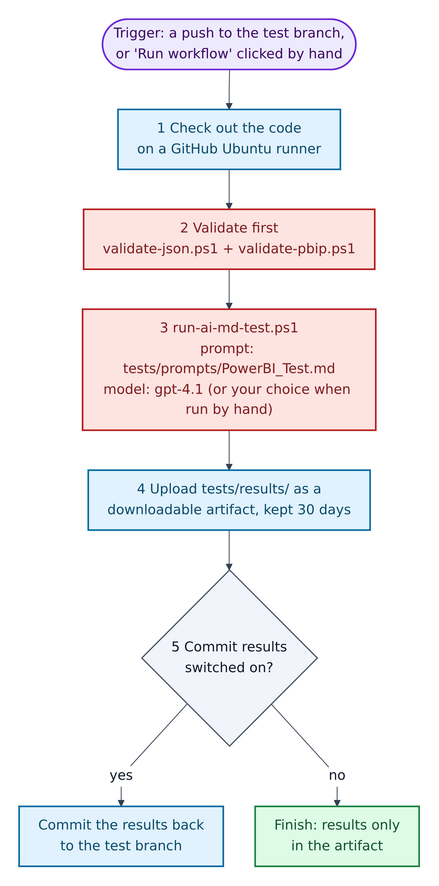
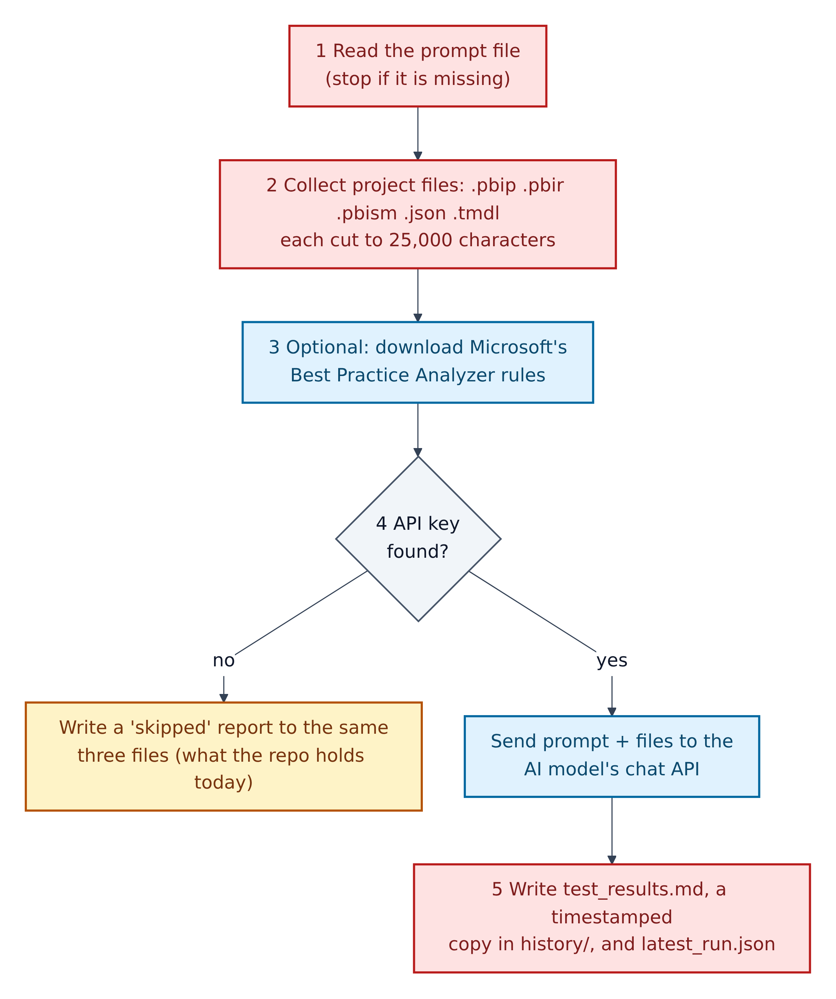
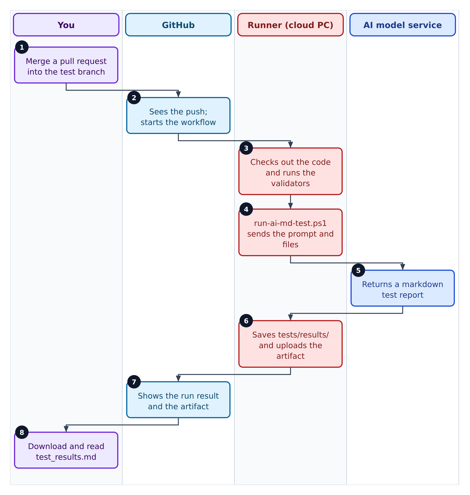

# 11. Testing and automation: AI tests, GitHub Actions and branches



**Figure 11.1 — `.github/workflows/ai-testing.yml`, step by step.** **GitHub Actions** is GitHub's automation service. GitHub defines a **workflow** as "a configurable automated process that will run one or more jobs", written in a YAML file in `.github/workflows/`. A **runner** is "a server that runs your workflows when they're triggered".

Walkthrough of Figure 11.1:

- **Trigger.** The workflow runs on every push to the `test` branch, or when someone clicks *Run workflow* (a `workflow_dispatch` trigger). A manual run can choose the AI model (default `gpt-4.1`) and whether to include Best Practice Analyzer rules.

1. **Check out the code** on a GitHub-hosted Ubuntu (Linux) runner, using the `test` environment.
2. **Validate first:** `validate-json.ps1` and `validate-pbip.ps1`, run with PowerShell 7 (`pwsh`). If either fails, the workflow stops.
3. **Run the AI test:** `scripts/run-ai-md-test.ps1` with the prompt `tests/prompts/PowerBI_Test.md` (Figure 11.2).
4. **Upload `tests/results/`** as a downloadable artifact named `ai-markdown-pbip-test-<run id>`, kept for 30 days.
5. **Commit results switched on?** Only when the run is on the `test` branch *and* the repository variable `AI_TEST_COMMIT_RESULTS` equals `true` does the workflow commit the results back to `test` (with `[skip ci]` in the message so it does not trigger itself again). Otherwise the results live only in the artifact.

---

## Inside the AI test runner



**Figure 11.2 — `scripts/run-ai-md-test.ps1`.**

Walkthrough of Figure 11.2:

1. **Read the prompt file.** It stops if the file is missing.
2. **Collect the project files** (`.pbip`, `.pbir`, `.pbism`, `.json`, `.tmdl`), skipping `tests/results/`, `.git/` and the Power BI data cache. Each file is cut to 25,000 characters (`-MaxFileChars`).
3. **Optional:** with `-IncludeBpaRules`, download Microsoft's Best Practice Analyzer rules from the `microsoft/Analysis-Services` repository on GitHub and add them to the prompt. If the download fails, it carries on without them.
4. **API key found?** The script looks in `GITHUB_MODELS_API_KEY`, then `AZURE_OPENAI_API_KEY`.
   - **No key:** it writes a "skipped" report. That is exactly what this repository's `tests/results/` holds today: two runs on 17 April 2026, both skipped with the reason "No AI API key was found…". Add `-FailIfNotConfigured` to make a missing key an error instead.
   - **Key found:** it sends the prompt and files to the chat API (by default `https://models.inference.ai.azure.com/chat/completions`, GitHub Models).
5. **Write the outputs:** `tests/results/test_results.md` (latest), `tests/results/history/test_results_<UTC time>.md` (permanent history), and `tests/results/latest_run.json` (details of the run).

Run it locally (PowerShell, from the repository root):

```powershell
./scripts/run-ai-md-test.ps1 -PromptFile tests/prompts/PowerBI_Test.md -OutputDir tests/results -OutputFileName test_results.md -IncludeBpaRules
```

## Who does what in an automated test



**Figure 11.3 — Swimlane of one automated test run.**

Walkthrough of Figure 11.3:

1. You merge a pull request into `test`. Merging is a push.
2. GitHub sees the push and starts the workflow.
3. A runner (a temporary cloud computer) checks out the code and runs the validators.
4. The runner's script sends the prompt and project files to the AI model.
5. The AI model service returns a markdown test report.
6. The runner saves `tests/results/` and uploads it as an artifact.
7. GitHub shows the run's result (green tick or red cross) and the artifact.
8. You download and read `test_results.md`.

## What the AI test checks

`tests/prompts/PowerBI_Test.md` is a "Measure Killer-style" audit prompt. Measure Killer is a third-party tool for finding unused parts of a Power BI model; the prompt imitates that kind of report without running any tool. In eight phases it:

1. finds and checks the project files;
2. lists every table, column, measure and relationship;
3. lists every page and visual and what they use;
4. finds visuals that point at measures or columns that do not exist, and measures or columns that nothing uses;
5. writes the report with severity markers (critical, high, medium, low, info) in a fixed layout;
6. returns a short chat summary;
7. adds a Best Practice Analyzer (BPA) assessment;
8. gives one combined verdict.

## Settings to add on GitHub

| Setting | Kind | Where | Purpose |
|---|---|---|---|
| `GITHUB_MODELS_API_KEY` or `AZURE_OPENAI_API_KEY` | Secret (at least one) | *Settings > Secrets and variables > Actions* | Lets the AI test call a model |
| `AI_TEST_COMMIT_RESULTS` | Variable, value `true` | Same page, *Variables* tab | Commits results back to `test` |
| `test` | Environment | *Settings > Environments* | The workflow's job runs in this environment |

GitHub's documentation notes that secrets are not passed to workflows triggered from forks (except the built-in `GITHUB_TOKEN`), and that a secret that is not set reads as an empty string. That is why a fork without secrets produces a "skipped" report rather than an error.

`docs/CICD-SETUP.md` also describes **Fabric deployment secrets** (`FABRIC_TENANT_ID`, `FABRIC_CLIENT_ID`, `FABRIC_CLIENT_SECRET`) and **workspace variables** (`PBI_WORKSPACE_ID_DEV`, `_TEST`, `_PROD`, optional `PBI_DEPLOYMENT_PIPELINE_ID`) for a deployment workflow called `cd.yml`. That workflow is not in this repository (Section 16).

## The recommended branch and environment set-up

From `docs/CICD-SETUP.md` (see also Figure 3.3):

1. **Branches:** create and protect `dev`, `test` and `main`. Feature work goes to `dev`, release candidates to `test`, production to `main`.
2. **GitHub environments:** `dev`, `test`, `prod`, with required reviewers for `test` and `prod`, and no self-approval for production.
3. **Branch protection:** require a pull request, passing status checks, at least one reviewer, and dismiss old approvals when new commits arrive.
4. **Optional hardening:** secret scanning, model linting, screenshot artifacts, release notes.

## Python data-value testing

`tests/prompts/Python_Data_Value_Test.md` is an "instruction-only" prompt. It does **not** write a script. It asks Copilot to read the model and visuals, find the measure behind a "Sales by Branch" visual, and then give you a blueprint for writing your own Python checker. The example question is "sales of branch `ABV` in March 2026", with command-line options `--branch`, `--month`, `--year` and `--dry-run`. Results should be saved under `tests/results/`. No validator script ships with the template; teams write their own (Section 13).
