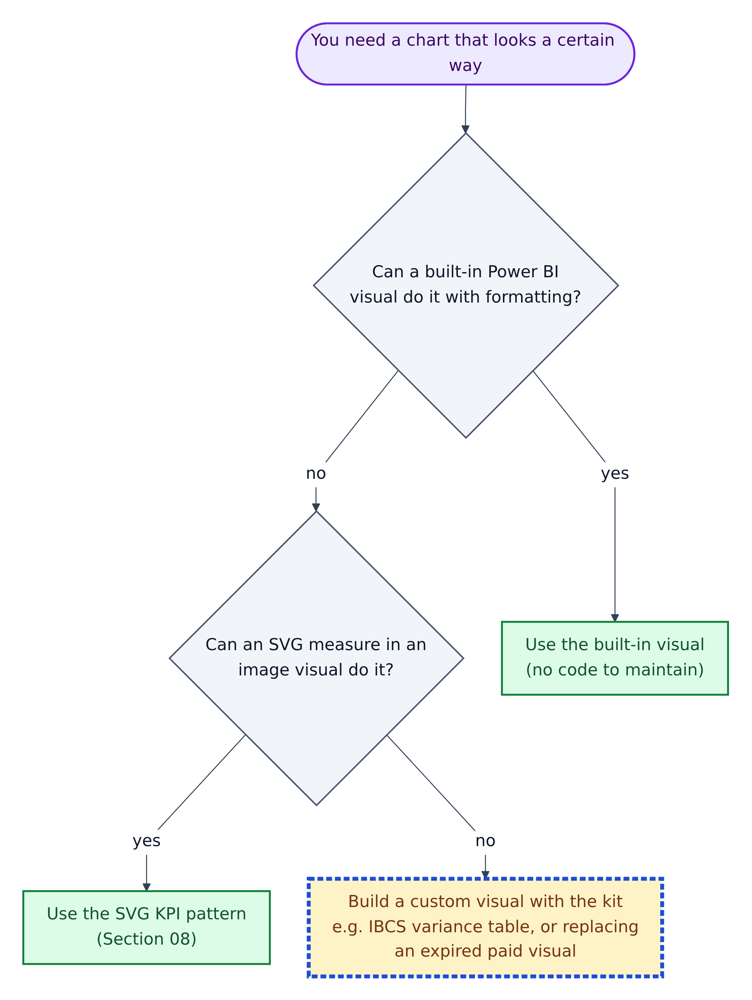
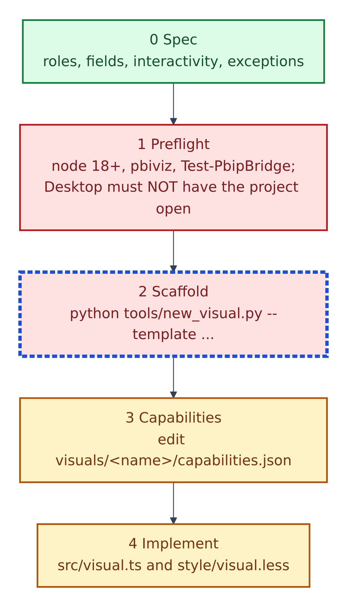
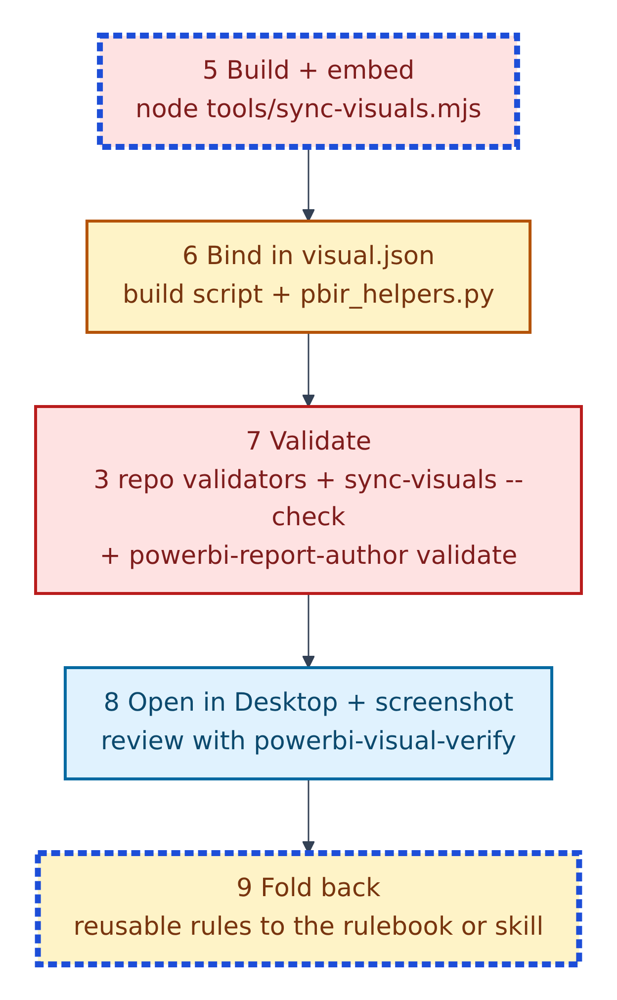
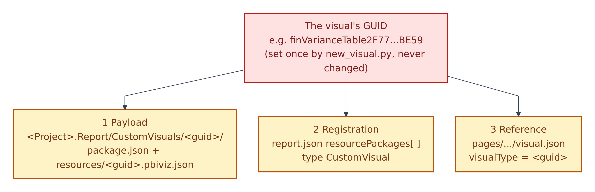
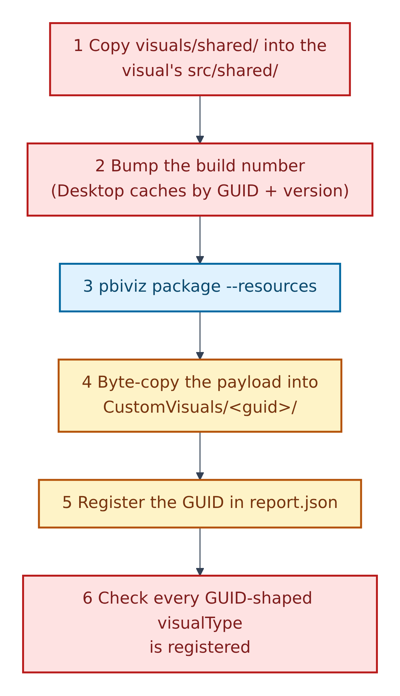
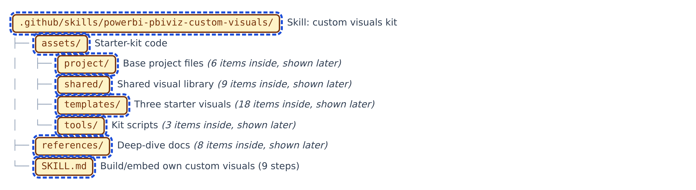

# 12. The custom-visual (.pbiviz) starter kit



**Figure 12.1 — Do you really need a custom visual?** A **custom visual** is a chart type your team writes in code (TypeScript), packaged as a `.pbiviz` bundle. The skill `.github/skills/powerbi-pbiviz-custom-visuals/SKILL.md` warns: "A custom visual is code to maintain. Say so if the request does not need one."

Walkthrough of Figure 12.1:

1. **Can a built-in visual do it with formatting?** Use it.
2. **Can an SVG measure in an image visual do it?** Use the SVG KPI pattern from Section 08.
3. **Neither?** Build one with this kit. Typical reasons: an **IBCS** finance layout (IBCS is a set of business-chart design standards, e.g. actuals solid dark, variances green and red), or replacing a paid marketplace visual whose licence expired.

Before building, the skill says the agent must ask three questions in one round: what the visual should show and why (with any reference screenshot), how interactive it should be (default: fully interactive), and the author name and email for `pbiviz.json` (packaging refuses without them).

---

## The ten-step workflow



**Figure 12.2 — Workflow, part 1: plan and write.**

Walkthrough of Figure 12.2:

0. **Spec.** Copy `specs/TEMPLATE.md`; for each visual record its data roles and fields, Format-pane options, computed logic, interactivity, size and exceptions.
1. **Preflight.** `node --version` (18 or later), `pbiviz --version` (install with `npm i -g powerbi-visuals-tools`), and `scripts\Test-PbipBridge.ps1`. Power BI Desktop must **not** have the project open while syncing.
2. **Scaffold** a new visual from a template:

   ```powershell
   python .github\skills\powerbi-pbiviz-custom-visuals\assets\tools\new_visual.py --name finVarianceTable --template varianceTable --display "Variance Table" --description "IBCS statement table" --author-name "<name>" --author-email "<email>"
   ```

   This creates `visuals/<name>/` in *your dashboard repository* (not in this template), gives it a permanent GUID, records it in `tools/visuals.json`, and runs `npm install`.
3. **Capabilities.** Edit `capabilities.json`: the data roles, how the data is shaped, and the Format-pane options. Microsoft describes this file as telling Power BI "what kind of data the visual accepts" and what to put in the properties pane.
4. **Implement** the drawing code in `src/visual.ts` and styles in `style/visual.less`. Edit shared code only in `visuals/shared/`; `src/shared/` is overwritten on every build.



**Figure 12.3 — Workflow, part 2: build, bind and prove.**

Walkthrough of Figure 12.3:

5. **Build and embed** with `node tools\sync-visuals.mjs` (or `--only <name>`). A TypeScript or lint error stops the build here.
6. **Bind** the visual on a page by writing its `visual.json`, preferably from the page's Python build script using `tools/pbir_helpers.py`, and check it with `check_against_capabilities(...)`.
7. **Validate** with the three repository validators, `node tools\sync-visuals.mjs --check`, and `powerbi-report-author validate`.
8. **Open in Desktop and screenshot** every page; review with the visual-verify skill. Extra checks: no empty boxes, no licence overlays, no clipped labels, totals match the agreed numbers, and clicking and expanding work.
9. **Fold back** reusable rules into the rulebook or the skill.

## The rule that breaks most often: three things must line up



**Figure 12.4 — The GUID triad**, from `references/PBIP-EMBEDDING.md`. A **GUID** is a long unique identifier, like a serial number.

Walkthrough of Figure 12.4:

1. **Payload:** the built bundle sits in `<Project>.Report/CustomVisuals/<guid>/`.
2. **Registration:** `report.json` lists the GUID in `resourcePackages` with type `CustomVisual`.
3. **Reference:** each page's `visual.json` names the GUID as its `visualType`.

"Get one wrong and the visual renders as an empty box with **no error dialog**." `sync-visuals.mjs` does steps 1 and 2 and checks step 3; `scripts/validate-pbip.ps1` also checks it. The GUID never changes once a report uses it; rename a visual only by its `displayName`.

## What `sync-visuals.mjs` does for each visual



**Figure 12.5 — The six steps of `sync-visuals.mjs`.**

Walkthrough of Figure 12.5:

1. Copy the shared library into the visual's `src/shared/`.
2. Increase the build number, because Desktop caches bundles by GUID and version.
3. Run `pbiviz package --resources`.
4. Copy the payload byte for byte into `CustomVisuals/<guid>/` (never re-save it through a JSON tool).
5. Register the GUID in `report.json`.
6. Check every GUID-shaped `visualType` is registered.

After a sync, **close and reopen** Desktop; a reload still serves the cached bundle.

## What is in the kit



**Figure 12.6 — The kit folder, two levels deep.** The four `assets/` sub-folders and the eight reference documents are listed in full in Section 14.

Walkthrough of Figure 12.6:

1. **`assets/project/`** — the files every visual project starts with: `package.json` (pinned versions: `powerbi-visuals-api` 5.11.1, `powerbi-visuals-utils-formattingmodel` 6.0.4, TypeScript 5.5.4), `pbiviz.json` (placeholders such as `__GUID__`), `tsconfig.json`, `eslint.config.mjs` and a 20×20 icon.
2. **`assets/shared/`** — a shared TypeScript library: colour tokens (`tokens.ts` + `base.less`), safe element builders (`dom.ts`, no `innerHTML`), number formats (`format.ts`), clicks and tooltips (`interaction.ts`), shapes (`paths.ts`), Format-pane settings (`props.ts`), scales (`scale.ts`) and text fitting (`text.ts`).
3. **`assets/templates/`** — three working starter visuals: `varianceTable` (IBCS statement table), `varianceChart` (IBCS period chart with a variance strip) and `blank` (a minimal skeleton showing every required pattern).
4. **`assets/tools/`** — `new_visual.py`, `sync-visuals.mjs`, `pbir_helpers.py`.
5. **`references/`** — eight deep-dive documents, from data roles to troubleshooting.
6. **`SKILL.md`** — the procedure itself.

All kit files are Red + AI: the agent copies them into your dashboard repository; you change the copies, not these originals.

## The ten hard rules (from SKILL.md, in plain words)

1. A GUID never changes once bound; rename with `displayName` only.
2. `visual.json` data keys must match the data-role names, and its options must match `capabilities.json`.
3. Close Desktop while syncing; reopen afterwards.
4. Copy built payloads byte for byte.
5. No `innerHTML`, no internet access (`privileges: []`), no vendor branding.
6. Visuals hide Power BI's container chrome; the SVG background draws cards and titles.
7. Table-style visuals that add up numbers in code only use additive measures; ratios are calculated from their parts.
8. Never copy a paid visual's pop-ups, logo or patent strip.
9. Interactive by default, and always signal rendering start and finish (needed for PDF and PowerPoint export).
10. A visual is never done because it built; only a reviewed Desktop screenshot counts.

## Related scoped rule file

`.github/instructions/power-bi-custom-visuals-development.instructions.md` loads automatically for `.ts`, `.tsx`, `.js`, `.jsx`, `.less` and `.css` files. It is a general React and D3.js reference for visual internals; the skill says to use the skill, not that file, for anything touching the PBIP project.
