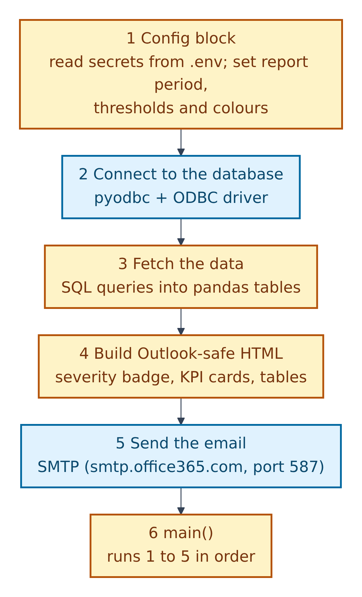
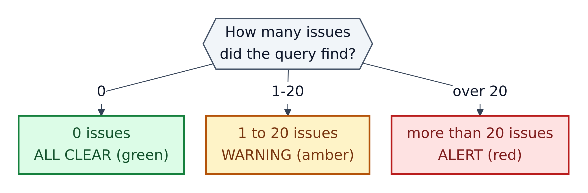
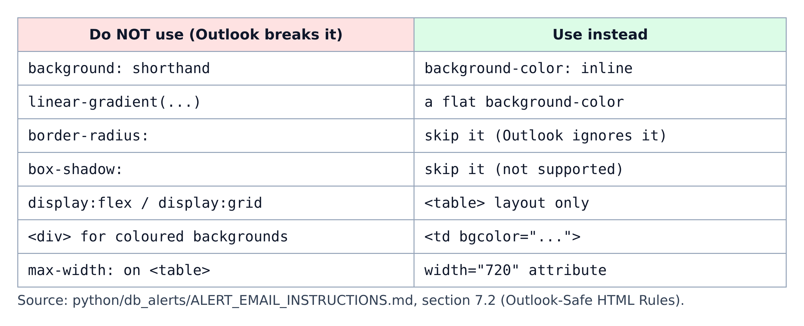
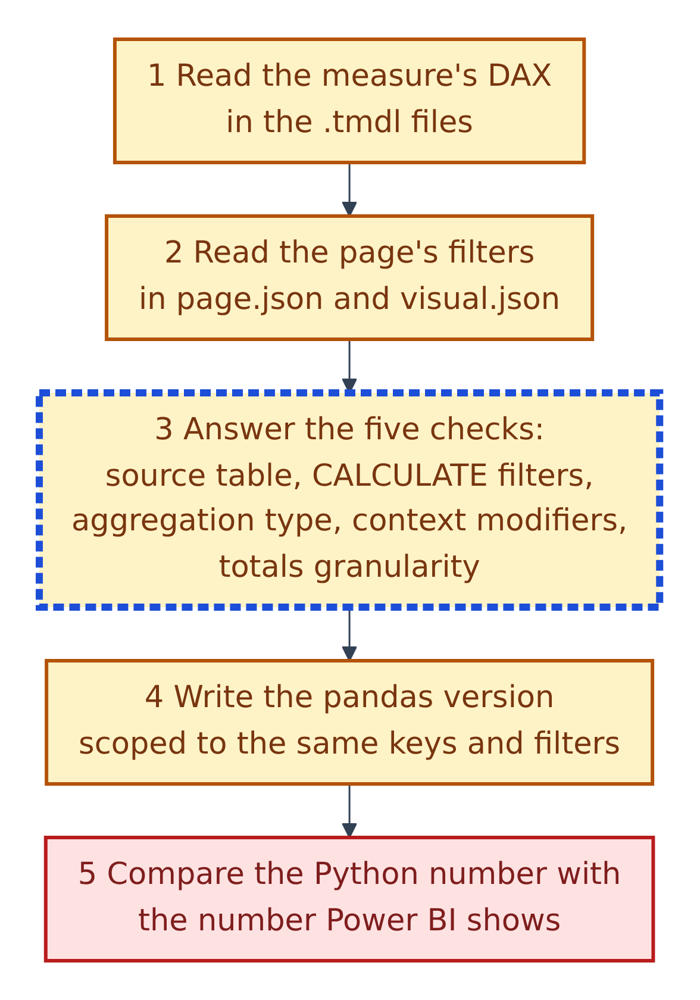

# 12. The Python email and alert guides

The `python/` folder holds **instructions only**; no Python script ships with the template. You (or the agent) follow these guides to write scripts in your own project.

**Figure 12.1 — How the alert-email script is organised** (`python/db_alerts/ALERT_EMAIL_INSTRUCTIONS.md`).

1. **Config:** load secrets from `.env` and set the period, thresholds and colours.
2. **Connect** to the database with `pyodbc` and an ODBC driver.
3. **Fetch** data with SQL into `pandas` tables.
4. **Build** HTML that Outlook displays correctly: severity badge, KPI cards, tables.
5. **Send** with SMTP; the example uses `smtp.office365.com`, port 587.
6. **`main()`** runs the steps in order.

Its `requirements.txt` lists `pyodbc`, `pandas` and `python-dotenv`.

## How the alert picks its colour

**Figure 12.2 — The severity rule** (section 7.1). These colours are about urgency, not the file-safety legend.

1. 0 issues: "ALL CLEAR", green.
2. 1 to 20 issues: "WARNING", amber.
3. More than 20: "ALERT", red.

Classify first, because the level sets the badge colour and the subject line.

## Outlook-safe HTML

**Figure 12.3 — What Outlook breaks, and what to use instead.**

1. Desktop Outlook ignores rounded corners, shadows, gradients and flex or grid layouts.
2. So the guide builds layout from `<table>` elements, inline `background-color`, and a fixed 720-pixel width.

## Making Python numbers match Power BI

**Figure 12.4 — The DAX-to-Python check** (`python/email_reporting/emal_style_instructions.md`, which calls it "MANDATORY").

1. Read the measure's DAX in the `.tmdl` files; the model and page JSON are "the source of truth".
2. Read the page's filters in `page.json` and `visual.json`.
3. Answer five checks for each measure: which source table; every `CALCULATE` filter; the aggregation type (`SUM`, `DISTINCTCOUNT`, `SUMX`, `AVERAGEX` differ in totals); context modifiers like `ALL(...)`; and whether totals double-count at a finer grain.
4. Write the pandas version with the same keys and filters, using helpers like `safe_div` and `fmt`/`fmt_pct`.
5. Compare with the number Power BI shows. They must match before any email goes out.

## The three files

| File | What it gives you |
|---|---|
| `python/README.md` | How to build your own value checker: read the PBIP, find a "Sales by Branch" visual, generate SQL, support `--dry-run`. Example: `python python/<your_script_name>.py --branch ABV --month March --year 2026` |
| `python/db_alerts/ALERT_EMAIL_INSTRUCTIONS.md` | A template for any database-triggered alert email: `.env` credentials, six phases, Outlook HTML parts, a pre-send checklist |
| `python/email_reporting/emal_style_instructions.md` | Rules for emails that copy a Power BI page. It is three documents joined: a boilerplate skill, Parts A–E (validation, HTML, Python structure, charts, project reference), and an HTML style guide |

Safety: never hard-code passwords; both guides read them from `.env`. Use the email guide's preview mode, which writes the HTML to a file instead of sending it, before emailing real people.
