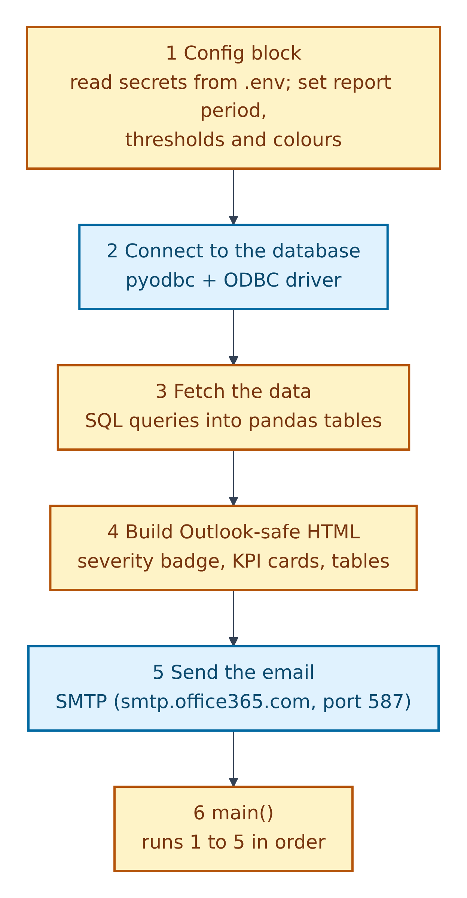
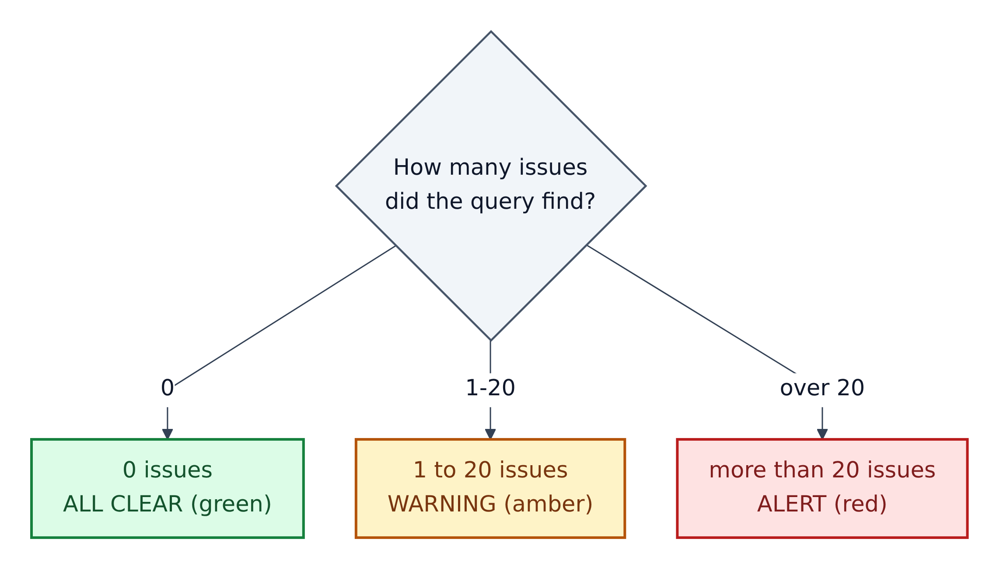
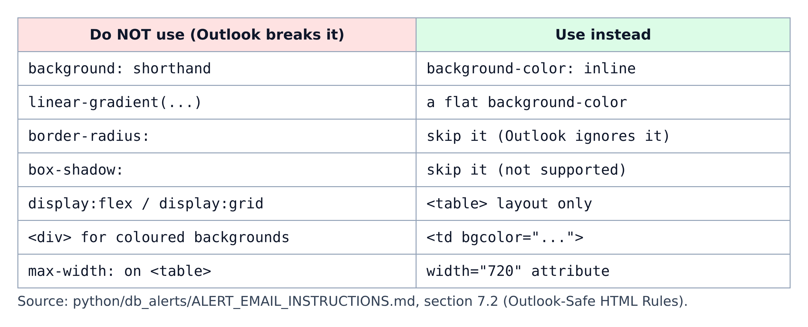
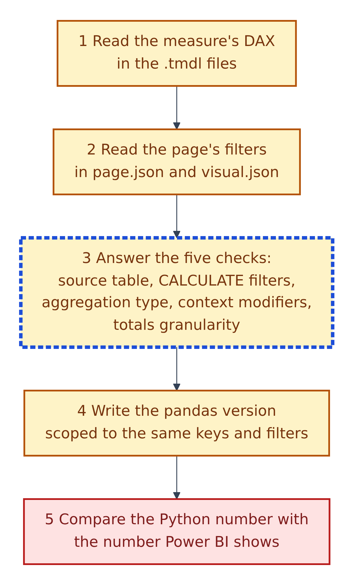

# 13. The Python email-report and alert guides

**Figure 13.1 — How the alert-email script is organised**, from `python/db_alerts/ALERT_EMAIL_INSTRUCTIONS.md`. The `python/` folder holds **instructions only**: no Python file ships with the template. You (or an agent) follow these guides to write a script in your own project.

Walkthrough of Figure 13.1:

1. **Config block.** Load secrets from `.env` (Section 07) and set the report period, thresholds, labels and colours.
2. **Connect to the database** with `pyodbc` and an ODBC driver (a standard Windows database connector).
3. **Fetch the data** with SQL queries into `pandas` tables (pandas is Python's spreadsheet-like data library).
4. **Build the email as HTML** that Outlook displays correctly: a severity badge, KPI cards, a summary table, a detail table, a note strip and a footer.
5. **Send the email** through SMTP (the email-sending protocol). The guide's example uses `smtp.office365.com` on port 587.
6. **`main()`** runs the steps in order.

The guide's `requirements.txt` lists `pyodbc`, `pandas` and `python-dotenv`. **Real-world comparison:** a night guard who checks the building, writes a short colour-coded note, and emails it to the manager.

---

## How the alert decides its colour

**Figure 13.2 — Severity rule** (section 7.1 of the alert guide). These colours describe the email's urgency, not the file-safety legend.

Walkthrough of Figure 13.2:

1. **0 issues:** "ALL CLEAR", green.
2. **1 to 20 issues:** "WARNING", amber.
3. **More than 20 issues:** "ALERT", red.

The guide says to classify the alert *before* building the HTML, because the level sets the badge colour and the email subject line.

## Outlook-safe HTML

**Figure 13.3 — What Outlook breaks, and what to use instead.**

Walkthrough of Figure 13.3:

1. Desktop Outlook ignores or breaks many modern web-page styles, such as rounded corners, shadows, gradients and flexible layouts.
2. The guide therefore builds every layout from `<table>` elements with inline `background-color` and fixed widths (720 pixels).

## Making Python numbers match Power BI

**Figure 13.4 — The DAX-to-Python validation protocol**, from `python/email_reporting/emal_style_instructions.md`. The guide calls it "MANDATORY" and says to read it "completely before writing ANY Python or HTML".

Walkthrough of Figure 13.4:

1. **Read the measure's DAX** in the model's `.tmdl` files. Treat the semantic model and page JSON as "the source of truth".
2. **Read the page's filters** in `page.json` and each `visual.json`, and build a set of the valid keys the page allows.
3. **Answer the five checks for every measure:**
   - **Source table**: which fact table does the measure use? Never mix tables with different scopes.
   - **CALCULATE filters**: copy every filter inside `CALCULATE`. Missing one gives wrong totals.
   - **Aggregation type**: `SUM`, `DISTINCTCOUNT`, `SUMX` and `AVERAGEX` behave differently in totals.
   - **Context modifiers**: `ALL(...)` removes filters, so Python must not filter that table either.
   - **Granularity in totals**: summing a per-customer number in a per-customer-per-location table counts it more than once.
4. **Write the pandas version**, scoped to the same keys and filters. Use helpers such as `safe_div` (never divide by zero) and `fmt` / `fmt_pct` for display.
5. **Compare** the Python number with the number Power BI shows. They must match before the email goes out.

**Real-world comparison:** translating a recipe from one language to another. If you skip one ingredient (a filter), the dish (the total) tastes different, even though every step you did translate is correct.

## The three Python files at a glance

| File | What it is | Key contents |
|---|---|---|
| `python/README.md` | "Build-your-own" validator instructions | Read the PBIP files, find a "Sales by Branch" visual, generate SQL from its measure, support `--dry-run`; example command `python python/<your_script_name>.py --branch ABV --month March --year 2026` |
| `python/db_alerts/ALERT_EMAIL_INSTRUCTIONS.md` | Template for any database-triggered alert email | 12 sections: project structure, `.env` credentials, 6-phase skeleton, Outlook HTML components, format helpers, colour reference, a pre-send checklist |
| `python/email_reporting/emal_style_instructions.md` | Rules for emails that copy a Power BI page | Actually three documents joined together: a boilerplate "SKILL", the universal instructions (Parts A–E: validation protocol, HTML style, Python structure, charts, project reference), and "HTML Email Style & Body Instructions" |

## Safety reminders for these guides

- **Never hard-code passwords.** Both guides read every secret from `.env` through `python-dotenv` (Section 07).
- **Part E of the email guide** has blank placeholders for the database and SMTP server: fill them in your own copy, not in this template.
- **Preview first.** The email guide describes a preview mode that writes the HTML to a file instead of sending it. Use it before emailing real people.
