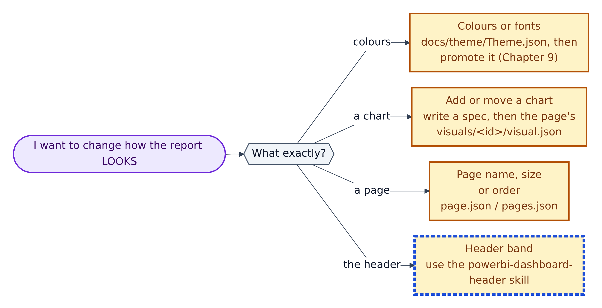
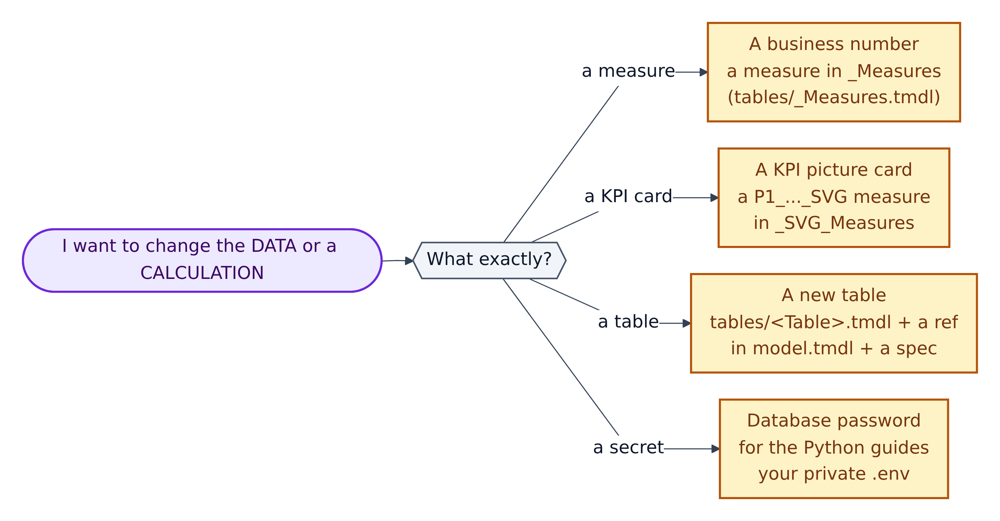
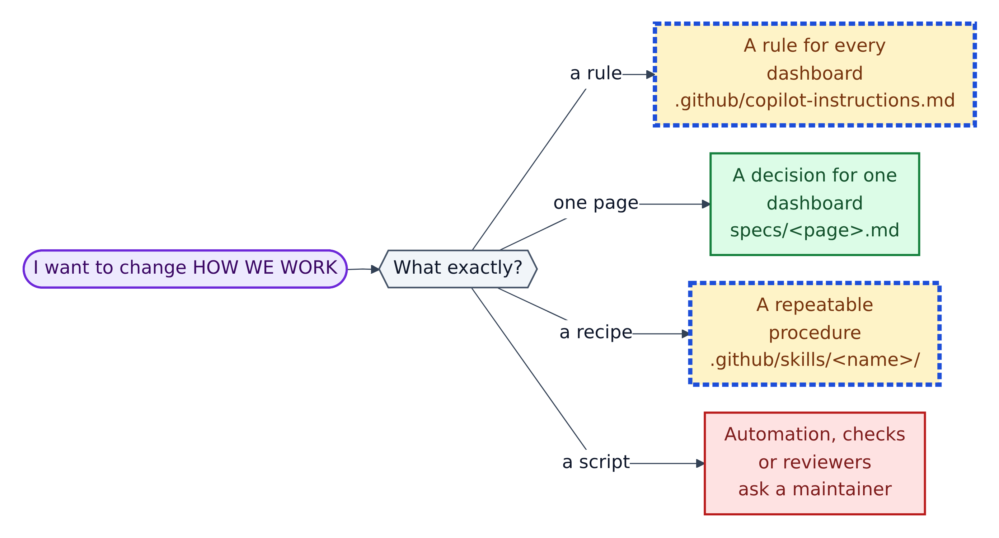

# 13. Which file do I touch?

Start with the quick look-up table. If your task isn't in it, the three decision trees after it walk you to the right file.

## Quick look-up

| I want to… | Touch | Safety | Then run |
|---|---|---|---|
| Plan a page | copy `specs/TEMPLATE.md` | Green | nothing yet |
| Add a measure | `tables/_Measures.tmdl` | Amber | `Test-PbipSemantics.ps1` |
| Add an SVG KPI card | `tables/_SVG_Measures.tmdl` + image `visual.json` | Amber | validators + verify loop |
| Add a table | `tables/<Table>.tmdl` + `model.tmdl` | Amber | all three validators |
| Add a page | new `pages/<id>/page.json` + `pages.json` | Amber | `validate-pbip.ps1`, verify loop |
| Add a background or theme | file in `RegisteredResources/` + `report.json` entry | Amber | `validate-pbip.ps1` |
| Change team colours | `docs/theme/Theme.json`, then promote | Amber | reopen Power BI, verify loop |
| Fix a typo in a doc | the `.md` under `docs/` or `specs/` | Green | nothing |
| Change what the AI always does | `.github/copilot-instructions.md` | Amber + AI | get a review |
| Store a secret for Python | your `.env` | Amber | `git check-ignore -v .env` |
| Store a secret for Actions | *Settings > Secrets and variables > Actions* | – | rerun the workflow |
| Change the test workflow | `.github/workflows/ai-testing.yml` | Red | ask a maintainer |
| Edit `version.json`, `.platform`, `definition.pbir`, `.pbism`, `database.tmdl` | **don't** | Red | – |
| Edit `tests/results/`, `tests/screenshots/`, `.github/.pbip-state/`, `**/.pbi/` | **don't**: generated | Red | – |

## Decision trees

**Figure 13.1 — "I want to change how the report looks."**

1. **Colours or fonts:** edit `docs/theme/Theme.json`, then promote it (Chapter 9). Don't edit only the copy in `RegisteredResources/`; the next promotion overwrites it.
2. **Add or move a chart:** update the spec, then the page's `visuals/<id>/visual.json`. Mind the `card_y + 30` rule.
3. **Page name, size or order:** the page's `page.json`, or `pages.json`.
4. **Header band:** follow the `powerbi-dashboard-header` skill and note any exception in the spec.

**Figure 13.2 — "I want to change the data or a calculation."**

1. **A business number:** a measure in `_Measures`, with a `///` description.
2. **A KPI picture card:** an SVG measure in `_SVG_Measures`, shown with an image visual.
3. **A new table:** `definition/tables/<Table>.tmdl`, a `ref table` line in `model.tmdl`, and a spec.
4. **A database password for the Python guides:** your private `.env` only.

**Figure 13.3 — "I want to change how we work."**

1. **A rule for every dashboard:** `.github/copilot-instructions.md`, then align `copilot-instructions.md` and `AGENTS.md`. Get it reviewed.
2. **A decision for one dashboard:** the spec.
3. **A repeatable procedure:** a skill, `.github/skills/<name>/SKILL.md`; the folder name must match its `name:` and the `description:` must say when to use it.
4. **Automation, checks or reviewers** (`scripts/`, `.github/workflows/`, `.github/CODEOWNERS`): ask a maintainer.
