# 14. File-by-file directory

Every one of the repository's 176 files and folders, grouped by folder. Each group opens with a folder-tree diagram coloured with the safety legend from Section 00 (fill colour = safety; blue dashed outline = AI agent file). Under each tree, the numbered entries follow the tree from top to bottom and give:

- the **exact path** and its **safety flag**;
- **What it is:** a plain-English summary with a real-world comparison;
- **Technical role:** what the file does for the tools.

Folders that appear closed in one tree are opened in their own tree, and their entry appears there.

## 14.1 Root files

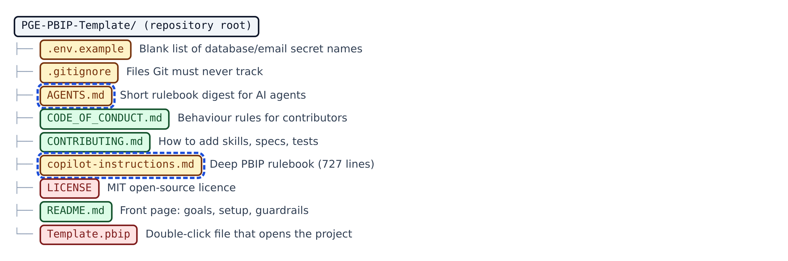

**Figure 14.1 — Root files.** The nine files that sit directly in the repository's top folder.

Walkthrough of Figure 14.1:

1. `.env.example` — **Amber**
   - *What it is:* A blank form listing the names of the secrets the Python guides need, with no real values. Like an empty form with labelled boxes.
   - *Technical role:* Template for a local, git-ignored .env file: DB_SERVER, DB_NAME, DB_USER, DB_PASSWORD, DB_DRIVER, SMTP_EMAIL, SMTP_PASSWORD.
2. `.gitignore` — **Amber**
   - *What it is:* The list of files Git must never save, such as your private .env and Power BI's local cache. Like a 'do not pack' list for a suitcase.
   - *Technical role:* Ignores \*\*/.pbi local settings and cache, .env and .env.\* (except .env.example), Python caches, \*.tmp, \*.log, tests/screenshots/, .github/.pbip-state/ and Proposals/.
3. `AGENTS.md` — **Amber** · **AI file**
   - *What it is:* A one-page summary of the house rules for any AI agent. Like the laminated safety card on a factory wall.
   - *Technical role:* Cross-agent instruction file (the AGENTS.md convention) read by Copilot and by Claude Code when no CLAUDE.md exists; mirrors the 10 guardrails, layers and finishing checklist.
4. `CODE_OF_CONDUCT.md` — **Green**
   - *What it is:* How people in this project are expected to treat each other. Like a club's code of behaviour.
   - *Technical role:* Community document adapted from the Contributor Covenant 2.0.
5. `CONTRIBUTING.md` — **Green**
   - *What it is:* Short rules for adding to the project: where skills, specs and tests go. Like the 'how to submit an article' note for a newsletter.
   - *Technical role:* Contributor guidance; notes a skill's folder name must match its frontmatter name and its description must say when to use it.
6. `copilot-instructions.md` — **Amber** · **AI file**
   - *What it is:* The full technical rulebook for building PBIP dashboards: file layouts, forbidden properties, JSON templates, SVG measure patterns. Like the detailed building code book.
   - *Technical role:* 727-line deep reference for agents; delegated to by .github/copilot-instructions.md. Not auto-loaded.
7. `LICENSE` — **Red**
   - *What it is:* The legal permission to use, copy and change this code. Like the terms printed on a ticket.
   - *Technical role:* MIT licence, copyright 2026 'Mofaji'.
8. `README.md` — **Green**
   - *What it is:* The front page of the repository: goals, guardrails, quick start, and how the verify loop and custom-visual kit work. Like the welcome leaflet in a hotel room.
   - *Technical role:* Markdown overview shown by GitHub on the repository home page; links to the deeper docs.
9. `Template.pbip` — **Red**
   - *What it is:* The file you double-click to open the project in Power BI Desktop. Like the front door of the house.
   - *Technical role:* PBIP entry file (pbipProperties 1.0.0 schema) whose artifacts list points at Template.Report; enableAutoRecovery is on.

## 14.2 Root folders

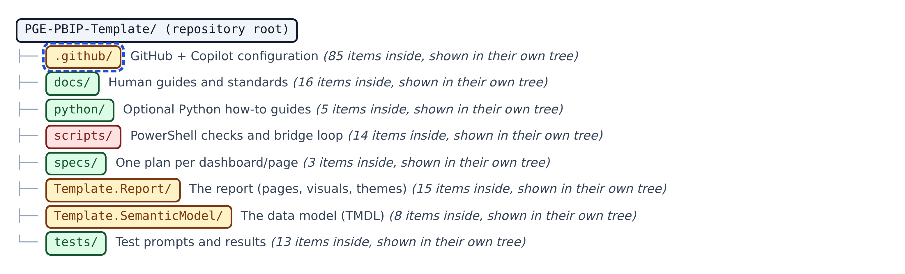

**Figure 14.2 — Root folders.** The nine top-level folders, each opened in its own tree below.

Walkthrough of Figure 14.2:

## 14.3 .github: top level

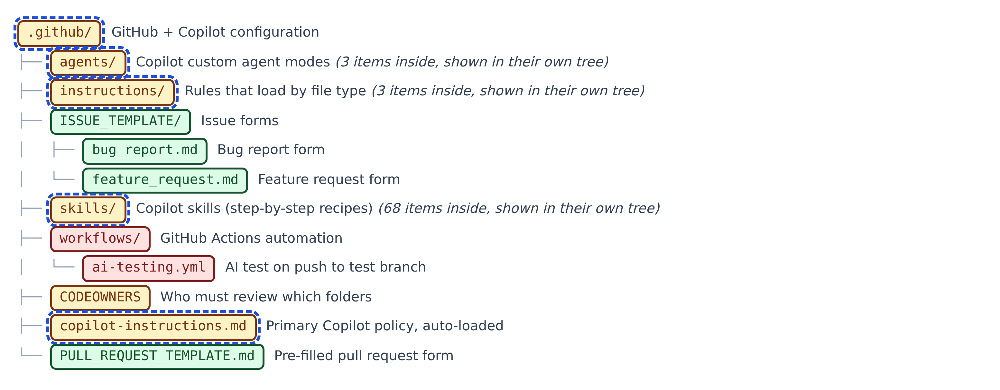

**Figure 14.3 — .github: top level.** GitHub's own configuration, plus the folders the AI agent reads.

Walkthrough of Figure 14.3:

1. `.github/` — **Amber** · **AI file**
   - *What it is:* GitHub's settings folder, which also holds all the AI agent configuration. Like the control room of the building.
   - *Technical role:* Holds Copilot policy, scoped instructions, agent modes, skills, issue and PR templates, CODEOWNERS and the workflow.
2. `.github/ISSUE_TEMPLATE/` — **Green**
   - *What it is:* Ready-made forms for reporting problems or asking for features. Like the forms at a help desk.
   - *Technical role:* GitHub issue-template folder.
3. `.github/ISSUE_TEMPLATE/bug_report.md` — **Green**
   - *What it is:* The form for reporting something broken. Like a repair request slip.
   - *Technical role:* Issue template with description, steps to reproduce, expected behaviour, context.
4. `.github/ISSUE_TEMPLATE/feature_request.md` — **Green**
   - *What it is:* The form for asking for something new. Like a suggestion-box card.
   - *Technical role:* Issue template with problem, proposed solution, context.
5. `.github/workflows/` — **Red**
   - *What it is:* Automation recipes GitHub runs for you. Like timers on a kitchen appliance.
   - *Technical role:* GitHub Actions workflow folder.
6. `.github/workflows/ai-testing.yml` — **Red**
   - *What it is:* Runs the AI test automatically when code reaches the test branch. Like an automatic inspection at the factory gate.
   - *Technical role:* Workflow: push to test or workflow_dispatch; validate-json, validate-pbip, run-ai-md-test.ps1; artifact 30 days; optional commit back.
7. `.github/CODEOWNERS` — **Amber**
   - *What it is:* Says which team must review changes to which folders. Like a sign-off sheet naming the inspector for each room.
   - *Technical role:* GitHub CODEOWNERS file; owners are auto-requested for review. Handles such as @your-org/bi-modelers are placeholders to replace.
8. `.github/copilot-instructions.md` — **Amber** · **AI file**
   - *What it is:* GitHub Copilot's main rulebook for this repository, loaded automatically every time. Like the manager's standing orders.
   - *Technical role:* Primary Copilot policy (wins conflicts); 12 guardrails, a map of where things live, checklist list, theme governance and validation commands.
9. `.github/PULL_REQUEST_TEMPLATE.md` — **Green**
   - *What it is:* The form every pull request starts with. Like a delivery note with tick boxes.
   - *Technical role:* Pre-fills new pull requests with a summary section and a three-item checklist (docs, tests, structure).

## 14.4 .github/agents and .github/instructions

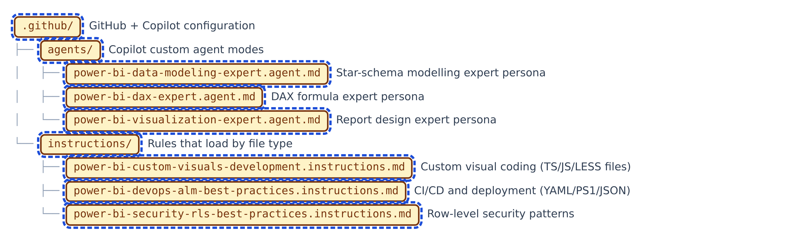

**Figure 14.4 — .github/agents and .github/instructions.** Expert modes and file-type rules for GitHub Copilot.

Walkthrough of Figure 14.4:

1. `.github/agents/` — **Amber** · **AI file**
   - *What it is:* Three 'expert hats' Copilot can put on. Like calling in a specialist consultant.
   - *Technical role:* Copilot custom agents (.agent.md): instructions plus a tool list for one role.
2. `.github/agents/power-bi-data-modeling-expert.agent.md` — **Amber** · **AI file**
   - *What it is:* Turns Copilot into a data-model expert (star schemas, relationships). Like a structural engineer.
   - *Technical role:* Custom agent (model gpt-4.1) with modelling guidance and repository override rules (measure homes, schema constraints).
3. `.github/agents/power-bi-dax-expert.agent.md` — **Amber** · **AI file**
   - *What it is:* Turns Copilot into a DAX formula expert. Like a specialist accountant for formulas.
   - *Technical role:* Custom agent with DAX best practices, anti-patterns and debugging; repository override rules for _Measures and _SVG_Measures.
4. `.github/agents/power-bi-visualization-expert.agent.md` — **Amber** · **AI file**
   - *What it is:* Turns Copilot into a report-design expert. Like an interior designer for dashboards.
   - *Technical role:* Custom agent with visual design, interactivity, accessibility and performance guidance; override rules for PBIP visual JSON.
5. `.github/instructions/` — **Amber** · **AI file**
   - *What it is:* Rules that switch on only for certain file types. Like safety rules that apply only in the workshop.
   - *Technical role:* Scoped Copilot instructions with applyTo glob patterns.
6. `.github/instructions/power-bi-custom-visuals-development.instructions.md` — **Amber** · **AI file**
   - *What it is:* Coding advice for writing custom charts. Like a carpentry manual for one kind of furniture.
   - *Technical role:* applyTo \*\*/\*.{ts,tsx,js,jsx,less,css}; React, D3.js, testing and performance patterns for Power BI visuals.
7. `.github/instructions/power-bi-devops-alm-best-practices.instructions.md` — **Amber** · **AI file**
   - *What it is:* Advice on releasing reports safely through test and production. Like a moving company's checklist.
   - *Technical role:* applyTo \*\*/\*.{yml,yaml,ps1,json,pbix,pbir}; deployment pipelines, REST API, Azure DevOps, environments, Key Vault; overridden by repo PBIP structure.
8. `.github/instructions/power-bi-security-rls-best-practices.instructions.md` — **Amber** · **AI file**
   - *What it is:* Advice on making sure each person sees only the data they should. Like a key-card system for rooms.
   - *Technical role:* applyTo \*\*/\*.{pbix,dax,md,txt,json,cs,ps1,psm1,psd1}; row-level security, dynamic RLS, embedded security, monitoring.

## 14.5 .github/skills, part 1

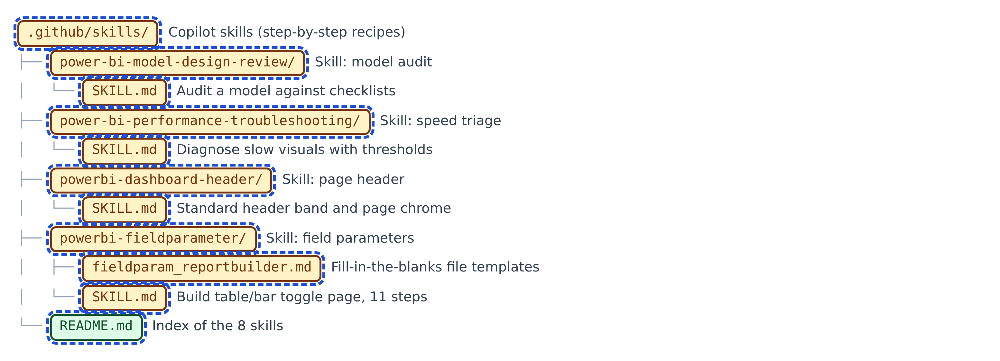

**Figure 14.5 — .github/skills, part 1.** The skills index and the first four skills.

Walkthrough of Figure 14.5:

1. `.github/skills/` — **Amber** · **AI file**
   - *What it is:* Step-by-step recipes the AI uses when a task matches. Like recipe cards in a kitchen drawer.
   - *Technical role:* Copilot agent skills: one folder per skill, each with a SKILL.md whose description routes tasks to it.
2. `.github/skills/power-bi-model-design-review/` — **Amber** · **AI file**
   - *What it is:* Folder for the 'model health check' skill.
   - *Technical role:* Skill folder.
3. `.github/skills/power-bi-model-design-review/SKILL.md` — **Amber** · **AI file**
   - *What it is:* A recipe for auditing an existing data model. Like a home inspection checklist.
   - *Technical role:* Skill: score checklist rows Pass/Needs Work/N/A, prioritise findings, output a Priority/Row/Status table.
4. `.github/skills/power-bi-performance-troubleshooting/` — **Amber** · **AI file**
   - *What it is:* Folder for the 'why is it slow?' skill.
   - *Technical role:* Skill folder.
5. `.github/skills/power-bi-performance-troubleshooting/SKILL.md` — **Amber** · **AI file**
   - *What it is:* A recipe for finding why a report is slow. Like a mechanic's diagnostic routine.
   - *Technical role:* Skill: thresholds (&lt;100 ms excellent, DAX >1000 ms review, queue >500 ms review), evidence-first triage, before/after timings.
6. `.github/skills/powerbi-dashboard-header/` — **Amber** · **AI file**
   - *What it is:* Folder for the page-header skill.
   - *Technical role:* Skill folder.
7. `.github/skills/powerbi-dashboard-header/SKILL.md` — **Amber** · **AI file**
   - *What it is:* A recipe for a consistent header band across pages: logo, title, filters, buttons. Like a letterhead template.
   - *Technical role:* Skill based on a client reference page; conflicts with rule 10 on visual titles and says to resolve per project in the spec.
8. `.github/skills/powerbi-fieldparameter/` — **Amber** · **AI file**
   - *What it is:* Folder for the field-parameter page skill.
   - *Technical role:* Skill folder.
9. `.github/skills/powerbi-fieldparameter/fieldparam_reportbuilder.md` — **Amber** · **AI file**
   - *What it is:* Fill-in-the-blanks file templates for the same page. Like a form letter with blanks.
   - *Technical role:* Boilerplate with {PLACEHOLDER} values for every TMDL, visual, button, slicer and bookmark file.
10. `.github/skills/powerbi-fieldparameter/SKILL.md` — **Amber** · **AI file**
   - *What it is:* A recipe for a page where users switch what a table and bar chart show. Like a TV remote that changes channels.
   - *Technical role:* 11-step skill: two field-parameter tables, table + clustered bar chart, two slicers, four buttons, two bookmarks; ID generation in PowerShell.
11. `.github/skills/README.md` — **Green** · **AI file**
   - *What it is:* The index card listing the eight skills. Like the contents page of the recipe box.
   - *Technical role:* Lists the 8 skills and points to docs/checklists/.

## 14.6 .github/skills, part 2

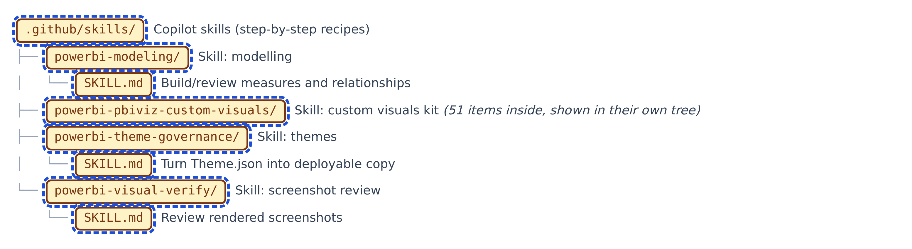

**Figure 14.6 — .github/skills, part 2.** Three more skills, and the custom-visual kit, which gets its own trees.

Walkthrough of Figure 14.6:

1. `.github/skills/powerbi-modeling/` — **Amber** · **AI file**
   - *What it is:* Folder for the modelling skill.
   - *Technical role:* Skill folder.
2. `.github/skills/powerbi-modeling/SKILL.md` — **Amber** · **AI file**
   - *What it is:* A recipe for building and reviewing measures and relationships. Like a builder's daily checklist.
   - *Technical role:* Skill: repository rules first, then relevant checklist rows, output Row/Area/Status/Evidence/Action table.
3. `.github/skills/powerbi-theme-governance/` — **Amber** · **AI file**
   - *What it is:* Folder for the theme skill.
   - *Technical role:* Skill folder.
4. `.github/skills/powerbi-theme-governance/SKILL.md` — **Amber** · **AI file**
   - *What it is:* A recipe for turning the editable theme into a safe, loadable one. Like proof-reading before printing.
   - *Technical role:* Skill: good->maximum, bad->minimum, add null, move #FFFFFF, keep 10 allowed root keys.
5. `.github/skills/powerbi-visual-verify/` — **Amber** · **AI file**
   - *What it is:* Folder for the screenshot-review skill.
   - *Technical role:* Skill folder.
6. `.github/skills/powerbi-visual-verify/SKILL.md` — **Amber** · **AI file**
   - *What it is:* A recipe for checking screenshots of the finished pages. Like a quality inspector's sheet.
   - *Technical role:* Skill: score rows, cite evidence, fix source not images, report by page display name; theme-specific checks.

## 14.7 Custom-visual kit: project files and tools

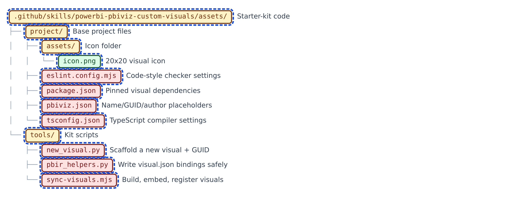

**Figure 14.7 — Custom-visual kit: project files and tools.** The base project every visual starts from, and the three kit scripts.

Walkthrough of Figure 14.7:

1. `.github/skills/powerbi-pbiviz-custom-visuals/assets/` — **Amber** · **AI file**
   - *What it is:* The starter-kit code the skill copies into a dashboard repository.
   - *Technical role:* Assets folder: project/, shared/, templates/, tools/.
2. `.github/skills/powerbi-pbiviz-custom-visuals/assets/project/` — **Amber** · **AI file**
   - *What it is:* The files every new visual project starts with. Like the blank chassis of a car.
   - *Technical role:* Base pbiviz project files copied by new_visual.py.
3. `.github/skills/powerbi-pbiviz-custom-visuals/assets/project/assets/` — **Amber** · **AI file**
   - *What it is:* Folder for the visual's icon.
   - *Technical role:* Icon folder referenced by pbiviz.json.
4. `.github/skills/powerbi-pbiviz-custom-visuals/assets/project/assets/icon.png` — **Green** · **AI file**
   - *What it is:* The tiny 20 x 20 picture shown for the visual in Power BI. Like a shop's sign.
   - *Technical role:* PNG icon referenced as assets.icon in pbiviz.json.
5. `.github/skills/powerbi-pbiviz-custom-visuals/assets/project/eslint.config.mjs` — **Red** · **AI file**
   - *What it is:* Settings for the code-style checker. Like a spell-checker's rule list.
   - *Technical role:* ESLint config using eslint-plugin-powerbi-visuals recommended rules; ignores node_modules, dist, .vscode, .tmp.
6. `.github/skills/powerbi-pbiviz-custom-visuals/assets/project/package.json` — **Red** · **AI file**
   - *What it is:* The shopping list of code libraries the visual needs, with exact versions. Like a parts list.
   - *Technical role:* npm manifest: powerbi-visuals-api 5.11.1, formattingmodel 6.0.4, TypeScript 5.5.4, ESLint; scripts pbiviz/start/package/lint.
7. `.github/skills/powerbi-pbiviz-custom-visuals/assets/project/pbiviz.json` — **Red** · **AI file**
   - *What it is:* The visual's identity card with blanks for name, GUID and author. Like an unfilled passport.
   - *Technical role:* pbiviz manifest with __NAME__, __GUID__, __AUTHOR_NAME__ etc. placeholders; apiVersion 5.11.1.
8. `.github/skills/powerbi-pbiviz-custom-visuals/assets/project/tsconfig.json` — **Red** · **AI file**
   - *What it is:* Settings for turning TypeScript into JavaScript. Like the translator's style sheet.
   - *Technical role:* TypeScript compiler options (ES2022, outDir .tmp/build/, src/visual.ts).
9. `.github/skills/powerbi-pbiviz-custom-visuals/assets/tools/` — **Amber** · **AI file**
   - *What it is:* Scripts that create, build and wire up visuals. Like power tools.
   - *Technical role:* new_visual.py, sync-visuals.mjs, pbir_helpers.py.
10. `.github/skills/powerbi-pbiviz-custom-visuals/assets/tools/new_visual.py` — **Red** · **AI file**
   - *What it is:* Creates a new visual project from a template and gives it a permanent ID. Like a birth certificate office.
   - *Technical role:* Python scaffolder: copies template, mints GUID, writes tools/visuals.json, installs shared lib and sync tooling, runs npm install (or --node-modules-from).
11. `.github/skills/powerbi-pbiviz-custom-visuals/assets/tools/pbir_helpers.py` — **Red** · **AI file**
   - *What it is:* Helpers for writing a page's visual files correctly. Like a form-filling assistant.
   - *Technical role:* Builders custom_visual, col, meas, props, literal encoders s/b/d/i, categorical_filter, check_against_capabilities; schema visualContainer 2.12.0.
12. `.github/skills/powerbi-pbiviz-custom-visuals/assets/tools/sync-visuals.mjs` — **Red** · **AI file**
   - *What it is:* Builds every visual and plugs it into the report. Like a factory line that also installs the product.
   - *Technical role:* Node script: sync shared code, bump build, pbiviz package, embed payload, register in report.json, verify references; --only, --check, --pbiviz-too, --project.

## 14.8 Custom-visual kit: shared library

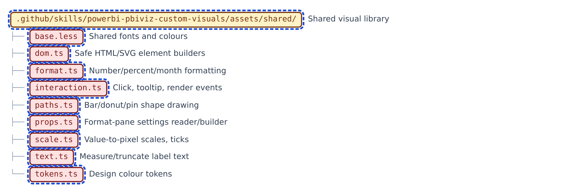

**Figure 14.8 — Custom-visual kit: shared library.** Code shared by every custom visual.

Walkthrough of Figure 14.8:

1. `.github/skills/powerbi-pbiviz-custom-visuals/assets/shared/` — **Amber** · **AI file**
   - *What it is:* Code shared by every custom visual. Like a shared toolbox in a workshop.
   - *Technical role:* Shared TypeScript/LESS library synced into each visual's src/shared/ at build time.
2. `.github/skills/powerbi-pbiviz-custom-visuals/assets/shared/base.less` — **Red** · **AI file**
   - *What it is:* Shared fonts and colours for every visual's styling. Like a paint colour card.
   - *Technical role:* LESS variables mirroring tokens.ts plus base html/body and empty-state styles.
3. `.github/skills/powerbi-pbiviz-custom-visuals/assets/shared/dom.ts` — **Red** · **AI file**
   - *What it is:* Safe helpers for creating page elements. Like pre-cut building blocks.
   - *Technical role:* createElement/createElementNS helpers (el, svg, svgText, clear, append); no innerHTML, which the lint step forbids.
4. `.github/skills/powerbi-pbiviz-custom-visuals/assets/shared/format.ts` — **Red** · **AI file**
   - *What it is:* Turns raw numbers into readable labels such as thousands and percentages. Like a price-tag printer.
   - *Technical role:* fmtValue, fmtDelta, fmtPct, fmtDeltaPct, fmtDeltaPp, fmtMonth; units K/M/none.
5. `.github/skills/powerbi-pbiviz-custom-visuals/assets/shared/interaction.ts` — **Red** · **AI file**
   - *What it is:* Makes visuals respond to clicks and hovering. Like the buttons on a remote control.
   - *Technical role:* Interactions class wrapping selection manager, tooltip service and render events; CLEAR_CATCHER; markOpacity.
6. `.github/skills/powerbi-pbiviz-custom-visuals/assets/shared/paths.ts` — **Red** · **AI file**
   - *What it is:* Draws shapes such as rounded bars and donut rings. Like stencils.
   - *Technical role:* SVG path builders: roundedTopBar, donutArc, pinTeardrop.
7. `.github/skills/powerbi-pbiviz-custom-visuals/assets/shared/props.ts` — **Red** · **AI file**
   - *What it is:* Reads and builds the visual's settings panel. Like the control panel wiring.
   - *Technical role:* PropSpec-driven readCard/buildCard/buildModel for the Format pane; literal-encoding notes.
8. `.github/skills/powerbi-pbiviz-custom-visuals/assets/shared/scale.ts` — **Red** · **AI file**
   - *What it is:* Converts numbers into positions on the screen. Like a ruler that maps money to centimetres.
   - *Technical role:* linearScale, bandScale, ticksByStep, niceStep, niceMax.
9. `.github/skills/powerbi-pbiviz-custom-visuals/assets/shared/text.ts` — **Red** · **AI file**
   - *What it is:* Measures and shortens labels so they fit. Like trimming a caption to fit a frame.
   - *Technical role:* measureText via an offscreen canvas; truncateToWidth.
10. `.github/skills/powerbi-pbiviz-custom-visuals/assets/shared/tokens.ts` — **Red** · **AI file**
   - *What it is:* The master list of colours and fonts for the visuals. Like a brand guide.
   - *Technical role:* Design tokens T: neutral greys, IBCS scenario colours (ac, pm), variance colours (pos, neg), swappable accent.

## 14.9 Custom-visual kit: templates, blank

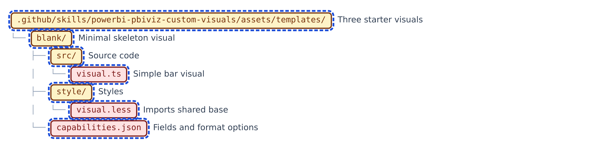

**Figure 14.9 — Custom-visual kit: templates, blank.** The templates folder and the minimal 'blank' starter visual.

Walkthrough of Figure 14.9:

1. `.github/skills/powerbi-pbiviz-custom-visuals/assets/templates/` — **Amber** · **AI file**
   - *What it is:* Three ready-to-adapt example visuals. Like model homes.
   - *Technical role:* Starter templates copied by new_visual.py --template.
2. `.github/skills/powerbi-pbiviz-custom-visuals/assets/templates/blank/` — **Amber** · **AI file**
   - *What it is:* The simplest example visual: one category, one number, horizontal bars.
   - *Technical role:* Template folder.
3. `.github/skills/powerbi-pbiviz-custom-visuals/assets/templates/blank/src/` — **Amber** · **AI file**
   - *What it is:* Source-code folder.
   - *Technical role:* Template source folder.
4. `.github/skills/powerbi-pbiviz-custom-visuals/assets/templates/blank/src/visual.ts` — **Red** · **AI file**
   - *What it is:* The drawing code for the simple bar visual. Like the engine.
   - *Technical role:* Minimal IVisual showing every required pattern: role parsing, Format pane, interactions, highlights, render events.
5. `.github/skills/powerbi-pbiviz-custom-visuals/assets/templates/blank/style/` — **Amber** · **AI file**
   - *What it is:* Style folder.
   - *Technical role:* Template style folder.
6. `.github/skills/powerbi-pbiviz-custom-visuals/assets/templates/blank/style/visual.less` — **Red** · **AI file**
   - *What it is:* The visual's style sheet. Like its paint job.
   - *Technical role:* Imports shared/base.less; svg display block.
7. `.github/skills/powerbi-pbiviz-custom-visuals/assets/templates/blank/capabilities.json` — **Red** · **AI file**
   - *What it is:* Tells Power BI which fields this visual accepts and which settings it has. Like the sockets on a device.
   - *Technical role:* Roles category (Grouping) and measure (Measure), categorical mapping (top 500), display object, supportsHighlight, privileges [].

## 14.10 Custom-visual kit: templates, varianceChart

**Figure 14.10 — Custom-visual kit: templates, varianceChart.** The IBCS period-chart starter visual (same six-item layout).

Walkthrough of Figure 14.10:

1. `.github/skills/powerbi-pbiviz-custom-visuals/assets/templates/varianceChart/` — **Amber** · **AI file**
   - *What it is:* A finance chart of values over time with a strip showing change from the previous period.
   - *Technical role:* IBCS period-chart template folder.
2. `.github/skills/powerbi-pbiviz-custom-visuals/assets/templates/varianceChart/src/` — **Amber** · **AI file**
   - *What it is:* Source-code folder.
   - *Technical role:* Template source folder.
3. `.github/skills/powerbi-pbiviz-custom-visuals/assets/templates/varianceChart/src/visual.ts` — **Red** · **AI file**
   - *What it is:* The drawing code for the period chart and its variance strip.
   - *Technical role:* IBCS chart: AC columns/line/area with data labels; green/red variance strip; percentage-point variances for ratios.
4. `.github/skills/powerbi-pbiviz-custom-visuals/assets/templates/varianceChart/style/` — **Amber** · **AI file**
   - *What it is:* Style folder.
   - *Technical role:* Template style folder.
5. `.github/skills/powerbi-pbiviz-custom-visuals/assets/templates/varianceChart/style/visual.less` — **Red** · **AI file**
   - *What it is:* The period chart's style sheet.
   - *Technical role:* Imports shared/base.less; svg display block.
6. `.github/skills/powerbi-pbiviz-custom-visuals/assets/templates/varianceChart/capabilities.json` — **Red** · **AI file**
   - *What it is:* Fields and settings for the period chart. Like the sockets on a device.
   - *Technical role:* Roles category (Period) and measure (Value AC); chart type column/line/area, value format, variance options.

## 14.11 Custom-visual kit: templates, varianceTable

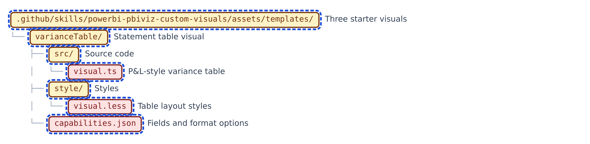

**Figure 14.11 — Custom-visual kit: templates, varianceTable.** The IBCS statement-table starter visual (same six-item layout).

Walkthrough of Figure 14.11:

1. `.github/skills/powerbi-pbiviz-custom-visuals/assets/templates/varianceTable/` — **Amber** · **AI file**
   - *What it is:* A finance statement table, such as a profit-and-loss, with variance bars.
   - *Technical role:* IBCS statement-table template folder.
2. `.github/skills/powerbi-pbiviz-custom-visuals/assets/templates/varianceTable/src/` — **Amber** · **AI file**
   - *What it is:* Source-code folder.
   - *Technical role:* Template source folder.
3. `.github/skills/powerbi-pbiviz-custom-visuals/assets/templates/varianceTable/src/visual.ts` — **Red** · **AI file**
   - *What it is:* The drawing code for the statement table. Like an accountant's ledger that draws itself.
   - *Technical role:* Two layouts (variance / cross-tab), running P&L results, ratio rows, expand/collapse, cross-filtering; additive measures only.
4. `.github/skills/powerbi-pbiviz-custom-visuals/assets/templates/varianceTable/style/` — **Amber** · **AI file**
   - *What it is:* Style folder.
   - *Technical role:* Template style folder.
5. `.github/skills/powerbi-pbiviz-custom-visuals/assets/templates/varianceTable/style/visual.less` — **Red** · **AI file**
   - *What it is:* The statement table's style sheet.
   - *Technical role:* Table layout styles (rows, columns, tabular numbers) on top of shared/base.less.
6. `.github/skills/powerbi-pbiviz-custom-visuals/assets/templates/varianceTable/capabilities.json` — **Red** · **AI file**
   - *What it is:* Fields and settings for the statement table.
   - *Technical role:* Roles rows, rowOrder, period, ac, pm (table mapping); statement, display and colour objects.

## 14.12 Custom-visual kit: SKILL.md and references

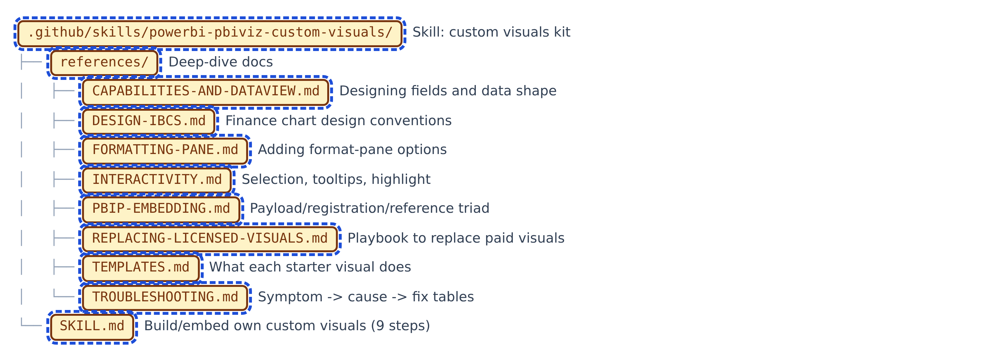

**Figure 14.12 — Custom-visual kit: SKILL.md and references.** The skill procedure and its eight reference documents.

Walkthrough of Figure 14.12:

1. `.github/skills/powerbi-pbiviz-custom-visuals/` — **Amber** · **AI file**
   - *What it is:* Folder for the custom-visual kit. Like a complete workshop for building your own chart types.
   - *Technical role:* Skill folder containing SKILL.md, assets/ and references/.
2. `.github/skills/powerbi-pbiviz-custom-visuals/references/` — **Amber** · **AI file**
   - *What it is:* Deep-dive manuals for the kit. Like the appendix of a workshop manual.
   - *Technical role:* Eight reference documents linked from SKILL.md.
3. `.github/skills/powerbi-pbiviz-custom-visuals/references/CAPABILITIES-AND-DATAVIEW.md` — **Amber** · **AI file**
   - *What it is:* How to decide which fields a visual takes and how the data arrives. Like a socket-and-plug guide.
   - *Technical role:* dataRoles, categorical vs table mappings, conditions, data reduction, dates, highlights, privileges.
4. `.github/skills/powerbi-pbiviz-custom-visuals/references/DESIGN-IBCS.md` — **Amber** · **AI file**
   - *What it is:* Design rules so custom visuals match the rest of the report. Like a style guide.
   - *Technical role:* Chrome suppression, tokens, IBCS semantics, number formats, typography, empty states.
5. `.github/skills/powerbi-pbiviz-custom-visuals/references/FORMATTING-PANE.md` — **Amber** · **AI file**
   - *What it is:* How to add settings users can change in the Format pane. Like adding knobs to a control panel.
   - *Technical role:* Declaring objects in capabilities, PropSpec reading/building, writing from visual.json, conventions.
6. `.github/skills/powerbi-pbiviz-custom-visuals/references/INTERACTIVITY.md` — **Amber** · **AI file**
   - *What it is:* How to make clicks, tooltips and highlighting work. Like wiring the doorbell.
   - *Technical role:* Selection IDs, standard update() shape, local expand state, page interactions, keyboard accessibility.
7. `.github/skills/powerbi-pbiviz-custom-visuals/references/PBIP-EMBEDDING.md` — **Amber** · **AI file**
   - *What it is:* How a built visual is stored inside the report so it opens anywhere. Like packing furniture inside the house.
   - *Technical role:* Payload / registration / reference triad, GUID identity, version cache, Desktop-closed rule, repo layout.
8. `.github/skills/powerbi-pbiviz-custom-visuals/references/REPLACING-LICENSED-VISUALS.md` — **Amber** · **AI file**
   - *What it is:* Step-by-step plan for replacing a paid chart whose licence expired. Like a renovation plan.
   - *Technical role:* Playbook steps 0-7: get to PBIR, inventory, map roles, profile data, decide what not to copy, build, verify, report.
9. `.github/skills/powerbi-pbiviz-custom-visuals/references/TEMPLATES.md` — **Amber** · **AI file**
   - *What it is:* What each starter visual does and how to bind it. Like model-home brochures.
   - *Technical role:* Roles, objects, behaviour, sizing and example bindings for varianceTable, varianceChart, blank.
10. `.github/skills/powerbi-pbiviz-custom-visuals/references/TROUBLESHOOTING.md` — **Amber** · **AI file**
   - *What it is:* A symptom-to-fix table for when things go wrong. Like a car's fault-finding chart.
   - *Technical role:* Tables for build, embedding, binding, rendering and model-side failures.
11. `.github/skills/powerbi-pbiviz-custom-visuals/SKILL.md` — **Amber** · **AI file**
   - *What it is:* The recipe for building, embedding and checking your own chart types. Like the workshop manual.
   - *Technical role:* Skill: 3 mandatory questions, workflow 0-9, 10 hard rules, starter kit table, pinned versions, definition of done.

## 14.13 Template.Report: definition

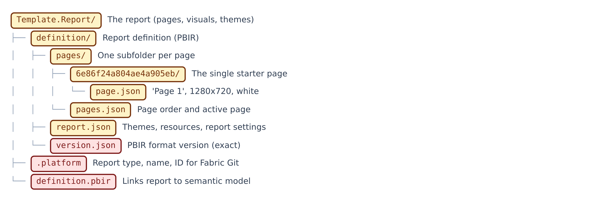

**Figure 14.13 — Template.Report: definition.** The report's pointer file, ID card and definition files.

Walkthrough of Figure 14.13:

1. `Template.Report/` — **Amber**
   - *What it is:* The report itself: pages, visuals and themes, as text files. Like the plated meal.
   - *Technical role:* PBIP report folder in PBIR format.
2. `Template.Report/definition/` — **Amber**
   - *What it is:* The report's detailed definition files. Like the report's filing drawer.
   - *Technical role:* PBIR definition folder.
3. `Template.Report/definition/pages/` — **Amber**
   - *What it is:* One folder per report page, plus the page order. Like pages in a binder.
   - *Technical role:* Pages folder.
4. `Template.Report/definition/pages/6e86f24a804ae4a905eb/` — **Amber**
   - *What it is:* The folder for the only page, named by a machine-made ID.
   - *Technical role:* Page folder (20-character hex id).
5. `Template.Report/definition/pages/6e86f24a804ae4a905eb/page.json` — **Amber**
   - *What it is:* Describes the blank starter page: name 'Page 1', size, white surround. Like a blank canvas on an easel.
   - *Technical role:* page 2.1.0 schema: displayName Page 1, FitToPage, 1280x720, outspace #FFFFFF.
6. `Template.Report/definition/pages/pages.json` — **Amber**
   - *What it is:* The order of pages and which one opens first. Like a table of contents.
   - *Technical role:* pagesMetadata: pageOrder [6e86f24a804ae4a905eb], activePageName.
7. `Template.Report/definition/report.json` — **Amber**
   - *What it is:* Report-wide settings and the list of themes and resources. Like the report's master settings page.
   - *Technical role:* report 3.2.0 schema: themeCollection (CY26SU02 + PGEColors), resourcePackages, section alignment, report settings.
8. `Template.Report/definition/version.json` — **Red**
   - *What it is:* A tiny file stating the report format version. Must be exactly right. Like a format stamp.
   - *Technical role:* versionMetadata 1.0.0 schema with version 2.0.0; copilot-instructions.md gives its exact required content.
9. `Template.Report/.platform` — **Red**
   - *What it is:* The report's ID card for Microsoft Fabric's Git sync. Like a passport number.
   - *Technical role:* Fabric platform file: type Report, displayName Template, logicalId GUID.
10. `Template.Report/definition.pbir` — **Red**
   - *What it is:* Tells the report where its data model is. Like a forwarding address.
   - *Technical role:* Report definition properties (version 4.0); datasetReference.byPath ../Template.SemanticModel.

## 14.14 Template.Report: StaticResources

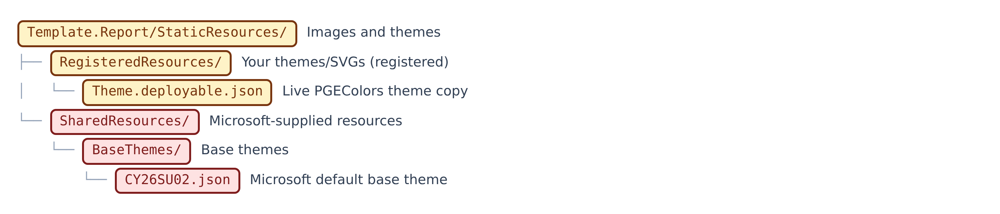

**Figure 14.14 — Template.Report: StaticResources.** Themes and images used by the report.

Walkthrough of Figure 14.14:

1. `Template.Report/StaticResources/` — **Amber**
   - *What it is:* Pictures and themes the report uses. Like the report's storeroom.
   - *Technical role:* StaticResources folder.
2. `Template.Report/StaticResources/RegisteredResources/` — **Amber**
   - *What it is:* Your own themes and background pictures, each listed in report.json. Like your own shelf in the storeroom.
   - *Technical role:* RegisteredResources package folder.
3. `Template.Report/StaticResources/RegisteredResources/Theme.deployable.json` — **Amber**
   - *What it is:* The team colour theme the report actually uses. Like the paint actually on the walls.
   - *Technical role:* PGEColors custom theme, registered as type CustomTheme; identical to docs/theme/Theme.deployable.json.
4. `Template.Report/StaticResources/SharedResources/` — **Red**
   - *What it is:* Resources supplied by Microsoft. Like the landlord's fixtures.
   - *Technical role:* SharedResources package folder.
5. `Template.Report/StaticResources/SharedResources/BaseThemes/` — **Red**
   - *What it is:* Microsoft's base themes.
   - *Technical role:* BaseThemes folder.
6. `Template.Report/StaticResources/SharedResources/BaseThemes/CY26SU02.json` — **Red**
   - *What it is:* Microsoft's default theme underneath the team theme. Like the primer coat under the paint.
   - *Technical role:* Base theme CY26SU02 (940 lines) registered under SharedResources.

## 14.15 Template.SemanticModel

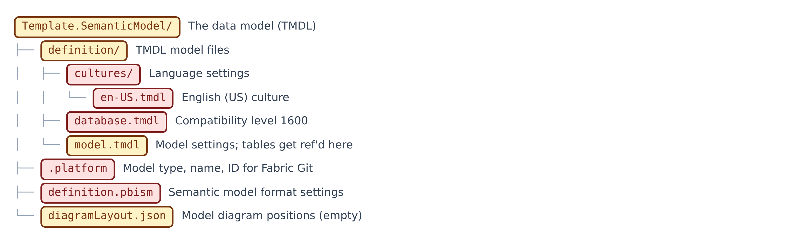

**Figure 14.15 — Template.SemanticModel.** The data model, as TMDL text files.

Walkthrough of Figure 14.15:

1. `Template.SemanticModel/` — **Amber**
   - *What it is:* The data model: tables, relationships and measures, as text files. Like the kitchen and pantry.
   - *Technical role:* PBIP semantic model folder in TMDL format.
2. `Template.SemanticModel/definition/` — **Amber**
   - *What it is:* The TMDL files describing the model.
   - *Technical role:* TMDL definition folder; tables/ is added when tables exist.
3. `Template.SemanticModel/definition/cultures/` — **Red**
   - *What it is:* Language settings folder.
   - *Technical role:* Cultures folder.
4. `Template.SemanticModel/definition/cultures/en-US.tmdl` — **Red**
   - *What it is:* Declares English (US) as the model language. Like setting the language on a phone.
   - *Technical role:* cultureInfo en-US.
5. `Template.SemanticModel/definition/database.tmdl` — **Red**
   - *What it is:* Sets the model engine's compatibility level. Like the voltage rating on an appliance.
   - *Technical role:* database compatibilityLevel 1600.
6. `Template.SemanticModel/definition/model.tmdl` — **Amber**
   - *What it is:* Model-wide settings; tables get listed here as they are added. Like the pantry's index.
   - *Technical role:* model Model: culture en-US, powerBI_V3 data source version, time-intelligence annotation 1, PBI_ProTooling DevMode, ref cultureInfo en-US.
7. `Template.SemanticModel/.platform` — **Red**
   - *What it is:* The model's ID card for Microsoft Fabric's Git sync.
   - *Technical role:* Fabric platform file: type SemanticModel, displayName Template, logicalId GUID.
8. `Template.SemanticModel/definition.pbism` — **Red**
   - *What it is:* Says which model format version this is. Like an edition number.
   - *Technical role:* semanticModel definitionProperties 1.0.0 schema, version 4.2.
9. `Template.SemanticModel/diagramLayout.json` — **Amber**
   - *What it is:* Remembers where tables sit in Power BI's model diagram. Like a seating plan. Empty for now.
   - *Technical role:* Diagram layout (All tables) with no nodes.

## 14.16 docs: guides

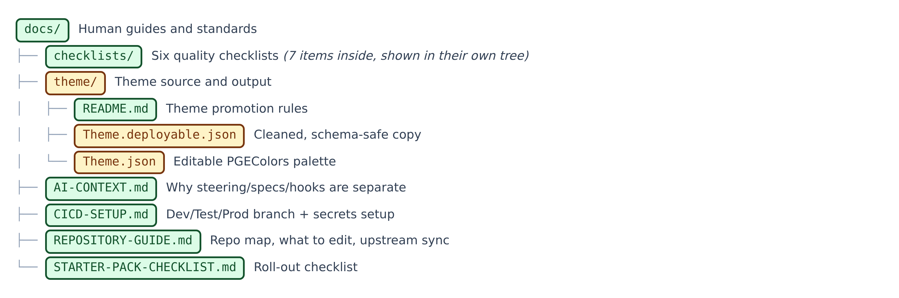

**Figure 14.16 — docs: guides.** Human guides, the theme source, and the checklists folder.

Walkthrough of Figure 14.16:

1. `docs/` — **Green**
   - *What it is:* Human-readable guides and quality standards. Like the company handbook shelf.
   - *Technical role:* Documentation folder.
2. `docs/theme/` — **Amber**
   - *What it is:* The team theme's editable source and its cleaned-up copy.
   - *Technical role:* Theme source and deployable output folder.
3. `docs/theme/README.md` — **Green**
   - *What it is:* Explains how the editable theme becomes the deployable one. Like a recipe card for the paint mix.
   - *Technical role:* Promotion rules and checklist alignment for Theme.json -> Theme.deployable.json.
4. `docs/theme/Theme.deployable.json` — **Amber**
   - *What it is:* The cleaned theme, safe to load into a report. Like paint mixed and ready to use.
   - *Technical role:* Deployable theme: maximum/minimum/null, white moved last, 10 allowed root keys.
5. `docs/theme/Theme.json` — **Amber**
   - *What it is:* The editable team colour theme (PGEColors). Like the designer's paint swatch book.
   - *Technical role:* Source theme with legacy good/bad keys and #FFFFFF first; starts with a UTF-8 BOM.
6. `docs/AI-CONTEXT.md` — **Green**
   - *What it is:* Explains why rules, plans and automatic checks are kept separate. Like the 'why we do it this way' chapter.
   - *Technical role:* Steering / specs / hooks model, Markdown vs JSON/TMDL/YAML, which layer a rule belongs to.
7. `docs/CICD-SETUP.md` — **Green**
   - *What it is:* How to set up dev, test and prod branches, environments and secrets. Like instructions for setting up three rooms.
   - *Technical role:* CI/CD guide: branches, environments, Fabric secrets, workspace variables, branch protection, AI and Python test stages; refers to a cd.yml not present.
8. `docs/REPOSITORY-GUIDE.md` — **Green**
   - *What it is:* A map of what to reuse, what to customise and how to get template updates. Like a floor plan with 'staff only' signs.
   - *Technical role:* Repo map table, files not to edit, workflow for adding an existing PBIP, validation commands, upstream sync.
9. `docs/STARTER-PACK-CHECKLIST.md` — **Green**
   - *What it is:* A to-do list for turning the template into a complete team platform. Like a move-in checklist.
   - *Technical role:* Checkbox lists: governance, secrets, model, report, testing, deployment, agentic enablement.

## 14.17 docs/checklists

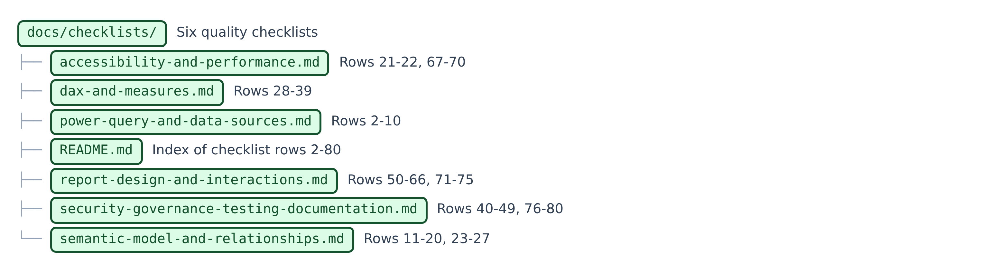

**Figure 14.17 — docs/checklists.** Six focused quality checklists and their index.

Walkthrough of Figure 14.17:

1. `docs/checklists/` — **Green**
   - *What it is:* Six focused quality checklists. Like inspection forms for each trade.
   - *Technical role:* Checklist folder (rows 2-80 of a modelling checklist workbook).
2. `docs/checklists/accessibility-and-performance.md` — **Green**
   - *What it is:* Checks for speed and for readability by everyone. Like a road test and an eye test.
   - *Technical role:* Rows 21-22, 67-70: visual density, slicer cardinality, contrast, text size, Performance Analyzer, query reduction.
3. `docs/checklists/dax-and-measures.md` — **Green**
   - *What it is:* Checks for well-written calculations. Like an accountant's review.
   - *Technical role:* Rows 28-39: measures vs columns, naming, explicit measures, calculation groups, date table, DIVIDE, VAR, formatting.
4. `docs/checklists/power-query-and-data-sources.md` — **Green**
   - *What it is:* Checks for how data is loaded and cleaned. Like checking deliveries at the back door.
   - *Technical role:* Rows 2-10: parameters, local files, query folding, staging, column reduction, typing, naming, documentation.
5. `docs/checklists/README.md` — **Green**
   - *What it is:* The index of the six checklists and how to use them. Like the cover sheet of an inspection pack.
   - *Technical role:* Row ranges per file; Pass / Needs Work / N/A method; skill alignment.
6. `docs/checklists/report-design-and-interactions.md` — **Green**
   - *What it is:* Checks for layout, visuals and clicks. Like a designer's review.
   - *Technical role:* Rows 50-66, 71-75: grid, theme, navigation, visual choice, labels, interactions, drillthrough, field parameters, consistency.
7. `docs/checklists/security-governance-testing-documentation.md` — **Green**
   - *What it is:* Checks for security, sign-off, testing and documentation. Like the compliance audit.
   - *Technical role:* Rows 40-49, 76-80: RLS, OLS, sensitivity labels, permissions, lineage, refresh, changelog, QA, exports, decommission.
8. `docs/checklists/semantic-model-and-relationships.md` — **Green**
   - *What it is:* Checks for a well-shaped data model. Like a structural survey.
   - *Technical role:* Rows 11-20, 23-27: star schema, cardinality, filter direction, keys, DirectQuery, Auto Date-Time, hiding, metadata.

## 14.18 python

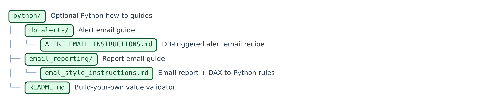

**Figure 14.18 — python.** Optional Python guidance; no scripts ship here.

Walkthrough of Figure 14.18:

1. `python/` — **Green**
   - *What it is:* Optional how-to guides for Python reporting and alerts. No scripts ship here.
   - *Technical role:* Python guidance folder.
2. `python/db_alerts/` — **Green**
   - *What it is:* The alert-email guide folder.
   - *Technical role:* Folder.
3. `python/db_alerts/ALERT_EMAIL_INSTRUCTIONS.md` — **Green**
   - *What it is:* A complete recipe for a database-triggered alert email. Like a template for a night-guard's report.
   - *Technical role:* pyodbc + pandas + python-dotenv; .env credentials; 6 phases; Outlook-safe HTML components; severity logic; checklist.
4. `python/email_reporting/` — **Green**
   - *What it is:* The report-email guide folder.
   - *Technical role:* Folder.
5. `python/email_reporting/emal_style_instructions.md` — **Green**
   - *What it is:* Rules for emails that copy a Power BI page, including how to make Python numbers match DAX. Like a translation guide.
   - *Technical role:* Three joined documents: boilerplate skill, Parts A-E (DAX-to-Python protocol, HTML, Python, charts, project ref), HTML style guide. File name has a typo ('emal').
6. `python/README.md` — **Green**
   - *What it is:* How to write your own Python checker that compares dashboard numbers with the database. Like instructions to build your own measuring tape.
   - *Technical role:* Build-your-own validator guidance: read PBIP, find Sales-by-Branch visual, generate SQL, dry-run, outputs to tests/results/.

## 14.19 scripts

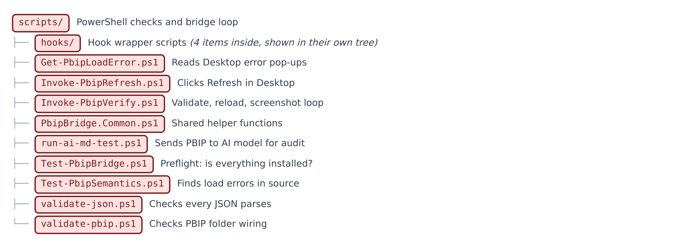

**Figure 14.19 — scripts.** PowerShell validation and verification scripts.

Walkthrough of Figure 14.19:

1. `scripts/` — **Red**
   - *What it is:* PowerShell scripts that check the files and drive Power BI Desktop. Like the inspection machines.
   - *Technical role:* Validation, bridge verification, AI test runner and hook wrappers.
2. `scripts/Get-PbipLoadError.ps1` — **Red**
   - *What it is:* Reads Power BI's error pop-ups so they can be fixed. Like someone reading a warning light's message aloud.
   - *Technical role:* UI Automation reader for 'Issues were found' and 'Your report has issues' dialogs; root-cause collapsing; Dismiss/Continue/CloseDesktop actions.
3. `scripts/Invoke-PbipRefresh.ps1` — **Red**
   - *What it is:* Clicks Power BI's Refresh button so a new project shows data. Like pressing 'play' for someone.
   - *Technical role:* UI Automation: 'Refresh now' banner or Home ribbon Refresh, because the bridge has no refresh method.
4. `scripts/Invoke-PbipVerify.ps1` — **Red**
   - *What it is:* Reloads Power BI and takes a screenshot of every page. Like a camera that photographs every room after work.
   - *Technical role:* Verify engine: validate, semantic gate, find instance, reload, detect issues dialog, screenshot-all, page manifest; statuses and warnings.
5. `scripts/PbipBridge.Common.ps1` — **Red**
   - *What it is:* Shared helper functions used by the other bridge scripts. Like a shared toolbox.
   - *Technical role:* Project discovery, Desktop version, bridge pipe, CLI calls, instance matching, reopen, load wait, definition hash, page manifest.
6. `scripts/run-ai-md-test.ps1` — **Red**
   - *What it is:* Sends the project files and a test prompt to an AI model and saves its report. Like mailing a sample to a lab.
   - *Technical role:* AI test runner: prompt + PBIP files to a chat API; skipped mode without key; writes test_results.md, history, latest_run.json.
7. `scripts/Test-PbipBridge.ps1` — **Red**
   - *What it is:* A preflight check that everything needed for the screenshot loop is installed and open. Like a pilot's pre-flight checklist.
   - *Technical role:* Read-only: project, Desktop version >= 2.155.756.0, both CLIs, bridge pipe, matching instance, semantic and PBIR validation.
8. `scripts/Test-PbipSemantics.ps1` — **Red**
   - *What it is:* Finds, in the text, the errors Power BI would otherwise show as a pop-up. Like a spell-checker for the model.
   - *Technical role:* File-local and cross-file semantic checks on TMDL and PBIR; -Path for one file; -Quiet.
9. `scripts/validate-json.ps1` — **Red**
   - *What it is:* Checks that every JSON-style file can be read. Like checking every envelope is sealed.
   - *Technical role:* Parses \*.json, \*.pbip, \*.pbir, \*.pbism recursively, excluding dependency folders, package-lock.json and tsconfig.json.
10. `scripts/validate-pbip.ps1` — **Red**
   - *What it is:* Checks the project folders are wired together properly. Like checking every pipe connects.
   - *Technical role:* Follows .pbip -> report -> definition.pbir -> model; required files; resource items exist; custom visual GUIDs registered.

## 14.20 scripts/hooks

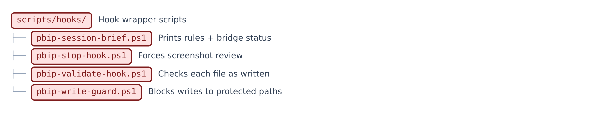

**Figure 14.20 — scripts/hooks.** The four hook wrapper scripts.

Walkthrough of Figure 14.20:

1. `scripts/hooks/` — **Red**
   - *What it is:* Small wrapper scripts meant to run at fixed moments. Like smoke alarms.
   - *Technical role:* Hook wrappers; fail open; read hook JSON from standard input.
2. `scripts/hooks/pbip-session-brief.ps1` — **Red**
   - *What it is:* Prints the house rules and whether Power BI's bridge is ready. Like a morning briefing.
   - *Technical role:* Session-start brief; reads the bridge named pipe; fails open and silent.
3. `scripts/hooks/pbip-stop-hook.ps1` — **Red**
   - *What it is:* Makes sure screenshots are reviewed before work is called finished. Like a supervisor's final sign-off.
   - *Technical role:* Stop wrapper: content-hash change detection, one-round fix budget, runs Invoke-PbipVerify, blocks with the report.
4. `scripts/hooks/pbip-validate-hook.ps1` — **Red**
   - *What it is:* Checks each file the moment it is written. Like a proof-reader at your shoulder.
   - *Technical role:* Post-write: JSON parse and filter checks; TMDL BOM, // comments, file-local semantics; exit 2 on failure.
5. `scripts/hooks/pbip-write-guard.ps1` — **Red**
   - *What it is:* Stops the agent writing into protected folders. Like a 'staff only' door lock.
   - *Technical role:* Blocks Write/Edit/NotebookEdit to Proposals/, \*\*/.pbi/, tests/screenshots/, .github/.pbip-state/ with exit code 2.

## 14.21 specs

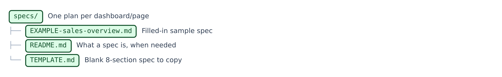

**Figure 14.21 — specs.** Plans for one dashboard or page at a time.

Walkthrough of Figure 14.21:

1. `specs/` — **Green**
   - *What it is:* One plan per dashboard or page, written before building. Like architects' drawings.
   - *Technical role:* Specs folder.
2. `specs/EXAMPLE-sales-overview.md` — **Green**
   - *What it is:* A filled-in example plan for a Sales Overview page. Like a sample completed form.
   - *Technical role:* Worked example (status built): tables, measures, relationships, page grid, card_y+30 placement, fold-back notes.
3. `specs/README.md` — **Green**
   - *What it is:* Explains what a spec is, when one is required, and the definition of done. Like the cover note on a drawing set.
   - *Technical role:* Spec purpose, when required, lifecycle, naming, difference from tests/prompts, definition of done.
4. `specs/TEMPLATE.md` — **Green**
   - *What it is:* The blank eight-part plan to copy for every new page. Like a blank order form.
   - *Technical role:* Sections: goal, data, pages, rules, build tasks, definition of done, open questions, fold-back.

## 14.22 tests: prompts

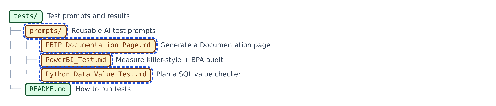

**Figure 14.22 — tests: prompts.** The tests folder, its guide and the three AI prompts.

Walkthrough of Figure 14.22:

1. `tests/` — **Green**
   - *What it is:* Test prompts and their results. Like the lab.
   - *Technical role:* Testing folder.
2. `tests/prompts/` — **Amber** · **AI file**
   - *What it is:* Reusable instructions you give the AI to run a test or job. Like standard lab procedures.
   - *Technical role:* Execution prompts reused unchanged.
3. `tests/prompts/PBIP_Documentation_Page.md` — **Amber** · **AI file**
   - *What it is:* The AI prompt that builds a Documentation page summarising the project. Like asking for an 'about this building' plaque.
   - *Technical role:* 7-phase prompt: inventory, SVG canvas, register resource, add page, update pages.json, markdown summary.
4. `tests/prompts/PowerBI_Test.md` — **Amber** · **AI file**
   - *What it is:* The AI audit prompt that looks for unused or broken model parts. Like a full health check request.
   - *Technical role:* 8-phase 'Measure Killer-style' + BPA audit prompt with severity markers and a fixed layout.
5. `tests/prompts/Python_Data_Value_Test.md` — **Amber** · **AI file**
   - *What it is:* The AI prompt that plans (but does not write) a Python number checker. Like asking for a blueprint.
   - *Technical role:* Instruction-only blueprint for a SQL validator: Sales by Branch, --branch/--month/--year/--dry-run.
6. `tests/README.md` — **Green**
   - *What it is:* How to run the tests locally and on GitHub. Like the lab's instruction sheet.
   - *Technical role:* Structure, local commands, Python value testing, credentials, CI integration.

## 14.23 tests/results

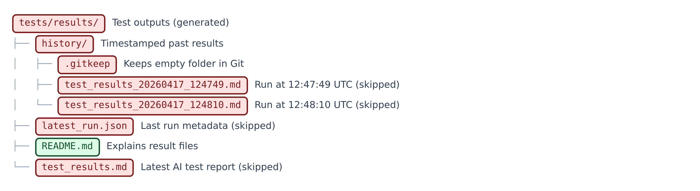

**Figure 14.23 — tests/results.** Generated test reports (Red: written by scripts).

Walkthrough of Figure 14.23:

1. `tests/results/` — **Red**
   - *What it is:* Where test reports are saved. Like the lab's results tray.
   - *Technical role:* Generated results folder.
2. `tests/results/history/` — **Red**
   - *What it is:* Every past test report, with a timestamp. Like an archive drawer.
   - *Technical role:* History folder.
3. `tests/results/history/.gitkeep` — **Red**
   - *What it is:* An empty file that keeps the empty folder in Git. Like a bookmark holding a place.
   - *Technical role:* Placeholder: Git does not store empty folders.
4. `tests/results/history/test_results_20260417_124749.md` — **Red**
   - *What it is:* A past test report from 17 April 2026, 12:47:49 UTC (skipped).
   - *Technical role:* Generated history copy.
5. `tests/results/history/test_results_20260417_124810.md` — **Red**
   - *What it is:* A past test report from 17 April 2026, 12:48:10 UTC (skipped).
   - *Technical role:* Generated history copy; same content as test_results.md.
6. `tests/results/latest_run.json` — **Red**
   - *What it is:* Details of the latest test run. Like the lab report's cover sheet.
   - *Technical role:* Run metadata: generatedUtc, promptFile, outputFile, reason, mode skipped, historyFile.
7. `tests/results/README.md` — **Green**
   - *What it is:* Explains the result files. Like a key to the results tray.
   - *Technical role:* Describes test_results.md, latest_run.json and history/.
8. `tests/results/test_results.md` — **Red**
   - *What it is:* The latest AI test report; today it says the test was skipped for lack of a key. Like the most recent lab report.
   - *Technical role:* Generated by run-ai-md-test.ps1 (skipped mode, 2026-04-17 12:48:10 UTC).

---

**Coverage check:** 176 of 176 items listed above.
