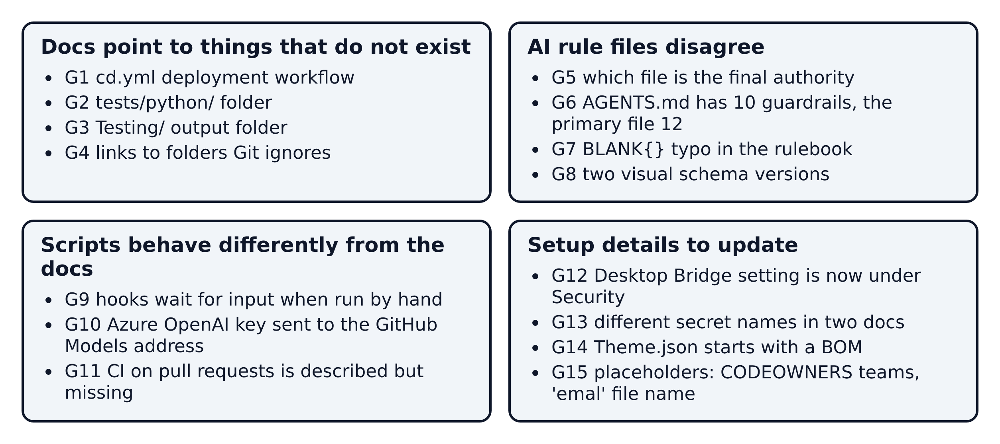
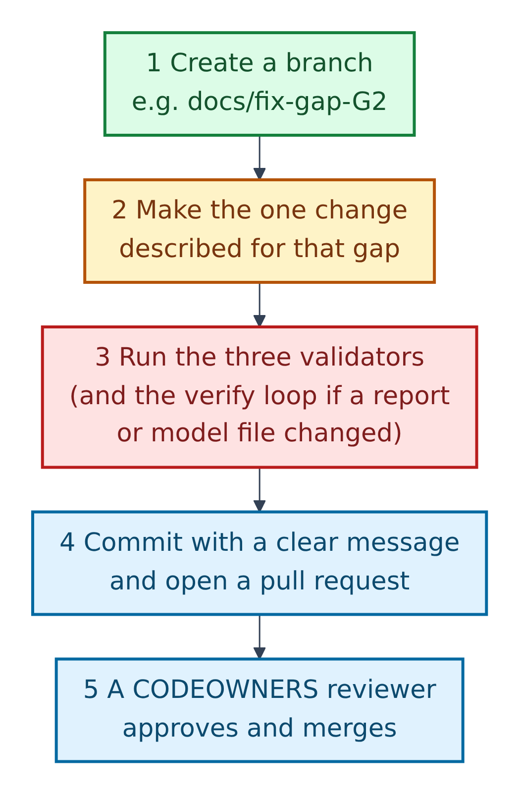

# 14. Known gaps and how to fix them

While reading every file for this guide, we found 15 places where the repo's docs disagree with each other, point to things that don't exist, or promise behaviour the scripts don't have. None of them stops the template working, but each can trip you up.

**Figure 14.1 — The 15 gaps in four groups.**

1. **G1–G4:** docs point to things that don't exist.
2. **G5–G8:** the AI rule files disagree.
3. **G9–G11:** scripts behave differently from the docs.
4. **G12–G15:** setup details to update.

This guide changes no repo files. Each fix below is for you or a maintainer to make as a separate change.

**Figure 14.2 — Apply any fix in five steps.**

1. Create a branch named after the gap, e.g. `docs/fix-gap-G2`.
2. Make only that change.
3. Run the three validators (and the verify loop if you touched report or model files).
4. Commit and open a pull request naming the gap.
5. A `CODEOWNERS` reviewer approves and merges. Amber + AI files always need a review.

## Docs point to things that don't exist

**G1. No `cd.yml`.** `docs/CICD-SETUP.md` describes deployments "using `workflow_dispatch` in `.github/workflows/cd.yml`", but only `ai-testing.yml` exists.
*Fix:* if you don't need automated deployment yet, mark sections 2–6 of that doc as "planned". If you do, have a platform engineer write `cd.yml` with the inputs the doc names (`target_environment`, `git_ref`) and the listed secrets, and test it on `dev` first.

**G2. No `tests/python/` folder.** `docs/CICD-SETUP.md`, `tests/README.md` and `tests/prompts/Python_Data_Value_Test.md` point to `tests/python/`, but the guidance lives in `python/README.md`.
*Fix:* replace `tests/python/` with `python/` in those three files, then search the repo for `tests/python` to confirm none are left.

**G3. Wrong output folder in the audit prompt.** `tests/prompts/PowerBI_Test.md` says to write `Testing/test_results.md`; everything else uses `tests/results/test_results.md`.
*Fix:* change both mentions (hard requirement 4 and Phase 5), then run the prompt once and confirm the file lands in `tests/results/`.

**G4. Links to ignored folders.** `docs/REPOSITORY-GUIDE.md` links to `tests/screenshots/`, `.github/.pbip-state/` and `Proposals/`. Git ignores them, so the links 404 on GitHub.
*Fix:* keep the names in code formatting but remove the links; optionally add "(created locally, never committed)".

## The AI rule files disagree

**G5. Which file is "the final authority"?** The README, `AGENTS.md` and `.github/copilot-instructions.md` say `.github/copilot-instructions.md` wins. The three `.github/agents/*.agent.md` files and the `powerbi-dashboard-header` and `powerbi-pbiviz-custom-visuals` skills say the root `copilot-instructions.md` does.
*Fix:* in those five files, change the sentence to the README's wording ("`.github/copilot-instructions.md` is the primary policy authority; `copilot-instructions.md` is the detailed PBIP reference") and have a reviewer compare them.

**G6. 10 vs 12 guardrails.** `.github/copilot-instructions.md` has 12; `AGENTS.md` and the README have 10. An agent that reads only `AGENTS.md` (like Claude Code) misses rules 11 and 12.
*Fix:* copy rules 11 and 12 into `AGENTS.md` and the README's guardrail list; check the wording matches.

**G7. `BLANK{}` typo.** Step 2 of the creation steps in `copilot-instructions.md` says `_Measures = BLANK{}`; the same file correctly writes `_SVG_Measures = { BLANK() }`.
*Fix:* replace `BLANK{}` with `{ BLANK() }`.

**G8. Two visual schema versions.** The rulebook's default is `visualContainer/2.7.0`; the kit's `pbir_helpers.py` writes `2.12.0`.
*Fix:* first check which version your Power BI Desktop writes for a new visual, agree one default, then align the rulebook (its "Schema (repo default)" line and five templates) or `SCHEMA_VIZ` in `pbir_helpers.py`, and note why.

## Scripts behave differently from the docs

**G9. Hooks wait for input when run by hand.** The README says the hooks are run manually, but `pbip-write-guard.ps1`, `pbip-validate-hook.ps1` and `pbip-stop-hook.ps1` start by reading hook data from standard input (`[Console]::In.ReadToEnd()`), as an agent tool like Claude Code sends it. In a plain terminal they just wait.
*Fix:* pipe in an empty object: `'{}' | powershell -NoProfile -File scripts\hooks\pbip-stop-hook.ps1`. For everyday checks use `Test-PbipSemantics.ps1 -Path <file>` and `Invoke-PbipVerify.ps1 -Mode Review` instead. Then document the `'{}' |` pattern in the README.

**G10. Azure key sent to the GitHub Models address.** `run-ai-md-test.ps1` uses `GITHUB_MODELS_API_KEY` or else `AZURE_OPENAI_API_KEY`, always as a `Bearer` token to the default GitHub Models endpoint, and the workflow never changes the endpoint. So a repo with only the Azure secret will very likely fail to authenticate (from reading the code; not tested live).
*Fix:* use `GITHUB_MODELS_API_KEY` and mark Azure OpenAI "not yet supported" in the docs, or have a maintainer pass an endpoint to `-ApiEndpoint` from the workflow and send the key the way your Azure resource expects.

**G11. Pull-request CI is described but missing.** `docs/CICD-SETUP.md` says pull requests into `dev`, `test` and `main` run CI; no workflow runs on `pull_request`.
*Fix:* add a small workflow on `pull_request` that runs `validate-json.ps1` and `validate-pbip.ps1` with `pwsh`, then make it a required check in branch protection.

## Setup details to update

**G12. The Desktop Bridge setting moved.** The repo says *Options > Preview features*; Microsoft's current page says *Options > Security > Desktop Bridge*, on by default, and states no minimum version (2.155.756.0 is the repo's own finding).
*Fix:* update the path in the README and `copilot-instructions.md` to "Security (older builds: Preview features)", have a maintainer update the "Fix" messages in `Test-PbipBridge.ps1` and `PbipBridge.Common.ps1`, and link Microsoft's page.

**G13. Two sets of secret names.** `.env.example` and the alert guide use `DB_SERVER`, `DB_NAME`, `DB_USER`, `DB_PASSWORD`, `DB_DRIVER`; section 9 of `docs/CICD-SETUP.md` uses `SERVER`, `DATABASE`, `USERNAME`, `PASSWORD`, `DRIVER`.
*Fix:* switch the CI/CD doc to the `DB_` names.

**G14. `Theme.json` has a BOM.** Python's `json.load` rejects it ("Unexpected UTF-8 BOM").
*Fix:* in VS Code click the encoding label in the status bar, choose *Save with Encoding* → *UTF-8*, then rerun `validate-json.ps1`. (The files in `tests/results/` also have one; they're generated, so leave them.)

**G15. Placeholders.** `CODEOWNERS` uses example handles (`@your-org/...`); `docs/REPOSITORY-GUIDE.md` uses `<upstream-owner>/<upstream-repo>`; and the email guide is spelled `emal_style_instructions.md`.
*Fix:* replace the handles with real teams in your fork; use `GibbonGambits/PGE-PBIP-Template` for upstream; optionally rename the guide and update the README reference in the same change.
