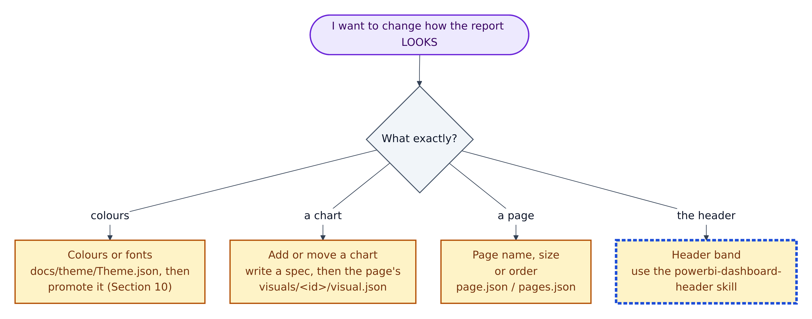
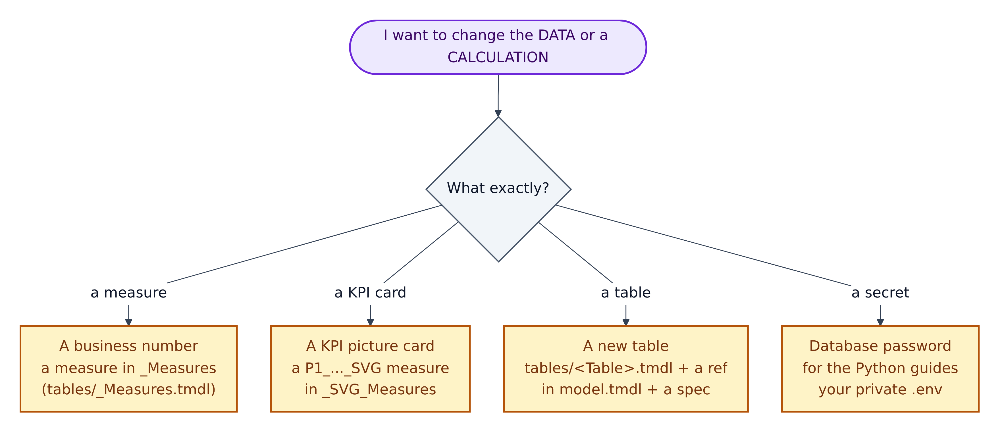
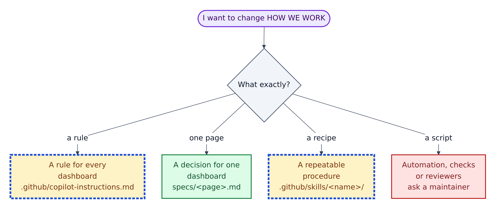

# 15. "Which file do I touch?" decision trees

**Figure 15.1 — "I want to change how the report looks."**

Walkthrough of Figure 15.1:

1. **Colours or fonts:** edit `docs/theme/Theme.json`, then promote it to the deployable copy and re-register it (Section 10). Never edit only the copy in `RegisteredResources/`; the next promotion would overwrite it.
2. **Add or move a chart:** write or update a spec first (Section 08), then change the page's `visuals/<id>/visual.json`. Check the `card_y + 30` rule.
3. **Page name, size or order:** a page's `page.json` (`displayName`, `width`, `height`) or `pages/pages.json` (`pageOrder`, `activePageName`).
4. **The header band:** follow the `powerbi-dashboard-header` skill, and record any exception (such as visual titles) in the spec.

---

**Figure 15.2 — "I want to change the data or a calculation."**

Walkthrough of Figure 15.2:

1. **A business number** (e.g. "Total Sales") is a measure in the `_Measures` table, with a `///` description.
2. **A KPI picture card** is an SVG measure in `_SVG_Measures`, named `P<page>_<Name>_SVG`, shown with an image visual.
3. **A new table** needs its own `Template.SemanticModel/definition/tables/<Table>.tmdl` file, a `ref table` line in `model.tmdl`, and a spec (a new fact table always needs one).
4. **A database password for the Python guides** belongs only in your private `.env` (Section 07). Never in any file Git tracks.

**Figure 15.3 — "I want to change how we work."** This mirrors Figure 6.3.

Walkthrough of Figure 15.3:

1. **A rule for every dashboard:** `.github/copilot-instructions.md` (then keep the root `copilot-instructions.md` and `AGENTS.md` aligned). Amber + AI: get it reviewed.
2. **A decision for one dashboard:** the spec, `specs/<page>.md`. Green.
3. **A repeatable procedure:** a skill, `.github/skills/<name>/SKILL.md`, whose folder name matches its `name:` and whose `description:` says when to use it (`CONTRIBUTING.md`).
4. **Automation, checks or reviewers** (`scripts/`, `.github/workflows/`, `.github/CODEOWNERS`): ask a maintainer. Red.

## Quick look-up table

| I want to… | Touch this | Safety | Then run |
|---|---|---|---|
| Plan a new page | copy `specs/TEMPLATE.md` to `specs/<name>.md` | Green | nothing yet |
| Add a measure | `Template.SemanticModel/definition/tables/_Measures.tmdl` | Amber | `Test-PbipSemantics.ps1` |
| Add an SVG KPI card | `tables/_SVG_Measures.tmdl` + an image `visual.json` | Amber | all three validators + verify loop |
| Add a table | `tables/<Table>.tmdl` + `model.tmdl` | Amber | all three validators |
| Add a page | new `pages/<id>/page.json` + `pages.json` | Amber | `validate-pbip.ps1`, verify loop |
| Add a background SVG or theme | file in `StaticResources/RegisteredResources/` + entry in `report.json` | Amber | `validate-pbip.ps1` (checks it exists) |
| Change team colours | `docs/theme/Theme.json` → promote | Amber | reopen Desktop, verify loop |
| Fix a typo in a guide | the `.md` file under `docs/` or `specs/` | Green | nothing |
| Change what the AI always does | `.github/copilot-instructions.md` | Amber + AI | get a review |
| Add a reusable AI procedure | `.github/skills/<name>/SKILL.md` | Amber + AI | get a review |
| Store a secret for Python | your private `.env` | Amber | `git check-ignore -v .env` |
| Store a secret for GitHub Actions | repository *Settings > Secrets and variables > Actions* | n/a | re-run the workflow |
| Change the test workflow | `.github/workflows/ai-testing.yml` | Red | ask a maintainer |
| Edit `version.json`, `.platform`, `definition.pbir`, `.pbism`, `database.tmdl` | **don't** | Red | n/a |
| Edit `tests/results/`, `tests/screenshots/`, `.github/.pbip-state/`, `**/.pbi/` | **don't**: they are generated | Red | n/a |
