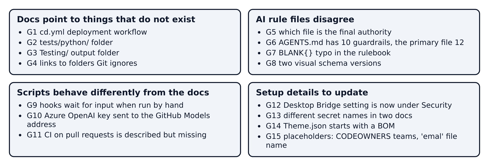
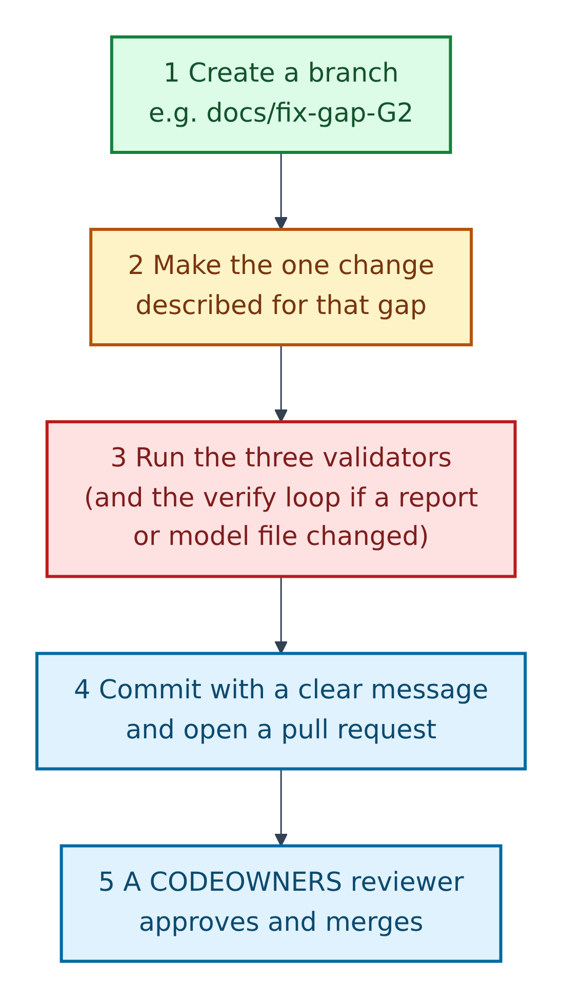

# 16. Gaps found in the repository, and how to fix them



**Figure 16.1 — Fifteen gaps, in four groups.** While reading every file for this guide, we found places where the documents disagree with each other, point to things that do not exist, or describe behaviour the scripts do not have. None of them stops the template working, but each can confuse a beginner.

Walkthrough of Figure 16.1:

1. **Docs point to things that do not exist** (G1–G4): a missing workflow, folder or output path.
2. **AI rule files disagree** (G5–G8): the files the agent reads give different answers to the same question.
3. **Scripts behave differently from the docs** (G9–G11): something the docs promise that the code does not do.
4. **Setup details to update** (G12–G15): small facts that have drifted or placeholders still to fill.

**This guide changes no repository files.** The fixes below are written as steps for you, or a maintainer, to carry out in a separate change.

---

## How to apply any fix safely



**Figure 16.2 — The same five steps for every fix.**

Walkthrough of Figure 16.2:

1. **Create a branch** named after the gap, e.g. `docs/fix-gap-G2`.
2. **Make only the change** described for that gap.
3. **Run the three validators** (Section 09). If you changed a report or model file, also run the verify loop.
4. **Commit and open a pull request**, naming the gap in the description.
5. **A reviewer listed in `CODEOWNERS` approves and merges.** Files marked Amber + AI change the agent's behaviour for everyone, so they always need a review.

---

## Group 1: docs point to things that do not exist

### G1. `docs/CICD-SETUP.md` describes a `cd.yml` deployment workflow that is not in the repository

**What we found:** the guide says deployments run "using `workflow_dispatch` in `.github/workflows/cd.yml`", but `.github/workflows/` only contains `ai-testing.yml`.

**Plain fix, step by step:**

1. Decide with your team whether you need automated deployment to Power BI workspaces yet.
2. **If not:** edit `docs/CICD-SETUP.md` and mark sections 2–6 as "planned, not yet included", so nobody looks for `cd.yml`.
3. **If yes:** ask a platform engineer to write `.github/workflows/cd.yml` with a `workflow_dispatch` trigger and the inputs the guide names (`target_environment`, `git_ref`), using the secrets and variables listed in sections 3–4 of that guide. Test it against the `dev` workspace first.

### G2. Three files point to a `tests/python/` folder that does not exist

**What we found:** `docs/CICD-SETUP.md` and `tests/README.md` refer to `tests/python/README.md` and `tests/python/<your_script_name>.py`, and `tests/prompts/Python_Data_Value_Test.md` suggests "file location options in `tests/python/`". The guidance actually lives in `python/README.md`, whose example command uses `python/<your_script_name>.py`.

**Plain fix, step by step:**

1. Pick one home for Python validators. `python/` already exists, so it is the smaller change.
2. In `docs/CICD-SETUP.md` (section 9) and `tests/README.md`, replace `tests/python/` with `python/`.
3. In `tests/prompts/Python_Data_Value_Test.md`, change the suggested location the same way.
4. Search the repository for `tests/python` (VS Code: `Ctrl+Shift+F`) and confirm nothing is left.

### G3. The AI audit prompt writes to `Testing/test_results.md`, not `tests/results/`

**What we found:** `tests/prompts/PowerBI_Test.md` tells Copilot to "Write final results to `Testing/test_results.md`", while the runner script, the workflow and `tests/results/README.md` all use `tests/results/test_results.md`.

**Plain fix, step by step:**

1. Open `tests/prompts/PowerBI_Test.md`.
2. Replace both mentions of `Testing/test_results.md` (hard requirement 4 and the start of Phase 5) with `tests/results/test_results.md`.
3. Save, then run the prompt once in Copilot Chat and confirm the report appears in `tests/results/`.

### G4. `docs/REPOSITORY-GUIDE.md` links to folders that Git never stores

**What we found:** the "Files users should not edit directly" list links to `tests/screenshots/`, `.github/.pbip-state/` and `Proposals/`. All three are in `.gitignore`, so on GitHub these links lead to "page not found".

**Plain fix, step by step:**

1. Open `docs/REPOSITORY-GUIDE.md`.
2. In that list, keep the folder names in code formatting but remove the links, e.g. change `` [`Proposals/`](../Proposals/) `` to `` `Proposals/` ``.
3. Optionally add "(created locally, never committed)" after each one.

---

## Group 2: AI rule files disagree

### G5. Which file is "the final authority"?

**What we found:** `README.md`, `AGENTS.md` and `.github/copilot-instructions.md` say `.github/copilot-instructions.md` wins any conflict. But the three files in `.github/agents/`, and the `powerbi-dashboard-header` and `powerbi-pbiviz-custom-visuals` skills, say the root `copilot-instructions.md` is "the final authority".

**Plain fix, step by step:**

1. Open each of the five files: the three `*.agent.md` files and the two `SKILL.md` files.
2. Change the authority sentence to the same wording the README uses, for example: "`.github/copilot-instructions.md` is the primary policy authority; `copilot-instructions.md` is the detailed PBIP reference."
3. Keep the rest of each "Repository Override Rules" section as it is.
4. Ask a reviewer to read the five changed sentences side by side.

### G6. `AGENTS.md` lists 10 guardrails; `.github/copilot-instructions.md` lists 12

**What we found:** the primary file adds two rules: keep SVG-header mode as the default, and treat `docs/theme/Theme.json` as source only. `AGENTS.md` and the README stop at 10. An agent that reads only `AGENTS.md` (for example Claude Code) never sees rules 11 and 12.

**Plain fix, step by step:**

1. Copy rules 11 and 12 from `.github/copilot-instructions.md`.
2. Paste them as rules 11 and 12 in `AGENTS.md` and in the README's "Non-Negotiable PBIP Guardrails" list.
3. Check that the wording of all twelve matches across the three files.

### G7. A typo in the rulebook: `_Measures = BLANK{}`

**What we found:** step 2 of "Dashboard Creation Steps" in the root `copilot-instructions.md` says "create `_Measures = BLANK{}` if needed". The same file later writes the correct DAX form for the SVG table: `_SVG_Measures = { BLANK() }`. An agent copying `BLANK{}` literally would write an invalid table expression.

**Plain fix, step by step:**

1. Open `copilot-instructions.md` and find `BLANK{}`.
2. Replace it with `{ BLANK() }`, so the line reads "create `_Measures = { BLANK() }` if needed".

### G8. Two visual schema versions

**What we found:** the root rulebook sets the repository default visual schema to `visualContainer/2.7.0`. The custom-visual kit's `pbir_helpers.py` writes `visualContainer/2.12.0`, and the skill says it was verified with that version. A page could end up mixing the two.

**Plain fix, step by step:**

1. Do not change any file yet. First, open a test copy of a report in your current Power BI Desktop and check which schema version it writes for a new visual.
2. Agree one default with the team.
3. Update the "Schema (repo default)" line and the five JSON templates in `copilot-instructions.md`, or the `SCHEMA_VIZ` line in `pbir_helpers.py`, so both say the same.
4. Add one sentence explaining why, so the next reader knows it was deliberate.

---

## Group 3: scripts behave differently from the docs

### G9. Three hook scripts wait for input when you run them by hand

**What we found:** the README says the hook wrappers are "run manually". But `pbip-write-guard.ps1`, `pbip-validate-hook.ps1` and `pbip-stop-hook.ps1` begin by reading hook data from standard input (`[Console]::In.ReadToEnd()`), the way an agent tool such as Claude Code passes it. Run directly in a terminal, they sit waiting for typed input.

**Plain fix, step by step:**

1. **To use them today:** give them an empty input. In PowerShell:

   ```powershell
   '{}' | powershell -NoProfile -File scripts\hooks\pbip-stop-hook.ps1
   ```

2. For everyday manual checks, use the underlying scripts instead: `Test-PbipSemantics.ps1 -Path <file>` (instead of the validate hook) and `Invoke-PbipVerify.ps1 -Mode Review` (instead of the stop hook).
3. **To fix the docs:** add a short note under the README's hook table explaining the `'{}' |` pattern, and that the hooks are designed to be wired into an agent tool's hook settings.

### G10. An Azure OpenAI key is sent to the GitHub Models address

**What we found:** `run-ai-md-test.ps1` uses `GITHUB_MODELS_API_KEY`, or else `AZURE_OPENAI_API_KEY`, and always sends it as a `Bearer` token to `-ApiEndpoint`, which defaults to `https://models.inference.ai.azure.com/chat/completions`. The workflow never passes a different endpoint. So a repository that sets only the Azure OpenAI secret will very likely fail to authenticate, even though the README says either key works.

**Plain fix, step by step:**

1. **Simplest:** set `GITHUB_MODELS_API_KEY` as the repository secret, and treat the Azure OpenAI option as "not yet supported" in the README and `tests/README.md`.
2. **To support Azure OpenAI properly:** ask a maintainer to add an endpoint input or variable to `ai-testing.yml`, pass it to the script's `-ApiEndpoint`, and send the key in the header your Azure resource expects. Test with a manual workflow run before relying on it.

### G11. "CI validates pull requests" is described but not set up

**What we found:** `docs/CICD-SETUP.md` says "Pull requests into `dev`, `test`, and `main` run CI validation". The only workflow, `ai-testing.yml`, runs on pushes to `test` and on manual runs, not on pull requests. Branch-protection rules that "require status checks from CI" will have no check to require.

**Plain fix, step by step:**

1. Ask a maintainer to add a small workflow (for example `.github/workflows/validate.yml`) that runs on `pull_request` to `dev`, `test` and `main`.
2. It needs only three steps: check out the code, then run `validate-json.ps1` and `validate-pbip.ps1` with `pwsh`, as `ai-testing.yml` already does.
3. After its first run, select it as a required status check in each branch's protection rule.

---

## Group 4: setup details to update

### G12. The Desktop Bridge setting has moved

**What we found:** the README, `copilot-instructions.md`, `Test-PbipBridge.ps1` and `PbipBridge.Common.ps1` say the checkbox is under *Options > Preview features*. Microsoft's current page, "What is the Power BI Desktop Bridge?", places it under *Options > Security > Desktop Bridge* and says it is on by default. Microsoft's page states no minimum version; the README's 2.155.756.0 is the repository's own finding.

**Plain fix, step by step:**

1. In the README and `copilot-instructions.md`, change the path to: "*File > Options and settings > Options > Security > Desktop Bridge* (older builds: *Preview features*)".
2. Ask a maintainer to make the same wording change in the "Fix" messages of `Test-PbipBridge.ps1` and `PbipBridge.Common.ps1`.
3. Add a link to Microsoft's page so the next reader can check it.

### G13. Two different sets of database secret names

**What we found:** `.env.example` and the alert guide use `DB_SERVER`, `DB_NAME`, `DB_USER`, `DB_PASSWORD`, `DB_DRIVER`. Section 9 of `docs/CICD-SETUP.md` lists `SERVER`, `DATABASE`, `USERNAME`, `PASSWORD`, `DRIVER`.

**Plain fix, step by step:**

1. Keep the `DB_` names, because `.env.example` and the Python guide already use them.
2. In `docs/CICD-SETUP.md` section 9, replace the five names with the `DB_` versions.
3. If any pipeline already uses the old names, rename those secrets at the same time.

### G14. `docs/theme/Theme.json` starts with a byte-order mark

**What we found:** the file begins with an invisible UTF-8 byte-order mark (BOM). Python's standard `json.load` refuses such a file ("Unexpected UTF-8 BOM"), which can trip up a promotion script. The deployable copies do not have one.

**Plain fix, step by step:**

1. Open `docs/theme/Theme.json` in VS Code.
2. Click the encoding label in the bottom status bar (it shows "UTF-8 with BOM").
3. Choose *Save with Encoding* → *UTF-8*.
4. Run `validate-json.ps1` to confirm it still parses.

(The files in `tests/results/` also have a BOM, written by PowerShell's `Set-Content`. They are generated, so leave them.)

### G15. Placeholders still to fill in

**What we found:**

- `.github/CODEOWNERS` uses example team handles (`@your-org/bi-platform-team` and others), as its first line says ("Update owners to your org/team handles").
- `docs/REPOSITORY-GUIDE.md` uses `<upstream-owner>/<upstream-repo>` in the upstream command.
- The email guide's file name is spelled `emal_style_instructions.md` (missing "i"), and the README links to that spelling.

**Plain fix, step by step:**

1. In your fork, replace each `@your-org/...` handle in `CODEOWNERS` with a real GitHub team or user who should review that folder.
2. Replace `<upstream-owner>/<upstream-repo>` with `GibbonGambits/PGE-PBIP-Template` in your own notes when you run the command.
3. Renaming the email guide is optional. If you rename it to `email_style_instructions.md`, update the two README links in the same change.
