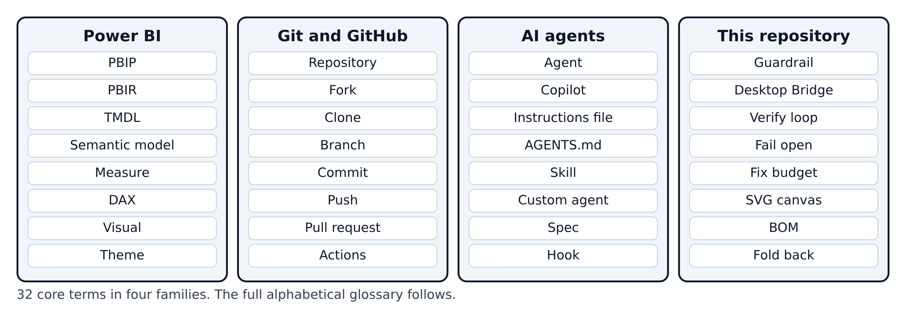

# 17. Beginner glossary

**Figure 17.1 — Four families of terms.** If a word in this guide is new, it is probably in one of these four columns.

Walkthrough of Figure 17.1:

1. **Power BI** words describe the report and its data.
2. **Git and GitHub** words describe saving and sharing changes.
3. **AI agent** words describe how the AI assistant is guided.
4. **This repository** words are the template's own vocabulary.

---

## A to Z

| Term | Plain meaning | Comparison | First explained |
|---|---|---|---|
| **Actions (GitHub Actions)** | GitHub's automation service; runs workflows on cloud computers | A timer that switches an appliance on | Section 11 |
| **Agent (AI coding agent)** | An AI assistant that can read files, edit them and run commands, not only chat | A contractor working in your house | Section 04 |
| **AGENTS.md** | A cross-tool instruction file for AI agents | A safety card on the wall | Section 04 |
| **API key** | A secret code that lets a program use an online service | A door key card | Section 11 |
| **applyTo** | The file pattern that decides when a `.instructions.md` file loads | "Workshop rules only" sign | Section 04 |
| **Artifact** | A file a GitHub workflow saves for you to download | A receipt from a machine | Section 11 |
| **Base theme** | Microsoft's default theme underneath your own | Primer under the paint | Section 10 |
| **BOM (byte-order mark)** | An invisible marker at the start of a text file; TMDL files must not have one | An invisible sticker on a page | Section 02 |
| **Bookmark** | A saved view of a report page, used for toggles | A page marker | Section 14 |
| **BPA (Best Practice Analyzer)** | Microsoft's rule set for checking data models | An inspection checklist | Section 11 |
| **Branch** | A separate line of work in Git | A draft copy of a document | Section 03 |
| **Card (KPI card)** | A box showing one headline number | A scoreboard | Section 08 |
| **`card_y + 30` rule** | A visual must start 30 pixels below its card's top so it does not cover the title | Leave room under a heading | Section 08 |
| **Checklist row** | One numbered quality check in `docs/checklists/` | One line on an inspection form | Section 05 |
| **CLI (command-line interface)** | A program you control by typing commands | A remote control with words | Section 07 |
| **Clone** | Download a full copy of a repository, with its history | Photocopying a whole binder | Section 03 |
| **CODEOWNERS** | A GitHub file naming who reviews which folders | A sign-off sheet | Section 03 |
| **Commit** | A saved snapshot of changes, with a message | A dated save point | Section 03 |
| **Compatibility level** | A version number for the model engine | A voltage rating | Section 02 |
| **Copilot (GitHub Copilot)** | GitHub's AI assistant, available in VS Code and as a CLI | A built-in assistant | Section 04 |
| **Custom agent** | A saved "expert role" for Copilot (`.agent.md`) | Calling in a specialist | Section 04 |
| **Custom visual** | A chart type your team writes in code (`.pbiviz`) | Custom-built furniture | Section 12 |
| **DAX** | Data Analysis Expressions, Power BI's formula language | A recipe language | Section 02 |
| **Desktop Bridge** | A local connection that lets programs control a running Power BI Desktop | A remote control for Power BI | Section 01 |
| **Dimension table** | A table describing things (products, dates, customers) | A catalogue | Section 02 |
| **`.env` file** | A private text file of `NAME=value` settings such as passwords | A locked drawer | Section 07 |
| **Fabric (Microsoft Fabric)** | Microsoft's online analytics platform | The head office | Section 02 |
| **Fact table** | A table of events or transactions (sales, orders) | A till receipt roll | Section 02 |
| **Fail open** | When a check breaks, it lets you continue rather than block you | A door that unlocks in a power cut | Section 06 |
| **Field parameter** | A Power BI feature that lets readers switch which field a visual shows | A channel selector | Section 14 |
| **Fix budget** | The verify loop allows one fix round, then lets the turn end | A limited number of retakes | Section 09 |
| **Fold back** | Moving a rule from a spec into the permanent rulebook | Adding a lesson to the manual | Section 06 |
| **Fork** | Your own copy of someone else's repository on GitHub | Your own copy of a shared recipe book | Section 03 |
| **Git** | Free software that records the history of files | Unlimited undo with labels | Section 03 |
| **GitHub** | A website that hosts Git repositories and adds collaboration | A shared photo album for snapshots | Section 03 |
| **`.gitignore`** | A list of files Git must never save | A "do not pack" list | Section 03 |
| **Guardrail** | One of the repository's non-negotiable rules | A road barrier | Section 01 |
| **GUID** | A long unique identifier | A serial number | Section 12 |
| **Hook** | A small script that runs at a fixed moment | A smoke alarm | Section 06 |
| **IBCS** | A set of design standards for business charts | A style guide for finance charts | Section 12 |
| **Image visual** | A Power BI visual that shows a picture; here, an SVG from a measure | A picture frame | Section 08 |
| **JSON** | A text format of named values in curly braces | A labelled form | Section 02 |
| **KPI** | Key performance indicator: a headline number | A car's speedometer | Section 08 |
| **Markdown (`.md`)** | Plain text with simple marks for headings, lists and links | Notes with underlines | Section 06 |
| **Measure** | A named calculation, such as "Total Sales" | A recipe | Section 02 |
| **Merge** | Combining one branch's changes into another | Folding a draft into the final copy | Section 03 |
| **Node.js / npm** | A JavaScript runtime and its package installer | An engine and its parts shop | Section 07 |
| **Page (report page)** | One screen of a report | A magazine page | Section 02 |
| **PBIP** | Power BI Project: a report saved as a folder of text files | A labelled filing cabinet | Section 02 |
| **PBIR** | Power BI's enhanced report format: the report as JSON files | Labelled drawers | Section 02 |
| **`.pbix`** | Power BI's classic single-file format | A sealed box | Section 02 |
| **Power BI Desktop** | Microsoft's free Windows app for building reports | The workshop | Section 02 |
| **Power Query** | Power BI's tool for loading and shaping data | The delivery bay | Section 02 |
| **PowerShell** | Microsoft's command shell and scripting language | A command line with a toolbox | Section 07 |
| **Preflight** | A check that everything is ready before you start | A pilot's checklist | Section 07 |
| **Pull request (PR)** | A request to review and merge a branch | Asking an editor to approve a draft | Section 03 |
| **Push / pull** | Upload commits to GitHub / download others' commits | Posting / collecting mail | Section 03 |
| **Relationship** | A link between two tables | Matching labels | Section 02 |
| **Repository (repo)** | A project folder whose history Git tracks | A binder that remembers every change | Section 00 |
| **Runner** | A cloud computer that runs a GitHub workflow | A hired worker for one job | Section 11 |
| **Secret (GitHub secret)** | A hidden setting a workflow can use but nobody can read | A sealed envelope | Section 11 |
| **Semantic model** | The tables, relationships and measures behind a report | The kitchen and pantry | Section 02 |
| **Skill** | A folder with a `SKILL.md` procedure the agent loads when the task matches | A recipe card | Section 04 |
| **Slicer** | An on-page filter control | A dial on a radio | Section 14 |
| **Spec** | A plan for one dashboard or page, written before building | An architect's drawing | Section 06 |
| **Star schema** | A model with fact tables in the middle and dimension tables around them | A hub with spokes | Section 02 |
| **Steering** | The permanent rule files that guide every session | The building code | Section 06 |
| **SVG** | Scalable Vector Graphics: a text-based picture format | A drawing made of instructions | Section 08 |
| **SVG canvas background** | The page background picture that draws cards and titles | A printed form | Section 08 |
| **Swimlane diagram** | A diagram with one column per person or tool | Lanes in a pool | Section 03 |
| **Theme** | A JSON file of colours and fonts for a report | Tableware and colour scheme | Section 10 |
| **TMDL** | Tabular Model Definition Language: the model as indented text | An indented recipe book | Section 02 |
| **UTF-8** | The standard way to store text characters in a file | The alphabet a file is written in | Section 02 |
| **Verify loop** | Validate, reload Power BI, screenshot every page, review, fix | A camera that photographs every room | Section 09 |
| **Visual** | One chart, table, card or image on a page | A photo on a page | Section 02 |
| **VS Code** | Visual Studio Code, Microsoft's free code editor | A word processor for code | Section 04 |
| **Workflow** | An automated process defined in a YAML file | A recipe the robot follows | Section 11 |
| **YAML** | An indentation-based text format used for workflows | A neat outline | Section 11 |
