# Appendix A. File-by-file directory

Every one of the repository's 176 files and folders, grouped by folder. Each group has a folder tree (coloured with the legend from Start here) and a table. Folders get one line. Paths in each table are relative to the folder named in its heading.

## A.1 Root files

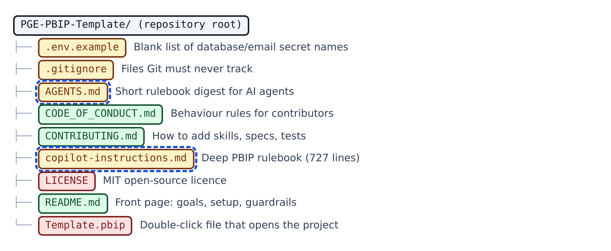

**Figure A.1 — Root files.** The nine files that sit directly in the repository's top folder.

| Item | Type | What it is | Safety |
|---|---|---|---|
| `.env.example` | Env template | A blank form listing the names of the secrets the Python guides need, with no real values. | Amber |
| `.gitignore` | Git config | The list of files Git must never save, such as your private .env and Power BI's local cache. | Amber |
| `AGENTS.md` | AI steering | A one-page summary of the house rules for any AI agent. | Amber · AI |
| `CODE_OF_CONDUCT.md` | Community doc | How people in this project are expected to treat each other. | Green |
| `CONTRIBUTING.md` | Community doc | Short rules for adding to the project: where skills, specs and tests go. | Green |
| `copilot-instructions.md` | AI reference | The full technical rulebook for building PBIP dashboards: file layouts, forbidden properties, JSON templates, SVG measure patterns. | Amber · AI |
| `LICENSE` | Legal | The legal permission to use, copy and change this code. | Red |
| `README.md` | Doc | The front page of the repository: goals, guardrails, quick start, and how the verify loop and custom-visual kit work. | Green |
| `Template.pbip` | PBIP entry | The file you double-click to open the project in Power BI Desktop. | Red |

## A.2 Root folders

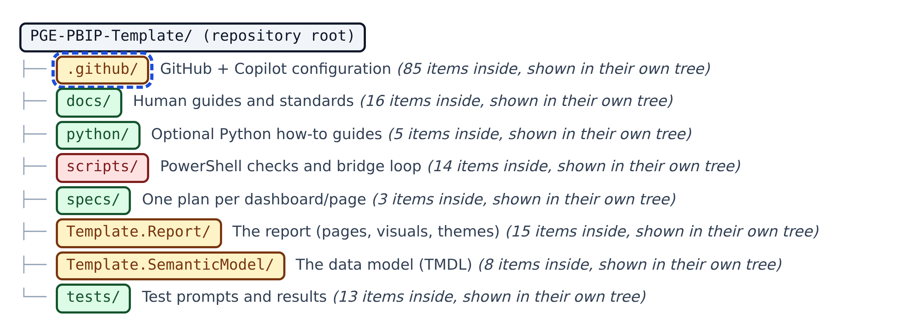

**Figure A.2 — Root folders.** The nine top-level folders, each opened in its own tree below.

| Item | Type | What it is | Safety |
|---|---|---|---|
| `.github/` | Folder | GitHub + Copilot configuration | Amber · AI |
| `docs/` | Folder | Human guides and standards | Green |
| `python/` | Folder | Optional Python how-to guides | Green |
| `scripts/` | Folder | PowerShell checks and bridge loop | Red |
| `specs/` | Folder | One plan per dashboard/page | Green |
| `Template.Report/` | Folder | The report (pages, visuals, themes) | Amber |
| `Template.SemanticModel/` | Folder | The data model (TMDL) | Amber |
| `tests/` | Folder | Test prompts and results | Green |

## A.3 .github: top level

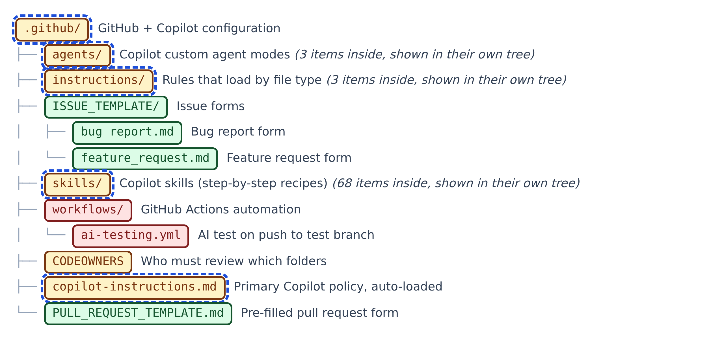

**Figure A.3 — .github: top level.** GitHub's own configuration, plus the folders the AI agent reads. Folders shown closed are opened in their own tree.

| Item | Type | What it is | Safety |
|---|---|---|---|
| `ISSUE_TEMPLATE/` | Folder | Issue forms | Green |
| `ISSUE_TEMPLATE/bug_report.md` | GitHub template | The form for reporting something broken. | Green |
| `ISSUE_TEMPLATE/feature_request.md` | GitHub template | The form for asking for something new. | Green |
| `workflows/` | Folder | GitHub Actions automation | Red |
| `workflows/ai-testing.yml` | CI workflow | Runs the AI test automatically when code reaches the test branch. | Red |
| `CODEOWNERS` | GitHub config | Says which team must review changes to which folders. | Amber |
| `copilot-instructions.md` | AI steering | GitHub Copilot's main rulebook for this repository, loaded automatically every time. | Amber · AI |
| `PULL_REQUEST_TEMPLATE.md` | GitHub template | The form every pull request starts with. | Green |

## A.4 .github/agents and .github/instructions

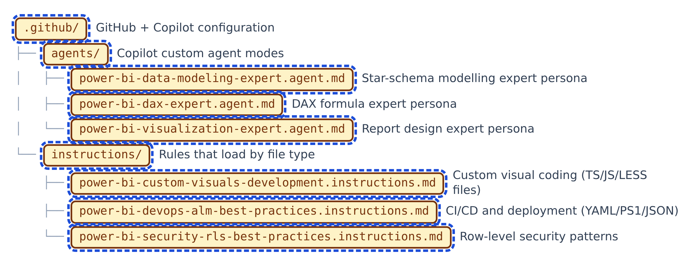

**Figure A.4 — .github/agents and .github/instructions.** Expert modes and file-type rules for GitHub Copilot.

| Item | Type | What it is | Safety |
|---|---|---|---|
| `agents/` | Folder | Copilot custom agent modes | Amber · AI |
| `agents/power-bi-data-modeling-expert.agent.md` | Agent mode | Turns Copilot into a data-model expert (star schemas, relationships). | Amber · AI |
| `agents/power-bi-dax-expert.agent.md` | Agent mode | Turns Copilot into a DAX formula expert. | Amber · AI |
| `agents/power-bi-visualization-expert.agent.md` | Agent mode | Turns Copilot into a report-design expert. | Amber · AI |
| `instructions/` | Folder | Rules that load by file type | Amber · AI |
| `instructions/power-bi-custom-visuals-development.instructions.md` | Scoped rules | Coding advice for writing custom charts. | Amber · AI |
| `instructions/power-bi-devops-alm-best-practices.instructions.md` | Scoped rules | Advice on releasing reports safely through test and production. | Amber · AI |
| `instructions/power-bi-security-rls-best-practices.instructions.md` | Scoped rules | Advice on making sure each person sees only the data they should. | Amber · AI |

## A.5 .github/skills, part 1

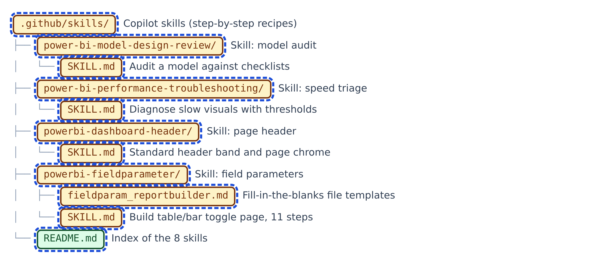

**Figure A.5 — .github/skills, part 1.** The skills index and the first four skills.

| Item | Type | What it is | Safety |
|---|---|---|---|
| `skills/` | Folder | Copilot skills (step-by-step recipes) | Amber · AI |
| `power-bi-model-design-review/` | Folder | Skill: model audit | Amber · AI |
| `power-bi-model-design-review/SKILL.md` | Skill | A recipe for auditing an existing data model. | Amber · AI |
| `power-bi-performance-troubleshooting/` | Folder | Skill: speed triage | Amber · AI |
| `power-bi-performance-troubleshooting/SKILL.md` | Skill | A recipe for finding why a report is slow. | Amber · AI |
| `powerbi-dashboard-header/` | Folder | Skill: page header | Amber · AI |
| `powerbi-dashboard-header/SKILL.md` | Skill | A recipe for a consistent header band across pages: logo, title, filters, buttons. | Amber · AI |
| `powerbi-fieldparameter/` | Folder | Skill: field parameters | Amber · AI |
| `powerbi-fieldparameter/fieldparam_reportbuilder.md` | Skill boilerplate | Fill-in-the-blanks file templates for the same page. | Amber · AI |
| `powerbi-fieldparameter/SKILL.md` | Skill | A recipe for a page where users switch what a table and bar chart show. | Amber · AI |
| `README.md` | Doc | The index card listing the eight skills. | Green · AI |

## A.6 .github/skills, part 2

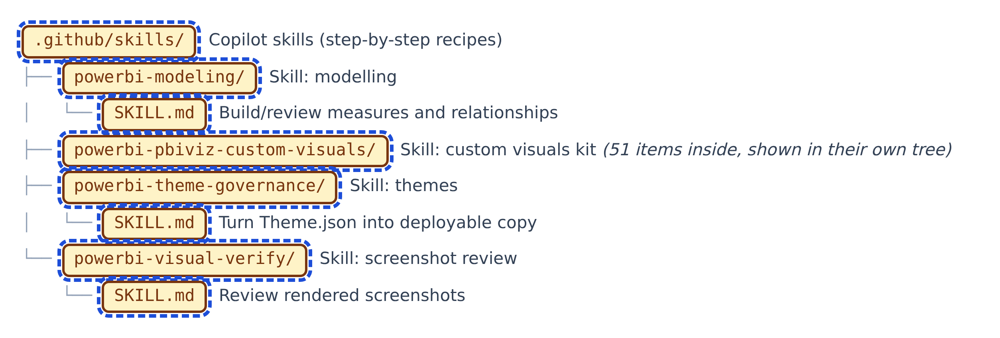

**Figure A.6 — .github/skills, part 2.** Three more skills, and the custom-visual kit, which gets its own trees.

| Item | Type | What it is | Safety |
|---|---|---|---|
| `powerbi-modeling/` | Folder | Skill: modelling | Amber · AI |
| `powerbi-modeling/SKILL.md` | Skill | A recipe for building and reviewing measures and relationships. | Amber · AI |
| `powerbi-theme-governance/` | Folder | Skill: themes | Amber · AI |
| `powerbi-theme-governance/SKILL.md` | Skill | A recipe for turning the editable theme into a safe, loadable one. | Amber · AI |
| `powerbi-visual-verify/` | Folder | Skill: screenshot review | Amber · AI |
| `powerbi-visual-verify/SKILL.md` | Skill | A recipe for checking screenshots of the finished pages. | Amber · AI |

## A.7 Custom-visual kit: project files and tools

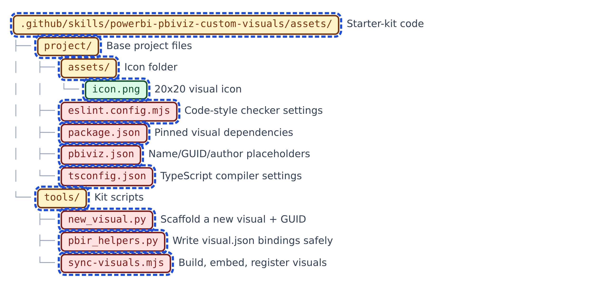

**Figure A.7 — Custom-visual kit: project files and tools.** The base project every visual starts from, and the three kit scripts.

| Item | Type | What it is | Safety |
|---|---|---|---|
| `assets/` | Folder | Starter-kit code | Amber · AI |
| `project/` | Folder | Base project files | Amber · AI |
| `project/assets/` | Folder | Icon folder | Amber · AI |
| `project/assets/icon.png` | Image | The tiny 20 x 20 picture shown for the visual in Power BI. | Green · AI |
| `project/eslint.config.mjs` | Lint config | Settings for the code-style checker. | Red · AI |
| `project/package.json` | npm manifest | The shopping list of code libraries the visual needs, with exact versions. | Red · AI |
| `project/pbiviz.json` | Visual manifest | The visual's identity card with blanks for name, GUID and author. | Red · AI |
| `project/tsconfig.json` | TS config | Settings for turning TypeScript into JavaScript. | Red · AI |
| `tools/` | Folder | Kit scripts | Amber · AI |
| `tools/new_visual.py` | Python | Creates a new visual project from a template and gives it a permanent ID. | Red · AI |
| `tools/pbir_helpers.py` | Python | Helpers for writing a page's visual files correctly. | Red · AI |
| `tools/sync-visuals.mjs` | Node script | Builds every visual and plugs it into the report. | Red · AI |

## A.8 Custom-visual kit: shared library

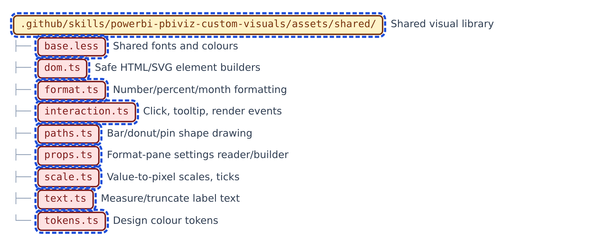

**Figure A.8 — Custom-visual kit: shared library.** Code shared by every custom visual.

| Item | Type | What it is | Safety |
|---|---|---|---|
| `shared/` | Folder | Shared visual library | Amber · AI |
| `base.less` | Stylesheet | Shared fonts and colours for every visual's styling. | Red · AI |
| `dom.ts` | TypeScript | Safe helpers for creating page elements. | Red · AI |
| `format.ts` | TypeScript | Turns raw numbers into readable labels such as thousands and percentages. | Red · AI |
| `interaction.ts` | TypeScript | Makes visuals respond to clicks and hovering. | Red · AI |
| `paths.ts` | TypeScript | Draws shapes such as rounded bars and donut rings. | Red · AI |
| `props.ts` | TypeScript | Reads and builds the visual's settings panel. | Red · AI |
| `scale.ts` | TypeScript | Converts numbers into positions on the screen. | Red · AI |
| `text.ts` | TypeScript | Measures and shortens labels so they fit. | Red · AI |
| `tokens.ts` | TypeScript | The master list of colours and fonts for the visuals. | Red · AI |

## A.9 Custom-visual kit: templates, blank

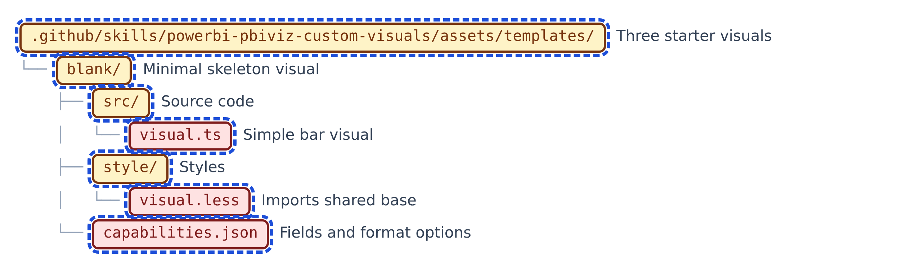

**Figure A.9 — Custom-visual kit: templates, blank.** The templates folder and the minimal 'blank' starter visual.

| Item | Type | What it is | Safety |
|---|---|---|---|
| `templates/` | Folder | Three starter visuals | Amber · AI |
| `blank/` | Folder | Minimal skeleton visual | Amber · AI |
| `blank/src/` | Folder | Source code | Amber · AI |
| `blank/src/visual.ts` | TypeScript | The drawing code for the simple bar visual. | Red · AI |
| `blank/style/` | Folder | Styles | Amber · AI |
| `blank/style/visual.less` | Stylesheet | The visual's style sheet. | Red · AI |
| `blank/capabilities.json` | Visual contract | Tells Power BI which fields this visual accepts and which settings it has. | Red · AI |

## A.10 Custom-visual kit: templates, varianceChart

**Figure A.10 — Custom-visual kit: templates, varianceChart.** The IBCS period-chart starter visual (same six-item layout).

| Item | Type | What it is | Safety |
|---|---|---|---|
| `varianceChart/` | Folder | Period chart visual | Amber · AI |
| `varianceChart/src/` | Folder | Source code | Amber · AI |
| `varianceChart/src/visual.ts` | TypeScript | The drawing code for the period chart and its variance strip. | Red · AI |
| `varianceChart/style/` | Folder | Styles | Amber · AI |
| `varianceChart/style/visual.less` | Stylesheet | The period chart's style sheet. | Red · AI |
| `varianceChart/capabilities.json` | Visual contract | Fields and settings for the period chart. | Red · AI |

## A.11 Custom-visual kit: templates, varianceTable

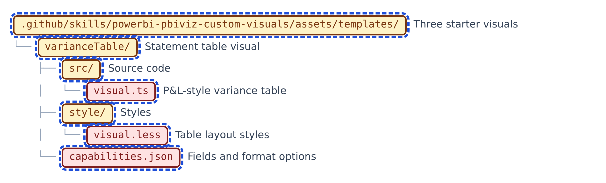

**Figure A.11 — Custom-visual kit: templates, varianceTable.** The IBCS statement-table starter visual (same six-item layout).

| Item | Type | What it is | Safety |
|---|---|---|---|
| `varianceTable/` | Folder | Statement table visual | Amber · AI |
| `varianceTable/src/` | Folder | Source code | Amber · AI |
| `varianceTable/src/visual.ts` | TypeScript | The drawing code for the statement table. | Red · AI |
| `varianceTable/style/` | Folder | Styles | Amber · AI |
| `varianceTable/style/visual.less` | Stylesheet | The statement table's style sheet. | Red · AI |
| `varianceTable/capabilities.json` | Visual contract | Fields and settings for the statement table. | Red · AI |

## A.12 Custom-visual kit: SKILL.md and references

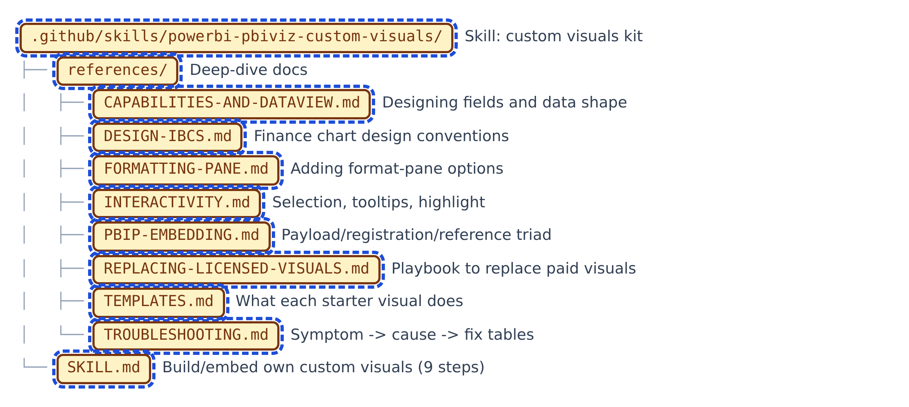

**Figure A.12 — Custom-visual kit: SKILL.md and references.** The skill procedure and its eight reference documents.

| Item | Type | What it is | Safety |
|---|---|---|---|
| `powerbi-pbiviz-custom-visuals/` | Folder | Skill: custom visuals kit | Amber · AI |
| `references/` | Folder | Deep-dive docs | Amber · AI |
| `references/CAPABILITIES-AND-DATAVIEW.md` | Doc | How to decide which fields a visual takes and how the data arrives. | Amber · AI |
| `references/DESIGN-IBCS.md` | Doc | Design rules so custom visuals match the rest of the report. | Amber · AI |
| `references/FORMATTING-PANE.md` | Doc | How to add settings users can change in the Format pane. | Amber · AI |
| `references/INTERACTIVITY.md` | Doc | How to make clicks, tooltips and highlighting work. | Amber · AI |
| `references/PBIP-EMBEDDING.md` | Doc | How a built visual is stored inside the report so it opens anywhere. | Amber · AI |
| `references/REPLACING-LICENSED-VISUALS.md` | Doc | Step-by-step plan for replacing a paid chart whose licence expired. | Amber · AI |
| `references/TEMPLATES.md` | Doc | What each starter visual does and how to bind it. | Amber · AI |
| `references/TROUBLESHOOTING.md` | Doc | A symptom-to-fix table for when things go wrong. | Amber · AI |
| `SKILL.md` | Skill | The recipe for building, embedding and checking your own chart types. | Amber · AI |

## A.13 Template.Report: definition

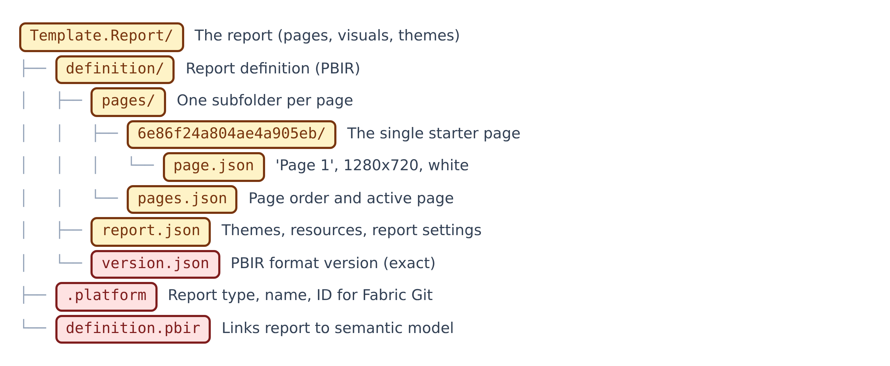

**Figure A.13 — Template.Report: definition.** The report's pointer file, ID card and definition files.

| Item | Type | What it is | Safety |
|---|---|---|---|
| `definition/` | Folder | Report definition (PBIR) | Amber |
| `definition/pages/` | Folder | One subfolder per page | Amber |
| `definition/pages/6e86f24a804ae4a905eb/` | Folder | The single starter page | Amber |
| `definition/pages/6e86f24a804ae4a905eb/page.json` | Page config | Describes the blank starter page: name 'Page 1', size, white surround. | Amber |
| `definition/pages/pages.json` | Report config | The order of pages and which one opens first. | Amber |
| `definition/report.json` | Report config | Report-wide settings and the list of themes and resources. | Amber |
| `definition/version.json` | Report config | A tiny file stating the report format version. Must be exactly right. | Red |
| `.platform` | Fabric metadata | The report's ID card for Microsoft Fabric's Git sync. | Red |
| `definition.pbir` | Report pointer | Tells the report where its data model is. | Red |

## A.14 Template.Report: StaticResources

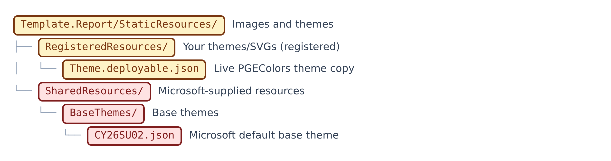

**Figure A.14 — Template.Report: StaticResources.** Themes and images used by the report.

| Item | Type | What it is | Safety |
|---|---|---|---|
| `StaticResources/` | Folder | Images and themes | Amber |
| `RegisteredResources/` | Folder | Your themes/SVGs (registered) | Amber |
| `RegisteredResources/Theme.deployable.json` | Theme | The team colour theme the report actually uses. | Amber |
| `SharedResources/` | Folder | Microsoft-supplied resources | Red |
| `SharedResources/BaseThemes/` | Folder | Base themes | Red |
| `SharedResources/BaseThemes/CY26SU02.json` | Theme | Microsoft's default theme underneath the team theme. | Red |

## A.15 Template.SemanticModel

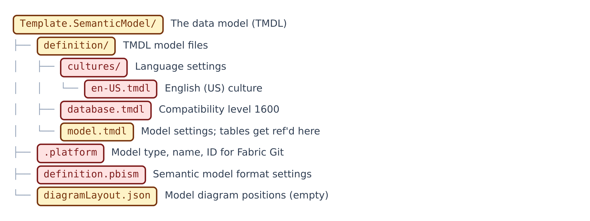

**Figure A.15 — Template.SemanticModel.** The data model, as TMDL text files.

| Item | Type | What it is | Safety |
|---|---|---|---|
| `definition/` | Folder | TMDL model files | Amber |
| `definition/cultures/` | Folder | Language settings | Red |
| `definition/cultures/en-US.tmdl` | TMDL | Declares English (US) as the model language. | Red |
| `definition/database.tmdl` | TMDL | Sets the model engine's compatibility level. | Red |
| `definition/model.tmdl` | TMDL | Model-wide settings; tables get listed here as they are added. | Amber |
| `.platform` | Fabric metadata | The model's ID card for Microsoft Fabric's Git sync. | Red |
| `definition.pbism` | Model pointer | Says which model format version this is. | Red |
| `diagramLayout.json` | Layout | Remembers where tables sit in Power BI's model diagram. Empty for now. | Amber |

## A.16 docs: guides

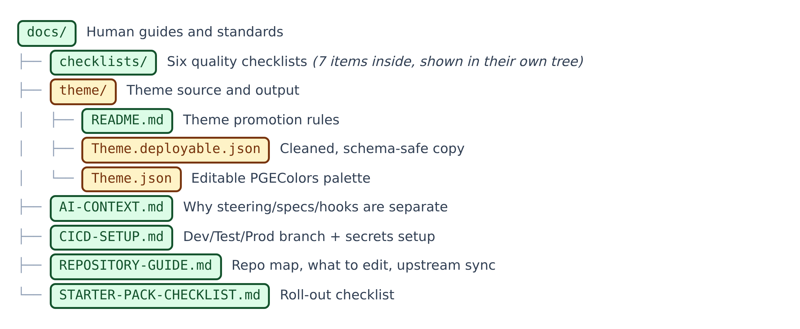

**Figure A.16 — docs: guides.** Human guides, the theme source, and the checklists folder. Folders shown closed are opened in their own tree.

| Item | Type | What it is | Safety |
|---|---|---|---|
| `theme/` | Folder | Theme source and output | Amber |
| `theme/README.md` | Doc | Explains how the editable theme becomes the deployable one. | Green |
| `theme/Theme.deployable.json` | Theme output | The cleaned theme, safe to load into a report. | Amber |
| `theme/Theme.json` | Theme source | The editable team colour theme (PGEColors). | Amber |
| `AI-CONTEXT.md` | Doc | Explains why rules, plans and automatic checks are kept separate. | Green |
| `CICD-SETUP.md` | Doc | How to set up dev, test and prod branches, environments and secrets. | Green |
| `REPOSITORY-GUIDE.md` | Doc | A map of what to reuse, what to customise and how to get template updates. | Green |
| `STARTER-PACK-CHECKLIST.md` | Doc | A to-do list for turning the template into a complete team platform. | Green |

## A.17 docs/checklists

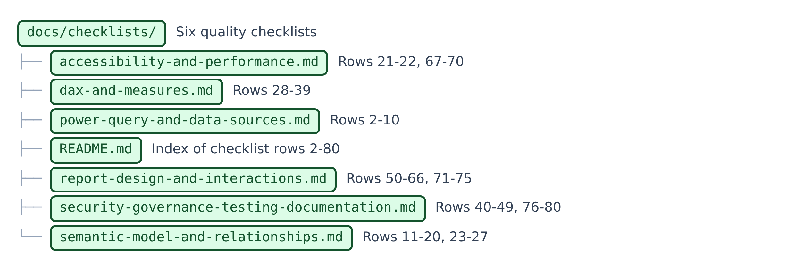

**Figure A.17 — docs/checklists.** Six focused quality checklists and their index.

| Item | Type | What it is | Safety |
|---|---|---|---|
| `checklists/` | Folder | Six quality checklists | Green |
| `accessibility-and-performance.md` | Checklist | Checks for speed and for readability by everyone. | Green |
| `dax-and-measures.md` | Checklist | Checks for well-written calculations. | Green |
| `power-query-and-data-sources.md` | Checklist | Checks for how data is loaded and cleaned. | Green |
| `README.md` | Doc | The index of the six checklists and how to use them. | Green |
| `report-design-and-interactions.md` | Checklist | Checks for layout, visuals and clicks. | Green |
| `security-governance-testing-documentation.md` | Checklist | Checks for security, sign-off, testing and documentation. | Green |
| `semantic-model-and-relationships.md` | Checklist | Checks for a well-shaped data model. | Green |

## A.18 python

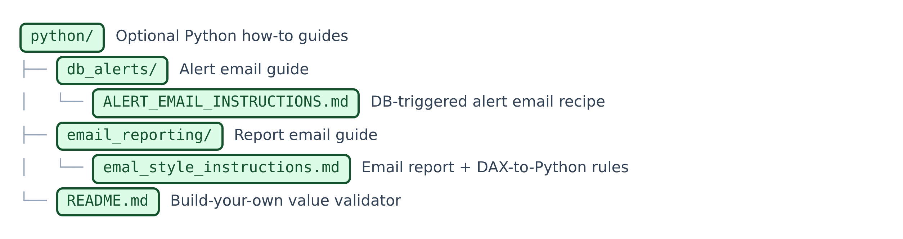

**Figure A.18 — python.** Optional Python guidance; no scripts ship here.

| Item | Type | What it is | Safety |
|---|---|---|---|
| `db_alerts/` | Folder | Alert email guide | Green |
| `db_alerts/ALERT_EMAIL_INSTRUCTIONS.md` | Doc | A complete recipe for a database-triggered alert email. | Green |
| `email_reporting/` | Folder | Report email guide | Green |
| `email_reporting/emal_style_instructions.md` | Doc | Rules for emails that copy a Power BI page, including how to make Python numbers match DAX. | Green |
| `README.md` | Doc | How to write your own Python checker that compares dashboard numbers with the database. | Green |

## A.19 scripts

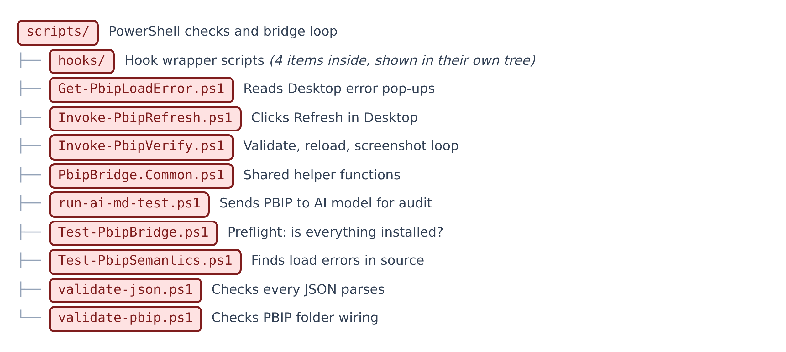

**Figure A.19 — scripts.** PowerShell validation and verification scripts. Folders shown closed are opened in their own tree.

| Item | Type | What it is | Safety |
|---|---|---|---|
| `Get-PbipLoadError.ps1` | PowerShell | Reads Power BI's error pop-ups so they can be fixed. | Red |
| `Invoke-PbipRefresh.ps1` | PowerShell | Clicks Power BI's Refresh button so a new project shows data. | Red |
| `Invoke-PbipVerify.ps1` | PowerShell | Reloads Power BI and takes a screenshot of every page. | Red |
| `PbipBridge.Common.ps1` | PowerShell | Shared helper functions used by the other bridge scripts. | Red |
| `run-ai-md-test.ps1` | PowerShell | Sends the project files and a test prompt to an AI model and saves its report. | Red |
| `Test-PbipBridge.ps1` | PowerShell | A preflight check that everything needed for the screenshot loop is installed and open. | Red |
| `Test-PbipSemantics.ps1` | PowerShell | Finds, in the text, the errors Power BI would otherwise show as a pop-up. | Red |
| `validate-json.ps1` | PowerShell | Checks that every JSON-style file can be read. | Red |
| `validate-pbip.ps1` | PowerShell | Checks the project folders are wired together properly. | Red |

## A.20 scripts/hooks

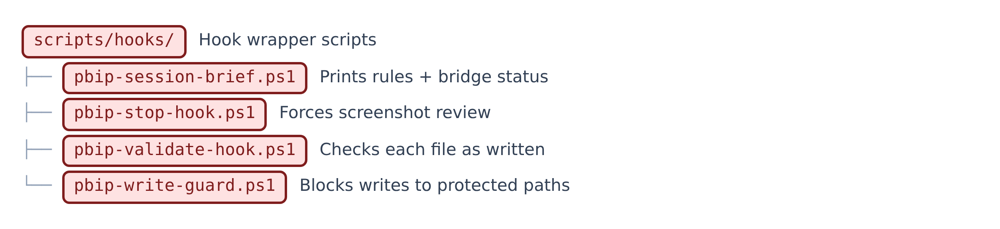

**Figure A.20 — scripts/hooks.** The four hook wrapper scripts.

| Item | Type | What it is | Safety |
|---|---|---|---|
| `hooks/` | Folder | Hook wrapper scripts | Red |
| `pbip-session-brief.ps1` | Hook | Prints the house rules and whether Power BI's bridge is ready. | Red |
| `pbip-stop-hook.ps1` | Hook | Makes sure screenshots are reviewed before work is called finished. | Red |
| `pbip-validate-hook.ps1` | Hook | Checks each file the moment it is written. | Red |
| `pbip-write-guard.ps1` | Hook | Stops the agent writing into protected folders. | Red |

## A.21 specs

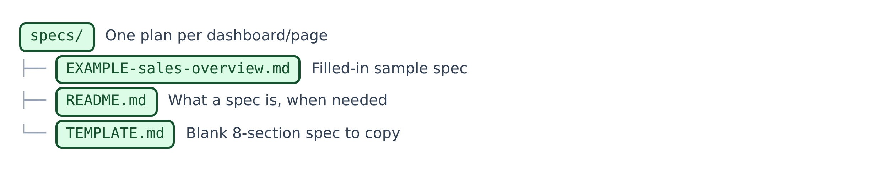

**Figure A.21 — specs.** Plans for one dashboard or page at a time.

| Item | Type | What it is | Safety |
|---|---|---|---|
| `EXAMPLE-sales-overview.md` | Example | A filled-in example plan for a Sales Overview page. | Green |
| `README.md` | Doc | Explains what a spec is, when one is required, and the definition of done. | Green |
| `TEMPLATE.md` | Template | The blank eight-part plan to copy for every new page. | Green |

## A.22 tests: prompts

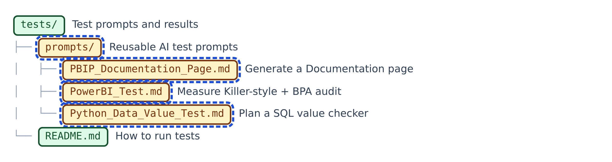

**Figure A.22 — tests: prompts.** The tests folder, its guide and the three AI prompts.

| Item | Type | What it is | Safety |
|---|---|---|---|
| `prompts/` | Folder | Reusable AI test prompts | Amber · AI |
| `prompts/PBIP_Documentation_Page.md` | AI prompt | The AI prompt that builds a Documentation page summarising the project. | Amber · AI |
| `prompts/PowerBI_Test.md` | AI prompt | The AI audit prompt that looks for unused or broken model parts. | Amber · AI |
| `prompts/Python_Data_Value_Test.md` | AI prompt | The AI prompt that plans (but does not write) a Python number checker. | Amber · AI |
| `README.md` | Doc | How to run the tests locally and on GitHub. | Green |

## A.23 tests/results

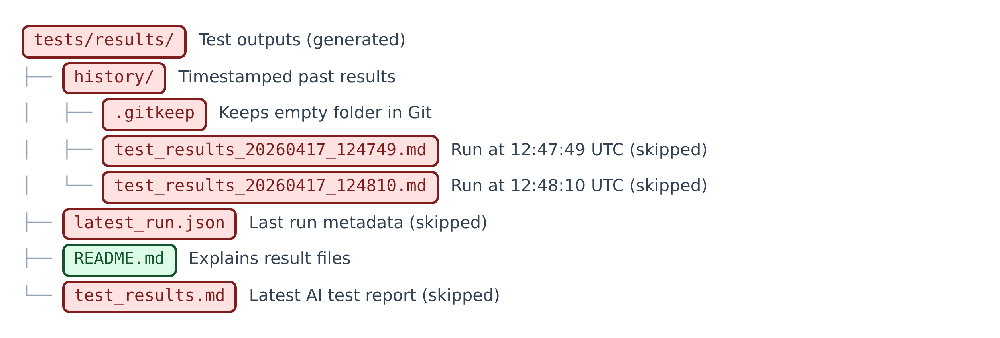

**Figure A.23 — tests/results.** Generated test reports (Red: written by scripts).

| Item | Type | What it is | Safety |
|---|---|---|---|
| `results/` | Folder | Test outputs (generated) | Red |
| `history/` | Folder | Timestamped past results | Red |
| `history/.gitkeep` | Placeholder | An empty file that keeps the empty folder in Git. | Red |
| `history/test_results_20260417_124749.md` | Generated | A past test report from 17 April 2026, 12:47:49 UTC (skipped). | Red |
| `history/test_results_20260417_124810.md` | Generated | A past test report from 17 April 2026, 12:48:10 UTC (skipped). | Red |
| `latest_run.json` | Generated | Details of the latest test run. | Red |
| `README.md` | Doc | Explains the result files. | Green |
| `test_results.md` | Generated | The latest AI test report; today it says the test was skipped for lack of a key. | Red |

**Coverage:** 176 of 176 items listed.
