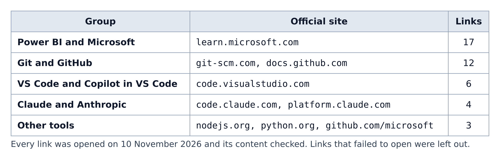

# Appendix B. Verified official references

**Figure B.1 — Where the references come from.** Every link below was opened on 10 November 2026 and the fact this guide uses was checked against the page. Links that wouldn't open (for example the npm pages for the two Power BI CLIs) are left out.

## Power BI and Microsoft (Microsoft Learn)

| Page | Use it for |
|---|---|
| [Power BI Desktop projects (PBIP)](https://learn.microsoft.com/en-us/power-bi/developer/projects/projects-overview) | What a `.pbip` project is and what saving one creates |
| [Power BI Desktop project report folder](https://learn.microsoft.com/en-us/power-bi/developer/projects/projects-report) | The PBIR files: `definition.pbir`, `report.json`, `pages.json`, `page.json`, `visual.json` |
| [Power BI Desktop project semantic model folder](https://learn.microsoft.com/en-us/power-bi/developer/projects/projects-dataset) | `definition.pbism`, the TMDL folder, and which `.pbi` files Git ignores |
| [Git integration with Power BI Desktop projects](https://learn.microsoft.com/en-us/power-bi/developer/projects/projects-git) | Putting a PBIP folder under Git in VS Code |
| [Tabular Model Definition Language (TMDL)](https://learn.microsoft.com/en-us/analysis-services/tmdl/tmdl-overview) | How TMDL files are structured |
| [Use report themes in Power BI](https://learn.microsoft.com/en-us/power-bi/create-reports/desktop-report-themes) | Theme JSON files and `dataColors` |
| [What is the Power BI Desktop Bridge?](https://learn.microsoft.com/en-us/power-bi/developer/agentic/power-bi-desktop-bridge-overview) | The bridge, its Security setting, and the `powerbi-desktop` CLI commands |
| [Download Power BI Desktop](https://learn.microsoft.com/en-us/power-bi/fundamentals/desktop-get-the-desktop) | Installing Power BI Desktop and its system requirements |
| [Set up an environment for developing a Power BI visual](https://learn.microsoft.com/en-us/power-bi/developer/visuals/environment-setup) | Node.js and the `pbiviz` tools for custom visuals |
| [Capabilities and properties of Power BI visuals](https://learn.microsoft.com/en-us/power-bi/developer/visuals/capabilities) | What `capabilities.json` declares |
| [Use field parameters in Power BI reports](https://learn.microsoft.com/en-us/power-bi/create-reports/power-bi-field-parameters) | The feature behind the field-parameter skill |
| [Row-level security (RLS) with Power BI](https://learn.microsoft.com/en-us/fabric/security/service-admin-row-level-security) | Restricting which rows each person sees |
| [Understand star schema and the importance for Power BI](https://learn.microsoft.com/en-us/power-bi/guidance/star-schema) | Fact and dimension tables |
| [Use Performance Analyzer to examine report performance](https://learn.microsoft.com/en-us/power-bi/create-reports/performance-analyzer) | Timing visuals for the performance skill |
| [DAX overview](https://learn.microsoft.com/en-us/dax/dax-overview) | The DAX formula language |
| [Overview of Fabric Git integration](https://learn.microsoft.com/en-us/fabric/cicd/git-integration/intro-to-git-integration) | Syncing Fabric workspaces with Git |
| [What is PowerShell?](https://learn.microsoft.com/en-us/powershell/scripting/overview) | The shell the repository's scripts use |

The six files in `docs/checklists/` also have a Microsoft Learn link for every checklist row.

## Git and GitHub

| Page | Use it for |
|---|---|
| [Git book: About Version Control](https://git-scm.com/book/en/v2/Getting-Started-About-Version-Control) | What version control is |
| [What is GitHub?](https://docs.github.com/en/get-started/start-your-journey/about-github-and-git) | How Git and GitHub differ |
| [Fork a repository](https://docs.github.com/en/pull-requests/collaborating-with-pull-requests/working-with-forks/fork-a-repo) | Forking, and adding the `upstream` remote |
| [About pull requests](https://docs.github.com/en/pull-requests/collaborating-with-pull-requests/proposing-changes-to-your-work-with-pull-requests/about-pull-requests) | Proposing and reviewing changes |
| [Ignoring files](https://docs.github.com/en/get-started/git-basics/ignoring-files) | How `.gitignore` works |
| [About code owners](https://docs.github.com/en/repositories/managing-your-repositorys-settings-and-features/customizing-your-repository/about-code-owners) | How `CODEOWNERS` requests reviewers |
| [Understanding GitHub Actions](https://docs.github.com/en/actions/get-started/understand-github-actions) | Workflows, jobs and runners |
| [Events that trigger workflows](https://docs.github.com/en/actions/reference/workflows-and-actions/events-that-trigger-workflows) | `push` and `workflow_dispatch` |
| [Using secrets in GitHub Actions](https://docs.github.com/en/actions/how-tos/write-workflows/choose-what-workflows-do/use-secrets) | Adding the API-key secrets |
| [Adding repository custom instructions for GitHub Copilot](https://docs.github.com/en/copilot/how-tos/configure-custom-instructions/add-repository-instructions) | `.github/copilot-instructions.md`, `.instructions.md` files and `AGENTS.md` |
| [About agent skills](https://docs.github.com/en/copilot/concepts/agents/about-agent-skills) | Where Copilot looks for skills |
| [Installing GitHub Copilot CLI](https://docs.github.com/en/copilot/how-tos/set-up/install-copilot-cli) | Installing Copilot in the terminal |

## VS Code and Copilot in VS Code

| Page | Use it for |
|---|---|
| [Download Visual Studio Code](https://code.visualstudio.com/download) | Installing VS Code |
| [Source control in VS Code](https://code.visualstudio.com/docs/sourcecontrol/overview) | Committing and pushing from the editor |
| [AI in VS Code overview](https://code.visualstudio.com/docs/copilot/overview) | What an agent does in VS Code |
| [Use custom instructions in VS Code](https://code.visualstudio.com/docs/copilot/customization/custom-instructions) | Instruction files and `applyTo` patterns |
| [Custom agents in VS Code](https://code.visualstudio.com/docs/copilot/customization/custom-agents) | `.agent.md` expert modes |
| [Use Agent Skills in VS Code](https://code.visualstudio.com/docs/copilot/customization/agent-skills) | `SKILL.md` format: `name` and `description` |

## Claude and Anthropic

| Page | Use it for |
|---|---|
| [Claude Code overview](https://code.claude.com/docs/en/overview) | What Claude Code is |
| [Claude Code hooks reference](https://code.claude.com/docs/en/hooks) | Hook events and exit code 2, which this repository's hook scripts follow |
| [How Claude remembers your project](https://code.claude.com/docs/en/memory) | `CLAUDE.md`, and when Claude reads `AGENTS.md` |
| [Agent Skills overview](https://platform.claude.com/docs/en/agents-and-tools/agent-skills/overview) | How skills work for Claude |

## Other tools

| Page | Use it for |
|---|---|
| [Download Node.js](https://nodejs.org/en/download) | Installing Node.js and npm |
| [Download Python](https://www.python.org/downloads/) | Installing Python 3 |
| [microsoft/skills-for-fabric](https://github.com/microsoft/skills-for-fabric) | The Copilot CLI plugin collection named in the README |

For Git itself, use the download link on the Git website's home page (`git-scm.com`); the direct downloads address only showed a redirect notice when checked.
