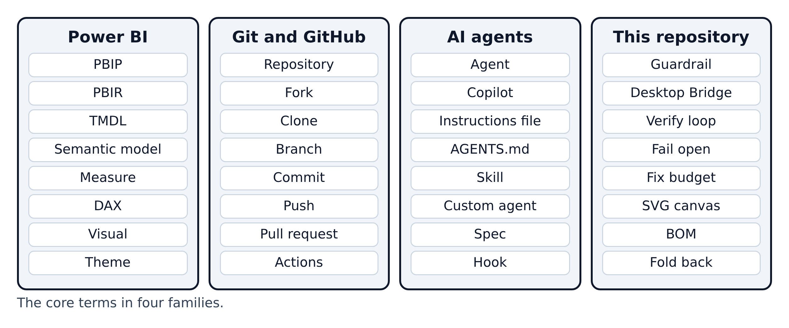

# Appendix C. Glossary

Every tool-specific term used in this guide, A to Z, with the chapter where it is explained. A summary by family follows the table.

| Term | Meaning | Chapter |
|---|---|---|
| **Actions (GitHub Actions)** | GitHub's automation service; runs workflows on cloud machines | 10 |
| **Agent (AI coding agent)** | An AI assistant that reads files, edits them and runs commands | 3 |
| **AGENTS.md** | A cross-tool instruction file for AI agents | 3 |
| **applyTo** | The file pattern that decides when an `.instructions.md` file loads | 3 |
| **Artifact** | A file bundle a workflow saves for download | 10 |
| **BOM** | Byte-order mark: an invisible marker at a file's start; TMDL files must not have one | 1 |
| **BPA** | Best Practice Analyzer: Microsoft's rule set for checking data models | 10 |
| **Branch** | A separate line of work in Git | 2 |
| **`card_y + 30` rule** | A visual must start 30 px below its card's top so it doesn't cover the title | 7 |
| **Clone** | Download a full copy of a repository with its history | 2 |
| **CODEOWNERS** | A GitHub file naming who reviews which folders | 2 |
| **Commit** | A saved snapshot of changes, with a message | 2 |
| **Copilot instructions** | A Markdown file of standing rules Copilot adds to every request (`.github/copilot-instructions.md`) | 3 |
| **Custom agent** | A saved expert role for Copilot (`.agent.md`) | 3 |
| **Custom visual** | A chart type you write in TypeScript and package as `.pbiviz` | 11 |
| **DAX** | Data Analysis Expressions, Power BI's formula language | 1 |
| **Desktop Bridge** | A local connection that lets programs control a running Power BI Desktop | 4 |
| **Dimension / fact table** | Tables of things (products, dates) / tables of events (sales) | 1 |
| **Fabric** | Microsoft's online analytics platform; `.platform` files are for its Git sync | 1 |
| **Fail open** | When a check breaks, it lets you continue instead of blocking | 5 |
| **Field parameter** | A Power BI feature that lets readers switch which field a visual shows | A |
| **Fix budget** | The verify loop allows one fix round, then lets the turn end | 8 |
| **Fold back** | Move a rule from a spec into the permanent rulebook | 5 |
| **Fork** | Your own copy of someone else's repository on GitHub | 2 |
| **Guardrail** | One of the repo's non-negotiable rules | 5 |
| **GUID** | A long unique identifier; a custom visual's permanent id | 11 |
| **Hook** | A small script that runs at a fixed moment, such as before a file is written | 5 |
| **IBCS** | A design standard for business charts | 11 |
| **Image visual** | A visual that shows a picture; here, an SVG returned by a measure | 7 |
| **KPI** | Key performance indicator: one headline number | 7 |
| **Measure** | A named calculation, such as "Total Sales" | 1 |
| **PBIP** | Power BI Project: a report saved as a folder of text files | 1 |
| **PBIR** | Power BI's enhanced report format: the report as JSON files | 1 |
| **`.pbix`** | Power BI's classic single-file format | 1 |
| **Power Query** | Power BI's tool for loading and shaping data | 1 |
| **Preflight** | `Test-PbipBridge.ps1`: checks everything is ready | 6 |
| **Pull request** | A request to review and merge a branch | 2 |
| **Runner** | The cloud machine that runs a GitHub workflow | 10 |
| **Secret** | A hidden setting a workflow can use but nobody can read | 10 |
| **Semantic model** | The tables, relationships and measures behind a report | 1 |
| **Skill** | A folder with a `SKILL.md` procedure the agent loads when the task matches | 3 |
| **Spec** | Your plan for one dashboard or page, written before building | 5 |
| **Star schema** | Fact tables in the middle, dimension tables around them | 1 |
| **Steering** | The permanent rule files that guide every session | 5 |
| **SVG background** | A page background image that draws cards and titles | 7 |
| **Theme** | A JSON file of colours and fonts for a report | 9 |
| **TMDL** | Tabular Model Definition Language: the model as indented text | 1 |
| **Upstream / origin** | The original repository / your fork | 2 |
| **Verify loop** | Validate, reload Power BI, screenshot every page, review, fix | 8 |
| **Visual** | One chart, table, card or image on a page | 1 |
| **Workflow** | An automated process defined in a YAML file | 10 |

**Figure C.1 — The same terms in four families.** Power BI words describe the report and its data; Git and GitHub words describe saving and sharing; AI-agent words describe how the assistant is guided; the last column is this repo's own vocabulary.
